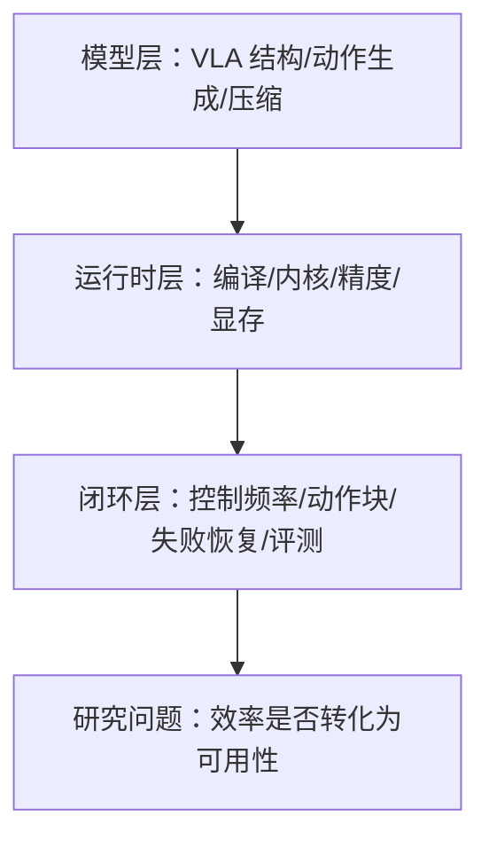

# Long-Term Research

> 这不是论文提案，也不是承诺。它是未来 5 年用来筛选问题、课程和论文的“方向罗盘”。每年复盘一次。

## 1. 定位

**Efficient AI / ML Systems for Embodied Intelligence**

翻成可执行的话：让具身模型在真实机器人约束下**跑得动、跑得快、跑得稳，并且能被可信地评价**。关键词不是“更大”，而是：

- 模型/系统协同：算法、数值格式、编译器、运行时、硬件；
- 具身闭环：延迟、控制频率、动作块、失败恢复；
- 可信评测：任务成功率、分布偏移、失败分类、可复现；
- 不锁死架构：VLA 会变，测量方法与系统思维不会。

## 2. 五个长期问题（候选）

| # | 问题 | 为什么值得做 | 可能证据 |
|---|---|---|---|
| Q1 | VLA 推理延迟的哪个环节真正影响闭环成功率？ | 端到端延迟不等于模型延迟；控制频率/动作块会改变系统行为 | 模块级 profiler + 注入延迟 + 固定任务成功率 |
| Q2 | 量化/低秩/蒸馏在动作头上是否比在视觉语言骨干上更敏感？ | 动作头小但直接决定动作；不同模块的误差传播不同 | 分层压缩 + 动作误差 + 闭环失败分类 |
| Q3 | 编译/运行时优化在 batch=1、短动作块、控制闭环下是否仍有收益？ | 训练吞吐的优化不等于机器人推理优化 | 新动作块 p50/p95、冷/热启动、显存、任务表现 |
| Q4 | 如何为轮式双臂的 VLA 部署定义“可复现的评测协议”？ | 单臂 LIBERO 不能代表双臂/移动平台 | 接口契约、初态集、失败分类、跨设备报告 |
| Q5 | 模型压缩的“容量收益”和“速度收益”何时一致，何时矛盾？ | 省显存可能变慢；部署决策需要分开报告 | 四列表：磁盘/显存/延迟/质量 |

这些问题目前都**没有**被本库的实验证明；它们只是筛选阅读与实验的框架。

## 3. 三个层次

- **模型层**：视觉语言骨干、动作头、流匹配/扩散/回归、动作块、量化敏感度。
- **运行时层**：PyTorch eager/compile、CUDA/Triton 内核、FP16/BF16/INT8/INT4、显存、批处理、传输。
- **闭环层**：观测/动作接口、控制频率、延迟、终止、成功判据、分布偏移、失败分类。

只做一层，容易得出“离线指标好、机器人不好用”的结论。

## 4. 阅读锚点（按问题，不按名气）

- **机器人学习基础**：Sergey Levine 团队的机器人学习/RL/模仿学习工作；重点读问题设定、评价协议、失败分析。
- **高效 AI 计算**：MIT Han Lab 的量化/剪枝/高效推理/硬件协同工作；重点读“真实内核/端到端收益”，不只看参数量。
- **具身智能与操作**：许华哲团队的相关工作；重点读任务、数据、泛化边界。
- **VLA/通用策略**：Zhiyuan Zhou 等公开研究页面；只选与“推理/部署/评测”相关条目。
- 入口：[`Reading_Watchlist.md`](../03_Research/Researchers_Labs/Reading_Watchlist.md)。

**纳入规则**：每篇论文必须回答“它与我当前哪个 RQ/实验有关”；仅因团队/热度不进入必读。

## 5. 反热点过滤器

遇到一个新方向，先问：

1. 它是否直接服务“轻量化/高效推理/部署/评测”？
2. 它是否能在本科资源下做一个最小、可证伪的实验？
3. 它是否会让我同时开两条主线？
4. 它是否能被现有基线公平比较？
5. 它是否只是“更大模型/更多数据/更炫 demo”？

如果答案是否，放入扩展阅读，不占主线。

## 6. 五年能力复利

| 年份 | 重点 | 可积累资产 |
|---|---|---|
| 本科最后阶段 | 复现、测量、一种优化、工程规范 | 可复跑基线、评测协议、代码/日志习惯 |
| 博士第 1 年 | 系统化文献、方法比较、跨模型/跨硬件测量 | 评测基准、 profiling 工具链、失败分类体系 |
| 博士第 2–3 年 | 一个可解释的效率机制 + 闭环验证 | 方法、消融、跨任务证据 |
| 博士第 4–5 年 | 系统/方法整合，真实平台验证 | 可部署系统、论文/开源、跨平台报告 |

不承诺论文数量、顶会命中或真机部署；这些取决于导师、平台、数据和实验。

## 7. 研究伦理与可复现

- 不伪造/挑选数据；失败分母保留。
- 不把仿真成功写成真机安全。
- 不把 AI 生成的文字/图表当实验证据。
- 不隐瞒负结果；负结果也是工程结论。
- 不擅自上传/同步/公开私人数据、代码或模型。
- 引用与版权遵守 Zotero/论文许可；不批量再分发未授权 PDF。

## 8. 年度复盘问题

1. 我今年最可信的一个实验结果是什么？证据在哪？
2. 哪个“方向”只是阅读，没有实验？
3. 哪个能力节点从“未开始”变成了“已通过独立验收”？
4. 哪篇论文真正改变了我的研究问题？
5. 我是否被热点牵着走？下一步最小的反证实验是什么？
6. 我是否把时间花在“配置环境/收藏课程”而不是“测量与解释”？

答案写进 `05_Reviews/Monthly/` 或年度复盘；没有证据就写“没有”。
