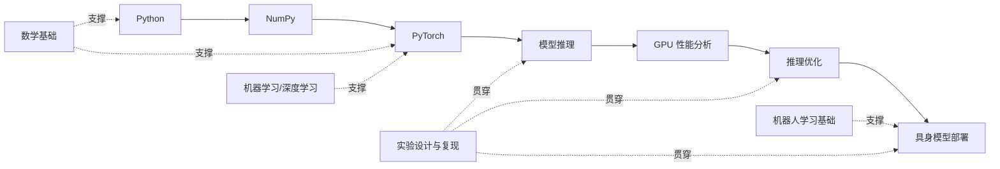

# Skills Map

> 状态与 [`Current_Status.md`](../00_Home/Current_Status.md) 一致；本页只增加“前置、练习、验收、项目关联”，不独立维护完成状态。  
> 任何节点都不得因为“有笔记/看过视频/目录存在”而标为已掌握。

## 主链

## 节点 1：Python 基础与独立程序

| 字段 | 内容 |
|---|---|
| 前置 | 无；但必须能运行脚本、读报错 |
| 对应课程/资源 | freeCodeCamp Python；旧 V3 第 1–2 周；[`Courses.md`](../06_Resources/Courses.md) |
| 现有笔记 | [`Python_基础学习笔记.md`](../02_Learning/Python/Python_基础学习笔记.md) |
| 最小练习 | 从空文件写 `latency_summary.py`：读一组数，输出 n/mean/p50/p95；空输入、坏值有明确行为；3 个测试 |
| 独立验收 | 关闭参考，60–90 分钟完成；普通/空/单元素/坏值四类测试通过；能解释 `return`、异常处理、文件路径 |
| 当前状态 | **学习中**（有课程摘录；无独立程序验收） |
| 相关实验 | 任何推理评测脚本的前置 |

## 节点 2：NumPy 与 Matplotlib

| 字段 | 内容 |
|---|---|
| 前置 | Python 函数、列表、循环 |
| 对应课程/资源 | 莫烦 NumPy/Matplotlib；NumPy 官方 beginner guide；Matplotlib tutorials |
| 现有笔记 | [`NumPy_Matplotlib_学习笔记.md`](../02_Learning/Machine_Learning/NumPy_Matplotlib_学习笔记.md) |
| 最小练习 | 生成 `(N,)`、`(N,1)`、`(N,D)` 数组；做按列标准化；画一张带标题/轴标签的损失曲线 |
| 独立验收 | 能预测 `*` 与 `@` 的 shape；能解释 `(N,)` 与 `(N,1)` 的广播差异；标准化统计只来自训练集 |
| 当前状态 | **已接触但待复习**（只记了 `.shape` 和 `scatter` 片段） |
| 相关实验 | 延迟数组统计、损失曲线、数据检查 |

## 节点 3：数学基础

| 字段 | 内容 |
|---|---|
| 前置 | 高中函数/微积分直觉 |
| 对应课程/资源 | MIT 18.01（当前复习）；18.02/18.06/6.041SC 按需；[`Courses.md`](../06_Resources/Courses.md) |
| 现有笔记 | [`MIT_18.01_学习笔记.md`](../02_Learning/Mathematics/MIT_18.01_学习笔记.md) |
| 最小练习 | 3 道链式法则；1 道线性近似；1 道“Newton 求根 vs 梯度下降”的区别题 |
| 独立验收 | 能写出复合函数内外层；能说明梯度指向增长最快、负梯度下降；能写出一次 Newton 更新并说明适用条件 |
| 当前状态 | **已接触但待复习**（18.01 若干主题）；线代/概率为**未开始** |
| 相关实验 | 损失函数、反向传播、最小二乘、概率评测 |

## 节点 4：机器学习基础

| 字段 | 内容 |
|---|---|
| 前置 | 函数、均值/方差、基本微积分 |
| 对应课程/资源 | 吴恩达 Machine Learning Specialization（当前）；旧 V3 的 C1–C2 取舍 |
| 现有笔记 | [`吴恩达机器学习笔记.md`](../02_Learning/Machine_Learning/吴恩达机器学习笔记.md) |
| 最小练习 | 3 个样本手算平方误差/平均损失；一次 w,b 同时更新；解释训练/验证划分 |
| 独立验收 | 能区分 loss/cost/objective；能解释学习率过大/过小；能指出“损失没降”先查什么 |
| 当前状态 | **学习中**（笔记覆盖监督学习、回归、损失、梯度下降；P 数未知） |
| 相关实验 | 基线训练、错误分析、指标口径 |

## 节点 5：深度学习与 PyTorch

| 字段 | 内容 |
|---|---|
| 前置 | Python、NumPy、ML 基础、链式法则 |
| 对应课程/资源 | PyTorch 官方 Learn the Basics；小土堆；CS231n 按需；DLS 只补难点 |
| 现有笔记 | 暂无；不预生成空白笔记 |
| 最小练习 | 固定小批数据上训练一个两层 MLP；保存/加载；打印每个 tensor 的 shape；跑通一次 `backward`/`step` |
| 独立验收 | 能解释 `requires_grad`、`zero_grad`、`detach`、`train/eval`；能从空文件重写核心训练循环；加载后输出在容差内一致 |
| 当前状态 | **未开始**（本机 torch 未安装） |
| 相关实验 | SmolVLA 模型加载、推理脚本、profiler |

## 节点 6：机器人学习基础

| 字段 | 内容 |
|---|---|
| 前置 | Python、ML、概率/优化直觉 |
| 对应课程/资源 | CS285 按需；机器人学习课程/论文；不要求先修完整个 RL |
| 现有笔记 | 暂无 |
| 最小练习 | 在低维环境记录 `(s,a,r,s')`；训练 BC 或一个 Q 函数；报告闭环成功率，不只报离线误差 |
| 独立验收 | 能解释 MDP、行为克隆的分布偏移、终止/截断、评价回合与分母 |
| 当前状态 | **未开始** |
| 相关实验 | LIBERO episode、动作接口、失败分类 |

## 节点 7：VLA 模型素养

| 字段 | 内容 |
|---|---|
| 前置 | Transformer 基础、PyTorch、机器人观测/动作概念 |
| 对应课程/资源 | SmolVLA、OpenVLA/OFT、π0 论文；先读模型卡和官方文档 |
| 现有笔记 | 暂无；`03_Research/Concepts/VLA_Inference_Pipeline.md` 是通用教学图，不是具体模型结论 |
| 最小练习 | 对 SmolVLA 画“图像/语言/状态→预处理→骨干→动作头→动作块→执行”的图；标出每个 shape 与未核实处 |
| 独立验收 | 能区分训练/推理；能说清动作块、执行长度、去归一化、控制频率；能指出论文未证明的部分 |
| 当前状态 | **未开始** |
| 相关实验 | 本科毕设阅读阶段 |

## 节点 8：模型推理工程

| 字段 | 内容 |
|---|---|
| 前置 | PyTorch、张量 shape、基本性能测量 |
| 对应课程/资源 | PyTorch Profiler 文档；推理引擎文档；[`Inference_Metrics_and_Benchmarking.md`](../03_Research/Efficient_Inference/Inference_Metrics_and_Benchmarking.md) |
| 现有笔记 | 指标备忘（AI 整理，待实践） |
| 最小练习 | 对一个 dummy 模型测 batch=1 的 p50/p95、峰值显存；区分预处理、H2D、模型、D2H |
| 独立验收 | 能解释“缓存弹出不是新动作块推理”；能同步计时；能报告原始分布与失败 |
| 当前状态 | **未开始** |
| 相关实验 | 原始基线、compile/num_steps 对照 |

## 节点 9：GPU 性能分析

| 字段 | 内容 |
|---|---|
| 前置 | 推理工程、CUDA 基本概念 |
| 对应课程/资源 | PyTorch Profiler；Nsight Systems（按需）；GPU 文档 |
| 现有笔记 | 暂无 |
| 最小练习 | 用 profiler 看一次前向：kernel 时间、H2D/D2H、显存峰值；写一页归因 |
| 独立验收 | 能区分 allocated/reserved/NVML；能解释 profiler 开销；能定位一个真实瓶颈 |
| 当前状态 | **未开始**（硬件已识别，计算栈未安装） |
| 相关实验 | 延迟/显存测量、模块归因 |

## 节点 10：模型压缩与推理优化

| 字段 | 内容 |
|---|---|
| 前置 | 推理工程、数值格式、模型结构 |
| 对应课程/资源 | MIT 6.5940 主题（按需）；AWQ/SmoothQuant/SVDQuant 原文；torch.compile 文档 |
| 现有笔记 | [`Compression_Methods_Overview.md`](../03_Research/Model_Compression/Compression_Methods_Overview.md)（概念备忘） |
| 最小练习 | 固定模型/输入，比较 eager vs compile；只改一个因素；报告冷/热启动、p50/p95、显存、输出误差 |
| 独立验收 | 能说明参数量≠延迟；能解释量化何时省显存但不加速；能给出负结果 |
| 当前状态 | **未开始** |
| 相关实验 | 毕设的“一种优化” |

## 节点 11：部署与闭环评测

| 字段 | 内容 |
|---|---|
| 前置 | 推理工程、机器人接口、实验设计 |
| 对应课程/资源 | LIBERO/LeRobot 文档；[`Deployment_Checklist.md`](../03_Research/Deployment/Deployment_Checklist.md) |
| 现有笔记 | 部署清单（概念，待实践） |
| 最小练习 | 写一页接口契约：图像键/尺寸、state 各维、动作单位/范围、频率、超时、失败处理 |
| 独立验收 | 一个完整 episode 可重跑；有成功/失败分母；有失败分类；不把仿真成功写成真机安全 |
| 当前状态 | **未开始** |
| 相关实验 | LIBERO 闭环、未来 OpenFleX 适配 |

## 节点 12：实验设计与复现

| 字段 | 内容 |
|---|---|
| 前置 | 统计直觉、版本管理、日志习惯 |
| 对应课程/资源 | V3 的科研规范；实验设计基础；[`Experiment_Record.md`](../07_Templates/Experiment_Record.md) |
| 现有笔记 | 计划文档多，运行记录为零 |
| 最小练习 | 写一个可证伪假设、两个基线、一个主指标、一个停止条件；跑一次空/最小实验并保存原始日志 |
| 独立验收 | 别人能按 README 复跑；所有数字能追到原始文件；失败不被删除 |
| 当前状态 | **未开始** |
| 相关实验 | 所有项目 |

## 节点 13：系统工具（C++/CUDA/Triton）

| 字段 | 内容 |
|---|---|
| 前置 | Python/PyTorch、计算机系统基础 |
| 对应课程/资源 | CUDA/Triton 官方教程；按项目需要 |
| 现有笔记 | 暂无 |
| 最小练习 | 写一个逐元素向量加法 kernel；与 PyTorch 结果对比；测一次延迟 |
| 独立验收 | 能解释 grid/block/内存层次；能验证数值正确性；能说明是否值得用 |
| 当前状态 | **未开始**（`nvcc` 未找到） |
| 相关实验 | 后续推理内核优化，不是当前门槛 |

## 能力链的解释

这条链不是“学完一个再学下一个”的硬门槛。真实顺序是：

- Python/NumPy 为代码服务；
- PyTorch 为模型服务；
- 推理/性能为问题服务；
- 优化只有在测量证明有瓶颈后才做；
- 部署/评测把模型放回闭环，防止“离线指标好看、机器人失败”。

当前最短板不是“课程数量”，而是：**没有独立程序验收、没有 PyTorch 环境、没有真实实验日志**。
