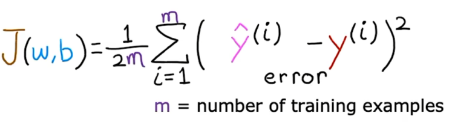
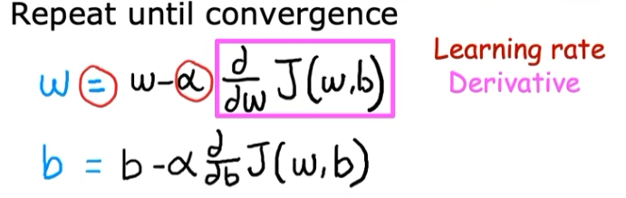
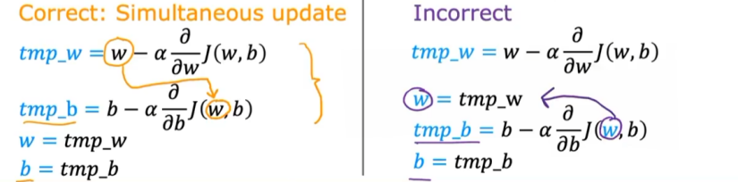

# 吴恩达机器学习笔记

> **来源**：`D:\Desktop\926150.docx`（SHA256 `05c1e731…6d1e0`），段落 P0415–P0442。  
> **原始日期**：没有独立日期；不能把文件保存时间当学习日期。  
> **课程版本**：旧 V3/Excel 指定 B 站合集 `BV16jyuBBEom`（142P），但源笔记没有记录当前 P 数；不能推断进度。  
> **性质**：概念速记 + 公式截图，不是完整课程作业记录。

## 图例

- **【原始笔记】**：源文档内容，保留原表述。
- **【整理重排】**：标题、顺序、公式/表格排版。
- **【AI解释】**：补充说明，不是用户当时的话。
- **【待核实】**：源文档不足。
- **【待纠正】**：不准确/不完整处；原文保留，更正单列。

## 1. 机器学习分类

【原始笔记】P0415–P0422。

- 监督学习：从大量例子中学习 `x → y` 的映射，预测新的 `x`。
- 回归算法：预测连续数值（“无限多数字预测一个数字”）。
- 分类算法：预测有限类别（离散）。
- 无监督学习：没有给定标签，找数据中的模式/结构。
- 聚类：把数据分组。
- 异常检测：源笔记只写标题，没有解释。
- 降维：减少维度/丢失，降低数据集规模。

【AI解释】“无限多数字”是源笔记的直观说法，不是严格定义；回归输出连续值，分类输出离散类别。异常检测通常是无监督/半监督的，但也可以有监督，取决于设定。

## 2. Jupyter Notebook 快捷键

【原始笔记】表格（源文档 P0423 后）：

| 操作 | 快捷键/方法 |
|---|---|
| 运行单元格并跳到下一个 | Shift + Enter |
| 运行单元格但不跳转 | Ctrl + Enter |
| 运行并在下方新增单元格 | Alt + Enter |
| 新建代码或文字单元格 | 顶部 + 代码 / + Markdown |
| 保存 Notebook | Ctrl + S |

> 【整理重排】该表位于 Python 段之后、ML 变量之前；按内容归入 ML 工具使用。它不是模型知识，不能算 ML 学习证据。

## 3. 符号与术语

【原始笔记】P0424–P0432。

| 符号/术语 | 源笔记含义 |
|---|---|
| Training set | 训练集 |
| `X` | 输入变量/特征 |
| `y` | 输出变量/目标变量 |
| `m` | 训练示例数 |
| `(x^(i), y^(i))` | 第 i 个训练例子；i 是特定行 |
| `ŷ` (y-hat) | 估计值/预测值 |
| `f = wx + b` | 函数/模型 |
| `w, b` | 参数（parameters） |
| implement | 实施/执行；在计算机/学术语境中常指编写代码实现模型/算法 |

【AI解释】上标 `(i)` 是样本编号，不是“i 次方”；这是机器学习符号常见混淆点。源笔记写的是 `（x**i，y**i）`，这里按课程惯例转写为 `(x^(i), y^(i))`，属于排版整理。

## 4. 代价函数与损失

【原始笔记】P0433–P0437。



*图：源文档 P0435 的课程截图；平方误差代价函数。*

图中公式（转写）：

`J(w,b) = 1/(2m) Σ_{i=1}^{m} (ŷ^(i) - y^(i))^2`

其中 `m` 是训练样本数。

- `Batch`：源笔记写“每次梯度下降使用的所有训练例子”。
- `Loss function`：计算单个样本预测与真实值之间的误差。
- `Cost function`：一个 batch 或全部数据集上所有样本 loss 的平均值；通过最小化 cost 更新参数。
- 目标函数还会额外加入正则项防止过拟合。

> 【待纠正/精确化】`Batch` 的源定义只对应 **batch gradient descent**（每次用全部训练样本）。mini-batch 梯度下降每次只用一小批，不是“所有训练例子”。原文保留，这里单列精确化。  
> 【AI解释】`1/(2m)` 的 `1/2` 是为了求导时和平方的 2 抵消，方便写梯度；它不是模型性能的一部分。正则项不在上图公式里，是另外加到目标函数中的。

## 5. 梯度下降

【原始笔记】P0438–P0442。



*图：源文档 P0440 的课程截图；`w := w - α ∂J/∂w`，`b := b - α ∂J/∂b`。*



*图：源文档 P0442 的课程截图；正确做法是先用旧 `w,b` 算临时值，再同时更新。*

- `α` 是学习率。
- 导数是更新方向/敏感度；负号表示沿下降方向。
- `Local minima`：源笔记只有标题，没有内容。
- `Simultaneously update w and b`：必须同时更新；不能先用新 `w` 去算 `b` 的梯度。

【AI解释】正确的同时更新：

```python
tmp_w = w - alpha * dJ_dw
tmp_b = b - alpha * dJ_db
w = tmp_w
b = tmp_b
```

错误做法：先更新 `w`，再用新 `w` 计算 `b` 的梯度，导致 `b` 用的是不同的模型状态。

> 【待核实】`Local minima` 段没有正文；不能判断当时是否学了局部/全局最小、鞍点或学习率影响。  
> 【原始笔记】P0444 只有 `dangp`，无法确定含义；保留为未解字符，不猜测。

## 6. 用户当时的理解

源文档 ML 段没有明确的第一人称总结/疑问；主要是课程术语和公式截图。  
因此不能把这些句子标成“用户自己的理解”。唯一接近个人表述的是“implement 最常见的意思是……”，属于术语笔记，不是模型理解。

## 7. 待解决问题

1. `loss`、`cost`、`objective` 的区别？正则项加在哪里？
2. 为什么 `J` 用 `1/(2m)`？如果去掉 `1/2`，梯度会怎样？
3. 梯度下降为什么必须同时更新 `w,b`？用 1 个样本手算演示。
4. 学习率过大/过小分别发生什么？如何判断？
5. `f'(x)=0` 与局部最小/全局最小的关系？
6. 当前吴恩达课程具体到哪一 P？不能凭旧计划猜。

## 8. 需要进一步验证的概念

| 概念 | 待验证 |
|---|---|
| 监督/无监督 | 能否各举一个机器人相关例子 |
| 回归/分类 | 输出是连续还是离散 |
| `m`、`(i)` | 样本数 vs 样本编号 |
| Cost | 单样本 loss 的平均；正则项位置 |
| 梯度下降 | 负梯度、学习率、同时更新 |
| Local minima | 局部/全局/鞍点；源笔记无内容 |

## 9. 自测（先不给答案）

1. 给 3 个样本 `(x,y)=(1,2),(2,4),(3,6)`，手算 `f=wx+b` 在 `w=0,b=0` 时的平方误差和 `J`（取 `1/(2m)`）。
2. 接上题，写出 `∂J/∂w`、`∂J/∂b` 的表达式（先不代数化简）。
3. 用 `α=0.1` 做一次同时更新；如果先更新 `w` 再算 `b`，结果差多少？
4. 用自己的话解释 `loss` 与 `cost` 的区别，并给一个正则项例子。
5. 学习率过大时，损失曲线可能怎样？过小呢？
6. 为什么“训练集 loss 很低”不代表模型好？需要看什么？

**通过标准**：1–3 手算正确；4–6 能口述并指出证据。通过后才考虑把“吴恩达机器学习”改为“已通过独立验收”。

## 10. 关联课程与知识点

- 吴恩达 Machine Learning Specialization C1 W1（旧 V3 的 P1–P20 主题；当前 P 数待确认）。
- MIT 18.01：导数、链式法则、极值（见数学笔记）。
- NumPy/Matplotlib：数组、shape、scatter（见单独笔记）。
- PyTorch：`loss.backward()`、`optimizer.step()`、`zero_grad()`（尚未学习）。
- 后续：线性回归/逻辑回归、正则化、偏差方差、错误分析。

## 11. 来源映射与完整性

| 主题 | 源段落 |
|---|---|
| 监督/无监督、回归/分类 | P0415–P0422 |
| Jupyter 表 | P0423 后 TABLE 0 |
| 符号/术语 | P0424–P0432 |
| Cost function | P0433–P0437（图 P0435） |
| Gradient descent | P0438–P0442（图 P0440、P0442） |

**完整性**：源文档 ML 段所有有效概念均已覆盖；3 张内嵌图均已保存并引用。未补造 `Local minima` 的正文，未解释无法辨认的 `dangp`。公式截图保留，转写仅为阅读辅助。
