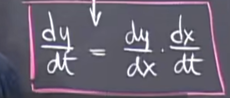
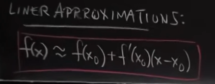

# MIT 18.01 学习笔记

> **来源**：`D:\Desktop\926150.docx`（SHA256 `05c1e731…6d1e0`），段落 P0000–P0049。  
> **日期**：源文档开头写 `9.26.2026`；L2 之后写 `10.6.2026`。后者之后的段落没有独立日期，不能推断每一讲都在 10 月 6 日完成。  
> **性质**：课堂速记 + 公式截图，不是完整讲义；**不能据此认定已掌握**。  
> **原文**：[`926150_原始笔记逐段提取.md`](../../90_Archive/Original_Documents/926150_原始笔记逐段提取.md)

## 图例

- **【原始笔记】**：源文档原文/原公式，保留原来的不完整处。
- **【整理重排】**：标题、顺序、公式排版。
- **【AI解释】**：补充说明，不是用户当时的话。
- **【待核实】**：源文档不足以确认。
- **【待纠正】**：明确错误/不精确处；原文保留，更正单列。

## 1. L1 Rate of Change：导数直觉

【原始笔记】P0002–P0007。

- 主题：变化率、导数直觉；目标是理解梯度到底是什么。
- 几何：切线是割线 `PQ` 当 `Q→P` 的极限；切线斜率是导数。
- 用户当时的理解（原文 P0006）：

> 梯度我的积累是导数下降最快的方向，但这节只讲了导数几何含义是切线然后求了一些导数

紧接着的 P0007 写：

> 梯度方向：梯度指向局部增长最快的方向；在通常的欧氏距离度量下，负梯度才是下降最快的方向。一元导数首先是变化率。

### 【待纠正】梯度方向

P0006 的“梯度是导数下降最快的方向”**不准确**：

- 一元导数 `f'(x)` 是**变化率/斜率**，不是“下降方向”本身；
- 多元梯度 `∇f` 指向**局部增长最快**的方向；
- 在欧氏度量下，**负梯度** `-∇f` 才是局部下降最快的方向；
- 梯度下降沿 `-∇f` 更新，不是因为“梯度就是下降方向”。

原文保留，不静默改写；以上为单列的更正。P0007 已经是校正性表述，但来源未注明是用户自己还是后来补充，不能当作“当时已理解”的证据。

【AI解释】一维时，`f'(x)>0` 表示函数在增加，沿负方向走会让函数变小；`f'(x)<0` 则相反。导数为 0 只是候选极值点，不保证最小。

## 2. L2 Limits：极限与连续

【原始笔记】P0009–P0017。

- 瞬时变化率是极限。
- 连续：左右极限存在且相等，并等于函数值。
- 间断类型：
  - Jump discontinuity：左右极限不相等。
  - Removable discontinuity：左右极限相等，但函数值不同（或未定义）。
  - Infinite discontinuity：趋于无穷。
  - Other discontinuity：震荡，例如 `sin(1/x)`。
- 奇函数/偶函数。
- 可导一定连续；连续不一定可导。

【AI解释】“连续”的三个条件可以记成：极限存在、函数值存在、二者相等。`|x|` 在 0 连续但不可导，是“连续不一定可导”的标准例子。

> 【待补】源笔记只列了间断类型，没有给出每类的函数例子/左右极限计算；需要时补 2–3 个例子。

## 3. L3 Derivatives：求导基本规则

【原始笔记日期标记】`10.6.2026`；P0020–P0022。

- 重要极限：
  - `x→0` 时 `(cos x - 1)/x → 0`
  - `x→0` 时 `sin x / x → 1`
- 用 0 处导数定义/单位圆证明（源笔记只写“单位圆证明”，没有展开）。

【待核实】源笔记没有写完整的单位圆证明步骤；不要补造成“当时已证明”。需要时自己画单位圆、用面积/夹逼重做。

## 4. L4 Chain Rule：链式法则

【原始笔记】P0024–P0026。

*图：源文档 P0026 的课程截图；公式为 `dy/dt = (dy/dx)(dx/dt)`。*

【AI解释】链式法则用于复合函数：若 `y = f(u)`、`u = g(x)`，则 `dy/dx = f'(g(x))·g'(x)`。它是反向传播“把梯度从外层传回内层”的数学基础。

【整理示例，不是源笔记原题】`y = (x^2 + 1)^3`：外层 `u^3`，内层 `x^2+1`；`dy/dx = 3(x^2+1)^2 · 2x = 6x(x^2+1)^2`。

> 【待补】源笔记只写了公式和截图，没有做复合函数例题；这正是旧 V3 自测要补的。

## 5. L6 Exponential and Log：指数与对数

【原始笔记】P0028–P0031。

- 指数求导引入 `e`，然后换底。
- 用对数做隐函数求导。
- `ln x` 的导数定义与 `e` 有关。

【AI解释】核心事实（需要自己推一遍）：

- `d/dx e^x = e^x`
- `d/dx ln x = 1/x`（`x>0`）
- `a^x = e^{x ln a}`，所以 `d/dx a^x = a^x ln a`
- `log_a x = ln x / ln a`

源笔记没有展开推导；这些是补充，不是“用户当时已写”。

## 6. L9 Linear and Quadratic Approximations：线性/二次近似

【原始笔记】P0033–P0035。

*图：源文档 P0034 的课程截图；一阶线性近似。*

- 一阶：`f(x) ≈ f(x0) + f'(x0)(x - x0)`。
- 源笔记写“泰勒展开。。”，但没有写二阶项/余项。

【AI解释】二阶近似：

`f(x) ≈ f(x0) + f'(x0)(x-x0) + (1/2) f''(x0)(x-x0)^2`

Newton 法用一阶/二阶信息找根/极值；线性近似用切线代替曲线。两者相关但不是同一件事。

> 【待核实】“泰勒展开”在源笔记中只是关键词，无法确定当时是否学了二阶项、余项或收敛条件。不要据此判定已掌握二次近似。

## 7. L11 Max-Min：极值

【原始笔记】P0037–P0044。

画图检查清单：

- 间断点
- 正负无穷
- 特殊点
- 导数
- 二阶导

【AI解释】求极值的基本流程：定义域 → 临界点（`f'=0` 或不存在）→ 端点/无穷行为 → 用一阶符号变化或二阶导判断极大/极小。`f'=0` 只是必要条件，不是充分条件。

> 【待补】源笔记只有检查清单，没有例题、没有“局部极小 vs 全局最小”的反例；旧 V3 D4 要求给反例，需补。

## 8. L13 Newton's Method：Newton 法

【原始笔记】P0045–P0049：只有标题 `L13 Newton's Method`，正文为空。

**状态：未开始/待补。** 不能因为标题存在就算学过。

【AI解释】Newton 法求根：

`x_{n+1} = x_n - f(x_n) / f'(x_n)`

用于解 `f(x)=0`。若用于最小化 `g(x)`，可对 `g'(x)=0` 用 Newton，迭代为：

`x_{n+1} = x_n - g'(x_n) / g''(x_n)`

它与梯度下降的区别：Newton 用二阶曲率信息，可能更快但需要二阶导/正定条件；梯度下降只用一阶信息，步长由学习率控制。不要把“求根”和“最小化”混为一谈。

> 【待核实】源笔记没有 Newton 公式、收敛条件或例题；以上为补充，不能写成“用户已学”。

## 9. 用户当时的理解

在源文档中，唯一明确的第一人称理解是 P0006 的“梯度我的积累是导数下降最快的方向…”。  
这句话包含概念错误，已在上文【待纠正】单列。除此之外，L2–L13 多为课堂关键词/公式截图，**没有足够证据**判断用户当时理解到什么程度。

## 10. 待解决问题

1. 梯度方向与负梯度方向的区别，能否用一元/二元例子说清？
2. 链式法则能否独立推导一个复合函数，并说明内外层？
3. 线性近似的误差如何估计？二阶项何时重要？
4. `f'(x)=0` 为什么不是极小值的充分条件？举反例。
5. Newton 法求根与梯度下降最小化的区别？Newton 什么时候会失败？
6. 积分/微积分基本定理在源笔记中没有实质内容；旧 V3 计划里有，需另补。

## 11. 需要进一步验证的概念

| 概念 | 待验证点 |
|---|---|
| 梯度 | 方向是增长最快；负梯度才是下降；一维导数是变化率 |
| 连续/可导 | 连续不一定可导；可导一定连续 |
| 链式法则 | 复合函数内外层；与反向传播的关系 |
| 线性/二次近似 | 一阶/二阶公式；误差/余项 |
| 极值 | 临界点、端点、二阶导、全局/局部 |
| Newton | 求根公式、收敛条件、与梯度下降的区别 |

## 12. 自测（先不给答案）

1. 求 `f(x) = (3x^2 + 1)^4` 的导数，并标出内外层。
2. 用 `f(x)=x^2` 在 `x0=1` 处写出一阶线性近似，估算 `f(1.1)` 并比较误差。
3. 举例说明“导数为 0 但不是极小值”。
4. 说明 `|x|` 在 0 处为什么连续但不可导。
5. 写出 Newton 求根的一次迭代；说明它和梯度下降的更新式差在哪。
6. 用自己的话解释：为什么梯度指向增长最快，而梯度下降用负梯度？

**通过标准**：1、2、4、6 能不查资料完成；3、5 能口述并写公式。通过后才考虑把“MIT 18.01 微分”改为“已通过独立验收”。

## 13. 关联课程与知识点

- MIT 18.01 L1–L13（源笔记覆盖到 Newton 标题）。
- 旧 V3 前 14 天：D1 链式自测、D3 线性近似、D4 极值、D9 Newton。
- 吴恩达 ML：损失函数、梯度下降、同时更新（见 ML 笔记）。
- PyTorch：`backward()` 是链式法则/计算图的工程实现（尚未学习）。
- 线性代数/多变量微积分：梯度、Hessian、矩阵微分（未开始；需要时补）。

## 14. 来源映射与完整性

| 主题 | 源段落 |
|---|---|
| L1 变化率/导数 | P0000–P0007 |
| L2 极限/连续 | P0008–P0017 |
| 日期标记 10.6.2026 | P0018 |
| L3 求导 | P0019–P0022 |
| L4 链式 | P0023–P0026（图 P0026） |
| L6 指数/对数 | P0027–P0031 |
| L9 近似 | P0032–P0035（图 P0034） |
| L11 极值 | P0036–P0044 |
| L13 Newton | P0045–P0049（正文空） |

**完整性**：源文档 P0000–P0049 的所有主题均已覆盖；2 张内嵌图已保存并引用。未把空白 Newton 段补造成学习记录。公式无法可靠转写的地方保留截图/原文并标注。
