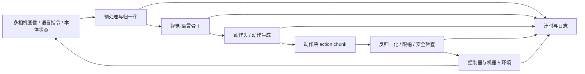
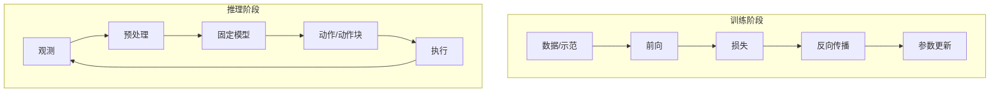

# VLA 推理链路（通用教学图）

> **这不是某一篇论文的架构图，也不是 SmolVLA/OpenVLA-OFT 的实测结论。**  
> 它只用于提出“推理时间可能花在哪里、需要记录什么”的通用问题。具体模型必须以论文/代码为准。

## 1. 通用闭环

### 逐个环节

| 环节 | 可能内容 | 需要记录 |
|---|---|---|
| 观测 | 多视角 RGB、语言 instruction、关节/末端/底盘状态、历史 | 图像键/尺寸/颜色、语言、state 维度与单位、时间戳 |
| 预处理 | resize、归一化、tokenizer、state normalization | 统计量来源（训练集）、dtype、设备（CPU/GPU） |
| 骨干 | 视觉编码器 + 语言模型/多模态 Transformer | 参数量、精度、输入 token 数、显存 |
| 动作头 | 回归、离散 token、diffusion、flow matching 等 | 动作维度、horizon/chunk、迭代步数、随机性 |
| 动作块 | 一次预测多个未来动作 | 块长、实际执行长度、何时重新预测 |
| 后处理 | 反归一化、clip、速率限制、安全校验 | 单位、范围、限幅次数、拒绝原因 |
| 执行 | 控制器/仿真器 | 控制频率、延迟、终止/截断、成功判据 |
| 日志 | 计时、显存、动作、视频索引 | 原始数据路径、版本、seed |

## 2. 训练与推理不是一张图

- 训练有标签/损失/反向传播；推理没有标签，也不更新参数。
- 推理优化（compile/量化/缓存）不能改变训练定义；比较时必须固定权重与输入。
- 动作块执行期间，模型可能不再前向；这时“缓存弹出”不是“新动作块推理”。

## 3. 对测量的启示

至少分开记录：

1. 预处理（CPU/GPU）；
2. H2D 传输；
3. 骨干前向；
4. 动作头迭代；
5. D2H / 反归一化；
6. 控制/环境步进；
7. 端到端墙钟。

如果只报“模型 forward 时间”，不能回答“机器人为什么慢”。

## 4. 具体模型的待核实问题

对 SmolVLA/OpenVLA-OFT，必须从论文/代码确认，不能从本图推断：

- 视觉/语言如何编码？是否有独立 action expert？
- 动作是回归、token 还是 flow/diffusion？迭代多少步？
- 动作块长度、执行长度、控制频率？
- 训练时使用什么数据/归一化？推理时如何反归一化？
- 官方评测的相机键、state 维度、动作维度、成功判据？

把答案写进 [`Papers_Index.md`](../../06_Resources/Papers_Index.md) 对应论文笔记，不要写在本通用图里。
