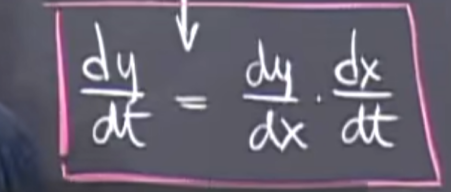
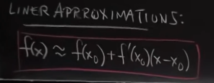
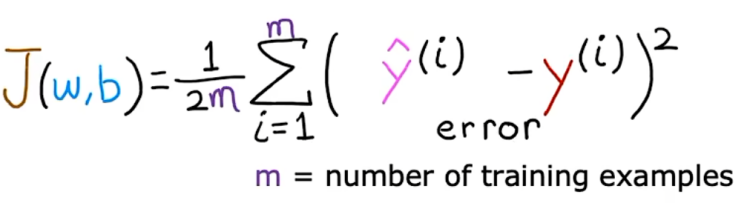
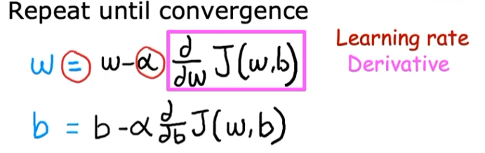
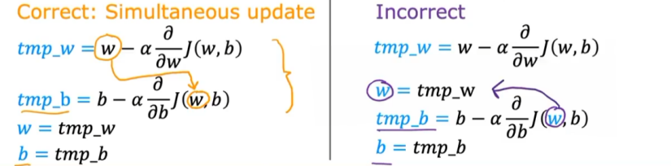

# 926150 原始学习笔记：逐段机械提取

> 来源：`D:\Desktop\926150.docx`  
> SHA256：`05c1e7311cbc24a274dbb2fae12bf405b5e30ffae9145bb6f0ffc6286536d1e0`  
> 性质：**机械提取，不是整理后的学习笔记**。原文的错别字、断行、代码拼接和未完成处均保留；不据此判断掌握程度。
> 整理后的主题笔记见 `02_Learning/`；概念纠正在整理笔记中以“待纠正/勘误”单列。

<!-- P0000 -->
9.26.2026

<!-- P0001 -->
（20min）

<!-- P0002 -->
L1 Rate of Change	变化率、导数直觉	理解梯度到底是什么

<!-- P0003 -->
Derivative 导数

<!-- P0004 -->
几何

<!-- P0005 -->
Tangent line（limit of secant line pq ->p）   slope is derivative（通过导数的定义求)

<!-- P0006 -->
梯度我的积累是导数下降最快的方向，但这节只讲了导数几何含义是切线然后求了一些导数

<!-- P0007 -->
梯度方向：梯度指向局部增长最快的方向；在通常的欧氏距离度量下，负梯度才是下降最快的方向。一元导数首先是变化率。

<!-- P0008 -->
（18min）

<!-- P0009 -->
L2 Limits	极限、连续	导数/积分基础

<!-- P0010 -->
rate of change 瞬时变化率

<!-- P0011 -->
连续：左右极限存在且相等等于函数值

<!-- P0012 -->
Jump discontinuity 左右不相等

<!-- P0013 -->
Removable discontinuity 左右极限相等，函数值不同

<!-- P0014 -->
Infinite discontinuity 

<!-- P0015 -->
Odd奇函数 even 偶函数

<!-- P0016 -->
Other discontinuity 震荡（sin（1/x））

<!-- P0017 -->
可导一定连续，连续不一定可导

<!-- P0018 -->
10.6.2026

<!-- P0019 -->
(20min)

<!-- P0020 -->
L3 Derivatives	求导基本规则	反向传播基础

<!-- P0021 -->
X-> 0   (Cosx-1)/x  -> 0  sinx/x -> 1   0处导数的定义

<!-- P0022 -->
单位圆证明

<!-- P0023 -->
（20min）

<!-- P0024 -->
L4 Chain Rule	链式法则	⭐ Backprop 核心

<!-- P0025 -->
Chain Rule

<!-- P0026; image source: word/media/image1.png -->


*图：链式法则：dy/dt = (dy/dx)(dx/dt)（MIT 18.01 L4，原始截图）*

<!-- P0027 -->
（50）

<!-- P0028 -->
L6 Exponential and Log	exp、log	Softmax、cross entropy、概率模型

<!-- P0029 -->
指数求导引入e然后换底

<!-- P0030 -->
隐函数求导用log求e

<!-- P0031 -->
Lnx导数定义证明e

<!-- P0032 -->
(30)

<!-- P0033 -->
L9 Linear and Quadratic Approximations	一阶/二阶近似	梯度、Hessian、Newton

<!-- P0034; image source: word/media/image2.png -->


*图：线性近似：f(x) ≈ f(x0) + f'(x0)(x-x0)（MIT 18.01 L9，原始截图）*

<!-- P0035 -->
泰勒展开。。

<!-- P0036 -->
（40）

<!-- P0037 -->
L11 Max-Min	极值	优化问题

<!-- P0038 -->
画图：

<!-- P0039 -->
间断点

<!-- P0040 -->
正负无穷

<!-- P0041 -->
特殊点

<!-- P0042 -->
导数

<!-- P0043 -->
二阶导

<!-- P0044 empty -->
<!-- P0045 -->
L13 Newton’s Method	Newton 法	二阶优化

<!-- P0046 empty -->
<!-- P0047 empty -->
<!-- P0048 empty -->
<!-- P0049 empty -->
<!-- P0050 -->
Python  

<!-- P0051 preformatted -->
```text
反转引用或者用“\”
```

<!-- P0052 preformatted -->
```text
msg ="It's a sunny day"
```

<!-- P0053 preformatted -->
```text
msg ='It\'s a sunny day'
```

<!-- P0054 -->
 in 操作符，它返回一个布尔值，指定该字符或字符是否存在于字串中。

<!-- P0055 -->
获取字串的长度并处理字串中的单个字符，这个过程称为索引 len()

<!-- P0056 -->
My_str[0]

<!-- P0057 -->
不允许直接修改字串：

<!-- P0058 preformatted -->
```text
greeting = 'hi'
```

<!-- P0059 preformatted -->
```text
greeting[0] = 'H' # TypeError: 'str' object does not support item assignment
```

<!-- P0060 -->
使用加号（+）操作符将多个字串串接在一起。这个过程称为字串串接

<!-- P0061 -->
用 * 操作符将字串乘以一个整数来重复它。

<!-- P0062 -->
将变量和表达式插入到字串中的过程称为字符串插值

<!-- P0063 preformatted -->
```text
name = 'John Doe'
```

<!-- P0064 preformatted -->
```text
age = 26
```

<!-- P0065 preformatted -->
```text
name_and_age = f'My name is {name} and I am {age} years old'print(name_and_age) # My name is John Doe and I am 26 years old
```

<!-- P0066 -->
字串切片 让你提取字串的一部分或仅处理其中的特定部分。

<!-- P0067 preformatted -->
```text
my_str = 'Hello world'
```

<!-- P0068 preformatted -->
```text
print(my_str[1:4]) # ell
```

<!-- P0069 preformatted -->
```text
反转字串：
```

<!-- P0070 preformatted -->
```text
my_str = 'Hello world'
```

<!-- P0071 preformatted -->
```text
print(my_str[::-1]) # dlrow olleH
```

<!-- P0072 -->
upper()：返回一个所有字符都转换为大写的新建字串。

<!-- P0073 preformatted -->
```text
uppercase_my_str = my_str.upper()
```

<!-- P0074 -->
lower()：返回一个所有字符都转换为小写的新建字串。

<!-- P0075 -->
strip()：返回一个新建字串，移除指定的前导和尾随字符。如果未传入参数，则移除前导和尾随空白字符。

<!-- P0076 preformatted -->
```text
my_str = '  hello world  '
```

<!-- P0077 empty -->
<!-- P0078 preformatted -->
```text
trimmed_my_str = my_str.strip()
```

<!-- P0079 preformatted -->
```text
print(trimmed_my_str)  # hello world
```

<!-- P0080 -->
replace(old, new)：返回一个新建字串，其中所有的 old 都被替换为 new。

<!-- P0081 preformatted -->
```text
my_str.replace('hello', 'hi')
```

<!-- P0082 -->
split(separator)：根据指定的分隔符将字串拆分成一个字串列表。列表是用方括弧括起来的值的集合。如果未指定分隔符，split() 会根据空白字符拆分。

<!-- P0083 preformatted -->
```text
my_str = 'hello world'
```

<!-- P0084 preformatted -->
```text
split_words = my_str.split()
```

<!-- P0085 preformatted -->
```text
print(split_words)  # ['hello', 'world']
```

<!-- P0086 -->
join()：将集合中的字串用分隔符连接成一个单一的字串。

<!-- P0087 preformatted -->
```text
my_list = ['hello', 'world']
```

<!-- P0088 preformatted -->
```text
joined_my_str = ' '.join(my_list)
```

<!-- P0089 preformatted -->
```text
print(joined_my_str)  # hello world
```

<!-- P0090 -->
startswith(prefix)：返回一个布尔值，指示字串是否以指定的前缀开头。

<!-- P0091 -->
endswith(suffix)：返回一个布尔值，指示字串是否以指定的后缀结尾。

<!-- P0092 -->
find(substring)：返回 substring 第一次出现的索引，如果未找到则返回 -1。

<!-- P0093 -->
count(substring)：返回字串中不重叠的子串出现次数。

<!-- P0094 -->
capitalize()：返回一个新字串，首个字符大写，其余字符小写

<!-- P0095 -->
isupper()：如果字串至少包含一个有大小写的字符且所有有大小写的字符都是大写，返回 True。否则返回 False。

<!-- P0096 -->
islower()：如果字串至少包含一个有大小写的字符且所有有大小写的字符都是小写，返回 True。否则返回 False。

<!-- P0097 -->
title()：返回一个新字串，其中每个单词的首字母大写，其余字母小写。

<!-- P0098 -->
地板除法将两个数字相除并返回小于或相等于结果的最大整数。此操作使用双转发斜线操作符（//）：

<!-- P0099 -->
取模操作符（%）返回左侧值除以右侧值时的余数：

<!-- P0100 -->
指数运算将一个数字提升到另一个数字的幂，使用双星号操作符（**）完成：

<!-- P0101 -->
round()：将数字四舍五入到指定的小数位数。默认情况下，此函数将数字四舍五入到最接近的整数，并返回没有小数位的整数：恰好居中时通常取偶数，例如 round(2.5) 是2，round(3.5) 是4；浮点表示还会影响小数结果。

<!-- P0102 -->
abs(): 返回一个数字的绝对值：

<!-- P0103 -->
pow()：将一个数字提升到另一个数字的幂，或执行模幂运算。

<!-- P0104 preformatted -->
```text
result_2 = pow(2, 3, 5)  # (2 ** 3) % 5
```

<!-- P0105 preformatted -->
```text
print(result_2)  # 3
```

<!-- P0106 -->
if 语句以 if 关键字开始。

<!-- P0107 -->
condition 是一个求值为 True 或 False 的表达式，后跟冒号（:）。

<!-- P0108 empty -->
<!-- P0109 preformatted -->
```text
if condition:
```

<!-- P0110 preformatted -->
```text
    pass # Code to execute if condition is True
```

<!-- P0111 -->
and 操作符接受两个操作对象，如果第一个操作对象是 falsy，则返回第一个操作对象；否则返回第二个操作对象。两个操作对象都必须是 truthy，表达式才会得到 truthy 值。

<!-- P0112 -->
 or 操作符。该操作符如果第一个操作对象是 truthy，则返回第一个操作对象；否则返回第二个操作对象。只要有一个操作对象是 truthy，or 表达式就会得到 truthy 值。

<!-- P0113 -->
not 操作符，它接受一个操作对象并反转其布尔值。它将真值转换为 False，将假值转换为 True

<!-- P0114 -->
input()，它允许你提示用户输入：

<!-- P0115 preformatted -->
```text
name = input('What is your name?') # User types "Kolade" and presses Enter  print('Hello', name) # Output: Hello Kolade
```

<!-- P0116 -->
	你使用 def 关键字，后跟你想给函数命名的名称、一对括号和冒号。然后在新的一行，编写你的函数应运行的代码。函数运行的代码也称为函数的体。

<!-- P0117 preformatted -->
```text
def calculate_sum(a, b):
```

<!-- P0118 preformatted -->
```text
    print(a + b)
```

<!-- P0119 -->
在函数外创建的变量具有全局作用域。你可以在函数内外都使用它。

<!-- P0120 -->
在函数内创建的变量具有局部作用域。你只能在该函数内部使用它。函数参数也是局部变量。

<!-- P0121 -->
	str.maketrans() 方法接受两个长度相等的字串，并返回一个翻译表，将第一个字串的每个字符映射到第二个字串对应的字符。翻译表中的每个字符都以 Unicode 序号保存，这是唯一标识该字符的数字。

<!-- P0122 -->
	translate() 方法接受由 str.maketrans() 生成的翻译表作为参数。它在一个字串上调用，并返回原始字串的拷贝，其中的字符已根据翻译表被替换：

<!-- P0123 preformatted -->
```text
t = str.maketrans('lk', 'br')
```

<!-- P0124 preformatted -->
```text
sentence = 'The tent gave in to the leaks.'
```

<!-- P0125 preformatted -->
```text
print(sentence.translate(t))# Output: The tent gave in to the bears.
```

<!-- P0126 -->
	Python 解释器遵循被称为读取、求值、打印、循环的周期，简称 REPL。每当你输入命令时，解释器会读取输入，求值，打印结果，然后循环回显示 >>>，以便你输入更多命令。

<!-- P0127 -->
	列表数据类型是由字串、数字甚至其他列表组成的有序元素序列。列表是可变的，使用零基索引，这意味着列表的第一个元素位于索引零。

<!-- P0128 preformatted -->
```text
cities = ['Los Angeles', 'London', 'Tokyo']
```

<!-- P0129 -->
### list() 构造函数

<!-- P0130 -->
另一种创建列表的方法是使用 list() 构造函数。list() 构造函数用于将可迭代对象转换为列表，如下所示：

<!-- P0131 preformatted -->
```text
developer = 'Jessica'list(developer) # ['J', 'e', 's', 's', 'i', 'c', 'a']
```

<!-- P0132 -->
	由于列表是可变的，只要你传入有效的索引数字，就可以更新列表中的任何元素。

<!-- P0133 preformatted -->
```text
programming_languages[0] = 'JavaScript'
```

<!-- P0134 -->
### 从列表中删除元素

<!-- P0135 -->
如果你想从列表中删除一个元素，可以像这样使用 del 关键字：

<!-- P0136 preformatted -->
```text
developer = ['Jane Doe', 23, 'Python Developer']
```

<!-- P0137 preformatted -->
```text
del developer[1]
```

<!-- P0138 preformatted -->
```text
print(developer) # ['Jane Doe', 'Python Developer']
```

<!-- P0139 -->
### 检查元素是否在列表中

<!-- P0140 -->
有时查看一个元素是否在列表中是很有帮助的。为此，你可以像这样使用 in 关键字：

<!-- P0141 preformatted -->
```text
developer = ['Alice', 25, ['Python', 'Rust', 'C++']]
```

<!-- P0142 preformatted -->
```text
developer[2][1] # 'Rust'
```

<!-- P0143 -->
### 从列表中解包值

<!-- P0144 preformatted -->
```text
developer = ['Alice', 34, 'Rust Developer']
```

<!-- P0145 preformatted -->
```text
name, age, job = developer
```

<!-- P0146 preformatted -->
```text
print(name) # 'Alice'
```

<!-- P0147 preformatted -->
```text
print(age) # 34
```

<!-- P0148 preformatted -->
```text
print(job) # 'Rust Developer'
```

<!-- P0149 empty -->
<!-- P0150 preformatted -->
```text
developer = ['Alice', 34, 'Rust Developer']
```

<!-- P0151 preformatted -->
```text
name, *rest = developer
```

<!-- P0152 preformatted -->
```text
print(name) # 'Alice'
```

<!-- P0153 preformatted -->
```text
print(rest) # [34, 'Rust Developer']
```

<!-- P0154 -->
### 切片列表

<!-- P0155 empty -->
<!-- P0156 preformatted -->
```text
numbers = [1, 2, 3, 4, 5, 6]
```

<!-- P0157 preformatted -->
```text
numbers[1::2] # [2, 4, 6]
```

<!-- P0158 -->
append() 方法

<!-- P0159 preformatted -->
```text
numbers = [1, 2, 3, 4, 5]
```

<!-- P0160 preformatted -->
```text
numbers.append(6)
```

<!-- P0161 preformatted -->
```text
print(numbers) # [1, 2, 3, 4, 5, 6]
```

<!-- P0162 preformatted -->
```text
numbers = [1, 2, 3, 4, 5]
```

<!-- P0163 preformatted -->
```text
even_numbers = [6, 8, 10]
```

<!-- P0164 empty -->
<!-- P0165 preformatted -->
```text
numbers.append(even_numbers)
```

<!-- P0166 preformatted -->
```text
print(numbers) # [1, 2, 3, 4, 5, [6, 8, 10]]
```

<!-- P0167 -->
	 extend() 方法。

<!-- P0168 preformatted -->
```text
numbers = [1, 2, 3, 4, 5]
```

<!-- P0169 preformatted -->
```text
even_numbers = [6, 8, 10]
```

<!-- P0170 empty -->
<!-- P0171 preformatted -->
```text
numbers.extend(even_numbers)
```

<!-- P0172 preformatted -->
```text
print(numbers) # [1, 2, 3, 4, 5, 6, 8, 10]
```

<!-- P0173 -->
	 insert() 方法

<!-- P0174 preformatted -->
```text
numbers = [1, 2, 3, 4, 5]
```

<!-- P0175 preformatted -->
```text
numbers.insert(2, 2.5)
```

<!-- P0176 preformatted -->
```text
print(numbers) # [1, 2, 2.5, 3, 4, 5]
```

<!-- P0177 -->
	remove() 方法将要移除的元素值作为参数：

<!-- P0178 preformatted -->
```text
numbers = [10, 20, 30, 40, 50, 50]
```

<!-- P0179 preformatted -->
```text
numbers.remove(50)
```

<!-- P0180 preformatted -->
```text
print(numbers) # [10, 20, 30, 40, 50]
```

<!-- P0181 -->
重要的是要注意，此方法只会移除第一处出现的项，而不是全部。

<!-- P0182 -->
pop() 方法：

<!-- P0183 preformatted -->
```text
numbers = [1, 2, 3, 4, 5]
```

<!-- P0184 preformatted -->
```text
numbers.pop(1) # The number 2 is returned
```

<!-- P0185 -->
如果你没有为 pop 方法指定元素，则会移除最后一个元素。

<!-- P0186 -->
清空列表 clear() 方法：

<!-- P0187 preformatted -->
```text
numbers = [1, 2, 3, 4, 5]
```

<!-- P0188 preformatted -->
```text
numbers.clear()
```

<!-- P0189 preformatted -->
```text
print(numbers) # []
```

<!-- P0190 -->
	sort() 方法。此方法用于就地排序元素。以下是就地排序一个随机数字列表的示例：

<!-- P0191 preformatted -->
```text
numbers = [19, 2, 35, 1, 67, 41]
```

<!-- P0192 preformatted -->
```text
numbers.sort()
```

<!-- P0193 preformatted -->
```text
print(numbers) # [1, 2, 19, 35, 41, 67]
```

<!-- P0194 -->
	sorted() 函数适用于任何可迭代对象，并返回一个新的排序列表，而不是修改原始列表。

<!-- P0195 preformatted -->
```text
numbers = [19, 2, 35, 1, 67, 41]
```

<!-- P0196 preformatted -->
```text
sorted_numbers = sorted(numbers)
```

<!-- P0197 preformatted -->
```text
print(numbers) # [19, 2, 35, 1, 67, 41]
```

<!-- P0198 preformatted -->
```text
print(sorted_numbers) # [1, 2, 19, 35, 41, 67]
```

<!-- P0199 -->
	reverse() 方法

<!-- P0200 preformatted -->
```text
numbers = [6, 5, 4, 3, 2, 1]
```

<!-- P0201 preformatted -->
```text
numbers.reverse()
```

<!-- P0202 preformatted -->
```text
print(numbers) # [1, 2, 3, 4, 5, 6]
```

<!-- P0203 preformatted -->
```text
index 方法
```

<!-- P0204 preformatted -->
```text
programming_languages = ['Rust', 'Java', 'Python', 'C++']
```

<!-- P0205 preformatted -->
```text
programming_languages.index('Java') # 1
```

<!-- P0206 -->
	元组是 Python 的一种数据类型，用于创建有序的值序列。元组中的元素在创建后不能被更改。

<!-- P0207 -->
tuple() 构造函数，如下所示：

<!-- P0208 preformatted -->
```text
developer = 'Jessica'
```

<!-- P0209 preformatted -->
```text
tuple(developer) # ('J', 'e', 's', 's', 'i', 'c', 'a')
```

<!-- P0210 -->
	 in 关键字

<!-- P0211 -->
	解包项,需要收集元组中剩余的元素，可以像这样使用星号（*）操作符

<!-- P0212 preformatted -->
```text
name, *rest = developer
```

<!-- P0213 -->
	切片操作符

<!-- P0214 preformatted -->
```text
desserts = ('cake', 'pie', 'cookies', 'ice cream')
```

<!-- P0215 preformatted -->
```text
desserts[1:3] # ('pie', 'cookies')
```

<!-- P0216 -->
	需要从一个元组中移除一项，这是不可能的，因为元组是不可变的。

<!-- P0217 -->
	count()。此方法用于确定一项在元组中出现了多少次。

<!-- P0218 -->
	index() 方法。此方法用于查找元组中某个特定项所在的索引

<!-- P0219 -->
	找不到指定的项，则 Python 会引起 ValueError：

<!-- P0220 -->
你还可以使用 index() 方法传入可选的起始和结束索引参数。以下是传入可选起始索引的示例：

<!-- P0221 preformatted -->
```text
programming_languages = ('Rust', 'Java', 'Python', 'C++', 'Rust', 'Python')
```

<!-- P0222 preformatted -->
```text
programming_languages.index('Python', 3) # 5
```

<!-- P0223 preformatted -->
```text
programming_languages.index('Python', 2, 5) # 2
```

<!-- P0224 empty -->
<!-- P0225 -->
下面是使用 sorted() 函数创建数字新建列表的示例：

<!-- P0226 preformatted -->
```text
numbers = (13, 2, 78, 3, 45, 67, 18, 7)
```

<!-- P0227 preformatted -->
```text
sorted(numbers) # [2, 3, 7, 13, 18, 45, 67, 78]
```

<!-- P0228 -->
	sorted() 函数总是创建一个排序值的新列表。

<!-- P0229 -->
	使用 key 参数按长度对元组中的项进行排序的示例：

<!-- P0230 preformatted -->
```text
programming_languages = ('Rust', 'Java', 'Python', 'C++', 'Rust', 'Python')sorted(programming_languages, key=len)
```

<!-- P0231 preformatted -->
```text
# Result# ['C++', 'Rust', 'Java', 'Rust', 'Python', 'Python']
```

<!-- P0232 -->
按相反顺序排列的新值列表，那么你可以像这样使用 reverse 参数：

<!-- P0233 preformatted -->
```text
programming_languages = ('Rust', 'Java', 'Python', 'C++', 'Rust', 'Python')
```

<!-- P0234 preformatted -->
```text
print(sorted(programming_languages, reverse=True))
```

<!-- P0235 preformatted -->
```text
# Result# ['Rust', 'Rust', 'Python', 'Python', 'Java', 'C++']
```

<!-- P0236 preformatted -->
```text
字母顺序
```

<!-- P0237 -->
### 使用 for 循环

<!-- P0238 preformatted -->
```text
programming_languages = ['Rust', 'Java', 'Python', 'C++']
```

<!-- P0239 preformatted -->
```text
for language in programming_languages:
```

<!-- P0240 preformatted -->
```text
print(language)
```

<!-- P0241 preformatted -->
```text
categories = ['Fruit', 'Vegetable']
```

<!-- P0242 preformatted -->
```text
foods = ['Apple', 'Carrot', 'Banana']
```

<!-- P0243 preformatted -->
```text
for category in categories:
```

<!-- P0244 preformatted -->
```text
    for food in foods:
```

<!-- P0245 preformatted -->
```text
        print(category, food)
```

<!-- P0246 preformatted -->
```text
Fruit Apple
```

<!-- P0247 preformatted -->
```text
Fruit Carrot
```

<!-- P0248 preformatted -->
```text
Fruit Banana
```

<!-- P0249 preformatted -->
```text
Vegetable Apple
```

<!-- P0250 preformatted -->
```text
Vegetable Carrot
```

<!-- P0251 preformatted -->
```text
Vegetable Banana
```

<!-- P0252 empty -->
<!-- P0253 -->
### 使用 while 循环

<!-- P0254 preformatted -->
```text
secret_number = 3
```

<!-- P0255 preformatted -->
```text
guess = 0
```

<!-- P0256 preformatted -->
```text
while guess != secret_number:
```

<!-- P0257 preformatted -->
```text
    guess = int(input('Guess the number (1-5): '))
```

<!-- P0258 preformatted -->
```text
    if guess != secret_number:
```

<!-- P0259 preformatted -->
```text
        print('Wrong! Try again.')
```

<!-- P0260 preformatted -->
```text
print('You got it!')
```

<!-- P0261 -->
	break 语句用于停止循环的执行。

<!-- P0262 -->
	continue 语句用于跳过循环的当前迭代并进入下一次迭代。让我们修改之前的示例，使用 continue 语句代替 break：

<!-- P0263 -->
range() 函数用于生成一个整数序列。以下是 range() 函数的基本语法：

<!-- P0264 preformatted -->
```text
range(start, stop, step)
```

<!-- P0265 -->
如果你想生成一个递减顺序的整数序列，那么你可以为 step 参数使用负整数，像这样：

<!-- P0266 preformatted -->
```text
for num in range(40, 0, -10):
```

<!-- P0267 preformatted -->
```text
    print(num)
```

<!-- P0268 -->
	enumerate() 函数。enumerate() 函数跟踪可迭代对象的索引并返回一个枚举对象。

<!-- P0269 preformatted -->
```text
languages = ['Spanish', 'English', 'Russian', 'Chinese']
```

<!-- P0270 preformatted -->
```text
list(enumerate(languages))# [(0, 'Spanish'), (1, 'English'), (2, 'Russian'), (3, 'Chinese')]
```

<!-- P0271 preformatted -->
```text
枚举对象（现在是一个列表）中的每个条目都是一个元组，包含一个计数，后跟传递给 enumerate() 函数的可迭代对象中的一个值。
```

<!-- P0272 preformatted -->
```text
languages = ['Spanish', 'English', 'Russian', 'Chinese']
```

<!-- P0273 preformatted -->
```text
for index, language in enumerate(languages):
```

<!-- P0274 preformatted -->
```text
    print(f'Index {index} and language {language}')
```

<!-- P0275 preformatted -->
```text
enumerate() 函数还接受一个可选的 start 参数，用于指定计数的起始值。如果省略此参数，则计数将从 0 开始。
```

<!-- P0276 preformatted -->
```text
for index, language in enumerate(languages, 1):
```

<!-- P0277 preformatted -->
```text
 zip() 函数，它将列表组合成元素的点对并返回元组的迭代器。
```

<!-- P0278 preformatted -->
```text
developers = ['Naomi', 'Dario', 'Jessica', 'Tom']
```

<!-- P0279 preformatted -->
```text
ids = [1, 2, 3, 4]
```

<!-- P0280 preformatted -->
```text
list(zip(developers, ids))# [('Naomi', 1), ('Dario', 2), ('Jessica', 3), ('Tom', 4)]
```

<!-- P0281 preformatted -->
```text
developers = ['Naomi', 'Dario', 'Jessica', 'Tom']
```

<!-- P0282 preformatted -->
```text
ids = [1, 2, 3, 4]
```

<!-- P0283 preformatted -->
```text
for name, dev_id in zip(developers, ids):
```

<!-- P0284 preformatted -->
```text
    print(f'Name: {name}')
```

<!-- P0285 preformatted -->
```text
    print(f'ID: {dev_id}')
```

<!-- P0286 -->
列表推导式允许你通过将循环和条件直接组合在方括弧内，在一行内创建一个新列表。这使代码更短且通常更易读。

<!-- P0287 -->
这是之前使用方括弧重构的示例：

<!-- P0288 preformatted -->
```text
even_numbers = [num for num in range(21) if num % 2 == 0]print(even_numbers)
```

<!-- P0289 preformatted -->
```text
numbers = [1, 2, 3, 4, 5]
```

<!-- P0290 preformatted -->
```text
result = [(num, 'Even') if num % 2 == 0 else (num, 'Odd') for num in numbers]print(result)
```

<!-- P0291 preformatted -->
```text
[(1, 'Odd'), (2, 'Even'), (3, 'Odd'), (4, 'Even'), (5, 'Odd')]
```

<!-- P0292 -->
	从现有可迭代对象创建列表的方法是使用 filter() 函数。下面是一个只创建长度超过四个字符单词的新列表的示例：

<!-- P0293 preformatted -->
```text
words = ['tree', 'sky', 'mountain', 'river', 'cloud', 'sun']
```

<!-- P0294 preformatted -->
```text
def is_long_word(word):
```

<!-- P0295 preformatted -->
```text
    return len(word) > 4
```

<!-- P0296 empty -->
<!-- P0297 preformatted -->
```text
long_words = list(filter(is_long_word, words))print(long_words) # ['mountain', 'river', 'cloud']
```

<!-- P0298 -->
	 map() 函数，它接受一个可迭代对象并对其每个元素应用一个函数。下面是使用 map() 函数将摄氏温度列表转换为华氏温度的示例：

<!-- P0299 preformatted -->
```text
celsius = [0, 10, 20, 30, 40]
```

<!-- P0300 preformatted -->
```text
def to_fahrenheit(temp):
```

<!-- P0301 preformatted -->
```text
    return (temp * 9/5) + 32
```

<!-- P0302 empty -->
<!-- P0303 preformatted -->
```text
fahrenheit = list(map(to_fahrenheit, celsius))print(fahrenheit) # [32.0, 50.0, 68.0, 86.0, 104.0]
```

<!-- P0304 -->
	 sum() 函数。这个函数用于从可迭代对象（如列表或元组）中获取总和。以下是使用 sum() 函数的示例：

<!-- P0305 preformatted -->
```text
numbers = [5, 10, 15, 20]
```

<!-- P0306 preformatted -->
```text
total = sum(numbers)
```

<!-- P0307 preformatted -->
```text
print(total) # Result: 50
```

<!-- P0308 preformatted -->
```text
total = sum(numbers, 10) # positional argument
```

<!-- P0309 preformatted -->
```text
print(total) # 60
```

<!-- P0310 preformatted -->
```text
使用匿名内联函数。这就是 lambda 函数的用武之地。
```

<!-- P0311 preformatted -->
```text
lambda num: num ** 2
```

<!-- P0312 preformatted -->
```text
字典是内置的数据结构，用于保存密钥-值点对的集合。它们的工作方式非常类似于真实的字典，你通过查找一个单词来找到其对应的含义。
```

<!-- P0313 preformatted -->
```text
pizza = {
```

<!-- P0314 preformatted -->
```text
    'name': 'Margherita Pizza',
```

<!-- P0315 preformatted -->
```text
    'price': 8.9,
```

<!-- P0316 preformatted -->
```text
    'calories_per_slice': 250,
```

<!-- P0317 preformatted -->
```text
'toppings': ['mozzarella', 'basil']
```

<!-- P0318 preformatted -->
```text
}
```

<!-- P0319 preformatted -->
```text
pizza = dict([('name', 'Margherita Pizza'), ('price', 8.9), ('calories_per_slice', 250), ('toppings', ['mozzarella', 'basil'])])
```

<!-- P0320 preformatted -->
```text
pizza['name']#'Margherita Pizza'
```

<!-- P0321 preformatted -->
```text
pizza.get('toppings', []) # ['mozzarella', 'basil']
```

<!-- P0322 preformatted -->
```text
pizza.keys()# dict_keys(['name', 'price', 'calories_per_slice'])
```

<!-- P0323 preformatted -->
```text
pizza.values()# dict_values(['Margherita Pizza', 8.9, 250])
```

<!-- P0324 preformatted -->
```text
pizza.items()# dict_items([('name', 'Margherita Pizza'), ('price', 8.9), ('calories_per_slice', 250)])
```

<!-- P0325 -->
.clear() 方法会从字典中移除所有的键值对：

<!-- P0326 preformatted -->
```text
pizza.clear()
```

<!-- P0327 -->
.pop() 方法移除你作为第一个参数指定的密钥对应的点对，并返回其值。如果密钥不存在，则返回你作为第二个参数指定的默认值。如果密钥不存在且你未传入默认值，则引起 KeyError：

<!-- P0328 preformatted -->
```text
pizza.pop('price', 10)
```

<!-- P0329 preformatted -->
```text
pizza.pop('total_price') # KeyError
```

<!-- P0330 preformatted -->
```text
.popitem() 方法会移除最后插入的项：
```

<!-- P0331 preformatted -->
```text
.update() 方法使用另一个字典的密钥-值点对来更新密钥-值点对。
```

<!-- P0332 preformatted -->
```text
pizza.update({ 'price': 15, 'total_time': 25 })
```

<!-- P0333 empty -->
<!-- P0334 -->
** 操作符可用于解包字典中的元素，并将它们作为关键字参数传递到函数调用中：

<!-- P0335 -->
示例代码

<!-- P0336 preformatted -->
```text
def sum(a, b, c):
```

<!-- P0337 preformatted -->
```text
    return a + b + c
```

<!-- P0338 preformatted -->
```text
nums = {'a': 2, 'b': 4, 'c': 1}
```

<!-- P0339 preformatted -->
```text
print(sum(**nums)) # 7
```

<!-- P0340 -->
在上面的示例中，sum(**nums) 等同于 sum(a=2, b=4, c=1)。

<!-- P0341 empty -->
<!-- P0342 -->
集合是 Python 的内置数据结构之一。集合的核心特性之一是它们不保存重复的值。如果你尝试将重复的值添加到集合中，只有其中一个会被保存。

<!-- P0343 -->
集合是可变的且无序的，这意味着它们的元素不会以任何特定顺序保存，因此你不能使用索引或密钥来访问它们。它们只能包含不可变的数据类型的值，如数字、字串和元组。并且它们支持数学集合操作，包括并集、交集、差集和对称差集。

<!-- P0344 preformatted -->
```text
my_set = {1, 2, 3, 4, 5} 
```

<!-- P0345 -->
如果你需要定义一个空集合，必须使用 set() 函数。如果你只是写空的括弧状的花括弧，比如 {}，Python 会自动创建一个字典。

<!-- P0346 preformatted -->
```text
set() # Set{}    # Dictionary
```

<!-- P0347 preformatted -->
```text
.add() 方法为集合添加一个元素
```

<!-- P0348 preformatted -->
```text
 .remove() 方法或 .discard() 方法，并将你想要移除的元素作为参数传入。
```

<!-- P0349 preformatted -->
```text
.clear() 方法从集合中移除所有元素：
```

<!-- P0350 preformatted -->
```text
.issubset() 和 .issuperset() 方法分别查看一个集合是否是另一个集合的子集或超集。
```

<!-- P0351 preformatted -->
```text
.isdisjoint() 方法查看两个集合是否不相交，这意味着它们没有任何共同的元素。
```

<!-- P0352 preformatted -->
```text
并集操作符 | 返回一个包含两个集合中所有元素的新建集合：
```

<!-- P0353 preformatted -->
```text
交集操作符 & 返回一个只包含集合共有元素的新建集合：
```

<!-- P0354 preformatted -->
```text
差集操作符 - 返回一个新建集合，该集合包含第一个集合中不在其他集合中的元素。
```

<!-- P0355 preformatted -->
```text
对称差操作符 ^ 返回一个新建集合，其中包含只存在于第一个集合或第二个集合中的元素，但不同时存在于两个集合中。
```

<!-- P0356 -->
你使用 import 语句。这些语句允许你将模块导入到你的 Python 脚本中。导入语句通常写在文件的顶部。此外，你可以根据你的需求自定义它们。首先，你使用 import 语句，后跟模块的名称：

<!-- P0357 preformatted -->
```text
import module_name
```

<!-- P0358 -->
然后，如果你需要在你的 Python 脚本中调用该模块中的函数，你可以使用点表示法，模块名称后跟函数名称：

<!-- P0359 preformatted -->
```text
module_name.function_name() 
```

<!-- P0360 -->
果你需要以不同的名称（也称为“别名”）导入模块，可以使用这种语法，在导入语句末尾使用 as 后跟别名：

<!-- P0361 preformatted -->
```text
import module_name as module_alias
```

<!-- P0362 -->
也许你只需要一两个特定的函数或类。Python 在这种情况下正好满足你的需求。

<!-- P0363 -->
现在 import 语句以 from 开头，后跟模块名称，然后是 import 关键字，后面跟着你想要导入的元素名称：

<!-- P0364 preformatted -->
```text
from module_name import name1, name2
```

<!-- P0365 preformatted -->
```text
from math import radians, sin, cos
```

<!-- P0366 empty -->
<!-- P0367 preformatted -->
```text
angle_degrees = 40
```

<!-- P0368 preformatted -->
```text
angle_radians = radians(angle_degrees)
```

<!-- P0369 empty -->
<!-- P0370 preformatted -->
```text
sine_value = sin(angle_radians)
```

<!-- P0371 preformatted -->
```text
cos_value = cos(angle_radians)
```

<!-- P0372 preformatted -->
```text
print(sine_value) # 0.6427876096865393print(cos_value)  # 0.766044443118978
```

<!-- P0373 -->
我们查找这个以星号结尾的导入语句。星号告诉 Python 你想导入该模块中的所有内容，但你想导入它，以便不需要使用模块名称作为前缀：

<!-- P0374 preformatted -->
```text
from module_name import *
```

<!-- P0375 preformatted -->
```text
from math import *
```

<!-- P0376 preformatted -->
```text
print(sqrt(36))  # 6.0
```

<!-- P0377 preformatted -->
```text
print(pow(5, 2)) # 25.0
```

<!-- P0378 preformatted -->
```text
print(exp(1))    # 2.718281828459045
```

<!-- P0379 preformatted -->
```text
if __name__ == '__main__': 
```

<!-- P0380 preformatted -->
```text
# Code
```

<!-- P0381 preformatted -->
```text
正则是一套用来描述字符串规则的 “迷你语言”，专门用来查找、匹配、筛选、替换文本。
```

<!-- P0382 -->
正则表达式，或称 regex，是用于匹配文本中字符序列的模式。re 模块中的 search 函数以正则表达式模式和字串作为它的参数。

<!-- P0383 -->
如果模式产生匹配，则返回相应的匹配对象。否则返回 None。

<!-- P0384 preformatted -->
```text
import re
```

<!-- P0385 empty -->
<!-- P0386 preformatted -->
```text
greeting = "Hello there!"print(re.search('Hi', greeting)) # Noneprint(re.search('Hello', greeting)) # <re.Match object; span=(0, 5), match='Hello'>
```

<!-- P0387 -->
\d 匹配一个十进制数字。

<!-- P0388 -->
在 Python 中，在字面字串前加上 r 或 R 会创建一个未经处理的字串。未经处理的字串将斜线视为字面字符，而不是转义序列，这使它们非常适合用于正则表达式。

<!-- P0389 preformatted -->
```text
import re
```

<!-- P0390 empty -->
<!-- P0391 preformatted -->
```text
book = "Fahrenheit 451"print(re.search(r'\d', book))# <re.Match object; span=(11, 12), match='4'>
```

<!-- P0392 preformatted -->
```text
+ 字符匹配前一个字符一次或多次：
```

<!-- P0393 preformatted -->
```text
为此你可以使用 re 模块中的另一个函数。fullmatch 函数在正则表达式模式匹配整个字串时返回一个匹配对象，否则返回 None。
```

<!-- P0394 preformatted -->
```text
import re
```

<!-- P0395 empty -->
<!-- P0396 preformatted -->
```text
book = "Fahrenheit 451"print(re.fullmatch(r'\d+', book)) #None
```

<!-- P0397 preformatted -->
```text
print(re.fullmatch(r'Fahrenheit \d+', book))# <re.Match object; span=(0, 14), match='Fahrenheit 451'>
```

<!-- P0398 preformatted -->
```text
is 和 is not 操作符用于检查两个值是否引用同一个对象。这称为同一性比较。你可以使用 is None 来检查一个值是否是 None 对象，使用 is not None 来检查它是否不是 None 对象。
```

<!-- P0399 empty -->
<!-- P0400 preformatted -->
```text
当传入的可迭代对象中的所有元素都为真值时，all 函数返回 True，否则返回 False：
```

<!-- P0401 preformatted -->
```text
truthy = [1, 2, 3]print(all(truthy)) # True
```

<!-- P0402 empty -->
<!-- P0403 preformatted -->
```text
falsy = [0, 1, 2, 3]print(all(falsy)) # False
```

<!-- P0404 empty -->
<!-- P0405 -->
__name__ 是 Python 中一个特殊的内置变量。

<!-- P0406 -->
当一个 Python 文件被直接执行时，Python 会将这个变量的值设置为字串 "__main__"。

<!-- P0407 -->
但是如果 Python 文件作为模块被导入到另一个 Python 脚本中，__name__ 变量的值将被设置为该模块的名称（通常是没有 .py 扩展名的文件名）。

<!-- P0408 -->
这就是为什么你经常会在 Python 脚本中看到这个条件式。它包含你只想在 Python 脚本作为主程序运行时才运行的代码：

<!-- P0409 preformatted -->
```text
if __name__ == '__main__': 
```

<!-- P0410 preformatted -->
```text
    # Code
```

<!-- P0411 -->
但是如果脚本作为模块被导入，那个块内的代码不会运行。

<!-- P0412 empty -->
<!-- P0413 empty -->
<!-- P0414 empty -->
<!-- P0415 -->
## Machine learning

<!-- P0416 -->
监督学习：从大量例子中学习x->y的映射，预测新的x

<!-- P0417 -->
回归算法：无限多数字预测一个数字（连续）

<!-- P0418 -->
分类算法：有限的类别（离散）

<!-- P0419 -->
无监督学习：没有给定标签，找出数据之间的模式或者结构

<!-- P0420 -->
聚类：把数据分类

<!-- P0421 -->
异常检测：

<!-- P0422 -->
降维技术：减少丢失，降低数据集

<!-- P0423 -->
Jupyter Notebook

<!-- TABLE 0 -->
| 操作 | 快捷键/方法 |
|---|---|
| 运行单元格并跳到下一个 | Shift + Enter |
| 运行单元格但不跳转 | Ctrl + Enter |
| 运行并在下方新增单元格 | Alt + Enter |
| 新建代码或文字单元格 | 顶部 + 代码 / + Markdown |
| 保存 Notebook | Ctrl + S |

<!-- /TABLE 0 -->

<!-- P0424 -->
Training set训练集

<!-- P0425 -->
X 输入变量 、（输入）特征

<!-- P0426 -->
y输出变量，目标变量

<!-- P0427 -->
m训练示例数

<!-- P0428 -->
（x**i，y**i）单个训练例子，i是特定行

<!-- P0429 -->
Y-hat 估计y、预测值

<!-- P0430 -->
f=wx+b是函数，模型

<!-- P0431 -->
W,b是参数parameter

<!-- P0432 -->
“implement” 最常见的意思是实施、执行；在计算机 / 学术语境中表示编写代码、实现（模型、算法等）。

<!-- P0433 -->
Cost function

<!-- P0434 -->
平方误差成本函数

<!-- P0435; image source: word/media/image3.png -->


*图：平方误差代价函数 J(w,b)（吴恩达机器学习 C1，原始截图）*

<!-- P0436 -->
Batch 每次梯度下降使用的所有训练例子

<!-- P0437 -->
Loss function 计算单个样本预测与真实值之间的误差；Cost function 是一个 batch 或者全部数据集上所有样本 loss 的平均值，我们通过最小化 cost function 来更新模型参数。目标函数还会额外加入正则项防止过拟合。

<!-- P0438 -->
Gradient descent 

<!-- P0439 -->
Local minima

<!-- P0440; image source: word/media/image4.png -->


*图：梯度下降参数更新（吴恩达机器学习 C1，原始截图）*

<!-- P0441 -->
Simultaneously update w and b

<!-- P0442; image source: word/media/image5.png -->


*图：同时更新 w 与 b 的正确与错误写法（吴恩达机器学习 C1，原始截图）*

<!-- P0443 empty -->
<!-- P0444 -->
dangp

<!-- P0445 empty -->
<!-- P0446 -->
Numpy￥￥￥matplotlab

<!-- P0447 -->
NumPy 数组拥有 .shape 属性。x_train.shape 会返回一个 Python 元组，元组中的每一项对应一个维度。

<!-- P0448 -->
x_train.shape 返回元组 (2,)

<!-- P0449 -->
x_train 是一维 numpy 数组，只有 1 个维度；

<!-- P0450 -->
元组里第一个数字 2：代表这个数组有2 个元素；

<!-- P0451 -->
可以用m = len(x_train)

<!-- P0452 -->
print(f"Number of training examples is: {m}")

<!-- P0453 -->
或者m = x_train.shape[0]

<!-- P0454 -->
print(f"Number of training examples is: {m}")

<!-- P0455 -->
使用matplotlib库中的scatter()函数绘制这两个点，如下代码单元格所示。

<!-- P0456 -->
函数参数marker和c将点显示为红色叉号（默认样式为蓝色圆点）。

<!-- P0457 -->
plt.plot()：画折线 / 直线，默认会把点按 x 顺序用线连起来

<!-- P0458 -->
plt.scatter()：画散点，只画孤立的数据点，不会自动连线

<!-- P0459 -->
# Plot the data points

<!-- P0460 -->
plt.scatter(x_train, y_train, marker='x', c='r')

<!-- P0461 -->
# Set the title

<!-- P0462 -->
plt.title("Housing Prices")

<!-- P0463 -->
# Set the y-axis label

<!-- P0464 -->
plt.ylabel('Price (in 1000s of dollars)')

<!-- P0465 -->
# Set the x-axis label

<!-- P0466 -->
plt.xlabel('Size (1000 sqft)')

<!-- P0467 -->
plt.show()

<!-- P0468 -->
parameter（形参）：函数定义时写在括号里的变量名

<!-- P0469 -->
def func(x, w, b): # x,w,b 是 parameters（形参）

<!-- P0470 -->
argument（实参）：调用函数时传入的具体数值 / 变量

<!-- P0471 -->
func(xtrain,100,100)# x_train,100,100 是

<!-- P0472 -->
np.zeros() 是 NumPy 的函数，用来创建一个全部元素都是 0 的数组。
