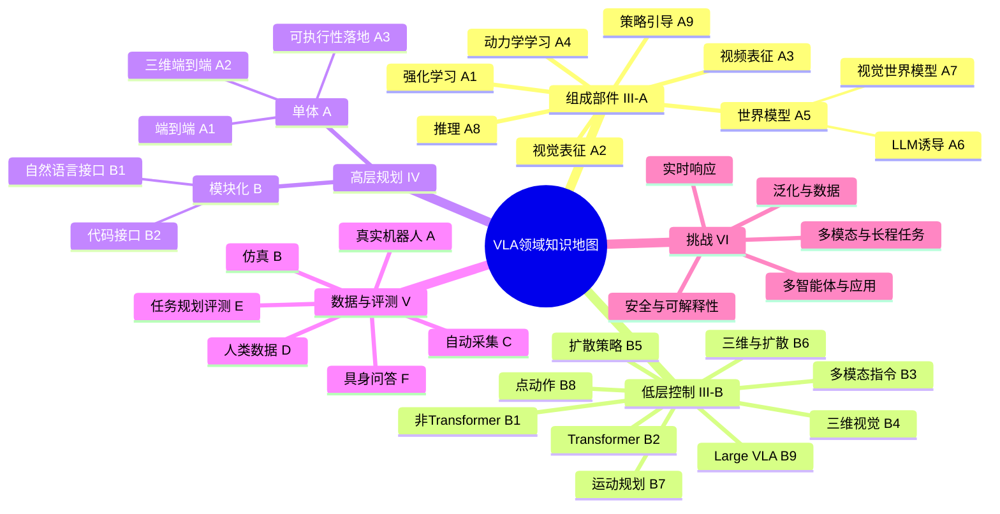

# VLA 领域知识地图

> 适用对象：刚开始学习机器学习、Python、线性代数的科研初学者。先建立问题与方法的对应关系，再读具体论文。
>
> **来源约定**：主来源为你上传的 Ma 等综述，54 页版本，首页标明 arXiv:2405.14093v8（2026-05-01）。以下 p. 均指 PDF 从 1 开始的物理页码；该版本与页眉页码一致。本文基于可读取的同名上传副本整理。
>
> **证据标签**：**[原文]**＝综述明确陈述或明确列出的分类；**[解释]**＝我的教学解释、重组、比较或推荐；**[待核实]**＝需要原始论文、实现或受控实验回答的问题。原文的判断代表作者在其综述范围内的归纳，不能自动视为普遍定律。
>
> 本文件以综述为边界，不声称覆盖截至 2026 年 10 月的全部进展。末尾五篇论文的标题、原文链接与基本研究主题另经原始论文页面核验；未对所有被引论文逐篇阅读全文。

## 1. 先看原文结构

**[原文] 总体分类有三条研究主线：组成部件、低层控制策略、高层任务规划。** 数据和评测为支撑层。定位：摘要 p.1；§I p.2；Fig.3 p.3；§VII p.17。

| 原文章节                                | 页码    | 组织问题               | 主要分类与定位                                                                                                |
| ----------------------------------- | ----- | ------------------ | ------------------------------------------------------------------------------------------------------ |
| I Introduction                      | 1–2   | 为什么需要 VLA；本文如何定义范围 | 广义 VLA 与 Large VLA；相关工作和贡献                                                                             |
| II Background                       | 2–3   | 机器人学习如何表述          | MDP/POMDP、强化学习、模仿学习、语言条件策略                                                                             |
| III-A Components of VLA             | 3–7   | 哪些组成能力可以改善策略       | A1 RL；A2 预训练视觉表征；A3 视频表征；A4 动力学；A5 世界模型；A6 LLM 诱导世界模型；A7 视觉世界模型；A8 推理；A9 策略引导；A10 优势与局限                |
| III-B Low-Level Control Policies    | 7–12  | 如何把指令与观察转为可执行动作    | B1 非 Transformer；B2 Transformer；B3 多模态指令；B4 3D 视觉；B5 扩散；B6 3D＋扩散；B7 运动规划；B8 点动作；B9 Large VLA；B10 优势与局限 |
| IV Task Planners                    | 12–15 | 如何把长任务转为子任务        | A 单体：端到端、3D 端到端、grounded；B 模块化：语言式、代码式；C 优势与局限                                                         |
| V Datasets & Benchmarks             | 15–16 | 如何获得数据并判断能力        | 真实机器人、仿真、自动采集、人类数据、任务规划评测、具身问答                                                                         |
| VI Challenges and Future Directions | 16–17 | 尚未解决什么             | 安全、评测、基础模型与泛化、多模态、长程任务、实时性、多智能体、伦理和应用                                                                  |
| VII Conclusion                      | 17    | 回收三条主线             | 总结部件、控制、规划与资源                                                                                          |
| References                          | 17–36 | 原始论文索引             | 用正文引用编号回查，避免把编号误当性能排名                                                                                  |
| Appendix                            | 37–54 | 背景与补充资料            | A 背景；B 单模态扩展；C 视觉语言模型扩展；D 补充相关模型；E 额外 VLA 文献及发展统计                                                      |

**[解释] 目录是阅读导航，不是互斥分类。** III-B 混合了网络结构、输入形式、动作生成方式、系统功能和模型规模等轴。例如 CogACT 同时涉及 Large VLA 与扩散，DP3 同时涉及 3D 与扩散。定位依据：§III-B4–6 pp.9–10、§III-B9 p.11、Table III p.8。不要把 Fig.3 的每个分支理解为独立赛道。

## 2. 一页理解 VLA 在做什么

**[原文] 广义 VLA：处理视觉与语言输入，输出完成具身任务所需的机器人动作。Large VLA 则特指基于 LLM 或大型 VLM 的路线。** 因此本文的 VLA 范围比“把大型 VLM 微调成机器人控制器”更宽。定位：§I p.2，Fig.2(a) p.2，§III-B9 p.11。

**[解释] 三个问题分别是：**

1. **部件**：机器人怎样看、理解目标、预测后果或改进选择？
2. **低层控制**：此刻具体怎么移动手臂、底盘或夹爪？
3. **高层规划**：接下来先完成哪个子任务，失败后如何调整？

**[原文] 分层系统把高层任务分解为子任务，再交给低层策略执行。** 高层利用大模型容量，低层侧重速度和精度。定位：§I p.2、Fig.4 p.7、§IV pp.12–13。

**[解释] 以“整理桌面”为例：** 高层决定先移开遮挡物再拿杯子；视觉表征定位目标；低层输出抓取和移动动作；世界模型可预测推动后的变化；推理可形成中间步骤；策略引导可对候选动作重新评分。这个例子是教学组合，不表示原文某个系统同时实现了全部能力。

### 最小符号表

| 概念 | 初学者理解 | 来源或性质 |
|---|---|---|
| 状态 s、观察 o | 状态描述环境；相机观察通常只是状态的一部分 | [解释] 对应 §II pp.2–3 的 MDP/POMDP 背景；原文公式用 s 表示策略条件 |
| 策略 π(a｜指令、历史) | 根据目标和观察选择动作的模型 | [原文] §III-B p.7，Eq.(3) |
| 模仿学习 IL / 行为克隆 BC | 向示范学习“在这种情境采取什么动作” | [原文] §II p.3；§III-B10 p.12，Eq.(4)–(6) |
| 强化学习 RL | 根据奖励反馈优化行为 | [原文] §II、§III-A1 p.3 |
| 表征 representation | 把图像等输入变成供后续网络使用的特征 | [解释] 对应 §III-A2 pp.3–4 |
| affordance | 在当前环境与能力下，有哪些操作可完成 | [解释] 对应 SayCan 的可执行性评分，§IV-A3 p.13 |
| action chunk | 一次预测一段动作，而不是单个时刻 | [原文] ACT，§III-B2 p.9 |
| 泛化 | 在训练之外的对象、布局、任务或机器人上工作 | [解释] 应拆开评测维度；参见 VIMA 四级评测，§III-B3 p.9 |

## 3. 主线一：组成部件地图

下表“研究问题”为 **[解释]** 的教学概括；“代表方法与核心概念”为 **[原文]** 的选择性提取。仅保留能帮助识别路线的方法，不逐篇摘要。

| 分支 | 研究问题 | 代表方法与核心概念 | 原文定位 |
|---|---|---|---|
| III-A1 强化学习 | 如何利用奖励、成功与失败经验改进策略？ | DQN；Decision Transformer / Trajectory Transformer：轨迹序列建模；Eureka：语言模型辅助奖励设计；RLHF | p.3 |
| III-A2 预训练视觉表征 PVR | 怎样让视觉特征同时适合目标语义与精细操作？ | CLIP：图文对比；R3M：时间对比与视频语言对齐；MVP：MAE；DINOv2：自蒸馏；Theia：多视觉模型蒸馏 | pp.3–4，Table I p.4 |
| III-A3 视频表征 | 如何利用多帧中的时间与多视角结构？ | 逐帧特征；NeRF；3D Gaussian Splatting；音频线索。视频也可提供 3D 表征来源 | p.4 |
| III-A4 动力学学习 | 动作怎样改变状态，状态变化又对应什么动作？ | SMART：前向、逆向和掩码控制；VPT：逆动力学补动作标签；GR-1：未来帧预测预训练 | pp.4–5，Eq.(1)，Table II p.5 |
| III-A5 世界模型 | 如何预测动作后果并在想象中学习或规划？ | Dreamer：潜在状态、转移、奖励模型与想象学习；IRIS / TWM：Transformer 世界模型 | p.5，Eq.(2) |
| III-A6 LLM 诱导世界模型 | 能否把语言知识转成状态转移或符号规划结构？ | DECKARD：抽象图；LLM-DM：PDDL；RAP：LLM 兼任策略与世界模型并结合 MCTS | pp.5–6 |
| III-A7 视觉世界模型 | 能否生成未来图像、视频或 3D 目标来支持控制？ | Genie：潜在动作与交互环境；3D-VLA：目标图像/点云生成；UniSim：视觉结果模拟 | p.6 |
| III-A8 推理 | 是否能在动作之前或执行中显式处理计划、子任务和异常？ | ReAct：推理与行动交替；ECoT：具身思维链；CoT-VLA：视觉思维链 | p.6 |
| III-A9 策略引导 | 已有策略生成候选后，能否在测试阶段改进选择？ | V-GPS：价值函数重排；RoboMonkey：VLM 验证器选择候选 | p.6 |

### 三组容易混淆的关系

**[原文] 前向动力学：** 已知当前状态与动作，预测下个状态；**逆动力学：** 已知前后状态，推断对应动作。定位：§III-A4 p.4，Eq.(1)。

**[解释] 两者分别对应“这样做会怎样”和“要到那里该怎样做”。** 逆动力学的输入含目标/后续状态，不能与只看当前观察的普通策略直接混同；推断出的动作也可能不唯一。后一点需要根据具体任务与动作空间判断。

**[原文] 动力学学习与世界模型有重叠，但作者按使用角色区分：** 前者常作为预训练目标或辅助损失，后者可作为独立预测模块服务控制、规划和经验生成。定位：§III-A5 p.5。

**[解释] 这是本综述采用的整理方式，不是整个领域统一的严格边界。** 判断一项工作时，追踪预测结果实际流向哪里，比只看论文是否使用“world model”更可靠。

**[原文] 世界模型与推理都可用于高层和低层；作者观察到，前者更多与控制策略交互，文本 CoT 更多服务任务规划。** 定位：§III-A10(c) p.7。

**[解释] 它们可组合：推理提出候选计划，世界模型估计后果，再据此行动。** 不能把“产生推理文字”直接当作“已经学会物理预测”，也不能把“能生成未来视频”直接当作“能稳定控制机器人”。

### 怎样读作者的比较结论

- **[原文]** 作者认为 MAE 类方法提供的像素细节有利于精细操作，并讨论 DINOv2、I-JEPA、Theia 的优势。定位：§III-A10(a) p.6，Table I p.4。
- **[待核实]** 是否优于 CLIP，应在相同数据、骨干、策略头与评测设置下比较；本文不把该段归纳扩写成所有任务上的性能排序。
- **[原文]** 作者结合 SMART 指出，前向动力学通常更难，可能带来更大改进；逆动力学可补动作标签。定位：§III-A10(b) pp.6–7。
- **[待核实]** 训练难度与收益不是必然正相关；需查看原论文的任务、损失和消融条件。

## 4. 主线二：低层控制地图

表内研究问题为 **[解释]**；代表方法和分类为 **[原文]**。统一输入输出依据 Eq.(3) p.7：观察/动作历史＋语言条件 → 当前动作。

| 原文分支 | 研究问题 | 代表方法 / 核心概念 | 定位 |
|---|---|---|---|
| B1 非 Transformer | 早期模型如何结合语义、空间与动作？ | CLIPort：语义/空间双流；BC-Z：FiLM；UniPi：视频生成＋逆动力学 | p.7 |
| B2 Transformer | 如何利用更大数据与历史序列？ | RT-1：离散动作；Q-Transformer：离线 Q 学习；ACT：动作块与时间集成；RoboFlamingo：VLM＋策略头 | pp.7–9 |
| B3 多模态指令 | 怎样用图片、演示、指点明确目标？ | VIMA：图文混合提示、四级泛化评测；MOO：目标定位与多模态提示 | p.9 |
| B4 3D 视觉 | 怎样显式利用空间几何？ | PerAct：体素；Act3D：连续 3D 特征场；RVT：点云重渲染多视图 | p.9 |
| B5 扩散策略 | 如何表示一个情境下多种合理动作？ | Diffusion Policy：条件去噪、滚动时域控制；Octo：通用策略；RDT-1B：双臂与异构动作格式 | pp.9–10 |
| B6 3D＋扩散 | 几何表征能否改善生成式动作策略？ | DP3；3D Diffuser Actor；3D-MoE | p.10 |
| B7 运动规划 | 如何把目标、障碍与约束转成可行轨迹？ | VoxPoser：3D 价值/约束图＋MPC；Language Costs：语言成本图；RoboTAP：点跟踪与视觉伺服 | p.10 |
| B8 点动作 | 能否用 VLM 的空间选择能力降低动作接口复杂度？ | PIVOT：视觉候选迭代；RoboPoint：2D affordance 点投影到 3D；ReKep：关键点约束优化 | pp.10–11 |
| B9 Large VLA | 怎样把大型视觉语言模型转为动作模型？ | RT-2：协同微调；OpenVLA：开源模型、LoRA/量化；π0：flow matching 动作专家；GR00T N1：双系统；WorldVLA：动作与视觉联合建模 | p.11 |
| B10 优势与局限 | 如何比较融合方式、动作类型、成本和规模？ | FiLM / cross-attention / concatenation；连续/离散动作；推理速度；scaling | pp.11–12，Fig.5 p.10，Table III p.8 |

### 关键区别：三种不同的“轴”

| 比较轴 | 选项 | 差别与联系 |
|---|---|---|
| 观察如何表示 | RGB、RGB-D、点云、体素、多视图 | [解释] 决定模型可直接利用的几何信息；不规定必须使用哪种动作头。依据 §III-B4、B6 pp.9–10 |
| 动作如何生成 | 连续回归、离散 token、扩散、flow matching | [解释] 决定动作分布的建模与解码过程；可与不同观察表征搭配。依据 Table III p.8、§III-B9–10 pp.11–12 |
| 系统如何组织 | 单策略、动作专家、双系统、外接规划器 | [解释] 决定模块分工与调用关系；不等于模型规模或训练目标。依据 Fig.5 p.10、Fig.4 p.7 |

**[原文] 动作类型与损失对应：** 连续动作 BC 可用 MSE，离散动作 BC 可用交叉熵，扩散动作策略学习去噪。定位：§III-B10(b) p.12，Eq.(4)–(7)。

**[解释] “Transformer”与“扩散”不是二选一。** 前者可指网络结构，后者指生成建模方式，DiT 就可以把二者结合。Diffusion Policy 本身也不是必然包含语言的 Large VLA；它作为动作建模基础被本综述纳入广义地图。依据：§III-B5 p.9、MDT 描述 p.10、广义定义 p.2。

**[原文] 大模型有指令理解优势，也有训练成本与部署速度问题；环境可能在推理期间发生变化。** 定位：§III-B10(d) p.12、§VI(f) p.17。

**[解释] 对高效 VLA 的研究，不能只测单次推理耗时。** 应同时测任务成功率、动作更新时间、显存及动态环境中的表现。这是由原文实时性问题推导的实验建议，不是原文已经给出的统一评测协议。

## 5. 主线三：高层规划地图

**[原文] 高层规划器输入复杂任务与当前状态，输出一串子任务；每个子任务成为低层策略的指令。** 定位：§IV pp.12–13，Eq.(8)，Fig.4 p.7。

| 分支 | 研究问题 [解释] | 代表方法与核心概念 [原文] | 定位 |
|---|---|---|---|
| IV-A1 端到端单体 | 能否由一个具身多模态模型直接形成高层计划？ | PaLM-E：图像/状态与语言输入，文本计划；EmbodiedGPT：规划信息引导动作特征 | p.13 |
| IV-A2 3D 端到端 | 如何让规划利用明确的三维结构？ | LEO、3D-LLM、ShapeLLM；3D 语言对齐与指令微调 | p.13 |
| IV-A3 Grounded | 怎样让“语言上合理”同时“当前可执行”？ | SayCan：语言相关性＋技能可执行性价值；Translated LM：映射到允许动作；(SL)3：技能发现 | p.13 |
| IV-B1 语言模块化 | 现成模块之间如何交换观察与执行反馈？ | Inner Monologue：文本化反馈和重规划；LLM-Planner；Socratic Models | p.14，Fig.6(a) p.13 |
| IV-B2 代码模块化 | 如何把计划转为对感知/控制工具的调用？ | Code as Policies、ProgPrompt、DEPS；API、程序断言、失败解释 | p.14，Fig.6(b) p.13 |

**[原文] 单体模型可通过具身数据微调，但成本高；模块化方案较容易构建，但并非自动即插即用。** 语言子任务可能超出低层能力，代码方案需要人工封装 API。定位：§IV-C pp.14–15、§VI(e) pp.16–17。

**[解释] “端到端”要问清覆盖哪段链路。** §IV 的端到端规划器可以仍然把文本子任务交给独立低层控制器；不能据此说整个机器人从图像到电机都由一个网络直接输出。依据：PaLM-E 描述 §IV-A1 p.13。

**[解释] 高层任务规划与运动规划分工不同。** 前者决定“先拿杯子再倒水”，后者处理“手臂沿哪条轨迹移动”。VoxPoser 位于 III-B7 的运动规划类别，SayCan 位于 IV-A3 的 grounded 任务规划类别。定位：pp.10、13。

## 6. 分支之间的交叉连接

下表整体为 **[解释]**，每行附原文例子作为依据。关系不是“某条路线必然优于另一条”。

| 连接 | 共同点 | 主要区别 / 组合方式 | 原文依据 |
|---|---|---|---|
| PVR ↔ 3D 视觉 | 提供任务相关的视觉信息 | PVR 是学习特征的方向；3D 是观察/几何表示选择，可组合 | §III-A2–3 pp.3–4；B4 p.9 |
| 动力学 ↔ 世界模型 | 学习状态随动作变化 | 预测可作为辅助训练，也可显式供规划和想象学习使用 | §III-A4–5 pp.4–5 |
| 世界模型 ↔ 策略 | 都服务行为决策 | 前者预测后果；后者选择动作；UniPi 用视频预测＋逆动力学连接 | §III-B1 p.7 |
| 世界模型 ↔ 推理 | 都可支持看得更远的决策 | 未来状态预测与中间推理过程不同；二者可以交互 | §III-A8 p.6；A10(c) p.7 |
| 推理 ↔ 高层规划 | 都处理任务步骤与异常 | 推理是能力/过程，规划是输出任务序列的角色；ECoT 也用于低层 | §III-A8 p.6；§IV p.13 |
| 策略引导 ↔ RL | 可以利用价值信息 | 引导可在测试时重排动作；RL 通常涉及学习策略或价值 | §III-A1 p.3；A9 p.6 |
| 3D ↔ 扩散 | 改善操作决策的不同环节 | 3D 提供几何，扩散生成动作；DP3 结合二者 | §III-B6 p.10 |
| Large VLA ↔ 扩散/流匹配 | 结合语义理解与动作生成 | 大型 VLM 可配专门动作头，不必逐 token 生成全部动作 | §III-B9 p.11，Fig.5 p.10 |
| 高层 ↔ 低层 | 共同完成任务 | 子任务接口连接；若高层选择低层不会的技能，系统仍会失败 | Fig.4 p.7；§VI(e) pp.16–17 |
| 数据 ↔ 泛化 ↔ 评测 | 决定模型学到什么及能证明什么 | 更多数据不自动代表所有泛化维度更强，须看划分与协议 | §III-B3 p.9；B10(e) p.12；§V–VI pp.15–16 |

## 7. 数据和评测：地图的地基

| 分支 | 核心问题与代表资源 [原文] | 阅读时追问 [解释] | 定位 |
|---|---|---|---|
| 真实机器人 | Bridge、RH20T、DROID、OXE；机器人配置和控制模式不一致 | 训练/测试有无场景、机器人、物体重叠？ | §V-A p.15，Table V p.14 |
| 仿真 | 多种交互仿真与操作基准；存在 sim-to-real gap | 优势是否转移到真实相机、接触与控制频率？ | §V-B p.15，Table VI p.15 |
| 自动采集 | RoboGen、AutoRT、DIAL | 合成/自动标注数据有哪些偏差？ | §V-C p.15 |
| 人类数据 | 人体与机器人存在形态和视角差异；UMI 用手持夹具缓解问题 | 人类视频是否有可用于该机器人的动作标签？ | §V-D pp.15–16 |
| 任务规划评测 | PlanBench、LoTa-Bench、EAI | 是仅检查文本计划，还是执行后判断；能定位哪种失败？ | §V-E p.16 |
| 具身问答 | EQA、OpenEQA 等，测空间/物理理解等相关能力 | 问答表现能否推出操作能力？通常不能直接推出 | §V-F p.16，Table VII p.16 |

**[原文] 只看成功率不足以细粒度诊断模型问题；需要更丰富的指标。EQA 也不直接评测操作、导航任务本身。** 定位：§V-E–F、§VI(b) p.16。

**[解释] 做论文比较前，至少对齐：** 机器人与动作空间、相机/状态输入、训练数据、任务划分、控制与推理频率、真实或仿真环境。条件不一致时保留各自结果，避免形成虚假的统一排行榜。

## 8. 原文挑战与仍待回答的问题

| 原文明确指出的问题 | 面向初学者的理解 [解释] | 待核实的具体问题 | 定位 |
|---|---|---|---|
| 安全与可解释性 | 错误动作会改变物理世界 | 验证器是否发现危险候选，还是只选看起来合理的动作？ | §VI(a) p.16 |
| 综合评测不足 | 一个成功率不能解释所有能力 | 失败来自感知、语义、规划、动作生成还是控制接口？ | §VI(b) p.16 |
| 跨环境、任务和形态泛化不足 | “没见过”有不同维度 | 新物体与新机器人是否需要不同适配方式？ | §VI(c) p.16 |
| 多模态对齐仍有争议 | 特征对齐未必足以支撑精细行动 | 额外深度/触觉的收益来自信息本身还是数据和模型规模？ | §VI(d) p.16 |
| 分层长任务增加失败点和延迟 | 局部技能成功不保证整段任务成功 | 统一策略和分层系统在同预算下谁更稳健？ | §VI(e) pp.16–17 |
| 实时性与容量冲突 | 推理完时环境可能已变化 | 剪枝、量化、缓存或提前退出降低时延后，闭环成功率如何变化？ | §VI(f) p.17；提前退出例子 §III-B10(d) p.12 |
| 多智能体协调困难 | 机器人间需要交换信息并协调目标 | 通信延迟和异构能力如何影响协作？ | §VI(g) p.17 |

**[待核实] 视觉世界模型的“画面逼真”能否转化为有用的动作后果预测？** 本综述描述了视觉生成支持控制的路线，但本文不据此认定接触物理、长程预测或真实部署可靠性已得到解决。需查对应方法的动作条件、预测跨度、消融和真实闭环实验。依据：§III-A7 p.6、§VI pp.16–17。

**[待核实] 附录文献统计的完整性。** 作者说明对 2020–2025 文献采用自动脚本与人工检索的混合流程，并承认可能存在自动化错误。统计图适合观察其收集样本，不宜当作领域的完全普查。定位：Appendix E p.45，Figs.9–12 pp.51–54。

## 9. 初学者如何使用这张地图

本节为 **[解释]**，是阅读方式建议，不是综述结论。

1. 先看 p.1 Fig.1、p.3 Fig.3 和 p.7 Fig.4，用自己的话说清“部件、控制、规划”。
2. 对照 §II 和 Eq.(3)，弄清一个模型的输入、输出、训练信号；暂时不必推导全部优化细节。
3. 在 §III-B 选一个动作建模实例，再与 §IV 的规划实例比较，确认两个层级输出什么。
4. 每读一篇原始论文，记录：问题、输入、输出、核心改动、验证条件、失败情形。只在需要时扩展单篇笔记。
5. 对“更快”“更强”“泛化更好”补上适用条件；先回查原实验再考虑复现。

### 可复制的轻量论文笔记

- 在地图中的位置：
- 研究问题：
- 输入 / 输出：
- 训练数据与目标：
- 相比基线改变了什么：
- 证据：原论文哪一节、哪张表，使用什么实验设置：
- 我的解释：
- 尚未核实：
- 与其他分支的连接：

## 10. Mermaid 思维导图源码

**[原文＋解释]** 下图主结构遵循 Fig.3 p.3；将 §III-A5–7 以世界模型父子节点便于阅读，将 §VI 合并显示。它是学习导航重排，不是原图逐字复刻。主干结构的交叉关系见第 6 节；mindmap 本身不表达全部交叉边。

独立源码另附为 `VLA_mindmap.mmd`，可复制到 Obsidian 的 mermaid 代码块。Markdown 无需额外插件；使用 Obsidian 阅读视图查看图。图形渲染仍取决于所用 Obsidian/Mermaid 版本。

## 11. 最值得优先精读的 5 篇原始论文

**[解释：推荐标准]** 这五篇覆盖高层落地、VLM 到动作、生成式动作头、开放模型适配与连续动作专家，服务于“建立全局理解”。它们不是综述作者给出的前五名，也不是性能或引用量排行榜。世界模型相关工作保留在地图中，未为凑齐每个分支再增加精读篇数。

| 建议顺序 | 原始论文 | 为什么值得精读 [解释] | 先回答的一个问题 | 综述回查 |
|---|---|---|---|---|
| 1 | **SayCan — Do As I Can, Not As I Say: Grounding Language in Robotic Affordances**（2022） | 把语言上的合理性与机器人的可执行性明确拆开，容易建立“高层规划—低层技能”的框架 | 为什么不能仅选择 LLM 认为最合理的下一步？ | §IV-A3 p.13；Table IV p.12；文献 [10] |
| 2 | **RT-2: Vision-Language-Action Models Transfer Web Knowledge to Robotic Control**（2023） | 理解原始 Large VLA 路线：视觉语言知识怎样进入动作预测，协同微调改变什么 | 动作怎样进入模型输出空间，语义迁移实验究竟测了什么？ | §III-B9 p.11；文献 [1] |
| 3 | **Diffusion Policy: Visuomotor Policy Learning via Action Diffusion**（2023；另有扩展版） | 补齐动作分布建模基础，为理解后来的扩散 VLA 动作头铺路；先把条件去噪与滚动执行分清 | 为什么一个状态可能对应多种合理动作，预测动作段后又怎样执行？ | §III-B5 pp.9–10；文献 [107] |
| 4 | **OpenVLA: An Open-Source Vision-Language-Action Model**（2024 预印本；CoRL 论文） | 把前面概念落到可检查的开放系统，关注视觉特征融合、数据、微调和资源需求 | 哪些能力来自视觉编码器、机器人数据和微调，如何分别验证？ | §III-B9 p.11；文献 [35] |
| 5 | **π0: A Vision-Language-Action Flow Model for General Robot Control**（2024 首发） | 理解预训练 VLM＋连续动作专家，连接语义能力与高频、灵巧动作生成 | 动作专家如何利用 VLM 信息，flow matching 与离散 token 动作输出有什么不同？ | §III-B9 p.11；文献 [118] |

### 原始论文入口与核验边界

以下均为作者论文或作者项目入口，核验日期 2026-10-28。原文版本可能随链接更新；具体数值以你精读的 PDF 版本为准。此处只核验题名与研究主题，不替代对全文和代码的阅读。

1. **SayCan**：[原论文](https://arxiv.org/abs/2204.01691)。原始摘要明确提出，用预训练技能为语言模型提供现实可执行性的 grounding。
2. **RT-2**：[原论文](https://arxiv.org/abs/2307.15818)。原始摘要明确描述机器人轨迹与互联网视觉语言任务的协同微调。
3. **Diffusion Policy**：[原论文](https://arxiv.org/abs/2303.04137)；[作者项目](https://diffusion-policy.cs.columbia.edu/)。原始摘要描述条件去噪策略、视觉条件和滚动时域控制。
4. **OpenVLA**：[原论文](https://arxiv.org/abs/2406.09246)；[作者代码](https://github.com/openvla/openvla)。原始摘要描述 7B 开源 VLA、DINOv2 与 SigLIP 特征融合、面向新设置的微调。
5. **π0**：[原论文](https://arxiv.org/abs/2410.24164)。原始摘要描述在预训练 VLM 上构建 flow matching 架构，并在多种机器人平台数据上训练。

**[解释] 精读的完成标准：** 能画出输入到动作的流程，解释核心设计解决了哪个问题，并指出至少一项实验能支持什么、不能支持什么。无需第一次就读懂所有公式，也无需把综述引用的每篇论文都扩写成长摘要。
