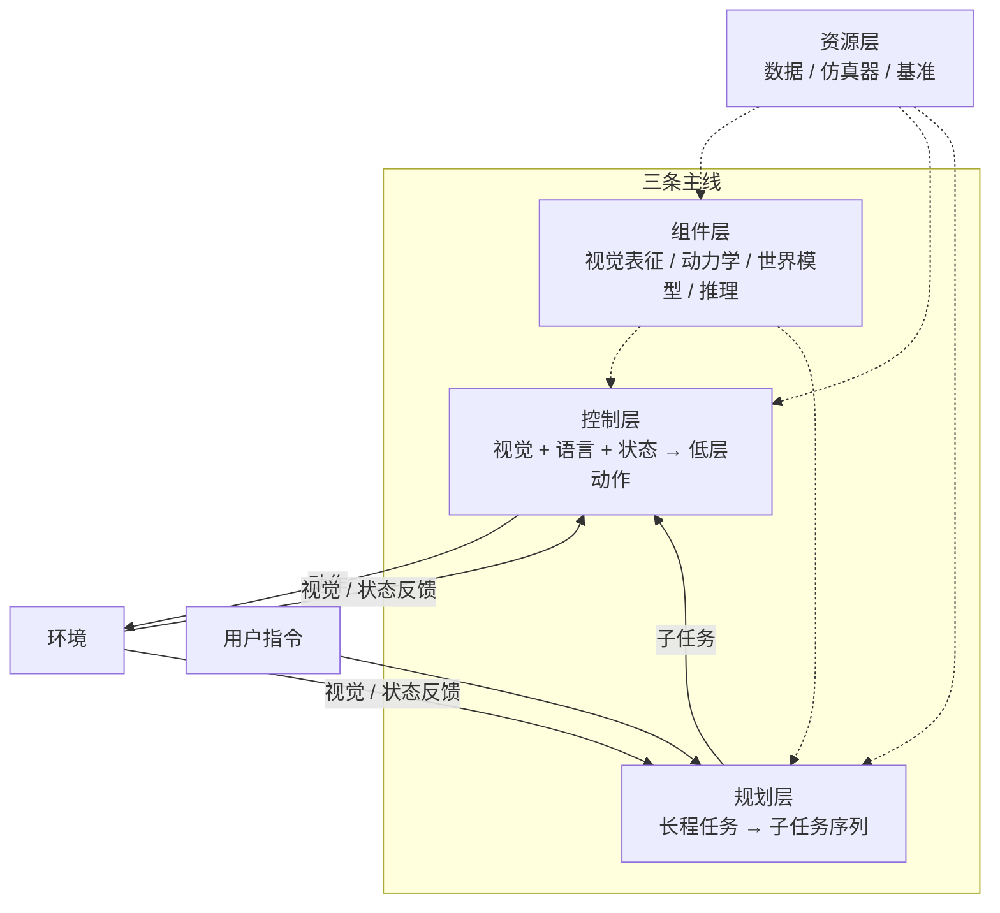
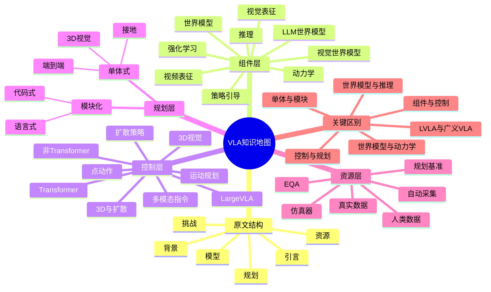

# VLA 领域知识地图

> [!info] 这份笔记怎么用
> 这不是“把每篇被引论文都摘要一遍”的清单，而是一张**从综述结构到研究判断**的地图。  
> 读完后，你应该能回答四个问题：VLA 分成哪几条线？每条线在解决什么？它们如何衔接？哪些结论有原文证据、哪些只是合理推断？  
> 标记约定：**🟦 原文** = 原文明确写出；**🟨 解读** = 我的综合/推断；**🟥 待核实** = 需要查原始论文或统一实验才能确认。  
> 笔记中的 **p.** 指论文印刷页码（正文 pp. 1–17；参考文献 pp. 17–36；附录 pp. 37–50），不是 PDF 阅读器的文件页序。正式排版可能造成页码偏移，因此引用时请同时看章节号、图号或表号。

> [!abstract] 一句话总览
> **VLA = 用视觉理解环境 + 用语言理解任务 + 输出机器人动作。**  
> 综述把 VLA 研究分成三条主线：**组件（Components）→ 低层控制策略（Control Policies）→ 高层任务规划（Task Planners）**，再加上**数据、仿真器与基准（Datasets & Benchmarks）**这一层支撑。三条主线不是互斥模型，而是同一个机器人系统的三个观察层级。  
> ——依据：p. 1 Abstract；p. 2 §I；p. 3 Fig. 3；p. 7 Fig. 4；p. 12 §IV。

---

## 1. 原文骨架：它到底讲了什么

### 1.1 章节结构

| 位置 | 内容 | 页码 | 读它解决什么问题 |
|---|---|---|---|
| Abstract | 问题、三条研究线、资源与挑战的总览 | p. 1 | 先建立“全文在讲什么”的框架 |
| I. Introduction | VLA 的定义、与 LLM/VLM/RL 的关系、贡献 | pp. 1–2 | 搞清 VLA 的边界与“Large VLA” |
| II. Background | 具身智能、MDP/POMDP、模仿学习、语言条件策略 | pp. 2–3 | 补机器人学习的最小背景 |
| III. VLA Models | 全文主体：组件层 + 控制策略层 | pp. 3–12 | 理解“模型内部有什么”和“怎样输出动作” |
| III-A. Components | RL、视觉表征、视频表征、动力学、世界模型、推理、策略引导 | pp. 3–7 | 理解 VLA 的“零件”和预训练目标 |
| III-B. Control Policies | 非 Transformer、Transformer、多模态指令、3D、扩散、运动规划、点动作、Large VLA | pp. 7–12 | 理解“从感知到动作”的完整策略 |
| IV. Task Planners | 单体式与模块化任务规划 | pp. 12–15 | 理解长程任务如何被拆成子任务 |
| V. Datasets and Benchmarks | 真实数据、仿真器、自动采集、人类数据、规划与 EQA 基准 | pp. 15–16 | 理解数据与评测为什么是瓶颈 |
| VI. Challenges and Future Directions | 安全、基准、基础模型、多模态、长程、实时性、多智能体、伦理、应用 | pp. 16–17 | 找研究空白与选题方向 |
| VII. Conclusion | 总结三条主线与资源 | p. 17 | 复盘全文 |
| References | 参考文献 | pp. 17–36 | 查原始论文 |
| Appendix A–E | 背景扩展、补充相关工作、额外 VLA 工作、2025 动态 | pp. 37–50 | 选读；不要一开始逐页啃 |
| Figures 9–12 | 2020–2025 年论文数量、机构、时间线等统计图 | pp. 51–54 | 看领域增长与机构分布 |

> [!note] 结构判断
> 原文的“章节结构”本身就是它的“研究分类”：**III-A 是零件，III-B 是整机（低层），IV 是上层规划，V 是训练与评测基础设施**。这不是按模型名称分类，而是按**系统层级**分类。  
> ——依据：p. 2 §I-B；p. 3 Fig. 3。

### 1.2 研究分类：三种切法

| 切法 | 类别 | 一句话解释 | 证据 |
|---|---|---|---|
| 按系统层级 | 组件 / 控制策略 / 任务规划 / 资源 | 全文主线；从“零件”到“整机”再到“上层指挥” | p. 1 Abstract；p. 3 Fig. 3 |
| 按动作生成 | 自回归动作 token / 扩散 / 流匹配 / 点动作 / 运动规划 | 同样是“输出动作”，但动作空间与生成方式不同 | pp. 9–12 §III-B5–B9；p. 10 Fig. 5 |
| 按规划方式 | 单体式 / 模块化；语言式 / 代码式 | 单体式用一个 MLLM 直接出计划；模块化用现成 LLM/VLM + API | pp. 12–15 §IV |
| 按模型规模 | Large VLA（LVLA）/ 广义 VLA | LVLA 基于 LLM 或大 VLM；广义 VLA 还包括更小、更专用的模型 | p. 2 §I；p. 11 §III-B9 |
| 按评测环境 | 真实世界 / 仿真；任务成功率 / EQA 等能力 | 真实数据贵但可信；仿真可扩展但有 sim-to-real gap | pp. 15–16 §V |

> [!tip] 🟨 我的解释
> 这张表是我对原文分类的**再组织**，不是原文的原始表格。原文的正式分类以 **Fig. 3** 为准；这张表的作用是让你从不同角度切同一块知识，避免把“模型名”当成唯一分类轴。  
> 依据：p. 3 Fig. 3；pp. 8–9 Table III；p. 12 Table IV。

### 1.3 一张总图：三条主线如何接起来

> 图注：这是**关系示意图**，不是原文原图。原文的分层示例见 p. 7 Fig. 4；分类树见 p. 3 Fig. 3。  
> 关键点：规划层输出“做什么”的子任务，控制层输出“怎么做”的动作；组件层既可以增强控制层，也可以增强规划层。  
> ——依据：p. 2 §I；p. 7 Fig. 4；p. 12 §IV。

---

## 2. 三条主线逐层拆解

> [!note] 阅读约定
> 下表只列**代表方法锚点**，每个方法只给“定位标签”，不写论文摘要。想深入某一篇，再去读原始论文。  
> 标签：**🟦 原文** = 原文明确写出；**🟨 解读** = 我的综合/推断；**🟥 待核实** = 需要查原始论文或统一实验才能确认。

### 2.1 组件层（Components, §III-A）

| 分支 | 研究问题 | 核心概念 | 代表方法（锚点） | 证据 |
|---|---|---|---|---|
| 强化学习 RL | 如何从经验/奖励中学策略；LLM 如何增强 RL | MDP/POMDP、policy、reward、RLHF、verbal RL | DQN、DT/TT、Gato、π*0.6；SEED、Reflexion、Eureka | p. 3 §III-A1 |
| 预训练视觉表征 PVR | 什么样的视觉表征最利于控制；图像级语义与像素级细节如何取舍 | CLIP、time-CL、MAE、self-distillation、JEPA | CLIP、R3M、MVP、VIP、VC-1、DINOv2、I-JEPA、Theia | pp. 3–4 §III-A2；p. 4 Table I |
| 视频表征 | 如何利用时序、多视角、3D、音频线索 | time CL、video-language alignment、NeRF、3D-GS | R3M/VIP、F3RM、3D-LLM、3D-GS、audio cues | p. 4 §III-A3 |
| 动力学学习 | 如何用前向/逆向动力学做预训练；没有动作标签怎么办 | forward/inverse dynamics、masked trajectory、action labels | Vi-PRoM、MIDAS、SMART、MaskDP、PACT、VPT、GR-1 | pp. 4–5 §III-A4；p. 5 Table II |
| 世界模型 | 如何预测未来状态，并在“想象”中规划 | latent dynamics、imagination、model-based control | Dreamer/V2/V3、DayDreamer、IRIS、TWM | p. 5 §III-A5 |
| LLM 诱导世界模型 | 如何用 LLM 的常识构建符号/文本世界模型 | AWM、PDDL、MCTS、reasoning tree | DECKARD、LLM-DM、RAP、LLM-MCTS、Tree-Planner | p. 6 §III-A6 |
| 视觉世界模型 | 如何生成未来图像、视频或 3D 场景 | generative interactive environment、video diffusion、3D goal generation | Genie、3D-VLA、UniSim、E2WM | p. 6 §III-A7 |
| 推理 | 如何用思维链改进规划或控制 | CoT、ReAct、RAG、tree-of-thought、embodied CoT | ThinkBot、ReAct、RAT、Tree-Planner、ECoT、CoT-VLA | p. 6 §III-A8 |
| 策略引导 | 测试时如何不重训就提升策略 | value re-ranking、verifier、test-time compute | V-GPS、RoboMonkey | p. 6 §III-A9 |

#### 组件层的 5 个关键判断

1. **视觉表征没有“全能冠军”。** CLIP 一类方法提供图像级语义，但缺少像素级细节；MAE 一类方法保留分割、位置、深度等细节；DINOv2、I-JEPA、Theia 分别在“像素+图像”“patch 表示”“多模型蒸馏”上补短板。**🟦 原文**（p. 6 §III-A10(a)；p. 4 Table I）  
   **🟨 解读：** 选视觉编码器时，先问任务更需要“语义泛化”还是“空间精度”，不要只看 ImageNet/零样本指标。

2. **前向动力学通常比逆向动力学更难，但收益也可能更大。** 预测未来状态比预测过去动作更复杂；逆向动力学还能给“只有状态、没有动作”的视频自动打动作标签。**🟦 原文**（pp. 6–7 §III-A10(b)）

3. **世界模型不等于前向动力学。** 前向动力学常被当作预训练任务或辅助 loss；世界模型更像一个独立模块，用来在想象空间中搜索动作、生成新经验。**🟦 原文**（p. 5 §III-A5）

4. **世界模型不等于推理。** 世界模型主要预测“下一个状态”，更适合和控制策略互动；CoT 推理主要产出文本思维链，更适合任务规划。**🟦 原文**（p. 7 §III-A10(c)）

5. **策略引导是“便宜的测试时增益”，但上限取决于价值函数/验证器质量。** V-GPS 用学习到的价值函数重排动作，RoboMonkey 用 VLM verifier 选动作。**🟦 原文**（p. 6 §III-A9）；**🟨 解读：** 如果 verifier 本身有偏，重排可能放大错误。

> [!warning] 🟥 待核实
> “世界模型能稳定提升真实机器人控制”在综述中是**合理化叙述**，不是统一的元分析结论。不同论文的任务、数据、基线差异很大；需要读 Dreamer、IRIS、WorldVLA 等原始实验，确认增益来自世界模型本身，还是来自更多数据/更大模型。  
> 依据：p. 5 §III-A5；p. 11 §III-B9；p. 16 §VI。

### 2.2 低层控制策略层（Control Policies, §III-B）

| 分支 | 研究问题 | 核心概念 | 代表方法（锚点） | 证据 |
|---|---|---|---|---|
| 非 Transformer | Transformer 之前如何做语言条件策略；语义与空间信息如何分工 | two-stream、FiLM、SE(2)、language-conditioned BC | CLIPort、BC-Z、MCIL、HULC、UniPi | pp. 7–8 §III-B1；pp. 8–9 Table III |
| Transformer | 如何用序列模型规模化多任务、多 embodiment | tokenization、autoregression、action chunking、Q-learning | Gato、RoboCat、RT-1、Q-Transformer、RT-Trajectory、ACT、RoboAgent、RoboFlamingo | pp. 8–9 §III-B2 |
| 多模态指令 | 如何支持演示、指点、新物体命名等非纯文本指令 | multimodal prompt、visual goal、pointing | VIMA、MOO | p. 9 §III-B3 |
| 3D 视觉 | 如何用点云/体素/特征场提升空间精度 | point cloud、voxel、3D feature field、re-rendering | PerAct、Act3D、RVT/RVT-2、RoboUniView、VER | p. 9 §III-B4 |
| 扩散策略 | 如何建模多峰动作分布和高维动作序列 | DDPM/DDIM、receding horizon、visual conditioning | Diffusion Policy、Octo、MDT、RDT-1B | pp. 9–10 §III-B5 |
| 3D + 扩散 | 如何把 3D 表征与生成式动作头结合 | point cloud + diffusion、3D feature field | DP3、3D Diffuser Actor、3D-MoE | p. 10 §III-B6 |
| 运动规划 | 如何用 LLM/VLM 生成 waypoint、affordance 或约束 | MPC、voxel value map、visual servoing、tracking | SUDD、VoxPoser、RoboTAP | pp. 10–11 §III-B7 |
| 点动作 | 如何把 VLM 的空间知识变成点或约束 | keypoint、2D affordance、3D projection、constraint function | PIVOT、RoboPoint、ReKep | pp. 10–11 §III-B8 |
| Large VLA | 如何把大 VLM 适配成动作策略；如何提效 | co-fine-tuning、action token、action expert、flow matching、dual-system | RT-2、RT-X、OpenVLA、π0、GR00T N1、WorldVLA/UniVLA | p. 11 §III-B9；p. 10 Fig. 5 |

#### 控制层的 6 个关键判断

1. **架构没有唯一解。** FiLM、cross-attention、concatenation、tool-use、quantization 都在用；原文的判断是：cross-attention 可能在小模型上更好，concatenation 更简单、在大模型上可以取得可比结果。**🟦 原文**（p. 11 §III-B10(a)；p. 10 Fig. 5）

2. **动作表示是核心设计轴。** 末端执行器位姿、离散 token、SE(2)、SE(3)、点动作、运动规划，对应不同的精度、泛化与硬件假设。**🟦 原文**（pp. 11–12 §III-B10(b)）

3. **离散动作与连续动作各有代价。** RT-1 上离散动作表现更好；Octo 认为离散动作可能导致早期抓取问题；ACT 用 action chunking + temporal ensembling 提升时序一致性。**🟦 原文**（pp. 11–12；p. 9 §III-B2）

4. **SE(2) 适合许多桌面操作，但复杂任务需要更多自由度。** 例如“把水倒进杯子”可能需要 SE(3) 或额外 DoF；点动作更粗，但更容易从 VLM 零样本获得。**🟦 原文**（p. 12 §III-B10(b)）

5. **LVLA 的强项是指令跟随与语义泛化，弱点是训练/部署成本。** TinyVLA、DeeR-VLA、π0、RoboMamba 等分别在更小 VLM、早退动态推理、flow matching、Mamba 线性推理上提效。**🟦 原文**（pp. 11–12 §III-B9–B10）

6. **机器人领域也观察到 scaling law，但它依赖模型、数据、环境与物体多样性。** **🟦 原文**（p. 12 §III-B10(e)）

> [!warning] 🟥 待核实
> “离散动作更好”与“离散动作导致早期抓取问题”并不矛盾，但**不能脱离任务、动作空间和基线**直接引用。Table III 同时收录 LVLA、广义 VLA 与非 VLA 相关模型（表注明确说 bracket 中是 closely related non-VLA），比较前必须先确认模型类别。  
> 依据：pp. 8–9 Table III 表注；pp. 11–12 §III-B10。

### 2.3 高层任务规划层（Task Planners, §IV）

| 分支 | 研究问题 | 核心概念 | 代表方法（锚点） | 证据 |
|---|---|---|---|---|
| 单体式：端到端 | 单个 MLLM 如何直接生成计划 | end-to-end MLLM、embodied reasoning | PaLM-E、EmbodiedGPT | pp. 12–13 §IV-A1；p. 12 Table IV |
| 单体式：3D | 如何把 3D 输入注入 planner | 3D vision-language alignment、point cloud encoder | LEO、3D-LLM、MultiPLY、ShapeLLM | p. 13 §IV-A2 |
| 单体式：接地 | 如何保证计划“可执行”而不只是“听起来合理” | task-grounding、world-grounding、affordance | SayCan、Translated LM、(SL)3 | p. 13 §IV-A3 |
| 模块化：语言 | 如何用自然语言连接 LLM 与低层策略 | inner monologue、feedback、replanning、active data gathering | Inner Monologue、LLM-Planner、LID、Socratic Models | p. 14 §IV-B1 |
| 模块化：代码 | 如何用代码/API 调用感知与控制 | code-as-policies、API、program assertions、3D scene graph | ProgPrompt、ChatGPT for Robotics、CaP、DEPS、ConceptGraphs、COME-robot | p. 14 §IV-B2 |

#### 规划层的 5 个关键判断

1. **分层是当前长程任务最实用的工程解。** 高层 planner 可以用大容量模型做语义推理，低层 controller 专注速度与精度。**🟦 原文**（p. 2 §I；p. 7 Fig. 4）

2. **单体式 planner 更容易“端到端优化”，但训练成本高。** 端到端 MLLM 可以在专门具身数据上微调，性能通常更好，但大模型训练代价大。**🟦 原文**（pp. 14–15 §IV-C）

3. **模块化 planner 更容易部署，但不是即插即用。** 语言式需要把生成计划对齐到低层策略可执行的动作空间；代码式需要手动把 VLM/控制策略包成 API，且受底层模型编程能力限制。**🟦 原文**（p. 15 §IV-C；p. 17 §VI(e)）

4. **“接地”是规划层的核心难点。** SayCan 把 LLM 的“可能下一步”与低层策略的 affordance value 结合：前者是 task-grounding，后者是 world-grounding。**🟦 原文**（p. 13 §IV-A3）

5. **层级越深，系统越复杂、越容易延迟。** 执行失败会触发重规划；单体式 planner 与 LVLA 架构相似，两个大模型并用可能冗余。**🟦 原文**（pp. 16–17 §VI(e)）

> [!tip] 🟨 我的解释
> 规划层与控制层的分界线，本质上是“**语义推理**”与“**电机精度**”的分工。随着 LVLA 变强，这条线会向控制层移动：一些原本由 planner 做的子任务分解，可能被单体 VLA 直接学掉。但这需要数据、算力和评测共同支撑，目前还不能说层级会被完全取代。  
> 依据：p. 2 §I；p. 11 §III-B9；pp. 16–17 §VI(e)。

### 2.4 资源与评测层（Datasets & Benchmarks, §V）

| 分支 | 研究问题 | 核心概念 | 代表资源（锚点） | 证据 |
|---|---|---|---|---|
| 真实机器人数据 | 如何获得多样、低成本、可复现的真实数据 | teleop、scripted data、human video、data aggregation | MIME、RoboTurk、BridgeV2、RH20T、DROID、OXE | p. 15 §V-A；p. 14 Table V |
| 仿真器与仿真基准 | 如何规模化训练，并缩小 sim-to-real gap | physics、rendering、domain shift、real-to-sim | iGibson、SAPIEN、AI2-THOR、RLBench、CALVIN、Habitat、ALFRED、Genesis | p. 15 §V-B；p. 15 Table VI |
| 自动数据采集 | 如何自动生成任务、场景与数据 | generative simulation、LLM orchestrator、VLM instruction augmentation | RoboGen、AutoRT、DIAL、RoboPoint | p. 15 §V-C |
| 人类数据 | 如何利用人类视频、手持设备与动作 | egocentric data、hand-held gripper、motion transfer | UMI、human video datasets | pp. 15–16 §V-D |
| 任务规划基准 | 如何评估长程规划、重规划、成本最优 | plan verification、cost optimality、executable success、fine-grained metrics | EgoPlan-Bench、PlanBench、LoTa-Bench、EAI | p. 16 §V-E |
| EQA 基准 | 如何评估空间推理、物理理解、世界知识与主动探索 | active exploration、answer set、LLM score | EQA、IQUAD、MT-EQA、MP3D-EQA、OpenEQA | p. 16 §V-F；p. 16 Table VII |

#### 资源层的 4 个关键判断

1. **真实数据稀缺是结构性的。** 设备成本、环境搭建、遥操作采集、机器人构型差异、6D 位姿标注、人工评测，都会限制规模。**🟦 原文**（p. 15 §V-A）

2. **仿真能扩展数据，但有 sim-to-real gap。** 渲染不真实、物理不准确、物体属性/运动规划器域偏移，都会造成迁移失败；可变形物体、液体、新物体导入尤其困难。**🟦 原文**（p. 15 §V-B）

3. **仿真的价值不只是“便宜”，还包括可复现与自动指标。** 同一实验设置可复现，适合公平比较；real-to-sim 还能复现失败案例、做数字孪生。**🟦 原文**（p. 15 §V-B）

4. **评测正在从“成功率”走向“诊断性指标”。** 需要覆盖更多技能、物体、embodiment、环境；EQA 不直接评估操作/导航，而是评估空间、物理、世界知识等支撑能力。**🟦 原文**（p. 16 §V；p. 16 §V-F）

### 2.5 附录里的 2025 动态（选读）

> 这一节是**附录补充**，不是正文主线。适合已经理解三条主线后，用来更新“前沿感”。

- **VLA + 世界模型**：WorldVLA、UniVLA、NORA-1.5 等把 VLA 与世界模型统一，部分工作用离散 token 共享词表，让动作、文本、图像都能自回归生成。**🟦 原文**（p. 11 §III-B9；pp. 43–50 §E）
- **双系统 / 人形**：GR00T N1 用 VLM-based System 2（约 10 Hz）加 diffusion System 1（约 120 Hz）做 humanoid 基础模型。**🟦 原文**（p. 11 §III-B9）
- **动作生成新路线**：π0 用 flow matching + action expert；FAST、π0.5 进一步改动作 tokenization 与数据规模。**🟦 原文**（p. 11 §III-B9；p. 45 §E5）
- **应用外扩**：humanoid、quadruped、dexterous hand、autonomous vehicle、virtual assistant 等都在出现专门 VLA。**🟦 原文**（pp. 45–50 §E5–E6）

---

## 3. 联系与区别：把分支接起来

### 3.1 四条关系

| 关系 | 说明 | 证据 |
|---|---|---|
| 组件 → 控制 | 视觉表征、动力学、世界模型可以增强低层策略的感知、预测与动作解码 | p. 3 §III-A；p. 7 §III-B |
| 组件 → 规划 | LLM 诱导世界模型、CoT 推理可以增强任务分解与重规划 | p. 6 §III-A6–A8；p. 12 §IV |
| 规划 → 控制 | planner 输出子任务序列，controller 逐步执行；失败可触发重规划 | p. 7 Fig. 4；p. 12 §IV |
| 资源 → 全部 | 数据、仿真器、基准决定训练规模与评测可信度 | p. 15 §V；p. 16 §VI(b) |

### 3.2 易混概念对照

| 对比 | A | B | 关键差异 | 证据 |
|---|---|---|---|---|
| 组件 vs 控制策略 | 视觉表征、动力学、世界模型等“零件/预训练目标” | 完整策略：输入感知+指令，输出低层动作 | 组件回答“用什么能力”，控制回答“如何端到端执行” | p. 3 §III-A；p. 7 §III-B |
| 控制策略 vs 任务规划 | 输出动作/动作序列 | 输出子任务/计划 | 时间尺度、动作空间、失败模式不同 | p. 7 Fig. 4；p. 12 §IV |
| 单体式 vs 模块化 planner | 一个 MLLM 端到端生成计划 | 现成 LLM/VLM + API/工具组合 | 单体性能潜力大但训练贵；模块部署快但需对齐/封装 | pp. 12–15 §IV；p. 17 §VI(e) |
| LVLA vs 广义 VLA | 基于 LLM/大 VLM 的原始 VLA | 还包括更小、更专用、非大 VLM 的 VLA | 规模、语义泛化、部署成本不同 | p. 2 §I；p. 11 §III-B9 |
| 世界模型 vs 动力学 | 独立预测未来状态，支持想象/规划 | 前向/逆向动力学，常作预训练或辅助 loss | 是否作为独立模块使用 | p. 5 §III-A5 |
| 世界模型 vs 推理 | 预测环境的下一个状态 | 生成文本思维链，偏任务规划 | 一个偏“状态预测”，一个偏“符号推理” | p. 7 §III-A10(c) |
| 语言式 vs 代码式 planner | 自然语言子任务 | 可执行程序/API 调用 | 语言更灵活但要对齐；代码更可控可调试但需封装 | p. 14 §IV-B；p. 15 §IV-C |
| 2D vs 3D 视觉 | RGB / 2D 特征 | 点云、体素、3D 特征场 | 3D 空间信息更丰富，但架构/算力成本更高 | p. 9 §III-B4；p. 10 §III-B6 |
| 扩散 vs 自回归 | 连续动作去噪/流匹配 | 离散动作 token 自回归 | 多峰分布 vs 统一词表/世界模型整合 | pp. 9–11 §III-B5–B9 |
| 真实 vs 仿真 | 真实机器人数据与评测 | 仿真器与仿真基准 | 可信度 vs 规模/可复现性；存在 sim-to-real gap | p. 15 §V-A–B |

### 3.3 三条主线的分工

| 主线 | 输入 | 输出 | 时间尺度 | 典型失败 | 证据 |
|---|---|---|---|---|---|
| 组件层 | 图像/视频/状态/动作序列 | 表征、预测、奖励、思维链 | 预训练/辅助 | 表征与任务不匹配、预测误差累积 | pp. 3–7 §III-A |
| 控制层 | 视觉 + 语言 + 状态 | 低层动作/动作序列 | 短程、闭环 | 精度不足、泛化差、动作多峰难建模 | pp. 7–12 §III-B |
| 规划层 | 用户指令 + 场景状态 | 子任务序列/计划 | 长程 | 计划不可执行、幻觉、重规划延迟 | pp. 12–15 §IV |

> [!tip] 🟨 我的解释
> 三条主线不是“三选一”的模型类别，而是**同一个系统的三个设计问题**：用什么表征、怎么出动作、怎么拆长任务。一个完整的机器人系统通常同时需要三者；一篇论文可能只优化其中一层。  
> 依据：p. 2 §I；p. 3 Fig. 3；p. 7 Fig. 4。

---

## 4. 核心概念小词典

| 术语 | 一句话定义 | 证据 |
|---|---|---|
| VLA | 处理视觉与语言输入、输出机器人动作的模型；广义上不限于大模型 | p. 2 §I；p. 2 Fig. 2(a) |
| LVLA（Large VLA） | 原始意义上的 VLA：基于 LLM 或大 VLM 适配到机器人任务 | p. 2 §I；p. 11 §III-B9 |
| PVR | 预训练视觉表征；视觉编码器提供给策略的环境表示 | p. 3 §III-A2 |
| Forward dynamics | 给定当前状态与动作，预测下一状态 | p. 4 §III-A4，Eq. 1 |
| Inverse dynamics | 给定状态转移，预测执行过的动作 | p. 4 §III-A4，Eq. 1 |
| World model | 预测未来状态分布，支持在想象空间中规划/搜索 | p. 5 §III-A5，Eq. 2 |
| Affordance | 环境中“可执行/可操作”的可能性；SayCan 用低层策略的价值函数近似 | p. 13 §IV-A3 |
| Task-grounding | LLM 判断“下一步最可能做什么” | p. 13 §IV-A3 |
| World-grounding | 低层策略判断“当前状态能不能做到” | p. 13 §IV-A3 |
| Action tokenization | 把连续动作离散成 token，便于自回归预测 | p. 9 §III-B2；p. 11 §III-B9 |
| Action chunking | 一次预测一段动作序列，而不是单步动作 | p. 9 §III-B2 |
| Diffusion policy | 把策略建模为扩散去噪过程，适合多峰动作分布 | pp. 9–10 §III-B5 |
| Flow matching | 用连续向量场/流生成动作；π0 用它连接 VLM 与 action expert | p. 11 §III-B9 |
| Sim-to-real gap | 仿真训练到真实部署的性能落差，源于渲染、物理、域偏移 | p. 15 §V-B |
| EQA | 具身问答；智能体可主动探索环境后回答问题 | p. 16 §V-F |
| TAMP | 任务与运动规划；与任务分解、子任务执行密切相关 | p. 13 §IV |

---

## 5. 重要结论与证据台账

> 这张表是“可引用结论”的索引。每行都给出类型与证据；**不要把 🟨 解读当成原文结论**。

| # | 结论 | 类型 | 证据 | 对初学者的意义 |
|---|---|---|---|---|
| 1 | VLA 的广义定义是“视觉+语言→机器人动作”；原始狭义 VLA 是 LVLA | 🟦 原文 | p. 2 §I；p. 2 Fig. 2(a) | 不要把“VLA”等同于“大 VLM” |
| 2 | 综述把研究分为组件、控制策略、任务规划三条主线，并总结数据/仿真器/基准 | 🟦 原文 | p. 1 Abstract；p. 3 Fig. 3 | 先定位论文属于哪一层，再读细节 |
| 3 | 当前机器人系统常采用分层框架：高层 planner + 低层 controller | 🟦 原文 | p. 2 §I；p. 7 Fig. 4 | 长程任务优先考虑分层，而非单模型硬扛 |
| 4 | PVR 存在“图像级语义 vs 像素级细节”的取舍，没有单一最优 | 🟦 原文 | p. 6 §III-A10(a)；p. 4 Table I | 视觉编码器要按任务精度需求选 |
| 5 | 前向动力学通常比逆向动力学难，但逆向动力学可给无动作视频打标签 | 🟦 原文 | pp. 6–7 §III-A10(b) | 逆动力学是重要的数据引擎 |
| 6 | 世界模型、前向动力学、CoT 推理是三种不同东西 | 🟦 原文 | p. 5 §III-A5；p. 7 §III-A10(c) | 不要把它们混为“预测未来” |
| 7 | 控制架构没有唯一解：FiLM、cross-attention、concat、tool-use、quantization 各有取舍 | 🟦 原文 | p. 11 §III-B10(a)；p. 10 Fig. 5 | 架构选择要匹配模型规模与部署约束 |
| 8 | 动作表示是核心设计轴：末端位姿、离散 token、SE(2)/SE(3)、点动作、运动规划 | 🟦 原文 | pp. 11–12 §III-B10(b) | 读论文先看 action space |
| 9 | 单体式 planner 性能潜力大但训练贵；模块化部署快但需要对齐/API 封装 | 🟦 原文 | pp. 14–15 §IV-C；p. 17 §VI(e) | 不要默认“模块化=即插即用” |
| 10 | 分层框架实用，但增加复杂度、失败点与重规划延迟；端到端统一框架仍是开放问题 | 🟦 原文 | pp. 16–17 §VI(e) | 长程任务是系统问题，不只是模型问题 |
| 11 | 真实数据稀缺、仿真有 sim-to-real gap、评测缺少细粒度指标 | 🟦 原文 | p. 15 §V；p. 16 §VI(b) | 数据和评测本身就是研究贡献 |
| 12 | 安全、实时性、基础模型泛化、多模态、多智能体、伦理与应用仍待解决 | 🟦 原文 | pp. 16–17 §VI | 选题可以从这些缺口切入 |

> [!warning] 🟥 关于“首个综述”
> 原文声称这是“first survey on VLAs”（p. 1 Abstract；p. 2 §I-A），这是**作者声明**，不是独立事实。原文附录本身已列出多篇后续 VLA 综述（p. 45 §E4），引用前应检索并比较范围。  
> ——依据：p. 1 Abstract；p. 2 §I-A；p. 45 §E4。

---

## 6. 哪些是原文结论，哪些是我的解释，哪些还要核实

### 6.1 原文明确结论（可直接引用）

- VLA 处理视觉、语言、动作三种模态；机器人是具身智能最突出的形态。**🟦 原文**（p. 1 §I）
- VLA 这一术语由 RT-2 提出；原始 VLA 被称为 LVLA。**🟦 原文**（p. 1 §I；p. 2 §I）
- 综述按“组件 / 控制策略 / 任务规划”三条线组织，并总结数据、仿真器、基准。**🟦 原文**（p. 1 Abstract；p. 3 Fig. 3）
- 分层框架让 planner 用大容量模型、controller 专注速度与精度。**🟦 原文**（p. 2 §I；p. 7 Fig. 4）
- PVR 的图像级语义与像素级细节存在取舍。**🟦 原文**（p. 6 §III-A10(a)）
- 世界模型、前向动力学、CoT 推理在用法上不同。**🟦 原文**（p. 5 §III-A5；p. 7 §III-A10(c)）
- 控制架构与动作表示没有唯一最优。**🟦 原文**（p. 11 §III-B10；pp. 11–12）
- 单体式与模块化 planner 各有明确代价。**🟦 原文**（pp. 14–15 §IV-C；p. 17 §VI(e)）
- 数据稀缺、sim-to-real、评测不足是领域级瓶颈。**🟦 原文**（p. 15 §V；p. 16 §VI(b)）

### 6.2 我的解释（不是原文结论）

1. **VLA 的真正分水岭不是“模型多大”，而是“动作表示 + 数据/评测”。**  
   原文用大量篇幅比较架构与动作类型，但 Table III/IV 中所列论文的数据、任务与评测设置高度异质；因此我认为，对初学者更重要的是先看 action space、训练数据和评测协议，而不是参数规模。  
   ——依据：pp. 8–9 Table III；p. 12 Table IV；pp. 15–16 §V；**🟨 解读**。

2. **分层是工程折中，不是理论必然。**  
   原文说分层“最实用”，但也指出它增加复杂度、失败点与延迟；随着 LVLA 变强，planner/controller 的边界会移动。  
   ——依据：p. 2 §I；p. 11 §III-B9；pp. 16–17 §VI(e)；**🟨 解读**。

3. **初学者的阅读顺序应按“轴”而不是按“模型名单”。**  
   先掌握四条轴：视觉表征、动作生成、规划方式、评测环境；再把论文放到轴上。这样不会被几百个模型名淹没。  
   ——依据：p. 3 Fig. 3；pp. 8–9 Table III；p. 12 Table IV；**🟨 解读**。

### 6.3 待核实问题（建议做成研究笔记）

1. **“首个 VLA 综述”是否仍成立？**  
   需要检索 2023–2026 年的相关综述，比较覆盖范围、分类法与截止时间。原文的声明见 p. 1 Abstract、p. 2 §I-A；后续综述列表见 p. 45 §E4。**🟥 待核实**

2. **不同论文的“成功率”能直接比较吗？**  
   Table III/IV 汇总了不同环境、机器人、数据与任务；原文没有做统一重评测。需要确认每个数字的评测协议，最好在相同 benchmark 上复现。**🟥 待核实**（pp. 8–9 Table III；p. 12 Table IV）

3. **世界模型带来的增益，究竟来自预测能力还是更多数据/算力？**  
   原文把世界模型描述为支持想象与规划，但没有给出跨任务的元分析。需要读 Dreamer、IRIS、WorldVLA 等的消融实验。**🟥 待核实**（p. 5 §III-A5；p. 11 §III-B9）

4. **3D 视觉一定优于 2D 吗？**  
   原文说 3D 信息更丰富，但也指出架构改动与计算成本；目前缺少同等数据/算力下的系统比较。需要对比 DP3、3D Diffuser Actor 与 2D 基线。**🟥 待核实**（p. 9 §III-B4；p. 10 §III-B6）

5. **分层一定优于端到端吗？**  
   原文说分层“最实用”，但也指出复杂度和延迟；没有同数据、同算力、同任务的公平对比。需要看长程任务上的受控实验。**🟥 待核实**（p. 2 §I；pp. 16–17 §VI(e)）

6. **模块化 planner 的失败率有多高？**  
   原文明确说语言式计划可能不可执行、代码式需要 API 封装；但缺少跨任务量化。需要统计“计划可执行率 / 重规划次数 / 延迟”。**🟥 待核实**（p. 15 §IV-C；p. 17 §VI(e)）

7. **机器人 scaling law 是否像 LLM 一样稳健？**  
   原文提到机器人领域也观察到 scaling law，但引用的是特定研究；需要确认它是否跨 embodiment、跨任务成立。**🟥 待核实**（p. 12 §III-B10(e)）

---

## 7. 初学者阅读路线（建议 3 周）

| 阶段 | 读什么 | 产出 | 时间 |
|---|---|---|---|
| 第 1 周：建立框架 | 本笔记 §1–§3；原文 §I–§II；Fig. 3、Fig. 4 | 用 1 页纸画出“组件/控制/规划/资源”四层图 | 2–3 天 |
| 第 2 周：读懂一条控制线 | RT-2 + OpenVLA；对照 §III-B9、Table III | 写清 action token、训练数据、评测协议、失败模式 | 3–4 天 |
| 第 3 周：补规划与动作头 | SayCan + Diffusion Policy + π0；对照 §IV-A3、§III-B5、§III-B9 | 比较“规划接地”“扩散动作头”“流匹配动作头” | 4–5 天 |
| 持续 | 选一个分支（PVR / 世界模型 / 3D / 规划 / 评测），读 3 篇原始论文 + 1 个 benchmark | 形成自己的选题问题 | 每周 |

> [!tip] 阅读技巧
> 每读一篇 VLA 论文，先填四个空：**视觉编码器是什么？动作空间是什么？训练数据是什么？在哪个 benchmark 上评测？** 这四个空比记住模型名字更有用。  
> ——依据：pp. 8–9 Table III；p. 12 Table IV；pp. 15–16 §V；**🟨 解读**。

---

## 8. 最值得精读的 5 篇原始论文

> 排序标准：**建立正确心智模型的优先级**，不是引用量。  
> 这一节是 **🟨 我的阅读建议**，不是原文结论；“对应综述”一列给出它在原文中的位置，具体论文内容以原文为准。  
> 建议阅读顺序：**SayCan → RT-2 → OpenVLA → Diffusion Policy → π0**。如果只读两篇，先读 **RT-2 + OpenVLA**。

| 排名 | 论文 | 一句话定位 | 对应综述 | 为什么现在读 |
|---|---|---|---|---|
| 1 | RT-2 | VLA 术语与“大 VLM 直接出动作”的原点 | p. 1 §I；p. 11 §III-B9；p. 10 Fig. 5(e) | 理解 VLA 的问题定义、co-fine-tuning 与动作 token |
| 2 | OpenVLA | 开源、可复现的大 VLA 基线 | p. 11 §III-B9；pp. 8–9 Table III | 最适合动手复现与做对照实验 |
| 3 | π0 | flow matching + action expert 的现代动作生成路线 | p. 11 §III-B9；p. 10 Fig. 5(f) | 理解“连续动作生成”为什么重要 |
| 4 | SayCan | 把 LLM 计划“接地”到可执行技能 | p. 13 §IV-A3；p. 12 Table IV | 理解高层规划的核心难点：说 vs 做 |
| 5 | Diffusion Policy | 扩散式视觉运动策略的基础论文 | pp. 9–10 §III-B5 | 理解多峰动作分布与扩散动作头 |

### 8.1 RT-2：定义原点

- **为什么读：** 综述把 RT-2 视为 VLA 术语的来源，并把它作为 LVLA 的代表：用大 VLM 联合互联网 VQA 数据与机器人数据做 co-fine-tuning，让模型直接输出机器人动作。**🟦 原文**（p. 1 §I；p. 11 §III-B9）
- **盯住什么：** 动作如何被 tokenization；互联网数据与机器人数据的混合比例；所谓“emergent capabilities”具体指什么；失败案例是什么（动作 token 的细节以 RT-2 原论文为准）。
- **与综述的接口：** §III-B9、Fig. 5(e)、Table III。
- **链接：** [arXiv:2307.15818](https://arxiv.org/abs/2307.15818)

### 8.2 OpenVLA：可复现基线

- **为什么读：** 综述把 OpenVLA 描述为 RT-2-X 的开源对应物，并探索了 LoRA、模型量化等高效微调方法。**🟦 原文**（p. 11 §III-B9）
- **盯住什么：** 训练数据如何组织；视觉编码器与语言模型如何拼接；动作 tokenizer 如何设定；微调成本与评测协议（具体数据配比以 OpenVLA 原论文为准）。
- **与综述的接口：** §III-B9、Table III。
- **链接：** [arXiv:2406.09246](https://arxiv.org/abs/2406.09246)

### 8.3 π0：动作生成前沿

- **为什么读：** 综述把 π0 作为 flow-matching 路线的代表：在 VLM 上增加 action expert，用 mixture-of-experts 结构继承互联网规模知识，同时扩展到机器人动作。**🟦 原文**（p. 11 §III-B9；p. 10 Fig. 5(f)）
- **盯住什么：** flow matching 与扩散、自回归的差别；action expert 如何接入 VLM；训练阶段与数据；实时控制与跨 embodiment 的取舍。
- **与综述的接口：** §III-B9、§III-B5、Fig. 5(f)。
- **链接：** [arXiv:2410.24164](https://arxiv.org/abs/2410.24164)

### 8.4 SayCan：规划接地

- **为什么读：** 它把“LLM 说下一步做什么”与“低层策略能不能做”拆成 task-grounding 和 world-grounding，是理解高层规划最干净的入口。**🟦 原文**（p. 13 §IV-A3）
- **盯住什么：** LLM 概率如何与 affordance value 结合；技能库如何定义；失败/重规划如何处理；对“预定义技能”的依赖。
- **与综述的接口：** §IV-A3、Table IV。
- **链接：** [arXiv:2204.01691](https://arxiv.org/abs/2204.01691)

### 8.5 Diffusion Policy：动作头基础

- **为什么读：** 综述把 Diffusion Policy 作为扩散式控制策略的代表：把策略建模为 DDPM，使用 receding horizon control、视觉条件与时间序列扩散 Transformer。**🟦 原文**（pp. 9–10 §III-B5）
- **盯住什么：** 去噪过程如何建模多峰动作；预测动作序列的长度；receding horizon 如何执行；与 BC/回归策略的对比。
- **与综述的接口：** §III-B5、Table III。
- **链接：** [arXiv:2303.04137](https://arxiv.org/abs/2303.04137)

> [!note] 为什么没有把 RT-1 放进前五？
> RT-1 是重要的前身（Transformer 控制策略、离散动作、数据规模化），但 RT-2 与 OpenVLA 已经覆盖了它的核心思想，并把它推进到 LVLA 与开源基线。若你要做控制策略复现，再把 RT-1 作为第 6 篇补读。  
> ——依据：p. 9 §III-B2；p. 11 §III-B9；**🟨 解读**。

---

## 9. 一页速记 + 自测

### 9.1 五句话

1. **VLA = 视觉 + 语言 → 动作**；LVLA 是“大 VLM 版”的原始 VLA。**🟦**（p. 2 §I）
2. **三条主线 = 组件、控制、规划**；资源层支撑全部。**🟦**（p. 1 Abstract；p. 3 Fig. 3）
3. **分层 = planner 出子任务，controller 出动作**；实用，但有复杂度与延迟代价。**🟦**（p. 2 §I；p. 7 Fig. 4；pp. 16–17）
4. **动作表示没有唯一解**：离散 token、连续回归、扩散/流匹配、点动作、运动规划各有取舍。**🟦**（pp. 11–12）
5. **数据与评测是瓶颈**：真实数据贵、仿真有 gap、指标还不细。**🟦**（pp. 15–16）

### 9.2 自测 6 问

1. VLA 与 VLM 的区别是什么？→ §1、§4
2. LVLA 与广义 VLA 的边界在哪？→ §3.2
3. 前向动力学与逆向动力学分别预测什么？→ §2.1、§4
4. 世界模型与 CoT 推理分别适合控制还是规划？→ §2.1、§3.2
5. 单体式与模块化 planner 的核心 trade-off 是什么？→ §2.3、§3.2
6. 为什么“成功率”不足以评价 VLA？→ §2.4、§6.3

---

## 附录 A：Mermaid 思维导图源码

> 下面这份源码与同目录的 `VLA领域知识地图.mmd` 一致，可直接在 Obsidian 中渲染，也可导入支持 Mermaid 的工具。

## 附录 B：图表页码索引

| 图表 | 页码 | 用途 |
|---|---|---|
| Fig. 1 | p. 1 | VLA 通用架构与三种动作预测方式 |
| Fig. 2 | p. 2 | 概念 Venn 图与时间线 |
| Fig. 3 | p. 3 | 全文分类树（最重要） |
| Fig. 4 | p. 7 | 分层机器人策略示例 |
| Fig. 5 | p. 10 | 代表性 VLA 架构（FiLM、cross-attn、concat、tool-use、LVLA、action expert、dual-system、quantization） |
| Fig. 6 | p. 13 | 模块化 planner 的语言式与代码式连接 |
| Table I | p. 4 | PVR 方法对比 |
| Table II | p. 5 | 动力学学习方法对比 |
| Table III | pp. 8–9 | 低层控制策略对比（注意含非 VLA 相关模型） |
| Table IV | p. 12 | 高层任务规划器对比 |
| Table V | p. 14 | 具身数据集对比 |
| Table VI | p. 15 | 仿真器与仿真基准 |
| Table VII | p. 16 | EQA 基准 |

## 附录 C：Obsidian 使用说明

- 将 `VLA领域知识地图.md` 放进任意 Obsidian vault 即可；YAML frontmatter 会生成属性。
- Mermaid 需要 Obsidian 内置的 Mermaid 支持；若无法渲染，检查是否关闭了“安全模式”或第三方 Mermaid 插件冲突。
- `VLA领域知识地图.mmd` 是独立思维导图源码，可单独导入支持 `.mmd` 的工具。
- 标签 `#embodied-ai/VLA` 可用于检索；建议把本笔记与原始 PDF、5 篇精读论文放在同一文件夹。
- 页码引用以**作者版 PDF** 为准；若换用正式排版，优先按“章节号 + 图/表号”定位。

---

> [!quote] 最后提醒
> 这是一张“地图”，不是“领土”。综述的分类是 2026 年作者视角的快照，领域仍在快速变化；真正的研究判断，要回到原始论文、代码、数据和统一评测。  
> **🟨 解读**：先把三条主线和四条设计轴吃透，再追新模型；否则很容易被模型名和榜单淹没。
