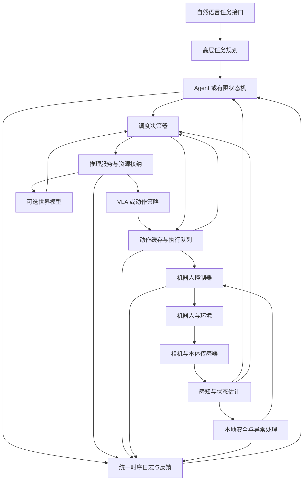
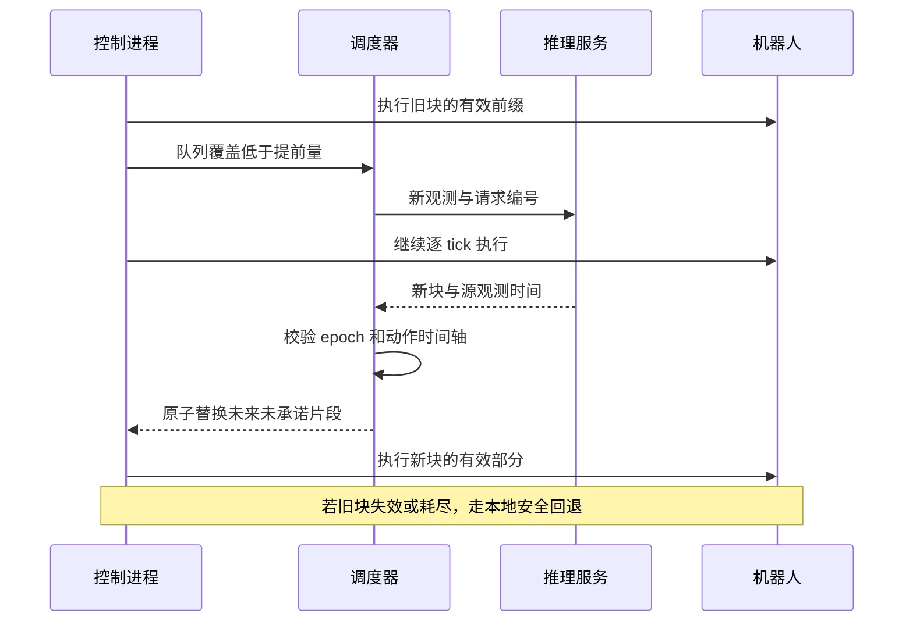

# 具身智能系统架构与协同调度：从 VLA、世界模型到 Agentic Robotics 的技术体系、研究进展与本科课题可行性

**证据截止：2026 年 11 月 5 日（北京时间）。对象：北京邮电大学机械工程（机器人试验班）本科阶段研究与后续博士衔接。**

本报告是独立开展的研究性范围综述与原型设计，不使用既往毕设文件。文中的实验方案尚未执行；“可实现”表示有代码与资源依据的工程判断，不表示已在 RTX 5070、SO-101 或 OpenFleX 上验证。引用按文末编号追溯；原始 PDF、提取文本、元数据及代码快照保存在 `sources/`。

## 1. 执行摘要：十条重要结论

1. **值得研究，但应把本科问题限定到一个可观测的闭环瓶颈。**推荐研究“冻结 SmolVLA 权重时，面向端到端延迟变化与动作有效期的请求提前量控制”，先复现官方异步，再检验是否存在收益。不能把部署模型、增加线程或添加队列本身作为算法创新。[5][10][16]
2. **Agent、VLA 和世界模型主要处在不同功能层次，可以组合。**Agent 管理目标、工具、任务进度与恢复；VLA 输出可执行动作；世界模型预测行动后果；WAM 将未来世界与动作联合建模。Hi Robot 和 Gemini Robotics 1.5 已有真实机器人集成，支持“组合路线可行”，并不支持“Agent 将取代 VLA”。[18][20][23]
3. **至少四种“调度”必须区分。**缓存、量化、算子融合属于模型计算；服务队列和 GPU 分配属于推理服务；动作拼接、过期丢弃和队列耗尽处理属于执行；子任务切换与重规划属于任务层。一个层面的加速不自动改善另一个层面的成功率。
4. **异步消除了等待，却没有消除信息陈旧。**旧观测生成的动作到达时，目标和机器人都可能移动。VLALagBench 的 lazy async 在其固定延迟模型下，与同步执行具有相同平均观测年龄；continuous async 降低年龄但增加调用频率。[16]
5. **“按队列阈值调用”和“适应延迟”已有明确先例。**SmolVLA 已有队列阈值、关节状态相似性过滤和空队列强制请求；RTC 已用历史延迟缓冲估计提前量；Reflex 也提出自适应重叠。因此本科主张应是特定延迟分布、预算与有效期约束下的实证增量，原创性仍需导师与进一步检索确认。[5][10][14]
6. **多频率架构需要解决训练分布失配。**ARP、Leap-VLA 让低频语义缓存与实时视觉动作专家解耦，并训练模型容忍陈旧语义。冻结原模型后简单缓存 VLM 输出，不等价于这些方法。[13][15]
7. **执行优化可以无需训练；恢复过时语义和未来视觉通常需要学习。**PTS 与 PACE 展示训练自由的执行层方法；FutureRTC 冻结基础策略但训练预测适配器。“基础模型不改”不等于“完全不训练”。[11][12][24]
8. **世界模型的预测必须偿还其成本。**V-JEPA 2-AC 有真实机器人规划证据，但所报告 RTX 4090 上的一个规划设置仍约 16 秒／动作；DreamZero 的低延迟依赖 H100／GB200 及模型、系统优化，不能移植成“12GB 显卡可实时运行”的结论。[21][23]
9. **成功率、速度、计算、安全存在条件性权衡。**不能用更少调用换取无法接受的失败，也不能用 CUDA kernel 时间声称闭环更快。应同时测端到端延迟、成功率、含失败的耗时、GPU 时间、动作年龄和约束违反。[16][17][26]
10. **长期价值在接口与可预测性，不在押注某种模型。**带时间戳和版本的模型接口、过时结果管理、执行预算、异常恢复与跨层日志可迁移到轮式双臂；具体 KV 缓存结构、flow guidance 与量化格式则更依赖模型架构。未来五年路线不能确定，但这些接口问题已有跨路线证据。

## 2. 研究对象、技术边界与检索方法

### 2.1 研究范围与证据标签

研究对象是一个机器人如何在有限计算与持续变化的物理世界中，协调感知、推理、任务决策和执行。机械结构、夹爪设计不属于主要研究变量。训练新通用基础模型也不适合当前资源和经验阶段。

全文采用三类命题标签：**【原文】**表示所引原始材料直接支持；**【推断】**表示基于多篇研究的分析；**【待验】**表示本报告提出、尚待实验的设计或假设。没有显式标签的原型参数、频率和实验数量均为设计建议，不是论文实测。

另用检索深度标签：**F**＝取得全文并针对方法、实验与局限进行重点阅读；**P**＝取得全文但仅完成相关段落核验，未作完整方法级评审；**A**＝仅核对权威元数据／摘要。F 不是“独立复现”，也不是论文质量评级。工业技术报告、作者预印本与独立同行评审状态分别记录，不能相互替代。

### 2.2 实际加载的 Scientific Agent Skills

实际安装根目录为 `C:/Users/Administrator/.codex/skills/`。下表的路径均在该根目录下；版本来自本次读取的 SKILL.md，不能推断为上游最新版。

|准确名称|版本|SKILL.md 相对路径|本次实际用途与执行状态|
|---|---|---|---|
|literature-review|1.11|literature-review/SKILL.md|按范围、检索、去重、提取、审查、综合、核引流程组织报告；读取 core_workflow|
|paper-lookup|2.4|paper-lookup/SKILL.md|读取 arxiv.md；调用公开 Atom API；实际运行随附 arxiv_atom.py 解析元数据|
|research-lookup|1.7|research-lookup/SKILL.md|读取说明并实际试调用脚本；因 CLI／凭据缺失失败，未声称成功检索|
|scientific-critical-thinking|1.5|scientific-critical-thinking/SKILL.md|核对实验单元、对照可比性、分母、训练依赖及外推边界|
|hypothesis-generation|2.4|hypothesis-generation/SKILL.md|区分观察、候选解释、反例与可证伪预测；生成主问题及竞争解释|
|experimental-design|1.5|experimental-design/SKILL.md|设计区组随机化、试验矩阵、独立重复与消融；实际调用 randomization.py 生成试点随机顺序；未安装 DOE 依赖|
|scientific-writing|2.3|scientific-writing/SKILL.md|以来源约束写作、明确缺失字段、审计引用与数字；未作投稿就绪声明|

这些 Skills 是程序性知识与本地脚本，不是七个自动替用户完成研究的外部服务。实际存在 Python 3.12.14、pypdf、NumPy 和 pandas；没有在全局安装软件。Parallel CLI、PARALLEL_API_KEY 和 OPENROUTER_API_KEY 均不可用；`research_lookup.py` 返回“No backend is available”。原生网页检索正常；命令行网络最初受沙箱限制，经获准后取得公开论文。一次 Python 子进程输出编码错误通过 `PYTHONUTF8=1` 重跑随附解析器解决，未把错误输出当作元数据。Skills 对应的软件论文亦经 arXiv 核验，见 [37]。

### 2.3 检索策略与边界

采用“经典种子＋术语检索＋前后向引用链＋官方代码”的范围综述。种子为 RT-1/2、ACT、Diffusion Policy、OpenVLA、SmolVLA、π 系列；调度词为 `action chunking`、`asynchronous inference`、`real-time chunking`、`inference latency`、`event-triggered`、`semantic staleness`、`GPU scheduling`；架构词为 `hierarchical VLA`、`agentic robotics`、`world action model`、`world model planning`。对 RTC、FutureRTC、PTS、ARP、Reflex、Leap-VLA、VLALagBench、VLA-HWBench 分别进行准确名称检索。

包含条件：直接研究机器人动作生成、模型分层、推理执行时序、动态延迟评测，或能具体迁移的 GPU 服务机制；优先原论文与官方代码。排除：只有公司宣传且没有可核验机制、同名不相关结果、重复转载、只在文献表出现而未核对的工作。搜索曾返回内容和身份错误的“SmolVLA”网站，未采纳；`LEAP-VLA: Latent-Enhanced Action Prototyping...` 与本报告的 `Leap-VLA: High-Rate Robot Control...` 是不同论文，不能合并。

主要来源为 arXiv 原始 PDF／API、NeurIPS 论文集、USENIX、作者论文页和 GitHub。未取得 IEEE Xplore、ACM DL、Google Scholar 全库的可复现导出，因此不声称数据库穷尽；未使用双审稿人独立筛选，也不虚构 PRISMA 流程数量。统计的是文末 **36 篇研究文献**，其中包含 1 篇背景综述与 2 篇通用服务系统工作；15 篇标 F 重点阅读。另列软件方法文献 [37] 与代码证据 [38]。PDF 可获得不等于全部正文都被深入审读。

## 3. Agent、VLA、WAM 与世界模型如何组合

**视觉—语言—动作模型（Vision-Language-Action model，VLA）**接收图像、指令和可能的本体状态，输出关节目标或末端动作。“把杯子放到盘子上”进入模型，输出的不只是文字步骤，而是机器人动作。其输出仍需控制器解释，不是直接产生电机安全保证。

**智能体式机器人（Agentic Robotics）**强调持续的目标管理、工具调用、记忆、进度判断与错误恢复。例如识别“收拾桌子但保留我的水杯”的约束，决定先清垃圾、检测完成，再调用动作策略。Agent 可以是大模型，也可以是有限状态机（Finite-State Machine，FSM）或混合系统；不是加一个聊天接口就成立。该术语尚有边界差异，综述 [31] 用模型、数据、环境与执行 harness 组织相关工作。

**世界模型（World Model）**近似状态转移：给定当前状态和候选动作，预测接下来的状态或视觉潜变量。它可用于训练、离线评测、在线规划、异常检测，四者的实时要求不同。预测图像看起来逼真，不证明接触动力学或动作后果准确。

**世界—动作模型（World-Action Model，WAM）**在所讨论论文中联合表示未来观测与动作；它不是一个定义完全统一的新物种。DreamZero 使用视频扩散基础；LingBot-VA 使用视频与动作双流及因果时序。[22][23] 与外置世界模型相比，WAM 可以把预测与动作的对齐学到同一模型内，但部署仍要处理观测反馈、缓存和延迟。

一个自然分解是：Agent 选择“取杯子”→VLA 产生动作候选→可选世界模型评估后果→调度器决定何时请求及接纳结果→控制器执行。另一分解是 Agent→WAM→控制器。还可以完全不用 Agent：固定任务直接由 SmolVLA 执行，由 FSM 管理失败。**【推断】这些是可组合职责，竞争发生在具体实现成本与泛化能力上，而非模块名称之间。**

## 4. 系统架构的主要技术路线

|路线|关键机制|实际证据|系统收益与代价|
|---|---|---|---|
|端到端 token VLA|把动作离散化，复用视觉语言主干|RT-2、OpenVLA [2][3]|统一训练接口；动作维数和自回归解码会影响延迟|
|VLM＋连续动作专家|语义特征条件化 flow／diffusion 动作头|π₀、SmolVLA [5][6]|连续动作与 chunk；多步采样增加执行时间|
|分层 VLM＋VLA|高层输出原子指令，低层负责运动|Hi Robot [18]|复杂指令与用户纠正；引入子任务完成判断和版本同步|
|Agent＋VLA＋工具|编排器、成功检测、工具和低层动作闭环|Gemini Robotics 1.5 [20]|长时程真实集成；闭源部分降低复现性|
|低频语义＋高频视觉动作|缓存语义，保留新鲜视觉和本体状态|ARP、Leap-VLA [13][15]|减少重编码；需要陈旧语义训练和一致性协议|
|世界模型＋规划|候选动作 rollout，优化目标能量|V-JEPA 2-AC [21]|可显式比较后果；候选数、规划深度和耗时相乘|
|联合视频—动作模型|联合预测，再用真实反馈修正历史|LingBot-VA、DreamZero [22][23]|利用视频先验；缓存、视频预测与动作频率需联合设计|

RT-1 侧重扩大真实机器人数据与多任务策略；RT-2 将网络视觉语言知识转入动作输出。[1][2] 这一演进解决的是能力和数据接口。ACT、Diffusion Policy 将动作序列作为预测对象，使推理与执行有了可重叠的时间窗口。[8][9] 后续 OFT 改变解码与微调配方，RTC 改变生成—执行衔接，ARP 改变模型进程之间的依赖。它们解决不同瓶颈，不能沿着“更新模型必然全面替代旧模型”的单线历史理解。

**【推断】系统协同的重要性已被多路线实测支持，但尚不能说领域的核心已彻底从模型转向调度。**如果策略根本不会抓取目标，调度不能补出技能；如果策略具备技能却因结果过晚到达而失效，时序设计可能比更大的模型更有效。应先通过无延迟／低延迟上限诊断区分两者。

## 5. 调度究竟调度什么

|层次|决策对象|典型控制量|不应混淆的结果|
|---|---|---|---|
|模型内部计算|token、层、采样步骤、缓存|量化位宽、去噪步数、KV 复用|更高 actions/s 不等于更低首动作延迟|
|推理服务|请求、模型实例、GPU 内存与执行顺序|接纳、优先级、截止期、批处理|服务吞吐提升可能增大单机器人尾延迟|
|机器人执行|动作时间轴、队列、chunk 交界|执行前缀、接纳窗口、衔接、失效处理|连续发送指令不等于动作基于新鲜观测|
|任务／Agent|技能、子目标、恢复与工具调用|重规划触发、任务切换、升级模型|更频繁思考不等于更好物理反应|

动作块（Action Chunk）是一次输出未来多个控制步。设预测长度为 H，实际执行前缀为 h，控制周期为 Δ，推理总延迟为 L。HΔ 是计划覆盖时间，hΔ 是两次重规划间的目标执行量。不同论文用 K、H、s 表示这些量，本文统一符号，比较时先还原定义。

例：机器人以 30Hz 执行 50 步动作，整块覆盖约 1.67 秒；一次往返 200ms，约消耗 6 个控制步。到队列剩余 2 步才请求显然太晚；剩余 20 步就请求可能及时，但相机看到的仍是半秒前尚未接触物体的状态。请求提前量、执行前缀与信息有效期共同决定行为，单一“队列越长越稳”判断不成立。

**观测新鲜度**用信息年龄（Age of Information，AoI）表示：执行动作时刻减去其依据的观测采集时刻。相机驱动缓冲也会增加年龄，不能只从发包算起。混合两块动作时应保留两个来源的观测年龄，或报告保守最大值，不能假装混合结果来自一张最新图像。

多频率还包括：传感器采样、状态估计、VLM 更新、动作专家推理、控制器发送、驱动器伺服。把“执行 50Hz”写成“VLA 每秒运行 50 次”，会夸大实际计算能力。高层重新规划也与低层重新推理不同：杯子略移动，通常仍执行同一抓取技能，只需刷新动作；用户改成“别碰这个杯子”，则必须更新任务版本并废弃旧动作。

## 6. 十五篇核心论文的方法级分析

以下重点段落结合文末准确作者、日期和链接使用。凡硬件／代码状态无法从已核读段落确认，明确留空或记“未核实”，不按惯例补齐。每项结果只在论文给定条件下解释。

### 6.1 OpenVLA-OFT：首先理解吞吐与延迟的差别 [4]

**问题与机制。【原文】**原 OpenVLA 的离散自回归动作生成效率较低。OFT 组合并行解码、chunk、连续动作与 L1 回归；这是需要微调的模型配方，不是给原权重装一个线程。团队为 Stanford University，延续 OpenVLA 开源路线。

**实验。**LIBERO 每套 10 任务、每任务 50 次；部分配方每套独立微调，训练使用 8 张 A100/H100、批量 64–128。计时用一张 A100，对固定图像与指令查询 100 次。Table II 中，原 OpenVLA 为 0.2396 秒／单动作、4.2 actions/s；并行解码＋chunk＋连续 L1 为 0.0729 秒／8 步、109.7 actions/s。加入腕部图像和本体状态后为 0.1120 秒／块、71.4 actions/s。完整输入配方的 LIBERO 平均成功率 97.1%，原配方 76.5%；成功率变化同时包含输入与训练改动，不能归因于单一调度机制。另有 ALOHA 双臂真机。

**限制与启示。**26 倍是动作生成吞吐比，不是机器人或闭环延迟加速 26 倍。官方当前 README 给出的推理显存约为 LIBERO 16GB、ALOHA 18GB，故 12GB 不宜作为默认全精度复现资源。代码由论文项目页链接，可开放复用；量化或远程 A100 需要独立闭环验证。最有价值的启示是先选择合适模型接口，再讨论调度。

### 6.2 SmolVLA：本科基线已包含系统设计 [5]

**机制。【原文】**Hugging Face 等机构使用 SmolVLM2 和 flow 动作专家；论文主模型约 450M 参数，约 100M 为动作专家。训练动作专家，冻结 VLM。社区预训练汇集 481 数据集、约 22.9K episodes、10.6M frames。正文表格附近曾出现 frames／episodes 单位不一致，本文采用统计表而非重复其错误表述。

**异步算法。**客户端在队列剩余比例低于 g 时发送观测；服务端比较关节状态相似性，过滤近重复观测；队列空时 `must_go` 绕过过滤。新旧块在重叠时刻聚合。论文以平均延迟估计足够阈值，但均值条件不能保证随机尾延迟下永不耗尽。

**实验。**LIBERO、Meta-World 和 SO-100/SO-101，比较 ACT、π₀；flow 推理默认 10 步、chunk 为 50。Fig.5 的 Pick-Place 时间实验：10 次试验、5 个方块位置，均时同步 13.75 秒、异步 9.70 秒；固定时间实验总完成数 9 对 19，不能混写为同一统计量。部分真机“success”采用阶段得分，不等于整任务二元成功。关键异步计时对应 GPU 型号未在所核段落可靠定位，不套用其他论文硬件。

**启示。**有公开代码、权重与社区数据，且低成本平台已验证。其性能不保证你自己的相机、物体和校准条件可零样本工作。需要准备固定权重的适配模型；必要时只做一次任务微调，随后所有调度方法共享该权重。[38] 的固定代码版本已验证其阈值和过滤机制，不能把它们再命名为新算法。

### 6.3 RTC：用生成机制保证跨块相容 [10]

**机制。【原文】**Physical Intelligence／UC Berkeley 将异步衔接表述为 inpainting：新块前部是计算结束前已承诺执行的动作，应固定或强约束；重叠尾部用逐渐减弱的 soft mask 保持策略连续，未覆盖区域自由生成。guided inference 包含向量—雅可比乘积；估计延迟使用历史缓冲，非仅固定常数。无需重训练，适用于 diffusion／flow 策略，不能直接用于任意离散 token VLA。

**实验。**NeurIPS 2025 论文；Kinetix 12 动态任务，H=8，注入 0–4 步延迟，每数据点 2048 rollouts；真机 6 个双臂任务，π₀.₅、H=50、Δ=20ms、5 去噪步。真机模型延迟基线 76ms、RTC 97ms，局域网另加 10–20ms。不能忽略 guidance 开销而称“无成本异步”。推理 GPU 型号未在本次相关计时段落明确定位。

**局限。**适用模型受限，且接触变化或外部目标运动仍可能使旧前缀失效。历史延迟预测失准会破坏时间对齐。其代码可从官方研究／openpi 路线寻找；本次未对其完整运行环境执行复现。对本科而言，RTC 是强相关对照，不宜承诺在 12GB 上完整重现所有真机任务。

### 6.4 FutureRTC：不是纯调度，而是预测上下文适配 [11]

**机制。【原文】**四川大学、电子科技大学、University of Alberta 团队训练状态修正模块 SCM 与视觉潜变量预测模块 OPM。利用已承诺动作推出未来状态，通过运动引导特征传输和残差合成预测执行时视觉；再用 policy consistency loss 对齐冻结策略在真实／预测上下文下的动作。预测对应执行时刻，因此新块从第一个动作执行，不再机械地丢前 d 步。

**实验。**SmolVLA-450M、π₀.₅，LIBERO、Kinetix 与真机；适配器在 RTX 4090 上训练，正文给出 200K iterations、batch=128，并随机采样训练延迟。Table 4：SmolVLA 基础 450M、35.4ms，新增约 5.19M、3.04ms；π₀.₅ 新增约 6.45M、3.64ms。这是适配器增量而非整个系统往返。LIBERO Table 3 在 d=20 的指定对齐协议下，SmolVLA 预测上下文直接执行为 69.4%，不能与另文 82% 或 95% 无条件排名。

**限制。**“不修改基础策略”仍需训练；运动主导视觉预测对独立运动的人或物体可能失准，作者也指出这一点。训练和推理时延分布需覆盖部署范围。项目页链接代码，但本次未运行代码。可作为将来做轻量未来状态估计的上界参考，本科第一阶段不必实现。

### 6.5 PTS：动作路径与执行时间分离 [12]

**机制。【原文】**Fuyi Chen（University of Nottingham Ningbo China）提出 Path-preserving Time Scaling。路径层采用确定性一步解码，按推理期间已经消费的“计划进度”进入新块；时间层累加相对动作增量，夹爪运动时回到 1 倍速，并依据执行器线性区及延迟可行性限制速率。无需更新权重，但需要执行器辨识与开发集选速率。

**实验。**2026-11-01 预印本。π₀.₅ 四个 LIBERO suite，SmolVLA 仅 Object/Goal；H=50、重规划间隔 s=8、20Hz，通过测得时延转换为注入控制步。每单元 100 episodes、相同初态／种子，任务分层配对 bootstrap。Table 1 中 π₀.₅ PTS 成功率 0.950，与 Async-1× 相同；吞吐每 1000 控制步 7.96 对 5.99，约增 33%。SmolVLA 6.94 对最强可部署基线 Sync-2× 的 3.40，约增 104%。这里不是“相对官方异步全部提升 104%”，也不是 GPU 吞吐。

**限制。**收益叠加了一步解码与速度调整，必须分解消融；条件均值动作可能落在多模态之间，存在精度损失。动作单位必须是适用的相对增量；不能把关节绝对目标直接相加。动力学／夹爪辨识无法直接迁移 SO-101。代码公开状态未从所核正文确认，未编造仓库。

### 6.6 ARP：把模型依赖改成进程级异步 [13]

**机制。【原文】**INSAIT／Sofia University 团队让慢 VLM 产生固定宽度语义 memory，快 Vision-Action Expert 处理当前视觉、本体状态与陈旧 memory。显式输入 memory 年龄与动作专家延迟；训练时配对同一轨迹内不同时刻的语义与新视觉，再加入 action-prefix conditioning。不是把 π₀ 原样拆开就能获得同样性能。

**实验。**2026-11-03 预印本；LIBERO 40 任务、2000 演示、每套 500 episodes；使用固定视觉编码器控制模型规模对照。Table 1 中 ARP-8B 89.3%，同文重建 π₀-8B 为 82.7%，而原 π₀ 引用行 94.2%，说明对照来源与训练条件必须区分。DROID 路线使用 PaliGemma 与 DINOv3，并部署 Franka 三任务；RoboLab 均时 20.9 对 16.8 秒。摘要“18% higher”不应脱离任务与计分直接改写为整个领域提升 18 个百分点。Dynamic-Bump 指定 p=1 时 ARP-1B 44.7%、π₀-1B 12.7%，是特定动态模拟结果。

**启示与限制。**已说明规模、频率、陈旧条件协同的重要性；不能将论文快回路不依赖 VLM 参数量，解释成共享 GPU 时完全无干扰。计算资源竞争仍在。项目页给出代码／checkpoint 入口，完整训练成本及 A100 40GB 可行配方本次未复现，故本科先不训练 ARP。

### 6.7 Reflex：缓存正确性与论文数值可信度都要审查 [14]

**机制。【原文】**北京邮电大学计算机学院团队提出 static prefix、sliding history、dynamic suffix 分区；仅在 perception encoder 不依赖 denoising timestep 等前提下，复用对应缓存。另有 AdaRMSNorm、视觉／动作异步流、未来本体状态推算与算子融合。固定输入下 attention 等价不意味着异步轨迹、混合精度与未来预测也严格等价；O(1) 增量更新也不是整个模型恒定零成本。

**实验与审查。**正文／附录给出 RTX 4090 24GB、LIBERO 与 Kinetix，并报告 PiPer 真机部署；计时先预热 100 次，再采样 1000 块。Table 1 的 π₀.₅ LIBERO 平均 reaction latency 为同步 156.5ms、Async-Naive 122.0ms、Reflex 82.5ms。这是作者报告、未独立复现。Table 2 写“每任务每方法 20 episodes”，却给出 76%、66% 等不能由单批 20 次二元试验直接得到的百分比，并附标准差；可能存在多种子均值等未解释汇总，本次无法消解，**不将该真机成功率作强结论**。论文称 p95 用于实时评估，但 p95 不能证明最坏执行时间或硬实时保证。

**状态与训练边界。**arXiv 作者 comment 声称 ICML2026 接收，本次未取得会议正式录用记录，保守按预印本使用。公开仓库在正文列出。缓存、环形缓冲与算子融合本身不需训练；未来状态模块与归一化改动能否直接套用你已有权重，尚未核实，不归为任意模型完全训练自由。其自适应 overlap 也使“动态提前请求”不能被轻率宣称首创。

### 6.8 Leap-VLA：低频语义有效不等于任意复用旧图像 [15]

**机制。【原文】**Leapmotor 的 Embodied Algorithm Group 使用低频 Qwen2.5-VL-2B 语义 anchor 与约 23M 快视觉编码器；快 stream 用机器人视频的重建、光流和深度目标预训练。memory age 经 AdaRMS 条件化动作专家，陈旧历史与随年龄增加的像素扰动参与训练。本体状态进入快回路，不放在长期缓存文本里。

**实验。**2026-10-31 预印本。LIBERO-Spatial 2 秒语义刷新时，未充分处理陈旧性的设置 61.4%，配方后 95.5%；四套平均 1 秒刷新为 95.2%、2 秒为 94.5%，matched anchor 96.3%。比较必须保留其训练和部署设置；不能推出任意模型语义都是 1Hz。方法 III-B 明确说事件触发刷新在设计上支持，**报告的部署实验只使用周期刷新和 reset**。因此它不能作为事件触发收益已验证的证据。

**限制。**涉及专门训练、快视觉编码器及多项机制，不适合直接重写为“冻结模型＋缓存”的廉价配方。frame difference、gripper event、subtask change 的触发组合仍需独立实证。代码可用性与具体训练 GPU 在本次所核信息中未完全确认。

### 6.9 VLALagBench：直接回答“什么时候延迟重要” [16]

**机制与实验。【原文】**NUS、NTU、Stanford、NVIDIA 联合研究动态释放、放置、抓取、关节物体操作；在 LIBERO 基础上让物体运动，显式推进延迟期间的物理世界。三种策略 π₀.₅、GR00T N1.7、MolmoAct2，20Hz、执行 5 步、预测 10 或 16 步，延迟 0–250ms，每单元 200 rollouts；另有 Isaac Sim 与 SO-101 验证。

0.1m/s 目标的 set-down 在同步模式 0→100ms 时由 71.5% 降到 40.5%；grasping 同条件由 86.5% 到 74.0%。因此“100ms 让成功率减半”不是跨任务定律。同步和 lazy async 的平均年龄均为 `(h−1)/2 + d` 个控制步；continuous async 为 `(3d−1)/2`，但请求更密。附录真机 MolmoAct2 测得中位推理 209ms，SO-101 30Hz，设置 267／367／467ms 总生效延迟；每设置仅 5 rollouts，提供方向性实机证据，不支持精确概率外推。

**局限。**经验成功率模型校准依赖任务、速度与策略；不等于控制稳定性证明。代码在作者 comment 中为“will be released”，不能写成已复现代码开放。对本科最直接的启示是必须同时放入静态和动态任务，并让仿真在推理时继续走时钟。

### 6.10 VLA-HWBench：模型尺寸不能代替实测 [17]

**机制。【原文】**NUS／0G Labs 对 18 个开放模型、19 个配置拆分 CPU 预处理、H2D、视觉编码、LM prefill、动作生成、后处理和 residual。在 Jetson AGX Thor 与 AMD Ryzen AI Max+ PRO 395 上比较参考实现，再对支持的模型研究 compile、FlashRT、量化等。

**实验。**统一 LIBERO-10 两张 256×256 图像、状态与指令；20 次预热、20–100 次设备同步计时，报告 p50，另测一个 episode 的 24 帧。动作生成在 Jetson 14/19 配置中是最大阶段；参数量对时延方差解释至多 15%。GR00T 优化后 CPU 预处理占比从 12% 增到 39%，是占比变化，不表示 CPU 绝对耗时增加到三倍。FlashRT 的 2.6–2.9 倍针对 π₀.₅／GR00T 的指定后端比较，只在该 NVIDIA 平台成立。

**限制与启示。**这是推理 profiling，不是同条件真实闭环成功率排行榜。编译／低精度还可能改变动作，附录讨论夹爪命令变化。不能按参数量推算 RTX 5070 与 A100 的延迟，也不能从边缘硬件论文移植 CUDA／PyTorch 版本。应在自己的 camera preprocessing 与 action postprocessing 上测全链路。

### 6.11 Hi Robot：高层重规划有具体实现 [18]

**机制。【原文】**Physical Intelligence 等作者团队以高层 VLM 解释复杂指令、输出原子语言命令，π₀ 低层执行；用机器人图像和已有动作标签合成高层指令／用户插话训练数据。实际高层调用策略是每 1 秒或收到用户新交互时运行，不是已实现一个最优事件触发器。

**实验。**ICML 2025；单臂、双臂和移动双臂，整理桌面、做三明治、购物；比较 flat VLA、GPT-4o 高层、人工高层 oracle，并评估 task progress 与 instruction accuracy。Fig.5 的图形结果支持层次与合成数据的价值，本文不从模糊图形反读精确均值。GPU 型号与整个高层训练配方没有完整复核；不能据此估算你的微调时长。完整可运行系统公开状态未确认。

**启示。**明确验证 Agent＋VLA 可用，支持低频语义与高频动作分离。低层失败与高层指令错误必须分开记录。若本科只有两个子任务，FSM 是更易验证的最小替代，不需要先复刻其高层训练。

### 6.12 Gemini Robotics 1.5：编排器与成功检测是独立瓶颈 [20]

**机制。【原文】**Google DeepMind 组合 Robotics-ER 1.5 与 GR 1.5 VLA，支持工具、记忆、任务规划与错误恢复；模型还研究多 embodiment motion transfer 及 thinking。不能把这三种贡献全部归于 Agent 调度。

**实验。**技术报告第 5 节比较 Thinking VLA、Gemini 2.5 Flash＋GR1.5、ER1.5＋GR1.5；ALOHA 和 bi-arm Franka 八个长任务。Table 1 对子任务失败分类：两种 Agent 的规划失败分别 25.5%／9%，成功检测失败 6%／4%，动作失败 13%／9%；总子任务失败 44.5%／22%。分母是论文长任务中的分类统计，不是所有机器人任务失败率。成功检测另有 5Hz、模拟推理延迟的离线 rollout 评测，作者明确讨论陈旧判断。

**限制。**参数、训练数据与 GPU 完整细节未全部开放；演示／技术报告不能等同可重复的开源基准。对本科最有用的是 failure taxonomy：错计划、误判完成、动作失败分别设置日志，而非调用更强模型后只看最终成功率。

### 6.13 V-JEPA 2-AC：世界模型在线规划不是免费功能 [21]

**机制。【原文】**FAIR at Meta 等团队先做自监督视频表示学习，再用约 62 小时 DROID 交互视频训练 action-conditioned predictor；“unlabeled”指没有任务／奖励标签，不是没有动作。冻结视频 encoder，在潜空间预测后果，以目标图像特征差为能量，交叉熵方法（Cross-Entropy Method，CEM）优化候选动作并滚动执行。

**实验。**两实验室 Franka＋RobotiQ，reach、grasp、pick-and-place，每设置 10 trials；比较目标图像条件 Octo 和 Cosmos。第 4.2 节 RTX 4090 对照：Cosmos 使用 80 samples、10 refinements、horizon=1，约 4 分钟／动作；V-JEPA 2-AC 在每轮候选更多的设置约 16 秒／动作。此处是特定采样规划配置，不是模型 forward 固有 16 秒，也不是可直接 30Hz 控制。

**局限。**相机位置敏感、目标表示与动作坐标对齐仍有限；低精度到达不能代表复杂接触稳定性。开放模型与代码可研究；本科若无必要，不应把完整 CEM 规划插入快速控制闭环。可先把世界模型用于离线动作后果分析，再决定在线调用是否值得。

### 6.14 LingBot-VA：WAM 仍需要闭环调度 [22]

**机制。【原文】**官方 Robbyant 路线使用 Wan2.2-5B 视频 stream 与约 350M 动作 stream，MoT 联合注意力；自回归历史、KV cache、变量 chunk 训练、部分去噪和异步执行。预测视频与动作后用真实观测重新落地，避免纯想象递归漂移。

**实验。**总模型约 5.3B，约 16K 小时机器人数据，RoboTwin2.0、LIBERO 与六个真机操作任务；RoboTwin 50Hz 动作而视频降到 12.5Hz。Table 1 同协议 50 任务的 Easy／Hard 平均为 92.93%／91.55%，对比包含 π 系列、Motus；不是延迟注入对照，也不能分离异步单项效果。基础训练 GPU 和本报告机器上的实时性尚未验证；代码、checkpoint 由正文给出。

**限制。**作者把因果注意力与物理因果相联系，不能进一步解释为模型已识别严格因果效应或保证安全。长期 cache、感知频率和校准变化仍有系统成本。可复用启示是让视频与动作时钟分开，并显式修正预测历史；不建议本科承担整模型训练。

### 6.15 DreamZero：视频—动作协同必须看计算账本 [23]

**机制。【原文】**NVIDIA 团队的 14B 视频扩散 WAM 联合建模视频和动作；模型／系统优化包含 CFG 并行、DiT cache、compile、CUDA graphs、kernel 优化和量化，Flash 版本进一步改变噪声调度／训练。真实反馈回灌 KV 历史。

**实验。**AgiBot G1 移动双臂与 Franka，主数据约 500 小时、22 环境；对照 GR00T N1.6、π₀.₅，区分从 VLM 初始化和已有机器人预训练权重。AgiBot seen/unseen 各 10 任务、每任务 8 rollouts；DROID seen/unseen 共 40 任务、每任务 2 rollouts，部分指标为 progress。Table 1 的系统优化相对基线累计速度 H100 约 9.6 倍、GB200 约 16.6 倍；Flash 后 GB200 约 38 倍，延迟约从 5.7 秒到 150ms。不同硬件、量化及模型版本共同参与，不能归因成“调度算法提升 38 倍”。

**限制。**不是本科现有 12GB 或一张 A100 40GB 可直接等价复现的资源设置；零样本泛化不等于任意任务、机器人和精度通用。代码／权重开放是可复用入口，训练成本和部署要求仍很高。它支持世界预测与动作联合学习的路线价值，也表明 WAM 并未消除推理优化与调度问题。

## 7. 其他近期进展与证据之间的联系

**执行长度也可自适应。**PACE [24] 从预测动作的速度曲线寻找明显低谷，选择下一次重规划边界；默认用已有演示校准阈值，不改策略权重。RoboTwin2.0 的 50 任务上，最强全局固定执行长度平均成功率 57.8%，PACE 64.2%；所有方法共享各任务权重。它还比较匹配平均执行长度的固定基线，避免把收益完全解释为“平均更短”。但速度低谷只是阶段线索，不能保证代表所有接触事件；它优化何时停止执行前缀，不自动解决共享 GPU、网络长尾或动作过时。其 arXiv comment 声称 NeurIPS 2026 接收，本报告未独立核对正式论文集，保留作者声明状态。

**训练时适应异步已有多条路线。**VLASH [34] 用旧动作推出执行时本体状态，训练未来状态条件策略；FutureRTC 进一步处理视觉潜变量。Soft RTC [25] 在已承诺前缀之外，以部分去噪 action prior 约束仍可编辑的 overlap。12 个 Kinetix 大型关卡的指定设置，短 soft window solve rate 0.809、hard TT-RTC 0.815，而中窗口降低动作差分／jerk；这支持“平滑性和成功率可能不同步”，不能把差分更小直接称为更安全。

**独立比较比作者间排行榜更有用。**Understanding Asynchronous Inference Methods [35] 统一 Kinetix 和 SmolVLA-LIBERO 实现，比较 IT-RTC、TT-RTC、VLASH、A2C2，并发现排名随延迟、chunk 长度和训练延迟范围变化。本次只核读摘要、问题定义与统一协议部分，未复核全部曲线，因此不把其“最好方法”当作普遍推荐。其开源实现可作为后续复现入口，并提醒本科实验要选择相同模型与版本。

**计算预算也可以学习。**ELASTIC [36] 把顺序去噪步数与并行候选数配置成 meta-MDP，通过强化学习训练元策略，在冻结底层策略上分配计算。这明确否定“状态驱动计算预算完全没人研究”。它与本科请求时间控制的区别是：前者改变每次推理内部的计算量，后者先固定推理配方，控制请求何时启动与结果何时失效；两者未来可以组合。本次对其只做部分正文核验，不据摘要倍数推荐直接重训元策略。

**安全呈跨层相互作用。**When Delay Meets Drift [26] 在同一 π₀.₅-LIBERO 实验中联合改变推理延迟与相机视角；作者明确限定为一个策略、一个 suite、模拟延迟，不能外推成所有真机失效率。价值在实验设计：延迟和视觉分布变化应有交互项，而不是分别测完就相加。

**Agent 的反馈思想并非 2026 年才出现。**SayCan 把语言概率与机器人技能可供性结合；Inner Monologue 将执行成功／环境反馈回送规划；Code as Policies 通过程序和工具 API 组织行为。[27][28][29] 最近的变化是低层通用策略、感知和推理能力提升，使这类组合覆盖更复杂任务。世界模型也不限于在线控制：Veo 机器人模拟器评测 [30] 研究离线评测、OOD 与安全探测，不能与实时 world-model planning 混为一谈。

## 8. 现有调度方法的技术分类与比较

### 8.1 固定周期：先建立可信基线

**直观解释。**每经过 h 个动作重新观察一次，像按固定拍子看路。具体算法是周期定时器请求推理，或执行 h 步后阻塞等待。二者分别是周期异步和 stop-and-wait，不应都叫“同步”。

固定周期 T、每次服务需求 C，单模型平均计算负载约为 C/T。同步一个循环需要 `hΔ+L`，动作占空比约 `hΔ/(hΔ+L)`；适用稳态、延迟较稳定且允许安全等待的任务。已有 ACT、Diffusion Policy 和大量 VLA 评测使用固定预测／执行长度。[8][9] 例如静态方块搬运中，机器人停一下未必损失成功，但耗时增加；接球停一下则可能必败。局限是无法利用阶段变化，也不能针对突发长尾作响应。本科可实现性最高，必须保留调优后的固定基线，不能只选最差周期。

### 8.2 异步流水线：把等待与执行重叠

**具体算法。**观测→后台推理→带时间索引的 chunk；主循环继续消费旧队列。队列剩余可覆盖时间低于提前量时请求；返回后丢弃已过执行时刻的部分，按明确衔接规则替换未来片段。RTC 不是简单线性平均，而是生成时条件化已承诺动作；SmolVLA 官方采用队列聚合。[5][10]

记队列剩余有效时间 B，端到端随机延迟 L，合并与定时抖动余量 J，则一次请求及时完成需要 `B ≥ L+J`。若新块以观测时刻对齐，接收时先消耗 d 个预测步，要继续执行 h 步，则至少 `H ≥ d+h`；这是覆盖条件，不是动作正确条件。发生“杯子被移走”时，长队列虽不断粮，却继续抓旧位置。动作过期应同时考虑索引与场景有效期。

**适用条件与局限。**必须有安全可继续执行的旧动作、统一动作时间轴和可检测的异常；推理速度长期低于队列消费所需更新率时，单纯增加提前量最终无效。两线程也不等于两块独立 GPU：同卡竞争可能让每个推理变慢。结果乱序用 request_id、观测序列、plan_epoch 判别，不能仅“最后收到的就是最新”。

### 8.3 事件触发：在信息失效时支付计算

**具体算法。**监控器计算场景变化 e_v、本体跟踪误差 e_q、目标相对位移 e_o 与阶段 p；满足阈值或超过最大等待时间就请求。引入上下双阈值、持续帧数与最短触发间隔，抑制振荡。接近夹爪接触时缩短允许观测年龄，平稳搬运时允许更久复用。

可定义

\[
z_t=\max(e_v/\theta_v,e_q/\theta_q,e_o/\theta_o),\quad
u_t=\mathbf1[z_t>1\text{ 持续 }k\text{ 帧，或 }A_t>A_{\max}(p)].
\]

其中 e_v 等必须经过单位归一化，不能随意将像素、角度、米相加。阈值在开发集确定，并报告误触发、漏触发和检测开销。误触发会挤占 GPU；漏触发会执行过时动作。相机抖动会制造全图变化，因此最好结合目标区域、机械臂遮挡与本体状态。

**已有证据。**SmolVLA 的关节相似性过滤、Hi Robot 的用户交互触发、PACE 的动作阶段边界都已覆盖部分触发思想；Leap-VLA 的视觉事件刷新尚未在其报告实验中启用。[5][15][18][24] 因而研究空间是具体信号、误检成本与任务有效期约束的结合，不能宣称“事件触发本身新”。机器人案例是抓取前目标被手移动：关节状态没变也必须重新看；在静态托盘上稳定搬运则可少调用。该机制为软实时优化；安全事件必须由独立本地保护直接处理，不能等待监控器调用大模型。

### 8.4 资源感知协同：先接纳，再分配有限 GPU

考虑多个作业 j，计算需求预测 C_j、截止期 D_j、到达时刻 r_j、收益 V_j、显存 M_j。最简单可实施算法是：动作相关请求优先；已承诺动作可覆盖时允许高层推理；批量世界预测与解释任务低优先级；过时请求在尚未执行前合并为最新一条。EDF（Earliest Deadline First，最早截止期优先）按 D_j 排序，不是按请求到达先后。

**不能照搬 EDF 定理。**单核、可抢占、确定执行时间任务的利用率结论，不直接适用于多 stream、非抢占长 kernel、共享显存和可变 shape 的 GPU。若当前不可抢占作业还要运行 R_block，则紧急作业即使最高优先级，也需要满足 `R_block+C_j+J ≤ D_j−t`。CUDA stream 优先级不保证立刻中断正在执行的任意 kernel。

Clockwork [32] 用可预测执行、显存与请求接纳组织服务；Paella [33] 向更低层控制 kernel 调度，说明高级请求队列无法解决全部干扰。但它们不是机器人闭环验证，移植收益是【推断】。本科先使用单 GPU worker、至多一条待执行动作请求、后台模型接纳限制；不把自定义 GPU kernel scheduler 纳入最低目标。

在多模型案例中，世界模型一次 300ms 预测可能阻挡 100ms 截止的动作请求；若没有可抢占机制，应延后／缩小预测，而不是希望 Python 线程优先级能救场。选择轻量／强模型还必须考虑加载、KV 缓存、权重迁移及结果兼容成本。12GB 下频繁换入换出可能比固定小模型更差，应该先做测量。

## 9. 数学建模与可实现的调度算法

### 9.1 首先统一时钟与延迟定义

每次请求记录相机采集 `t_cap`、发送 `t_send`、服务接收 `t_recv`、开始 `t_start`、GPU 完成 `t_gpu_end`、结果就绪 `t_ready`、客户端接收 `t_arrive`、首次实际发出动作 `t_cmd`。反馈确认运动还需 `t_feedback`。

\[
L_{\mathrm{model}}=t_{gpu\_end}-t_{start},\quad
L_{\mathrm{system}}=t_{arrive}-t_{cap},\quad
A(a)=t_{cmd}-t_{cap}(a).
\]

第一项若含 CPU 调度，应进一步拆分；CUDA Event 只测设备时间，不包括相机、排队、传输和动作发送。物理轨迹完成时间是另一指标。跨主机 monotonic clock 不能直接相减；先在单机闭环做完整往返，再用 PTP／NTP 与偏差估计报告跨机分解不确定度。动作序号提供逻辑顺序，不能替代物理时间测量。

### 9.2 基于分位数的请求提前量：候选方法而非已证明创新

设每 tick 消耗一个动作，Q_t 为**连续且有效**的未来动作步数，不能把时间轴有洞的元素总数当覆盖长度。用最近 W 个完整往返样本估计高分位延迟 `q̂_(1−ε)`，提前量为

\[
\ell_t=\left\lceil\frac{\widehat q_{1-\varepsilon}(L\mid c_t)+J_t}{\Delta}\right\rceil,
\qquad \text{request if }Q_t\le\ell_t.
\]

c_t 可包含本地／远程、GPU 是否有后台负载等可观测上下文；本科先不训练复杂预测器。ε 是允许迟到的设计目标；样本依赖、分布变化和小 W 会让经验分位数失准，因此这不是概率保证。需报告实测覆盖率 `P(L ≤ 预测分位数)` 和分布突变后的适应时间。与固定最优 g、均值＋余量、RTC 式历史保守值比较，才能判断分位数是否有价值。

必须同时约束 `ell_t < H−h_min`。若预测延迟超过模型可覆盖窗口，应进入资源不足状态，降低非关键负载或安全暂停，不可无限增加队列。过早请求还会使视觉变旧；目标不是最小空队列率，而是满足成功与安全约束下减少等待／计算。

### 9.3 事件与有效期结合

为每块定义 `valid_until`、`scene_epoch` 和 `task_epoch`。普通时间年龄大于 A_max 触发刷新；明显场景改变先使旧块失效，再等待新块。A_max 不能凭空设为通用 200ms，应由目标速度、允许误差与跟踪能力校准。粗略运动学上 `A_max ≤ e_allow/v_target`，只在匀速、无预测补偿且其他误差已留余量时有意义；接触、遮挡和非匀速需更保守。

对 Agent 的重规划，建议依据子任务完成、有限次执行失败、用户约束更新、场景使目标不可达等触发。低层误差超阈值先做局部停／恢复，再决定任务重规划。每次完成判定要求连续 k 帧、状态条件与超时上限；否则杯子短暂经过盘子上方可能被误判“放置完成”。

### 9.4 优化问题与理论工具的适用范围

多目标可以写为

\[
\min_\pi\ \mathbb E[T+\lambda_G G+\lambda_N N+\lambda_A\sum_t A_t\Delta],
\quad P(\mathrm{success})\ge p_0,\quad P(\mathrm{violation})\le\delta.
\]

T 为 episode 总耗时，G 为 GPU 忙碌秒，N 为请求数；权重带单位，必须公开。实践中优先画 Pareto 曲线，不靠任意加权总分隐藏成功率下降。安全限制与成功约束应单独展示；本科小样本不能证明极低风险概率。

MPC（Model Predictive Control，模型预测控制）用于每次只执行短前缀、观察后再规划；如果把调度也作为 MPC，需要能预测队列与延迟、给出短期代价。它不必使用大型视频模型，简单队列动力学就能做调度预测。MDP（Markov Decision Process，马尔可夫决策过程）可将状态设为队列、年龄、任务阶段和资源负载，动作是“请求／等待／升级”；但现实部分可观测、成功奖励稀疏，训练元策略容易比问题本身更难。ELASTIC [36] 已有具体 meta-MDP 先例。本科应先做反馈阈值，再考虑学习策略。

PTS [12] 的特定恒速路径消费模型给出 `2rd+s ≤ H`：r 为每控制步消耗的计划进度，d 为推理控制步，s 为重规划进度间隔。这个式子针对其“新块到达后还要维持到后继块”的协议，不能作为所有异步队列的通用条件。

### 9.5 核心伪代码

```text
控制进程，每 Δ 秒（不等待网络、GPU 或日志写盘）：
    读取最新有效反馈，更新时间轴和本地保护
    若硬件急停/限位/严重跟踪异常：触发本地安全动作；推进 epoch
    取截至本 tick 已接收的结果快照
    对每个结果：
        拒绝 task_epoch/scene_epoch/权重版本不匹配的结果
        按目标执行 tick 丢弃已过时动作；拒绝 NaN、越界和失效块
        原子更新尚未承诺的未来动作；保持已承诺前缀
    若场景突变使当前块无效：暂停或进入受限恢复；增加 scene_epoch
    若有可执行且有效的动作：限速后发送；否则执行平台专用安全回退
    B = 连续有效覆盖步数 × Δ
    若无有效在途请求，且（B ≤ 提前量 或事件触发）：
        快照最新观测，交给非阻塞发送队列；设置请求有效期
    以非阻塞方式写入内存日志环形缓冲；结束 tick

服务进程：
    待处理观测只保留最新有效一条；检查接纳截止期
    空闲时推理；超期/取消令牌不匹配的结果不进入执行队列
    返回 request_id、源观测时间、epoch、动作语义与预测时间轴
```

“取消”通常只能取消接纳和结果使用，未必能终止已提交 CUDA 计算。单线程 worker 下超时后立刻无限重发会制造排队灾难；应先保持至多一个未完成 GPU 作业，用最新观测覆盖尚未开始的待处理请求。

## 10. 完整系统架构、频率与执行时序



图中安全到控制器是独立通道。世界模型虚拟分支在本科最低原型里关闭，避免它与策略同时抢显存。日志反馈供诊断与任务恢复，不能让同步写盘阻塞主回路。

下表是**拟议原型的频率预算**，非 OpenFleX 官方规格，也非所有平台的硬实时保证。

|模块|输入→输出|频率／位置|通信与主要延迟|主要失效与实时等级|
|---|---|---|---|---|
|语言接口|文本→任务对象|事件／主机 CPU|本地消息，语音可异步转写|歧义；尽力而为|
|高层规划|目标、场景→子目标|事件或低频／CPU、可选远端|带 task_epoch 的命令|幻觉、过迟；尽力而为|
|FSM／Agent|子目标、进度→技能状态|10–30Hz 轻量 tick＋事件／CPU|状态快照|误判完成；软实时|
|感知估计|图像、编码器→带时间戳状态|相机约 30Hz、本体以实测为准／CPU|最新值缓冲，时间同步|相机旧帧、丢包；软实时|
|可选世界模型|状态、动作→未来后果|按需／GPU 或离线|异步作业，预算约束|预测偏差、挤占资源；尽力而为|
|VLA 策略|图像、状态、技能→chunk|按调度请求／GPU|推理服务，非确定耗时|迟到、错误动作；软截止期|
|调度器|覆盖、年龄、负载→请求／接纳|控制 tick／本地 CPU|非阻塞 IPC、原子快照|误估尾延迟；软实时|
|推理服务|请求→带来源结果|异步／GPU 主机|序列化、排队、预后处理|拥塞、OOM；软截止期|
|动作队列|chunk→当前目标动作|30Hz 起步／控制 CPU|有界缓存、锁粒度短|乱序、耗尽、过期；软实时|
|机器人控制器|受限目标→驱动命令|上位发送约 30Hz；底层伺服由厂商确定|串口／CAN／EtherCAT 等实际接口|抖动、追踪误差；底层可能硬实时|
|本地安全|反馈、急停→停／限速|独立硬件与驱动路径|不依赖 LLM 和网络|检测盲区；硬实时能力待平台核实|
|时序记录|事件→可重建 trace|异步批写／CPU 磁盘|环形缓冲、后台 writer|丢日志；尽力而为|

硬实时指所有相关条件下必须满足可证明截止期；软实时允许有限错过但要评估后果；尽力而为不承诺截止期。通用 Python、Windows、USB 摄像头、共享 GPU 的组合不构成可证明硬实时系统。SO-101 的驱动器内环也不能仅凭“有伺服电机”宣称满足整机安全等级。对 OpenFleX，需先获取实际驱动、总线、控制器与急停文档，再确定哪些功能可下沉。



## 11. 哪些问题尚未充分解决

**A 多频率协同：**模型已能学习使用陈旧 memory，但真实共享资源、任务切换和语义失效并非仅年龄标量可表达。缓存“拿红杯子”在用户改口后立即失效，即使只生成了 10ms。

**B 延迟不确定与连续动作：**RTC 等解决块衔接，但尾延迟、运行时抢占、相机积压和网络故障可能共同超过覆盖窗口。需在有效动作不足时承认不可调度，而非保证永不停止。

**C 旧动作何时仍可用：**年龄不是充分条件；静态匀速搬运容忍旧动作，接触与外力不容忍。要区分“可继续执行”和“应立即废弃”，同时避免对安全仍有效的动作全部清空。

**D Agent 重规划：**何时刷新技能命令、何时重算运动、何时改变任务目标仍是三个不同触发。高层可能误判已完成，低层可能实际成功但视觉遮挡。双层错误归因和迟滞机制是具体问题。[18][20]

**E GPU 分配：**设备服务研究已有成熟机制，但机器人截止期随动作队列与风险改变；请求优先级应随有效覆盖缩短而上升。多进程开销、显存与 kernel 不可抢占使实际响应上界难建立。[32][33]

**F 预测是否值得：**当预测能减少失败但同时增加观测年龄，净效应可能反转。应比较相同总 GPU／时间预算下“预测一次”与“多观察并调用轻策略几次”，不能只与无预测但同等慢的弱基线比。

**G 多目标评估：**减少请求却显著降低成功率，不是资源效率胜利；更快完成少数成功但长时间失败也可能降低吞吐。应同时报告失败成本、恢复、约束违反与 Pareto 前沿。

**H 实时与大模型：**模型延迟可通过预热、固定 shape 和隔离变得更可预测，但不等于硬实时证明。电机侧安全和力矩／位置限制应由本地确定机制实施。

**I 训练与调度的分界：**排队、超时、版本、结果乱序、请求提前量可先不训练；新技能、使用新鲜视觉理解旧语义、预测接触后果通常需要训练或新的可观测模型。调度不能修复模型不存在的感知能力。

**J 仿真迁移：**用 step sleep 模拟等待，如果物理世界不随墙钟推进，可能完全掩盖问题。真机还存在电机动态、限速、相机曝光与线路延迟；仿真的最优阈值不应无校准照搬。

这些是“文献显示仍有条件性缺口”，不是“无人研究”。尤其自适应执行长度、延迟感知训练、未来状态、内部预算均已有直接工作。[11][24][34][35][36]

## 12. 四个本科研究候选与可行性评估

### 候选一：延迟变化下，动作有效期约束的请求提前量控制——推荐主问题

**问题。**在同一 SmolVLA、同一执行／拼接规则下，动态提前量能否比调优固定 g 更稳定地适应局域网抖动／GPU 竞争，同时避免过早观测造成的过时动作？

**最近邻与实质区别。**SmolVLA 已有阈值，RTC 有延迟历史，Reflex 有平均延迟 overlap；VLALagBench 测执行模式。[5][10][14][16] 研究对象不是“首次适应延迟”，而是在固定模型和计算预算下，联合评估延迟分位数、**连续有效覆盖时间**、观测有效期与状态突变。能否形成实质新贡献取决于受控实验和更广检索；若只是均值改成 p95，论文价值可能有限。

**实现与资源。**无需为调度训练模型；机器人任务本身可能需一次 SmolVLA 微调。RTX 5070 12GB 先实测推理，A100 用于可选微调或远程服务。改客户端触发、请求／结果元数据、日志与有效性校验；复用官方策略、处理器与机器人接口。最低实验是仿真两种任务、固定与突变延迟、官方异步和两个简单统计提前量；不需要 Agent、世界模型或双臂。

**可证伪预测。**【待验】在分布发生变化且模型原本足够成功的任务中，该方法减小耗尽和失败调整耗时；静态恒延迟中收益应小。竞争解释是收益仅来自更早调用、更多计算；用同调用预算／匹配提前量对照消解。如果固定阈值全程不劣、AoI 上升抵消连续性、或 GPU 竞争无法在截止前完成，则主假设不成立。可靠负结果是“此任务与延迟范围内，动态提前量不值得其复杂度”，同样有系统研究价值。

**本科与博士衔接。**任务边界清晰、代码改动集中，本科可完成最小版本；以后在 OpenFleX 复用时间戳、epoch、有效动作覆盖和资源接纳，再扩到基座／双臂不同截止期，而非照搬 SO-101 参数。

### 候选二：任务阶段与外部变化联合触发轻量推理

**问题与最近邻。**与 SmolVLA 关节相似过滤、PACE 的速度低谷、Leap-VLA 的未实测事件路径最近。[5][15][24] 检验“关节几乎不动但目标被移位”的外部变化，是否能在相同调用数下更有效分配刷新。

**方法。**FSM 分 approach／grasp／transport／release，结合目标区域位移或便宜图像差分，调阶段阈值。需改事件监控、任务状态和请求触发，复用原模型。无需学习新策略，但目标跟踪器本身可靠性要单独评估。SO-101 加普通相机即可；也可先做仿真目标真值触发作为上界，再换为视觉触发，避免把检测器失败与调度混为一谈。

**最低实验与反例。**静态搬运＋一次可控目标位移，比较纯时间、纯队列、纯视觉与联合触发；测漏检／误触发、检测时间与成功。若同计算预算下不优于固定刷新，或 detector 运行成本超过节省的推理，则假设失败。创新不是“事件触发”名称，而是特定物理事件与调用效用关系。OpenFleX 可复用阶段感知，但需重标定视觉及接触信号。本科可做，风险主要在感知，而非模型。

### 候选三：共享 GPU 下，面向动作截止期的后台推理接纳

**最近邻。**Clockwork／Paella 的通用服务接纳，ARP／Leap-VLA 的多频率进程，以及 ELASTIC 的内部预算。[13][15][32][33][36] 实质对象是动态物理 deadline 下的作业接纳，不是重写 CUDA 调度器。

**实现。**先用一个固定后台视觉任务模拟竞争，再换成轻量成功检测模型；固定 SmolVLA，测 FIFO、固定优先级、按有效覆盖生成 deadline 的 EDF＋接纳。改 GPU worker 队列、估时器和模型驻留；复用 PyTorch 推理。不需训练新模型。12GB 可能限制两个模型同时驻留，必须先预算；A100 能辅助，但实验硬件要固定，不能用更大显存代替算法收益。

**最低实验与失败。**一个机器人任务＋三种后台负载；测动作 deadline miss、后台被丢弃比例和闭环成功。不能仅通过永久饿死后台证明优势。若长 kernel 阻塞主导，作业级优先级帮助有限，这是可以报告的边界。OpenFleX 多相机、多臂、多模型共享更直接，但本科难度高于候选一，不宜作为首选。

### 候选四：统一时序与故障注入基准——低风险备选

**最近邻。**VLALagBench、VLA-HWBench、异步方法统一比较。[16][17][35] 不声称提出新控制算法，研究“相同基础策略在固定、随机、突变延迟下，官方同步／异步的速度、动作年龄和失败模式如何变化”。

**实现。**开发可重放延迟轨迹、源观测追踪、失效动作计数与公平实验脚本；保留官方执行机制。无需新训练，最低只需一个已有仿真 checkpoint 和 GPU；若 SmolVLA 无稳定兼容权重，先 ACT 验证时序，再增加 SmolVLA。真机只有一两个静态任务也能测量，但应限定贡献为工程评测。

**最低实验与失败条件。**两任务、四类延迟、一组相同初态和权重；若变化不影响成功但影响耗时，仍得到有效结论。若日志无法区分各段延迟、仿真未推进或基线权重不同，则实验不可解释，必须修正。对 OpenFleX 可直接复用故障注入与日志协议。它适合在候选一收益不成立、购机延迟、训练资源不足时作为可交付毕设，不会因算法没有正收益而全盘失败。

**取舍。**主问题选候选一，因为改动集中、独立于昂贵模型训练，且与未来系统研究相连；备选选四。候选二是二阶段扩展，候选三留到基础链路成熟后。世界模型与完整 LLM Agent 当前都不是毕业验收依赖。

## 13. 最小原型：固定策略、FSM、调度器与时序日志

### 13.1 先固定一个真实可追溯的官方基线

本次实际读取 LeRobot **v0.4.4，提交 `8fff0fde7c79f23a93d845d1a50e985de01f8b8a`** 的 `src/lerobot/async_inference/` 代码。[38] 固定它是为了可复现旧式客户端／服务端接口，并非推荐所有实验永久使用旧依赖。检索截止日前另一个提交 `9e5ee9859480e425a97a6836bb3fee479539beb5` 的 tree 已不含该目录，而线上 async 文档仍展示旧模块；因此不能让初学者直接在浮动 main 上复制旧命令。

在固定版本，客户端 RPC 实际调用 **`GetActions`**；某些注释／二次文档写 `StreamActions`，以代码为准。服务端观测队列 `maxsize=1`，满时移走旧待处理观测；重复 timestep 与关节状态相似过滤已经存在。聚合 registry 的 `weighted_average=0.3 old+0.7 new`，还有 latest_only、average、conservative。新队列由 incoming future actions 构造，不应在实验中悄悄替换成无限追加旧尾部，再仍称“官方异步”。

计划基线：B0 官方同步 chunk 执行；B1 固定版本官方异步并在独立开发集调 g；B2 同样有效性保护下固定提前量；B3 均值／保守历史估计；M 分位数提前量。若安全补丁必须应用 B1，应同时留存原行为诊断与“共同保护版”配置，明确各自身份。不是修改官方基线让它变弱，也不是给新方法独占必要保护。

### 13.2 数据结构与接口

建议只新增 scheduler 与 tracing 模块，不 fork 策略网络。以下是拟议接口，字段不是声称现有 LeRobot 全部已有。

```python
Observation = {
    'episode_id': str, 'obs_seq': int,
    'capture_mono_ns': int, 'joint_capture_mono_ns': int,
    'images': dict, 'joint_state': list,
    'task_epoch': int, 'scene_epoch': int, 'phase': str
}
InferenceRequest = {
    'request_id': int, 'observation': Observation,
    'policy_revision': str, 'normalizer_hash': str,
    'deadline_client_ns': int, 'target_start_tick': int,
    'chunk_len': int, 'control_dt_ns': int,
    'action_semantics': str, 'committed_prefix_id': int
}
InferenceResult = {
    'request_id': int, 'obs_seq': int,
    'task_epoch': int, 'scene_epoch': int,
    'source_capture_ns': int, 'policy_revision': str,
    'actions': list, 'action_start_tick': int,
    'valid_until_client_ns': int, 'server_durations_ns': dict
}
```

跨机请求里的 client deadline 不能由服务器与自己的 monotonic clock 直接比较；发送剩余预算并扣除估计通信，或由客户端负责最终超期判断。图像与关节传感器分别记录采集时间，防止“最新图像＋半秒前状态”拼成假同步观测。

**动作语义是关键合同。**SO-101 通常经 LeRobot 关节目标接口发送，具体键名与单位以该版本 `action_features`、校准与 processor 为准。仿真 checkpoint 若输出末端增量，不能不经运动学／控制映射直接发送到关节位置。加入 schema 校验，记录绝对／相对、坐标系、单位、采样周期和归一化统计；迁移 OpenFleX 时也需同样的显式适配。

### 13.3 状态、队列与安全处理

调度器设 INIT（校准／预热）、READY、RUNNING、WAIT_RESULT、DEGRADED、SAFE_HOLD、RECOVER、DONE、E_STOP。WAIT_RESULT 表示有在途推理，仍可执行旧有效动作，不是机器人必须静止。READY 至 RUNNING 前需要第一个有效块；出现迟到预测先记账，队列仍充足则继续；无有效动作转 SAFE_HOLD；明确异常且可恢复时重新观察、推进 epoch 后进入 RECOVER；人工急停进入锁存 E_STOP。

队列使用目标 tick 排序的有界缓冲、已承诺前缀不可改，未来片段原子替换。返回结果依次检查：episode、task／scene epoch、权重版本、obs_seq、时间窗、数组形状、NaN、位置／速度界限。两个请求乱序时，老观测不能覆盖新观测计划；但不能仅按 request_id 判断另一个任务版本的结果。夹爪开闭是离散事件，不能无检查按 0.3／0.7 混成半开状态；如修改此规则，所有被比较方法应共享修改，并单独消融。

|故障|调度器反应|控制器反应|
|---|---|---|
|模型推理长期过慢|标记 H 覆盖不可满足，减少后台负载；不堆请求|仅执行仍有效的旧前缀，耗尽后平台专用安全回退|
|网络长尾／断开|端到端超时，取消接纳；重连使用新 epoch|本地处理，不能等待网络停止命令|
|队列耗尽|记录有效覆盖归零；最新观测强制重请求一次|位置控制下可经验证保持；其他平台需零速度／阻尼等适配|
|目标突移／跟踪异常|scene_epoch 增加，废弃受影响计划|先限制或停止相关动作，再请求新观测推理|
|返回结果过旧／乱序|丢弃，记录原因，不改当前有效块|维持当前安全计划|
|相机停帧／编码器丢失|观测健康超时，禁止新动作计划生效|转安全状态；不能把旧帧当新帧继续运行|
|关节限位／急停|锁存 E_STOP，禁止自动恢复|本地急停路径执行，由人工确认复位|

“保持位置”不是通用安全答案：吊着物体断力可能掉落，持续位置控制也可能过流；需根据硬件手册和低速试验制定状态。LLM 不参与紧急停止的必要路径。所有异常策略先在仿真／空载验证，真机从低速、小工作空间开始。

### 13.4 软件、资源与实施顺序

复用 LeRobot 的 SmolVLA policy／processor、SO-101 `get_observation()`／`send_action()`、摄像头与校准；固定版本的 async client／server、gRPC、PyTorch。仿真采用可兼容的 LIBERO／MuJoCo 或简单可用机械臂环境，需先验证权重与动作空间匹配；不能仅装好 simulator 就假定 SmolVLA 可控制。ROS 2 可在 OpenFleX 阶段作为通讯适配，当前不必为两个本地进程引入整套中间件。

最低资源是能稳定运行选定策略的单卡主机、可记录数据的存储和已有仿真；RTX 5070 12GB 是合理首测资源，但本次未实测。先检查 PyTorch／CUDA 是否支持该 GPU，再测 batch=1 的峰值显存、warmup 和 p95。A100 40GB 是备选训练／服务资源，必须确认实际配额、使用时间、共享负载和网络；“可以借到”不能写成已具备独占条件。不要从参数量估算所有激活、图像与缓存都必然装得下。SO-101 尚未购买，不将采购作为第一周前置条件。

|阶段|可验收交付|继续或降级条件|
|---|---|---|
|第 1–2 周|模型／仿真兼容性；单步动作 schema；延迟分解|无稳定动作先解决适配，必要时用 ACT 校验管线|
|第 3–4 周|同步／官方异步复现、固定权重和日志|低延迟成功率仍很低，优先数据／校准，不做调度归因|
|第 5–6 周|延迟注入与 trace 重放、乱序／超时保护|必须证明物理时间正确推进与日志一致|
|第 7–9 周|主方法、固定／均值基线及开发集调参|没有增益则转候选四，不堆叠模型求正结果|
|第 10–12 周|锁定测试、统计分析；有设备则真机小规模验证|配额／硬件不足时限定结论为仿真与管线|
|第 13–14 周|失败案例、复现实验配置、毕业报告|保留负结果与范围，不宣称未经验证实机通用|

这是实施预算示例，实际按学期和设备到位调整；研究从稳定最小任务开始，不以两周学完机器人学习为前提。

## 14. 公平实验、指标与统计设计

### 14.1 冻结比较合同

实验单元为一次完整 rollout，处理是调度方法；同一初态／随机种子形成配对区组。硬件、权重、图像、动作周期、处理器、任务、成功判据、超时和故障轨迹均固定。主实验保持去噪步数和 chunk 长度一致；如加入 PTS 一步解码，单列“解码变化”实验，不能混入纯请求调度比较。

开发集调阈值和延迟估计窗口，测试集初态、延迟 trace 和结果事先封存。每种方法给予相同调参预算。实际到达时刻不同导致同一相对延迟序列不完全相同，应区分按墙钟加载轨迹和按请求序号加载轨迹；前者模拟外部网络／负载，后者便于成对机制诊断，两个协议都说明。

### 14.2 分阶段实验矩阵

|维度|最小设置|扩展与作用|
|---|---|---|
|任务|静态宽容搬运、接近／接触敏感任务各 1|增加目标移动，分清连续性与新鲜度|
|调度|同步、调优官方异步、固定／均值提前、主方法|预算匹配连续异步；可运行时加 RTC|
|延迟|本机原生、固定额外延迟、随机长尾、均值突变|远端真实网络和后台竞争分别测|
|扰动|无扰动、一次规定时刻目标位移|相机小变化＋延迟交互，先仿真|
|调用预算|不限制但记录；匹配调用率两种协议|防止收益仅来自更多请求|

先在 2 任务×3 方法×3 延迟条件、每格 10 次作管线 pilot，目的仅估计方差和发现错误，不用于确认小成功率提升。正式实验可收窄为 2–3 主任务、核心 3–4 方法和 3 类延迟；每任务条件先规划 30–50 个独立初态，真实机器人用分日区组逐步增加。不能将所有维度全组合造成无法完成的几千次真机试验。

试验数要由目标精度和 pilot 支撑。对独立二元成功率，最坏 p=0.5、正态近似 95% 半宽约 `1.96√(0.25/n)`：n=50 约 0.139，n=100 约 0.098；要半宽 0.05 约需 385 次。这不是推荐真机一定做 385 次，而是说明 20 次只能识别较大差异。配对设计可能提高比较精度，但取决于不一致配对数，不能预先保证。

### 14.3 统一日志与指标计算

每条日志包含 run_id、task、seed、method、各版本哈希、request_id、obs_seq、epochs、phase、tick、各时间点、队列连续有效覆盖、当前动作来源、丢弃理由、关节反馈、成功／安全事件。图像可低频索引保存，时序事件完整；日志 ring buffer 满时累计丢失数，不能默默丢数据。用单机 monotonic_ns 计算间隔、UTC 仅作 run 对齐；GPU NVTX／profiler 只用于解释分解，不替代端到端 trace。

|指标|操作定义与注意事项|
|---|---|
|推理／系统延迟 p50、p95|分别从 model start 与采集时间计算；报告冷启动、预热与样本数；不足样本不称尾部稳定|
|任务完成时间|初始任务就绪至完成；含启动等待、所有推理与物理执行；另分首次动作后时间方便对照原文|
|成功率|完整 rollout 二元成功，给分子／分母与 Wilson 区间；阶段进度单独列|
|失败调整效率|总成功次数／全部 episode 总时间；失败采用统一超时并记录提前停止，不能只平均成功轨迹|
|GPU 时间、显存|设备忙碌时间与 peak allocated/reserved 分开；并发重叠不能把多个模型时间简单相加当墙钟|
|请求次数／无效请求|实际启动次数；完成后因旧 epoch／超期等无法使用的次数；被替换但未启动单独计数|
|队列耗尽率|无有效动作的控制 tick 数／全部运行 tick；再列发生过耗尽的 episode 比例|
|过期动作比例|接收后因执行 tick 或有效期过期而丢弃数／生成总动作数；正常主动缩短前缀不混为过期|
|观测年龄|每个执行命令相对源采集时间的分布；混合动作保存两源或保守最大年龄|
|周期抖动|实际相邻命令间隔减 Δ 的分布、p95／p99 和超限次数；不只报告平均 Hz|
|恢复时间|扰动被注入至重新进入有效任务执行；检测延迟、停止时间和新推理分别拆分|
|安全代理|关节／速度界限、工作空间越界、接触／碰撞代理次数；失败与安全不同，零观测不等于零风险|
|调度开销|CPU 决策与合并时间、日志开销；包含锁等待，避免仅测阈值算术|

并发 GPU 计时可在专门 profiling runs 进行，闭环主实验减少 profiler 扰动。相机缓存深度、分辨率、曝光、帧率、USB 设备、GPU 功耗／时钟与后台进程全部归档；避免把温升降频误认为算法效果。

### 14.4 统计、消融和可信结论

主要终点预先选为**含失败成本的每成功任务时间／吞吐**，成功率为约束性共同终点，动作年龄、耗尽和 GPU 时间解释机制。建议显示每方法联合指标及 Pareto 图，不仅一个综合分数。真机按日、任务、初态区组内随机方法顺序，尽量由不知道方法身份的判定者按视频与固定规则评分。

成功率差使用配对差区间或 exact McNemar，连续耗时采用区组／任务分层配对 bootstrap；按 episode 聚合，不能把同一 rollout 的几千控制 tick 当几千独立实验。失败导致时间删失时优先用统一上限下的总时间／成功率和限制平均时间，不直接删除失败轨迹。主比较预先限定，多个次要比较用 Holm 或明确探索性。报告效应量和区间；“p>0.05”不证明等效，也不能据此称成功率无损。若要主张不劣，事前确定有实际意义的界值和足够试验数。

必要消融：固定提前量／均值／分位数；关掉动作有效期；去掉事件触发；相同调用预算；相同平均提前量；oracle 未来延迟作为不可部署诊断上界。所有 oracle 必须标明使用未来信息，不能当可部署方法。保护机制逐项移除只在仿真开展。

以下结果均可形成可信结论：主方法只在突变延迟有益；静态恒延迟无收益；减少耗尽但成功下降；事件检测开销抵消计算节省；官方异步已足够。只有当收益跨未见初态、未见 trace 和至少一个任务边界仍存在，才能提出有限泛化结论；仿真有收益不等于真机已验证。

## 15. 风险、失败条件与替代方案

最先排除**策略能力不足**：若低延迟／无注入上限也频繁失败，就先检查校准、视角、任务数据与控制映射。此时增加模型调用无法解释为调度改进。适配只做一次并冻结，防止每种方法拿不同质量的模型。

第二是**计算资源与环境不确定**：5070 支持、显存和 A100 配额都需实测；优先本机部署以免网络成为所有问题的混合来源。无法可靠使用 SmolVLA 时，用 ACT 验证执行与日志，明确它是替代策略实验；不能把结果冒称 VLA 泛化。

第三是**方法没有增益或接近已有工作**：不以堆 Agent、world model、强化学习寻找正结果。收敛到候选四，报告何种任务／延迟条件下固定策略已足够，以及代价由哪一段产生。一个可复现实验工具和可靠负结论，比无法解释的复杂系统更适合后续博士工作。

第四是**真实设备风险与进度**：SO-101 采购、装配、相机固定、示教与标定都需时间；本科原型不用设计新机械结构。实机未就绪则完成动态仿真与故障处理验证，清楚限定范围。简单低速无接触／宽容搬运优先于高速动态抓取。

第五是**过度推断安全与硬实时**：本研究只能报告给定协议下代理约束、异常处理和时序统计。要保证工业级硬实时与安全等级，需要平台级分析与专门验证，不能从 p95 或几十次无碰撞推导。

## 16. 与 OpenFleX 博士研究及未来五年的联系

### 已有证据支持的判断

Agentic 系统已把 VLA 包含为执行模块；WAM 已在真实机器人中联合预测与动作；多频率语义与动作架构已有预印本和实机证据。[13][18][20][22][23] 因此本科研究接口、延迟与闭环实验，具有与这些路线接轨的实际对象。它不是因为某一家公司宣布“机器人有大脑”才成立。

与具体架构强相关的问题包括：flow 的 inpainting guidance、离散 token 解码、timestep-invariant KV cache、特定量化与 CUDA graph shape；模型换代可能大幅改变这些实现。跨架构问题包括：观测来源时间、命令有效期、子任务版本、执行预算、结果乱序、资源接纳、故障恢复、成功检测误差和统一实验设计。这些协议同时适用于 VLA、WAM 与规划器。

### 合理趋势与仍不确定的预测

**【推断】**更强模型可能将技能泛化从训练配方转成多组件协同，使观测新鲜度与计算效用更突出；也可能因硬件和蒸馏变快，让某些请求提前量优化价值缩小。世界模型带来候选数×预测长度×采样步数的预算，潜空间模型可能比视频像素模型便宜，但真实闭环价值仍要付费测量。Agent 可能增加工具与记忆，也可能将部分规划内化到策略，系统接口因此需要可替换。

**【待验】**未来五年的重要方向可能是物理风险驱动计算分配、可证明的本地控制边界与模型协作接口、跨机器人迁移的时序评测。但不能据此预测 2031—2032 年的主流模型，更不能保证“多模型”始终优于高效单模型。

### OpenFleX 的自然扩展

本次没有获得 OpenFleX 的型号、驱动、算力与控制协议一手规格，故不写具体自由度、总线频率、载荷或官方 SDK。将其视为未来待接入的轮式双臂平台。需要先获得基础控制 API、关节／底盘单位、传感器时间戳、急停与 watchdog 行为；按本报告 schema 编写 adapter。

从单臂扩到双臂，增加“联合动作计划版本”和跨臂交接屏障，避免一只手采用新计划另一只仍执行旧计划；从固定底座扩到移动操作，增加基座运动导致相机／坐标系变化的有效性检测。导航、双臂操作和高层推理可以不同频率，但接触与防碰撞需联合本地约束。原来单队列的 QΔ 变成各执行器有效覆盖向量，调度 deadline 根据当前最紧任务约束决定。它们是研究扩展，不是已验证的 OpenFleX 实现。

### 本科优先学习顺序

先学 Python 的数据结构、类型、线程／进程和测试，能读懂队列与锁；学习 Linux／Git／环境锁定、PyTorch 推理、数据处理与 GPU profiling。随后掌握机器人坐标系、正逆运动学、位置／速度／力矩控制区别、相机标定和采样系统；再学习模仿学习、ACT／Diffusion Policy／flow、VLA processor 与动作归一化。统计上优先理解独立样本、配对实验、区间与失败处理。

只有能重建一次失败的完整 trace 后，再投入 ROS 2、任务规划、实时调度理论、GPU 多租户和世界模型规划。博士继续该方向值得考虑，条件是愿意把“机器人行为＋计算系统＋实验方法”一起做深；它不是只调两个阈值即可长期开展的方向，也不要求本科先训练通用大模型。

## 17. 深入阅读顺序

1. ACT [9] 与 Diffusion Policy [8]：理解动作块、预测长度与执行长度；先画出一轮观测—预测—执行时序。
2. SmolVLA [5] §3.3、§4.6 与固定 LeRobot 代码 [38]：逐行对应阈值、相似性过滤、时间索引和队列替换。
3. OFT [4] Table I–II：手算 8 步／0.0729 秒为什么是约 109.7 actions/s，却不是 109.7 次完整新观测决策。
4. RTC [10] §3、Algorithm 1、§4：理解 committed prefix、soft mask 与额外计算成本。
5. VLALagBench [16] §3.5–4、附录 F：比较三种执行模式的 idle、年龄与请求频率；检查动态环境是否继续推进。
6. PACE [24] §3–5 与 PTS [12] §4–5：理解“何时重规划”和“怎样改变速度”是两个变量。
7. FutureRTC [11] 与 VLASH [34]：检查预测状态、预测视觉和训练依赖的区别。
8. ARP [13] 与 Leap-VLA [15]：找出新鲜视觉、陈旧语义和 age conditioning；特别核对设计与实际实验。
9. Hi Robot [18] 与 Gemini Robotics 1.5 [20] 第 5 节：标注高层误判、低层失败和成功检测失败。
10. V-JEPA 2 [21] §3–4、LingBot-VA [22] §3.4、DreamZero [23] §3.2：为每个未来预测操作写下延迟与资源成本。

Reflex [14] 建议作为证据审查练习：区分数学等价、有限样本统计、软件声称和真实时间保证；不要因为作者机构与自己学校相关就降低证据标准。

## 18. 参考文献、核验范围与未解决事项

### 18.1 可审计性和限制

本次按准确题目／arXiv ID 去重、使用原论文作者与日期；arXiv 是权威投稿记录，不自动证明同行评审。文末列首次／最近更新时间及所取版本；首次日期是预印本首次提交，不是项目首次发布。英文作者全名单来自 API；作者机构为论文署名范围，不推断个人履历。F 的 15 篇为本报告第 6 节；其他取得 PDF 的文献仍按 P 标记，而非因下载成功自动升为深读。

没有完成：所有代码运行复现；RTX 5070 兼容与延迟实测；A100 具体配额；SO-101 实机；OpenFleX 规格核验；全部最新论文的会议官网接收与勘误排查；部分论文的完整训练硬件和代码 release 核验。未发现撤稿通知不能解释成完成全面撤稿核验。读到的最新预印本距截止只有数日，可信度受独立重复证据不足限制。

方法比较中证据仍不足的具体问题是：状态触发对真实移动目标的净收益、分位数调度跨延迟分布的稳健性、共享 GPU 对实际失效率的作用、在线世界预测相对更频繁轻策略的预算收益，以及这些结果向轮式双臂的迁移。它们均应作为实验问题，不作为已成立事实。

最终检查覆盖章节、引文编号、元数据日期与证据深度计数；实际运行 scientific-writing 的写作检查和 hypothesis-generation 的措辞检查。后者主要识别英文词法，不能视为已自动审查中文因果命题；写作检查保留了未提供投稿 manifest 的提示。experimental-design 的 randomization.py 已生成 180 行**未执行试点**顺序，保存在 sources。两段 Mermaid 使用基础 flowchart／sequenceDiagram 语法并人工式检查；环境无 Mermaid 包，未运行解析器／渲染器验证，此项仍须在支持 Mermaid 的阅读器检查。检查脚本不证明科学事实、原创性或实际机器人安全。

下列参考条目的“方法与结果”补充定位与研究作用；未给出原始定量值时表示本报告不依赖该数值。所有链接为原始材料或作者提供入口。参考文献中的软件开放状态来自此次所核论文／代码，不代表已完整安装运行。

<!-- REFERENCES_INSERT -->

**[1] RT-1: Robotics Transformer for Real-World Control at Scale.** Anthony Brohan；Noah Brown；Justice Carbajal；Yevgen Chebotar；Joseph Dabis；Chelsea Finn；等（完整作者序列见 sources 元数据）。机构：Robotics at Google、Everyday Robots、Google Research Brain。首次 2022-12-13；最近更新 2023-08-11；读取 2212.06817v2；状态：arXiv 预印本／技术报告，会议状态本次未独立核实；深度 **P**。

论文：[arXiv 原始记录](https://arxiv.org/abs/2212.06817)；[PDF](https://arxiv.org/pdf/2212.06817v2)。代码／项目入口：[作者入口](https://robotics-transformer1.github.io/)；具体开放状态按第 6–7 节限定。

扩展多任务策略与真实数据规模；不是实时调度论文。本文不提取其跨条件性能百分比。

**[2] RT-2: Vision-Language-Action Models Transfer Web Knowledge to Robotic Control.** Anthony Brohan；Noah Brown；Justice Carbajal；Yevgen Chebotar；Xi Chen；Krzysztof Choromanski；等（完整作者序列见 sources 元数据）。机构：Google DeepMind。首次 2023-07-28；最近更新 2023-07-28；读取 2307.15818v1；状态：arXiv 预印本／技术报告，会议状态本次未独立核实；深度 **P**。

论文：[arXiv 原始记录](https://arxiv.org/abs/2307.15818)；[PDF](https://arxiv.org/pdf/2307.15818v1)。代码／项目入口：[作者入口](https://robotics-transformer2.github.io/)；具体开放状态按第 6–7 节限定。

VLM 与机器人动作共同微调；语义迁移路线。大模型动作解码不构成电机实时保障。

**[3] OpenVLA: An Open-Source Vision-Language-Action Model.** Moo Jin Kim；Karl Pertsch；Siddharth Karamcheti；Ted Xiao；Ashwin Balakrishna；Suraj Nair；等（完整作者序列见 sources 元数据）。机构：Stanford、UC Berkeley、Toyota Research Institute、Google DeepMind、Physical Intelligence、MIT 等论文署名机构。首次 2024-06-13；最近更新 2024-09-05；读取 2406.09246v3；状态：arXiv 预印本／技术报告，会议状态本次未独立核实；深度 **P**。

论文：[arXiv 原始记录](https://arxiv.org/abs/2406.09246)；[PDF](https://arxiv.org/pdf/2406.09246v3)。代码／项目入口：[作者入口](https://github.com/openvla/openvla)；具体开放状态按第 6–7 节限定。

7B、融合视觉特征、动作 token 与参数高效微调；是 OFT 的基础模型，不能用 OFT 配方结果替代原方法。

**[4] Fine-Tuning Vision-Language-Action Models: Optimizing Speed and Success.** Moo Jin Kim；Chelsea Finn；Percy Liang。机构：Stanford University。首次 2025-02-27；最近更新 2025-04-28；读取 2502.19645v2；状态：RSS 2025（API comment）；深度 **F**。

论文：[arXiv 原始记录](https://arxiv.org/abs/2502.19645)；[PDF](https://arxiv.org/pdf/2502.19645v2)。代码／项目入口：[作者入口](https://openvla-oft.github.io/)；具体开放状态按第 6–7 节限定。

方法、模型／平台、实验协议、基线、定量结果、训练依赖与局限见第 6 节对应小节；未确认的硬件和 release 保持未核实。

**[5] SmolVLA: A Vision-Language-Action Model for Affordable and Efficient Robotics.** Mustafa Shukor；Dana Aubakirova；Francesco Capuano；Pepijn Kooijmans；Steven Palma；Adil Zouitine；Michel Aractingi；Caroline Pascal；Martino Russi；Andres Marafioti；Simon Alibert；Matthieu Cord；Thomas Wolf；Remi Cadene。机构：Hugging Face、Sorbonne University、valeo.ai、ENS Paris-Saclay。首次 2025-06-02；最近更新 2025-06-02；读取 2506.01844v1；状态：arXiv 预印本／技术报告，会议状态本次未独立核实；深度 **F**。

论文：[arXiv 原始记录](https://arxiv.org/abs/2506.01844)；[PDF](https://arxiv.org/pdf/2506.01844v1)。代码／项目入口：[作者入口](https://github.com/huggingface/lerobot)；具体开放状态按第 6–7 节限定。

方法、模型／平台、实验协议、基线、定量结果、训练依赖与局限见第 6 节对应小节；未确认的硬件和 release 保持未核实。

**[6] π_0: A Vision-Language-Action Flow Model for General Robot Control.** Kevin Black；Noah Brown；Danny Driess；Adnan Esmail；Michael Equi；Chelsea Finn；等（完整作者序列见 sources 元数据）。机构：Physical Intelligence。首次 2024-10-31；最近更新 2026-01-08；读取 2410.24164v4；状态：RSS 2025（API comment）；深度 **P**。

论文：[arXiv 原始记录](https://arxiv.org/abs/2410.24164)；[PDF](https://arxiv.org/pdf/2410.24164v4)。代码／项目入口：[作者入口](https://github.com/Physical-Intelligence/openpi)；具体开放状态按第 6–7 节限定。

VLM 与 flow action expert；需要训练。RSS 2025 状态见 arXiv comment。作为模型路线而非本文本机基准。

**[7] π_{0.5}: a Vision-Language-Action Model with Open-World Generalization.** Physical Intelligence；Kevin Black；Noah Brown；James Darpinian；Karan Dhabalia；Danny Driess；等（完整作者序列见 sources 元数据）。机构：Physical Intelligence。首次 2025-04-22；最近更新 2025-04-22；读取 2504.16054v1；状态：arXiv 预印本／技术报告，会议状态本次未独立核实；深度 **P**。

论文：[arXiv 原始记录](https://arxiv.org/abs/2504.16054)；[PDF](https://arxiv.org/pdf/2504.16054v1)。代码／项目入口：[作者入口](https://github.com/Physical-Intelligence/openpi)；具体开放状态按第 6–7 节限定。

异构数据共训练、语义与动作层次；机器人能力与系统时序均非只由网络规模决定。

**[8] Diffusion Policy: Visuomotor Policy Learning via Action Diffusion.** Cheng Chi；Zhenjia Xu；Siyuan Feng；Eric Cousineau；Yilun Du；Benjamin Burchfiel；Russ Tedrake；Shuran Song。机构：Columbia University、Toyota Research Institute、MIT、Stanford（所取扩展版本）。首次 2023-03-07；最近更新 2024-03-14；读取 2303.04137v5；状态：arXiv 预印本／技术报告，会议状态本次未独立核实；深度 **P**。

论文：[arXiv 原始记录](https://arxiv.org/abs/2303.04137)；[PDF](https://arxiv.org/pdf/2303.04137v5)。代码／项目入口：[作者入口](https://diffusion-policy.cs.columbia.edu/)；具体开放状态按第 6–7 节限定。

条件动作扩散与滚动时域；所取 PDF 为原 RSS 2023 工作的扩展稿。未把扩展稿所有数字归于原会议版本。

**[9] Learning Fine-Grained Bimanual Manipulation with Low-Cost Hardware.** Tony Z. Zhao；Vikash Kumar；Sergey Levine；Chelsea Finn。机构：Stanford、UC Berkeley、Meta。首次 2023-04-23；最近更新 2023-04-23；读取 2304.13705v1；状态：arXiv 预印本／技术报告，会议状态本次未独立核实；深度 **P**。

论文：[arXiv 原始记录](https://arxiv.org/abs/2304.13705)；[PDF](https://arxiv.org/pdf/2304.13705v1)。代码／项目入口：[作者入口](https://tonyzhaozh.github.io/aloha/)；具体开放状态按第 6–7 节限定。

ACT：CVAE／Transformer 动作序列与 temporal ensemble，低成本 ALOHA；需模仿学习训练。

**[10] Real-Time Execution of Action Chunking Flow Policies.** Kevin Black；Manuel Y. Galliker；Sergey Levine。机构：Physical Intelligence、UC Berkeley。首次 2025-06-09；最近更新 2025-12-05；读取 2506.07339v2；状态：NeurIPS 2025（会议论文集与 API）；深度 **F**。

论文：[arXiv 原始记录](https://arxiv.org/abs/2506.07339)；[PDF](https://arxiv.org/pdf/2506.07339v2)。代码／项目入口：[作者入口](https://www.pi.website/research/real_time_chunking)；具体开放状态按第 6–7 节限定。

方法、模型／平台、实验协议、基线、定量结果、训练依赖与局限见第 6 节对应小节；未确认的硬件和 release 保持未核实。

**[11] FutureRTC: Real-Time Robot Execution with Anticipatory-Conditioned Action Chunking.** Hai Jiang；Yixian Zou；Binbin Liang；Boqian Liu；Fanman Meng；Shuaicheng Liu。机构：四川大学、电子科技大学、University of Alberta。首次 2026-07-27；最近更新 2026-07-27；读取 2607.24008v1；状态：arXiv 预印本／技术报告，会议状态本次未独立核实；深度 **F**。

论文：[arXiv 原始记录](https://arxiv.org/abs/2607.24008)；[PDF](https://arxiv.org/pdf/2607.24008v1)。代码／项目入口：[作者入口](https://jianghaiscu.github.io/FutureRTC_proj/)；具体开放状态按第 6–7 节限定。

方法、模型／平台、实验协议、基线、定量结果、训练依赖与局限见第 6 节对应小节；未确认的硬件和 release 保持未核实。

**[12] Same Path, Less Time: Training-Free Fast Execution of Vision-Language-Action Models under Inference Latency.** Fuyi Chen。机构：University of Nottingham Ningbo China。首次 2026-11-01；最近更新 2026-11-01；读取 2611.01390v1；状态：arXiv 预印本／技术报告，会议状态本次未独立核实；深度 **F**。

论文：[arXiv 原始记录](https://arxiv.org/abs/2611.01390)；[PDF](https://arxiv.org/pdf/2611.01390v1)。代码：本次未核实可运行 release，不构造仓库地址。

方法、模型／平台、实验协议、基线、定量结果、训练依赖与局限见第 6 节对应小节；未确认的硬件和 release 保持未核实。

**[13] Asynchronous Robot Policies.** Sombit Dey；Luc Van Gool；Danda Pani Paudel。机构：INSAIT、Sofia University。首次 2026-11-03；最近更新 2026-11-03；读取 2611.05155v1；状态：arXiv 预印本／技术报告，会议状态本次未独立核实；深度 **F**。

论文：[arXiv 原始记录](https://arxiv.org/abs/2611.05155)；[PDF](https://arxiv.org/pdf/2611.05155v1)。代码／项目入口：[作者入口](https://arp.insait.ai)；具体开放状态按第 6–7 节限定。

方法、模型／平台、实验协议、基线、定量结果、训练依赖与局限见第 6 节对应小节；未确认的硬件和 release 保持未核实。

**[14] Reflex: Real-Time VLA Control through Streaming Inference.** Yuanchun Guo；Bingyan Liu。机构：北京邮电大学计算机学院。首次 2026-07-16；最近更新 2026-07-16；读取 2607.14695v1；状态：预印本；作者 comment 声称 ICML2026 接收，未独立确认；深度 **F**。

论文：[arXiv 原始记录](https://arxiv.org/abs/2607.14695)；[PDF](https://arxiv.org/pdf/2607.14695v1)。代码／项目入口：[作者入口](https://github.com/9yc/Reflex)；具体开放状态按第 6–7 节限定。

方法、模型／平台、实验协议、基线、定量结果、训练依赖与局限见第 6 节对应小节；未确认的硬件和 release 保持未核实。

**[15] Leap-VLA: High-Rate Robot Control from a Low-Rate VLM Backbone.** Lin Yang；Yunjie Shen；Zheyu Li；Zhenjie Tian；Yongli Wang；Dongze Huang；Weiqi Wang；Yucheng Zhu；Zhaoquan Jiang；Guofeng Xie；Peigen Fang。机构：Leapmotor，Embodied Algorithm Group。首次 2026-10-31；最近更新 2026-10-31；读取 2611.01011v1；状态：arXiv 预印本／技术报告，会议状态本次未独立核实；深度 **F**。

论文：[arXiv 原始记录](https://arxiv.org/abs/2611.01011)；[PDF](https://arxiv.org/pdf/2611.01011v1)。代码：本次未核实可运行 release，不构造仓库地址。

方法、模型／平台、实验协议、基线、定量结果、训练依赖与局限见第 6 节对应小节；未确认的硬件和 release 保持未核实。

**[16] VLALagBench: Understanding When and Why VLA Inference Latency Matters.** Qi Wen；Borui Xu；Hussein Amro；Hongshi Tan；Hanmin Lin；Chaoyi Ruan；Shanghao Liu；Gang Yang；Yuejiang Liu；Jiafei Duan；Bingsheng He；Jason Clemons；Christos Kozyrakis；Wenqi Jiang。机构：NUS、NTU、Stanford、NVIDIA。首次 2026-11-02；最近更新 2026-11-02；读取 2611.03103v1；状态：arXiv 预印本／技术报告，会议状态本次未独立核实；深度 **F**。

论文：[arXiv 原始记录](https://arxiv.org/abs/2611.03103)；[PDF](https://arxiv.org/pdf/2611.03103v1)。代码／项目入口：[作者入口](https://github.com/codestrongestx/VLALagBench)；具体开放状态按第 6–7 节限定。

方法、模型／平台、实验协议、基线、定量结果、训练依赖与局限见第 6 节对应小节；未确认的硬件和 release 保持未核实。

**[17] VLA-HWBench: Where the Time Goes When VLA Models Run on Edge Hardware.** Borui Xu；Hongshi Tan；Wenqi Jiang；Bingsheng He；Ming Wu；Jason Zeng；Michael Heinrich。机构：NUS、0G Labs。首次 2026-10-26；最近更新 2026-10-27；读取 2610.34717v2；状态：arXiv 预印本／技术报告，会议状态本次未独立核实；深度 **F**。

论文：[arXiv 原始记录](https://arxiv.org/abs/2610.34717)；[PDF](https://arxiv.org/pdf/2610.34717v2)。代码：本次未核实可运行 release，不构造仓库地址。

方法、模型／平台、实验协议、基线、定量结果、训练依赖与局限见第 6 节对应小节；未确认的硬件和 release 保持未核实。

**[18] Hi Robot: Open-Ended Instruction Following with Hierarchical Vision-Language-Action Models.** Lucy Xiaoyang Shi；Brian Ichter；Michael Equi；Liyiming Ke；Karl Pertsch；Quan Vuong；James Tanner；Anna Walling；Haohuan Wang；Niccolo Fusai；Adrian Li-Bell；Danny Driess；Lachy Groom；Sergey Levine；Chelsea Finn。机构：Physical Intelligence；完整个人跨机构映射未逐一核实。首次 2025-02-26；最近更新 2025-07-15；读取 2502.19417v2；状态：ICML 2025（API comment）；深度 **F**。

论文：[arXiv 原始记录](https://arxiv.org/abs/2502.19417)；[PDF](https://arxiv.org/pdf/2502.19417v2)。代码／项目入口：[作者入口](https://www.pi.website/research/hirobot)；具体开放状态按第 6–7 节限定。

方法、模型／平台、实验协议、基线、定量结果、训练依赖与局限见第 6 节对应小节；未确认的硬件和 release 保持未核实。

**[19] Gemini Robotics: Bringing AI into the Physical World.** Gemini Robotics Team；Saminda Abeyruwan；Joshua Ainslie；Jean-Baptiste Alayrac；Montserrat Gonzalez Arenas；Travis Armstrong；等（完整作者序列见 sources 元数据）。机构：Google DeepMind。首次 2025-03-25；最近更新 2025-03-25；读取 2503.20020v1；状态：arXiv 预印本／技术报告，会议状态本次未独立核实；深度 **P**。

论文：[arXiv 原始记录](https://arxiv.org/abs/2503.20020)；[PDF](https://arxiv.org/pdf/2503.20020v1)。代码：本次未核实可运行 release，不构造仓库地址。

初代 Gemini Robotics 与 ER 技术报告；提供真实多平台实例。未将其参数、硬件或完整权重开放状态推断为已公开。

**[20] Gemini Robotics 1.5: Pushing the Frontier of Generalist Robots with Advanced Embodied Reasoning, Thinking, and Motion Transfer.** Gemini Robotics Team；Abbas Abdolmaleki；Saminda Abeyruwan；Joshua Ainslie；Jean-Baptiste Alayrac；Montserrat Gonzalez Arenas；等（完整作者序列见 sources 元数据）。机构：Google DeepMind。首次 2025-10-02；最近更新 2025-11-28；读取 2510.03342v3；状态：arXiv 预印本／技术报告，会议状态本次未独立核实；深度 **F**。

论文：[arXiv 原始记录](https://arxiv.org/abs/2510.03342)；[PDF](https://arxiv.org/pdf/2510.03342v3)。代码：本次未核实可运行 release，不构造仓库地址。

方法、模型／平台、实验协议、基线、定量结果、训练依赖与局限见第 6 节对应小节；未确认的硬件和 release 保持未核实。

**[21] V-JEPA 2: Self-Supervised Video Models Enable Understanding, Prediction and Planning.** Mido Assran；Adrien Bardes；David Fan；Quentin Garrido；Russell Howes；Mojtaba；等（完整作者序列见 sources 元数据）。机构：FAIR at Meta、Mila／Polytechnique Montréal。首次 2025-06-11；最近更新 2025-06-11；读取 2506.09985v1；状态：arXiv 预印本／技术报告，会议状态本次未独立核实；深度 **F**。

论文：[arXiv 原始记录](https://arxiv.org/abs/2506.09985)；[PDF](https://arxiv.org/pdf/2506.09985v1)。代码／项目入口：[作者入口](https://github.com/facebookresearch/vjepa2)；具体开放状态按第 6–7 节限定。

方法、模型／平台、实验协议、基线、定量结果、训练依赖与局限见第 6 节对应小节；未确认的硬件和 release 保持未核实。

**[22] Causal World Modeling for Robot Control.** Lin Li；Qihang Zhang；Yiming Luo；Shuai Yang；Ruilin Wang；Fei Han；Mingrui Yu；Zelin Gao；Nan Xue；Xing Zhu；Yujun Shen；Yinghao Xu。机构：官方 Robbyant 项目；PDF 首页未列完整机构映射，不据姓名补齐。首次 2026-01-29；最近更新 2026-03-22；读取 2601.21998v2；状态：arXiv 预印本／技术报告，会议状态本次未独立核实；深度 **F**。

论文：[arXiv 原始记录](https://arxiv.org/abs/2601.21998)；[PDF](https://arxiv.org/pdf/2601.21998v2)。代码／项目入口：[作者入口](https://github.com/robbyant/lingbot-va)；具体开放状态按第 6–7 节限定。

方法、模型／平台、实验协议、基线、定量结果、训练依赖与局限见第 6 节对应小节；未确认的硬件和 release 保持未核实。

**[23] World Action Models are Zero-shot Policies.** Seonghyeon Ye；Yunhao Ge；Kaiyuan Zheng；Shenyuan Gao；Sihyun Yu；George Kurian；等（完整作者序列见 sources 元数据）。机构：NVIDIA。首次 2026-02-17；最近更新 2026-02-17；读取 2602.15922v1；状态：arXiv 预印本／技术报告，会议状态本次未独立核实；深度 **F**。

论文：[arXiv 原始记录](https://arxiv.org/abs/2602.15922)；[PDF](https://arxiv.org/pdf/2602.15922v1)。代码／项目入口：[作者入口](https://dreamzero0.github.io/)；具体开放状态按第 6–7 节限定。

方法、模型／平台、实验协议、基线、定量结果、训练依赖与局限见第 6 节对应小节；未确认的硬件和 release 保持未核实。

**[24] PACE: Phase-Aware Chunk Execution for Robot Policies with Action Chunking.** Junnan Nie；Jiayi Li；Chenghao Liu；Junyi Lao；Jiachen Zhang；Tianle Zhang；Songfang Huang。机构：北京大学、JD Explore Academy。首次 2026-05-30；最近更新 2026-11-03；读取 2606.00537v4；状态：预印本；作者 comment 声称 NeurIPS2026 接收，未独立确认；深度 **P**。

论文：[arXiv 原始记录](https://arxiv.org/abs/2606.00537)；[PDF](https://arxiv.org/pdf/2606.00537v4)。代码：本次未核实可运行 release，不构造仓库地址。

PACE，低速谷选择执行前缀；正文 §3–5 与 Table 1／4／5 核验。作者 comment 声称 NeurIPS 2026 接收，正式会议记录未独立核实。

**[25] Action-Prior Denoising for Smooth Real-Time Chunking.** Dongyang Liu；Zhaowen Zheng；Yu Sun；Longxu Zhang；Yixuan Liu；Hao Wan。机构：本次未可靠定位机构，留待作者页核实。首次 2026-05-25；最近更新 2026-05-25；读取 2605.25537v1；状态：arXiv 预印本／技术报告，会议状态本次未独立核实；深度 **P**。

论文：[arXiv 原始记录](https://arxiv.org/abs/2605.25537)；[PDF](https://arxiv.org/pdf/2605.25537v1)。代码：本次未核实可运行 release，不构造仓库地址。

Soft RTC，需训练的 action-prior denoising；Kinetix 与初步真机。本文只使用原文限定指标，不推断安全等级。

**[26] When Delay Meets Drift: Physical Safety of Robot Foundation Models Is a Cross-Layer Problem.** Liangkai Liu；Bimal Thapa Magar。机构：Texas Tech University。首次 2026-11-01；最近更新 2026-11-01；读取 2611.02101v1；状态：arXiv 预印本／技术报告，会议状态本次未独立核实；深度 **P**。

论文：[arXiv 原始记录](https://arxiv.org/abs/2611.02101)；[PDF](https://arxiv.org/pdf/2611.02101v1)。代码：本次未核实可运行 release，不构造仓库地址。

延迟×视角变化的模拟交互实验；一策略一任务套，未真实硬件复现。

**[27] Do As I Can, Not As I Say: Grounding Language in Robotic Affordances.** Michael Ahn；Anthony Brohan；Noah Brown；Yevgen Chebotar；Omar Cortes；Byron David；等（完整作者序列见 sources 元数据）。机构：Robotics at Google、Everyday Robots。首次 2022-04-04；最近更新 2022-08-16；读取 2204.01691v2；状态：arXiv 预印本／技术报告，会议状态本次未独立核实；深度 **P**。

论文：[arXiv 原始记录](https://arxiv.org/abs/2204.01691)；[PDF](https://arxiv.org/pdf/2204.01691v2)。代码／项目入口：[作者入口](https://say-can.github.io/)；具体开放状态按第 6–7 节限定。

语言概率结合技能可供性，说明语言计划需要可执行性约束；完整训练硬件未核实。

**[28] Inner Monologue: Embodied Reasoning through Planning with Language Models.** Wenlong Huang；Fei Xia；Ted Xiao；Harris Chan；Jacky Liang；Pete Florence；等（完整作者序列见 sources 元数据）。机构：Robotics at Google。首次 2022-07-12；最近更新 2022-07-12；读取 2207.05608v1；状态：arXiv 预印本／技术报告，会议状态本次未独立核实；深度 **P**。

论文：[arXiv 原始记录](https://arxiv.org/abs/2207.05608)；[PDF](https://arxiv.org/pdf/2207.05608v1)。代码／项目入口：[作者入口](https://innermonologue.github.io/)；具体开放状态按第 6–7 节限定。

把执行／环境反馈文本回送 LLM，仿真与真实机器人；底层技能不等于由 LLM 实时控制电机。

**[29] Code as Policies: Language Model Programs for Embodied Control.** Jacky Liang；Wenlong Huang；Fei Xia；Peng Xu；Karol Hausman；Brian Ichter；Pete Florence；Andy Zeng。机构：Robotics at Google。首次 2022-09-16；最近更新 2023-05-25；读取 2209.07753v4；状态：arXiv 预印本／技术报告，会议状态本次未独立核实；深度 **P**。

论文：[arXiv 原始记录](https://arxiv.org/abs/2209.07753)；[PDF](https://arxiv.org/pdf/2209.07753v4)。代码／项目入口：[作者入口](https://code-as-policies.github.io/)；具体开放状态按第 6–7 节限定。

代码生成组织感知与运动 API；生成代码不自动拥有实时或安全保证。

**[30] Evaluating Gemini Robotics Policies in a Veo World Simulator.** Gemini Robotics Team；Krzysztof Choromanski；Coline Devin；Yilun Du；Debidatta Dwibedi；Ruiqi Gao；等（完整作者序列见 sources 元数据）。机构：Google DeepMind。首次 2025-12-11；最近更新 2026-01-06；读取 2512.10675v2；状态：arXiv 预印本／技术报告，会议状态本次未独立核实；深度 **P**。

论文：[arXiv 原始记录](https://arxiv.org/abs/2512.10675)；[PDF](https://arxiv.org/pdf/2512.10675v2)。代码／项目入口：[作者入口](https://veo-robotics.github.io/)；具体开放状态按第 6–7 节限定。

多视角动作条件 Veo 评测系统；用途以离线策略评测为主，不将其误用为在线低延迟证据。

**[31] Towards Agentic Robots: Model, Data, Environment, and Harness.** Chonghan Qin；Dongming Wu；Kaituo Feng；Jiaxu Wang；Xinlei Yu；Peiwen Sun；Yijia Fan；Xilin He；Bingao Chen；Weitong Lian；Ryan Ji；Wenqi Ren；Xiaobin Hu；Dahua Lin；Yu-Gang Jiang；Xiangyu Yue。机构：CUHK MMLab、复旦、NovaXBot、清华、浙江大学、中山大学。首次 2026-10-14；最近更新 2026-10-14；读取 2610.20442v1；状态：arXiv 预印本／技术报告，会议状态本次未独立核实；深度 **P**。

论文：[arXiv 原始记录](https://arxiv.org/abs/2610.20442)；[PDF](https://arxiv.org/pdf/2610.20442v1)。代码：本次未核实可运行 release，不构造仓库地址。

背景综述，非新系统实验；用其术语框架，不用综述引用替代原始方法证据。

**[32] Serving DNNs like Clockwork: Performance Predictability from the Bottom Up.** Arpan Gujarati；Reza Karimi；Safya Alzayat；Wei Hao；Antoine Kaufmann；Ymir Vigfusson；Jonathan Mace。机构：Max Planck Institute for Software Systems、Emory University。OSDI 2020，2020-11；首次预印本／最近更新本次未核实；深度 **A**（官方论文页与摘要）。[USENIX 原文入口](https://www.usenix.org/conference/osdi20/presentation/gujarati)。可预测模型执行、资源隔离与请求接纳；不是机器人动作安全验证，不将服务 SLO 外推为机器人保证。

**[33] Paella: Low-latency Model Serving with Software-defined GPU Scheduling.** Kelvin K.W. Ng；Henri Maxime Demoulin；Vincent Liu。University of Pennsylvania、DBOS Inc.。SOSP 2023，2023-10-23—26；预印本最新修订时间未核实；深度 **A**（作者 PDF 身份／摘要与问题段落）。[作者 PDF](https://vincen.tl/files/ng23paella.pdf)；[DOI](https://doi.org/10.1145/3600006.3613163)；[公开代码](https://github.com/eniac/paella)。软件控制 GPU kernel 次序并减少路径开销；本报告仅借用机制，不引述其未完整核读的性能结果。

**[34] VLASH: Real-Time VLAs via Future-State-Aware Asynchronous Inference.** Jiaming Tang；Yufei Sun；Yilong Zhao；Shang Yang；Yujun Lin；Zhuoyang Zhang；James Hou；Yao Lu；Zhijian Liu；Song Han。机构：MIT、NVIDIA、清华、UC Berkeley、UCSD、Caltech。首次 2025-11-30；最近更新 2026-07-26；读取 2512.01031v2；状态：arXiv 预印本／技术报告，会议状态本次未独立核实；深度 **P**。

论文：[arXiv 原始记录](https://arxiv.org/abs/2512.01031)；[PDF](https://arxiv.org/pdf/2512.01031v2)。代码／项目入口：[作者入口](https://github.com/mit-han-lab/vlash)；具体开放状态按第 6–7 节限定。

VLASH，未来本体状态条件与异步执行；本报告只核读部分正文，未复核摘要全部速度倍数。

**[35] Understanding Asynchronous Inference Methods for Vision-Language-Action Models.** Ayoub Agouzoul。机构：École polytechnique；ETH Zürich Systems Group。首次 2026-05-04；最近更新 2026-05-04；读取 2605.08168v1；状态：arXiv 预印本／技术报告，会议状态本次未独立核实；深度 **P**。

论文：[arXiv 原始记录](https://arxiv.org/abs/2605.08168)；[PDF](https://arxiv.org/pdf/2605.08168v1)。代码／项目入口：[作者入口](https://github.com/TheAyos/async-vla-inference)；具体开放状态按第 6–7 节限定。

同模型／代码条件下比较 IT-RTC、TT-RTC、VLASH、A2C2；本文未完成其全部实验表格复核，不将排名泛化。

**[36] ELASTIC: Efficiently Learning to Adaptively Scale Test-Time Compute for Generative Control Policies.** Andrew Zou Li；Gokul Swamy；Yonatan Bisk；Andrea Bajcsy。机构：Carnegie Mellon University。首次 2026-06-30；最近更新 2026-06-30；读取 2606.31132v1；状态：arXiv 预印本／技术报告，会议状态本次未独立核实；深度 **P**。

论文：[arXiv 原始记录](https://arxiv.org/abs/2606.31132)；[PDF](https://arxiv.org/pdf/2606.31132v1)。代码：本次未核实可运行 release，不构造仓库地址。

顺序与并行 test-time compute 的 meta-MDP／强化学习元策略；底层策略冻结但元策略要训练。摘要定量结果未进一步用于本报告推荐。

**[37] Scientific Agent Skills: A Library of Procedural Knowledge for Research Agents.** Timothy Kassis；Vinayak Agarwal；Yuhuan He；Darshil Patel；Aubrey M. Brueckner。机构：K-Dense Inc.。首次 2026-08-30；最近更新 2026-09-02；读取 2609.00065v2；状态：arXiv 预印本／技术报告，会议状态本次未独立核实；深度 **P**。

论文：[arXiv 原始记录](https://arxiv.org/abs/2609.00065)；[PDF](https://arxiv.org/pdf/2609.00065v2)。代码：本次未核实可运行 release，不构造仓库地址。

软件方法引用；不是机器人研究样本。Skill 文档实际版本见 §2.2。

**[38] LeRobot 代码核验证据（不计入研究论文数量）。** Hugging Face，v0.4.4，commit `8fff0fde7c79f23a93d845d1a50e985de01f8b8a`。[robot_client.py](https://github.com/huggingface/lerobot/blob/8fff0fde7c79f23a93d845d1a50e985de01f8b8a/src/lerobot/async_inference/robot_client.py)、[policy_server.py](https://github.com/huggingface/lerobot/blob/8fff0fde7c79f23a93d845d1a50e985de01f8b8a/src/lerobot/async_inference/policy_server.py)、[configs.py](https://github.com/huggingface/lerobot/blob/8fff0fde7c79f23a93d845d1a50e985de01f8b8a/src/lerobot/async_inference/configs.py)、[helpers.py](https://github.com/huggingface/lerobot/blob/8fff0fde7c79f23a93d845d1a50e985de01f8b8a/src/lerobot/async_inference/helpers.py)。实际读取源码，未运行机器人。`sources/lerobot_*` 为取回快照；`code_probe.py` 中固定 SHA 为真实下载版本，终端打印的 `sha=9e5...` 是另查 main 的变量，不能误当这些快照版本。

本报告由 AI 辅助检索、提取与综合；未冒充人工双评审、实际机器人实验或投稿批准。正文的本科方案是可审查研究设计，下一步应先验证策略基本能力与基线时序，再决定是否值得增加算法复杂度。
