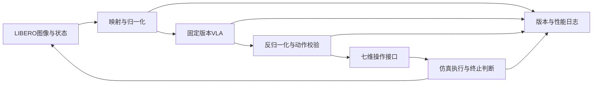

# 实验基线与复现规划 V1

2026-11-06，北京时间。状态：方案与源码静态核查完成；Ubuntu 安装、模型下载、GPU 推理和任务评测均未执行。所有预算是计划，所有性能结果须由原始日志生成。

## 1. 选型结论及适用条件

**首选路线 A：SmolVLA + 官方 `lerobot/smolvla_libero` + LeRobot LIBERO。备用路线 B：OpenVLA-OFT + 作者 LIBERO-Spatial checkpoint + 官方评测，在 A100 40GB 上运行。**

A 的理由是模型规模约 450M、官方已有领域匹配权重及评测框架，适合初学者在 12GB 上迭代，并且源码提供 `compile_model` 与 `num_steps` 两个可控推理优化入口。它仍需通过相机映射、processor、MuJoCo 和完整 episode 验收；不是“已有 checkpoint 就保证成功”。B 的模型—任务—评测脚本对应关系更明确，且有直接 VLA 量化研究可复用，但官方约 16GB 的 LIBERO 推理要求超过本地 12GB，旧依赖栈也不宜移植到 RTX 5070 后再开始原始精度基线。[E01–E06]

**首选优化：复现 SmolVLA 官方 `torch.compile` 推理路径，固定精度、权重、输入与流匹配步数。**它是本科可完成的高效推理复现，不是原创算法，也不减少模型参数。量化是后续有条件扩展：若导师要求量化为主线，优先转 B，在 A100 复现 VLAQuantBench 的 LLM-only 真实内核路径，保留动作头精度。不要把 AWQ 直接硬套到 SmolVLA 自定义 action expert。

## 2. 两条基线的证据与版本

| 项目 | 路线 A（首选） | 路线 B（备用） |
|---|---|---|
| 代码 | [huggingface/lerobot](https://github.com/huggingface/lerobot) | [moojink/openvla-oft](https://github.com/moojink/openvla-oft) |
| 本次确定的代码版本 | `d490e472a5d1a207cfe0255caaaf74b6d66e4656`，包版本 0.7.1 | `e4287e94541f459edc4feabc4e181f537cd569a8`，包版本 0.0.1 |
| 权重 | [lerobot/smolvla_libero](https://huggingface.co/lerobot/smolvla_libero)，不是 `smolvla_base` | [moojink/openvla-7b-oft-finetuned-libero-spatial](https://huggingface.co/moojink/openvla-7b-oft-finetuned-libero-spatial) |
| 权重 revision 状态 | Hub 页面可访问；本次 API 返回 502，完整 SHA 与分片哈希未取得，禁止写成已锁定或已下载 | 同左；Hub 历史可看到提交短号 `6d0231a`，完整 SHA 仍待下载前解析 |
| Python | 该固定版本要求 ≥3.12；拟 Python 3.12 | 官方 SETUP 用 3.10；拟 Python 3.10 |
| PyTorch / CUDA | 固定源码允许 torch ≥2.7,<2.16；首轮候选 2.7.1+cu128、torchvision 0.22.1，须 `pip check` 及实际 forward 后冻结 | pyproject 硬锁 torch 2.2.0、vision 0.17.0、audio 2.2.0；拟官方 cu121 wheel 在 A100，不能先装新 torch 再让 pip 静默降级 |
| 模型依赖 | 固定源码要求 transformers ≥5.22,<5.23，accelerate、num2words；不是旧教程常见的 transformers 4.x 栈 | 作者 `transformers-openvla-oft` 分支；timm 0.9.10、tokenizers 0.19.1、peft 0.11.1、TF 2.15.0、diffusers 0.30.3；FlashAttention 2.5.5 依官方说明安装 |
| 数据 | [lerobot/libero](https://huggingface.co/datasets/lerobot/libero)，需核数据 revision/格式，首轮只取离线样本 | [openvla/modified_libero_rlds](https://huggingface.co/datasets/openvla/modified_libero_rlds)，仅重新微调时必需；评测不需要先下载训练集 |
| 环境 | Linux 的 `hf-libero>=0.1.4,<0.2.0`，由该版本 extra 安装；实际解析后的版本必须记录 | [LIBERO](https://github.com/Lifelong-Robot-Learning/LIBERO) `8f1084e3132a39270c3a13ebe37270a43ece2a01`；robosuite 1.4.1，MuJoCo 拟 3.3.2 |
| 评测入口 | `lerobot-eval` → `src/lerobot/scripts/lerobot_eval.py` | `experiments/robot/libero/run_libero_eval.py` |
| 原始精度 | checkpoint 配置 `use_amp=false`，不能默认它已经 BF16；先原样验收，再记录 BF16 autocast 档 | 官方工具使用 BF16，L1 regression、双相机、本体状态、8 步执行 |
| 12GB / 40GB | 12GB 值得优先试；约 0.9GB BF16/1.8GB FP32 只是 450M 权重体积估算；整进程暂按 4–8GiB 预留，不是实测。40GB 推理余量较大 | 官方 LIBERO 约16GB；40GB 适合原精度推理；12GB 不作为原精度复现设备，不能先用量化取代原始基线 |
| 训练资源边界 | 不做全量预训练；单卡微调可行性须按 batch、冻结模块、优化器实测，不承诺12GB全参训练 | 官方训练要求随配置约27–80GB、多卡可选；单A100 40GB不等于复现论文8卡训练 |

代码 SHA 来自实际 GitHub commit API，原响应与源码在 `证据/`。目前锁定的是**代码审查候选版本**，不是已运行的兼容环境锁。A 中新 transformers 与较早 torch 组合是否有运行时限制尚待验收；不得把依赖区间相容写成运行成功。[E02,E05,E06,E10]

## 3. 必须先消除的接口陷阱

1. A 的 checkpoint 当前 config 输入是 `observation.images.camera1/camera2`，state=8、action=7；LeRobot LIBERO 默认图像键是 `image/image2`。必须把主相机映射到 camera1、腕相机到 camera2，并核对 processor 保存的统计键；仅重命名 tensor 而遗漏归一化统计也会错。[E03,E04]
2. A 的 config 为 `chunk_size=50, n_action_steps=50, num_steps=10`。先原样单回合验收，再将主实验执行长度固定为10；执行长度的改变是单独配置变更，不能混入 compile 对比。50 指预测块长，10 个流匹配迭代不是10个机器人执行动作。
3. B 不是普通 OpenVLA 自回归动作 token 策略。保持作者的双向注意力 fork、L1 连续动作头、proprio projector、数据归一化统计和8步动作块。只下载 VLM 分片不足以运行策略。[E05]
4. 两条路线使用相同 LIBERO 名称并不保证环境实现和任务协议相同。A 的 hf-libero 与 B 的原仓库分别冻结；优先比较同路线优化前后，跨模型数字只作描述，不做不公平排名。
5. EGL、GPU设备权限、MuJoCo、robosuite、NumPy、视频解码都可能先于模型失败。VLAQuantBench 指出 MuJoCo ≥3.4 的碰撞变化影响某些既有初始状态，因此B先选3.3.2；A若 hf-libero 限制冲突，不强装，记录并检查初始场景视频或切B。[E08]
6. RTX 5070 属新架构，旧torch 2.2/旧FlashAttention组合不作为其可运行证据。PyTorch官方2.7开始提供Blackwell/cu128支持；驱动、wheel编译架构、扩展算子要逐项试。A100与5070环境分开，不共享同一个conda环境。[E09]

## 4. 执行准备命令（Ubuntu，尚未执行）

先创建独立工作目录，保留全部安装日志；服务器配额与访问方式须实际取得后运行。以下是候选安装，不是“一键保证成功”的环境。

```bash
conda create -n vla-smol-v1 python=3.12 -y
conda activate vla-smol-v1
python -m pip install torch==2.7.1 torchvision==0.22.1 --index-url https://download.pytorch.org/whl/cu128
git clone https://github.com/huggingface/lerobot.git
cd lerobot
git checkout d490e472a5d1a207cfe0255caaaf74b6d66e4656
python -m pip install -e '.[smolvla,libero,evaluation]'
python -m pip check
python -m pip freeze > environment-freeze.txt
lerobot-eval --help > eval-help.txt
export MUJOCO_GL=egl
```

安装后检查torch没有被升级/替换；如5.22 transformers要求更高torch，则保留resolver日志，选择其声明支持且具有5070内核的cu128/cu130构建，并记录变更，不能继续宣称采用2.7.1结果。视频路线冻结torchcodec与torch/FFmpeg配套版本；该问题可通过先做环境render及不用视频数据的推理验收隔离。

权重先运行附带 `执行工具/lock_hub.py`，解析完整SHA、下载至本地快照、生成每文件SHA256；离线加载这个目录，禁止正式实验引用浮动main。A的VLM/tokenizer如仍从Hub取资源，也要同样冻结 `config.vlm_model_name` 指向的模型。不能用 `snapshot_download` 返回路径代替分片完整性检查。

A的一回合示例（模型路径按实际下载位置修改；选项已从本次源码/文档核对，但尚未运行）：

```bash
lerobot-eval \
  --policy.path=./checkpoints/smolvla_libero \
  --policy.device=cuda --policy.use_amp=false \
  --env.type=libero --env.task=libero_spatial --env.task_ids='[0]' \
  --env.control_mode=relative --env.init_states=true --env.hard_reset=true \
  --env.max_parallel_tasks=1 --eval.batch_size=1 --eval.n_episodes=1 \
  --rename_map='{"observation.images.image":"observation.images.camera1","observation.images.image2":"observation.images.camera2"}' \
  --seed=20261106 --output_dir=./runs/A_smoke_original
```

若权重processor已经重命名，不再重复映射；在正式跑前打印原始键、预处理后键、统计键、动作范围与图像缩略图。主实验再单独冻结 `--policy.n_action_steps=10`。不得把基础模型模型卡的SO-101示例或生成的训练示例当作本checkpoint的LIBERO评测命令。[E03,E04]

B在独立conda Python3.10环境中按快照SETUP/pyproject安装，cu121 torch2.2.0与FlashAttention在A100验收；LIBERO安装完成后：

```bash
export MUJOCO_GL=egl
python experiments/robot/libero/run_libero_eval.py \
  --pretrained_checkpoint ./checkpoints/openvla-oft-spatial \
  --task_suite_name libero_spatial --num_trials_per_task 1 \
  --use_l1_regression True --use_diffusion False --num_images_in_input 2 \
  --use_proprio True --num_open_loop_steps 8 --seed 7
```

该官方脚本默认遍历整个suite，`num_trials_per_task=1`是10任务各1回合，不是总共1回合。若只验收task0，应增加有代码diff记录的任务过滤，不能编造原脚本没有的CLI参数。B的transformers/dlimp是git依赖，安装前替换为本次 `证据/*_commit.json` 的完整SHA；`pip freeze`若仍有无SHA依赖则G0不通过。

## 5. 四层基线、验收门槛与退路

| 层 | 实际执行与通过标准（工程准入，非统计结论） | 必交记录 | 失败退路/时间盒 |
|---|---|---|---|
| 0 环境 | `nvidia-smi`、框架版本、compute capability；权重/processor哈希齐；一次真实观测输入产生有限且形状正确的动作块；峰值显存有记录；独立render成功 | `gpu.json`、driver文本、freeze、revision、文件哈希、tensor schema、forward日志、场景图 | A累计1工作日无法加载，分离下载/接口/内核错误；12GB峰值超过可用显存或余量<1GiB转A100；累计2工作日仍无法闭环则B |
| 1 原模型 | 先原样配置，再冻结主实验配置；FP32默认验收，BF16 AMP另列支持性试验；至少3独立进程测量session，每次预热20、新块推理200次；无NaN/OOM且原始样本可重算p50/p95 | load.json、latency.csv、memory.json、profiler trace、基线表；如不足200次如实报告 | BF16异常则保留FP32基线、compile也用FP32；硬件型号分表；模型加载但环境缺失只能交L1，不能标为L3完成 |
| 2 优化 | 主对比 eager vs compile；同精度、同noise、同新块输入；首次编译另计，记录graph break、额外显存与冷/热启动。候选采用门槛：p50至少降低10%、p95不增加超过5%、显存不越界；这是暂拟工程标准 | 配置diff、代码commit、全部计时与compile日志、误差表、kernel/graph证据 | 编译累计1工作日无收益或OOM即结束该尝试；改测num_steps 10→5，固定其他条件，作为近似计算基线；无需为负结果反复调参 |
| 3 闭环任务 | 同checkpoint、同初态数组、语言、动作和任务时限；先task0的3个初态完成运行并诊断全败；试点3任务×10初态×2条件=60回合；每回合有终止标签、动作日志、墙钟和视频索引 | paired_order.csv、episode.jsonl、视频、成功数/总数、失败分类、轨迹表 | 原精度全败先诊断接口/环境，不扫优化。A两天仍无匹配环境即B；两者都失败交阻塞报告与L0–L1，不伪称满足任务四 |

切换B意味着缩减为一套模型，不同时搭两套大实验。B量化扩展使用VLAQuantBench `4a2cb7c1bf9160ae683fe598ec583d7c9b9c13c9`，先查CLI `--help` 与真实内核开关，复用官方安装脚本的torch2.2、bitsandbytes0.43.3等锁；AWQ/SmoothQuant内核还需A100实际支持验收。其合成LLM microbenchmark不能替代整网络任务评测。

## 6. 指标与测量纪律

- **时间边界**：下载耗时、CPU反序列化、模型上传GPU、首次推理、首次编译、稳态分别记录；模型加载时间从本地文件开始，不混入网络。端到端推理包括预处理、H2D、真正生成新块、反归一化、D2H；另报仅模型设备时间。
- **严防动作缓存假加速**：`select_action()`常直接从队列弹出旧动作。测新块用 `predict_action_chunk()`，或记录 `new_chunk=true/false` 后分组。不能把50次队列弹出平均为一次网络推理延迟。
- **显存**：每个配置独立进程；预热后重置peak，分别测加载/编译峰值、稳态 `max_memory_allocated`、`max_memory_reserved`及进程NVML占用。GiB=2^30 bytes；nvidia-smi常含context与其他进程，不能与allocated混用。
- **延迟**：`perf_counter` + 调用前后CUDA synchronize得到墙钟，CUDA Events作设备归因；200次新块报p50/p95与原始分布。Profiler用独立run，避免其开销污染主计时。视觉编码、VLM、action expert迭代、processor各自标范围；嵌套/重叠耗时不能直接相加。
- **吞吐**：batch=1串行的新块/s；预测动作/s=新块/s×块长；实际执行动作/s按执行日志计算，三者分别命名。执行长度固定，不用多输出无用动作来制造吞吐提升。
- **存储压缩**：磁盘字节之比；**显存节省**：峰值显存之差；**真实加速**：同设备同输入的热/冷延迟和任务墙钟；**质量**：固定观测同噪声动作MAE/RMSE/最大误差，以及闭环成功率。四列单独填，失败也保留。
- **功率/资源**：可用NVML或nvidia-smi定期采样GPU功率并积分，报告J/回合、J/成功任务和采样间隔；短推理用长测量窗口。无权限则记缺失。不能从显存减少推断节能；不把GPU能量称全系统能量。

## 7. 配对试验、假设与误差分析

问题：固定SmolVLA和LIBERO输入时，官方compile路径是否改善实际新动作块延迟？这种变化能否在闭环中保留任务表现？假设H1为编译减少Python/算子启动及内存访问开销；竞争解释R1为GPU本已饱和而编译无效，R2为计时包含缓存动作或预热偏差，R3为编译引入额外显存和重新编译成本。通过同输入同噪声回放、eager重跑、graph日志和独立进程区分；目前没有支持本硬件H1的实验结果。

实验单元为任务–初始状态对，重复GPU调用不是机器人独立样本。已用experimental-design实际生成 `证据/配对试点顺序_未执行.csv`，3任务各10初态、每对original/optimized随机顺序、共60行；这是工程试点计划，不是已完成结果或功效计算。实际运行器必须显式设置和保存相同初态数组/哈希，不能仅传相同seed就假定完全配对；若只能使用官方自动初态逻辑，核对日志中的初态序号再配对。

固定noise seed与策略reset，随机顺序仅控制运行先后；hardware、日期、温度和服务器共享负载作为区组记录。跨设备不池化。主比较只有一种优化；若改用5步推理，应另建计划和文件，不与compile混为一种方法。

成功率报告每任务成功数/总数、Wilson区间；合并试点仅描述这3个任务，不外推整个LIBERO。耗时报所有回合截至统一horizon的墙钟，以及成功回合耗时；失败不能因更快终止而被称更高效。配对风险差及按初态的bootstrap为探索性分析；未来全suite应考虑task聚类。试点不作“等效/非劣已证明”结论。拟容忍成功率下降δ=5个百分点必须导师认可，并经区间精度/功效重新决定正式样本数；“p>0.05”不能证明无损。

轨迹指标：固定观测回放的动作逐维误差（明确归一化空间或米/弧度）、闭环末端路径长度、速度/加速度差分（dt=1/20s时注明）、最大动作变化、限幅次数。不同闭环轨迹不可直接逐帧RMSE而不说明时间对齐；离线动作误差小不保证成功率高。

失败分类统一为：模型/依赖错误、渲染/初态异常、接口/归一化错误、抓取未成、掉落、放置不达标、超时、约束拒绝/保护停止。基础设施失败单列，并报告重跑规则和所有启动记录；不能默默删掉失败分母。

若量化省显存却更慢：归类为容量优化，检查反量化、矩阵尺寸、在线量化及动作块并行结构；部署是否采用由显存约束决定。若推理变快而任务退化：先排查相机/精度/随机性/步数混杂，再查动作误差及关键接触阶段失败；保留原精度动作头或回退原配置。缺微调数据时先做冻结权重推理研究，不为完成“训练”而造数据。

## 8. 工程系统与OpenFleX衔接



该图是本课题拟设计系统，不是论文新增算法。提交接口规范：图像尺寸/键/颜色、state各维定义、动作坐标系/单位/相对或绝对、夹爪符号、控制20Hz、观测时间、request ID、有效期、模型hash。输入NaN、维度错、动作越界、推理超时分别做故障注入，要求无非法动作下发，终止原因可追溯。仿真安全校验不能称真实机器人安全认证。

OpenFleX只留未来接口适配任务：确认底盘/双臂自由度、控制协议、ROS或SDK、相机与标定、急停、控制周期和示范数据。LIBERO的单臂7维动作不能直接复制到轮式双臂；不承诺零样本迁移，不把当前回合成功写成OpenFleX验证。

## 9. 证据索引

- E01：[SmolVLA论文](https://arxiv.org/abs/2506.01844)，结构与训练；评测设备型号未在本次检索定位到，不能补写A100。
- E02：[LeRobot固定版本pyproject](https://github.com/huggingface/lerobot/blob/d490e472a5d1a207cfe0255caaaf74b6d66e4656/pyproject.toml)，Python、torch与extras依赖。
- E03：[SmolVLA LIBERO配置](https://huggingface.co/lerobot/smolvla_libero/blob/main/config.json)，浮动页面；完整SHA未获取。
- E04：[固定版本LIBERO文档](https://github.com/huggingface/lerobot/blob/d490e472a5d1a207cfe0255caaaf74b6d66e4656/docs/source/libero.mdx)，CLI、控制接口、图像键。
- E05：[OpenVLA-OFT官方代码](https://github.com/moojink/openvla-oft/tree/e4287e94541f459edc4feabc4e181f537cd569a8)，README/SETUP/LIBERO/pyproject和robot评测工具均已下载快照。
- E06：[OFT论文](https://arxiv.org/abs/2502.19645)，Table II、Appendix D：A100推理计时与多卡训练协议。
- E07：[VLAQuantBench论文](https://arxiv.org/abs/2609.25376)，§5.6/Table10；不能把4090数字当作A100预测。
- E08：[VLAQuantBench固定版本](https://github.com/jiuyixu25/VLAQuantBench/tree/4a2cb7c1bf9160ae683fe598ec583d7c9b9c13c9)，环境脚本、协议和real-kernel路径。
- E09：[PyTorch2.7官方发布](https://pytorch.org/blog/pytorch-2-7/)，Blackwell与cu128。
- E10：[OpenPI固定版本](https://github.com/Physical-Intelligence/openpi/tree/215abfb217dbac7d5f1273282331b9b1866c0479)，README资源门槛与LIBERO checkpoint；仅扩展，不加到首轮任务。

本稿用于制定实验，尚需学生复跑和导师审核；未宣称人工逐条审定全部外部材料。
