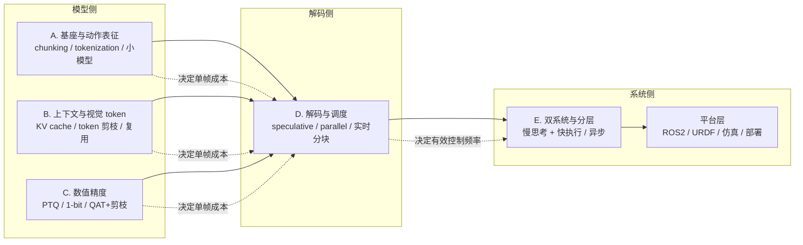

# VLA 高效推理文献矩阵

> [!warning] 阅读本文件前必须知道的三件事
> 1. **本文的量化数字绝大多数来自 arXiv 摘要（abstract），不是全文表格。** arXiv 摘要页的 `citation_*` 元数据（标题、作者、日期）我逐条抓取核实；但「延迟 / 吞吐 / 显存 / 成功率」这些指标，只有**摘要里明确写出**的我才会写进表里，并标注证据等级。**我没有逐篇读全文 PDF 的实验表格**，因此凡是摘要没写的，一律标 `未报告`，而不是猜测。
> 2. **证据分三级**：🟦 已核实（本次抓取到原始页面/接口）｜🟨 推算或综合（由已核实事实推出，非原文结论）｜🟥 待核实（需读全文、查官方文档或做实验）。
> 3. **检索不是穷尽的。** 本次是「按候选 arXiv ID 逐条核实 + 关键词发现」的定向检索，不是数据库穷尽式系统综述。凡是「没找到」的表述，都只意味着**在本次检索边界内没找到**，不意味着领域内不存在。

---

## 1. 可用的 Scientific Agent Skills 检查结果

任务要求优先使用 `paper-lookup`、`literature-review`、`scientific-brainstorming`、`hypothesis-generation`、`experimental-design`。

**检查结论（🟦 已核实）**：任务开始时，本会话**没有**安装任何 Scientific Agent Skills（调用 `paper-lookup` 返回 `skill unknown or no longer available`）。随后安装了 [K-Dense-AI/scientific-agent-skills](https://github.com/K-Dense-AI/scientific-agent-skills)（177 个 skill，v2.72.0），安装位置与验证见 `advisor_discussion.md` §5。

本次实际使用情况：

| Skill | 是否可用 | 本次怎么用的 | 对产出的影响 |
|---|---|---|---|
| `paper-lookup` | 🟦 安装后可用 | 按其「provenance 优先、区分 200 与内容、报告检索边界」的规范组织核实流程 | 决定了本文用 arXiv `citation_*` 元数据逐条核实、并记录失败模式 |
| `literature-review` | 🟦 安装后可用 | 按其「主题化综合而非逐篇摘要」「引用必须回到原始来源」的要求组织 §4–§6 | 表格按「优化对象」分主题，而不是按论文逐条罗列 |
| `experimental-design` | 🟦 安装后可用 | 按 Fisher 三原则（随机化/重复/区组）与「伪重复」警告设计 `experiment_plan.md` | 每个实验都定义实验单元、区组（seed/task suite）、重复数与判定阈值 |
| `hypothesis-generation` | 🟦 安装后可用 | 按「观察 → 问题 → 假设 → 可区分预测 → 竞争解释 → 证伪条件」拆分 `candidate_topics.md` | 每个候选题都写明「创新性主张尚待检索/尚待实验证实」 |
| `scientific-brainstorming` | 🟦 安装后可用 | 用于选题的发散与收敛（先独立生成候选，再按可行性筛） | 5 个候选题的排序理由 |

> [!note] 一个必须说明的限制
> `paper-lookup` 与 `literature-review` 官方工作流都假定可以调用 `curl`/Python 直接访问 arXiv、Semantic Scholar 等 API。本机环境里 **harness 自带的 `web_fetch` 不可用**（DNS 把 `arxiv.org`、`api.github.com`、`export.arxiv.org` 解析到非公网 IP，工具直接拒绝），而**系统自带的 `Invoke-WebRequest` 可以正常访问 `arxiv.org`**。所以核实工作是用 PowerShell 直连完成的；这一步的失败与绕行都记在这里，避免后来者以为检索是「一次成功」的。

---

## 2. 检索与核实方法（可复现）

| 项 | 内容 |
|---|---|
| 检索截止 | 2026-11-01（Asia/Shanghai） |
| 元数据来源 | `https://arxiv.org/abs/<id>` 页面的 `citation_title` / `citation_author` / `citation_date` / `citation_arxiv_id` meta 标签 |
| 抓取方式 | PowerShell `Invoke-WebRequest` + 正则解析；每条间隔 2 s；结果落盘 `work/arxiv_meta.json` |
| 抓取结果 | **主批次 43 条候选 ID 全部 200 且 `citation_title` 非空；0 失败**（日志 `work/probe_log.txt`）。v2 追加 3 条近邻论文（§4.7），**累计 46 篇**，同样 0 失败 |
| 代码仓库核实 | GitHub REST API `GET /repos/{owner}/{repo}`，2026-11-01；仅探测「组织/仓库名按论文名直接拼写」这一种假设，未做站内搜索 |
| 平台核实 | `OpenFleX-Wheeled-Humanoid/OpenFLEX` 仓库元数据 + 目录清单；技术档案页 `aiman.world`（第三方目录，非厂商官网） |
| 摘要级证据 | 从 abs 页 `blockquote.abstract` 抽取，保存 `work/arxiv_abs.json` |

**发现并纠正的 4 处「ID → 标题」错配（🟦 已核实）**。这几条本来是我凭记忆写下的 ID，抓取后发现标题完全不是目标论文，说明「凭记忆写 arXiv 号」在本任务里必然出错：

| 我最初以为的 ID | 实际是什么论文 | 目标论文的正确 ID |
|---|---|---|
| `2410.10817`（以为 RoboDual） | When Does Perceptual Alignment Benefit Vision Representations? | `2410.08001` |
| `2412.04189`（以为 DualVLA） | HANDI: Hand-Centric Text-and-Image Conditioned Video Generation | `2511.22134` |
| `2412.14093`（以为 Spec-VLA） | Alignment faking in large language models | `2507.22424` |
| `2312.33331`（以为 RoboVLM） | 404，不存在 | 该论文实为 `2311.01378`（RoboFlamingo） |

**检索边界（必须与「没有」区分开）**：
- 只核实了「我想到并写下的候选 ID」与「关键词搜索命中的论文」，**没有**做 OpenAlex/Crossref 的引用图穷尽遍历。
- 因此本文无法支持「某方向无人做过」这类主张；只能支持「在本次检索边界内，我没有定位到直接对应的工作」。

---

## 3. 领域怎么切：五条加速线 + 一个平台层

🟨 这是我的综合切法，不是任何单篇论文的分类。它服务于一个判断标准：**这条线优化的是「每帧算得多快」，还是「多久算一帧」，还是「一帧算出来能用多久」。**

一句话区分这五条线：

| 线 | 优化对象 | 典型手段 | 典型副作用 |
|---|---|---|---|
| A 基座与动作表征 | 单帧要生成多少 token / 模型多大 | action chunking、FAST tokenization、小模型蒸馏 | chunk 变长→开环误差、反应变慢 |
| B 上下文与视觉 token | 每帧重复算什么 | KV cache 复用、视觉 token 剪枝、历史上下文压缩 | 剪错 token→细微操作失败 |
| C 数值精度 | 每个算子多贵 | PTQ/W4A8、1-bit 三值权重、QAT+剪枝 | 动作头对量化敏感 |
| D 解码与调度 | 生成 tokens 的方式 | 投机解码、并行解码、延迟感知分块 | 接受率下降→反变慢 |
| E 双系统与分层 | 谁在什么频率上跑 | 慢 VLM 规划 + 快策略执行、异步 | 两级不一致、切换抖动 |

---

## 4. 主对比表（按优化对象分组）

> 列说明：**硬件**一栏只写论文摘要/元数据明确的；摘要没写就是 `未报告`。**复现性**一栏的仓库状态是 2026-11-01 GitHub API 探测结果，`未找到仓库`只表示「按 `<组织>/<仓库名>` 直接探测 404」，我**没有**排除作者用别的命名/托管平台的可能。

### 4.1 表 A：基座模型与动作表征（决定「一帧有多贵」的上游选择）

| # | 论文（bib key） | 年 | 研究问题 | 核心方法 | 模型/规模 | 硬件 | 评测任务 | 关键量化结果（摘要级） | 复现性 |
|---|---|---|---|---|---|---|---|---|---|
| A1 | OpenVLA [@openvla2024] | 2024 | 开源通用 VLA 能否追上闭源大模型 | 7B VLM + 离散动作 token，970k 真机演示 | 7B | 未报告 | 29 个任务、多本体真机 | 比 RT-2-X（55B）绝对成功率 **+16.5%**；比 Diffusion Policy **+20.4%**；摘要称可用 LoRA 在消费级 GPU 微调、量化部署不掉点 | 🟦 `openvla/openvla` 存在（7.2k⭐） |
| A2 | OpenVLA-OFT [@openvlaoft2025] | 2025 | **怎么微调**才能又快又准 | 并行解码 + 动作分块 + 连续动作头 + L1 回归 | 基于 OpenVLA 7B | 未报告 | LIBERO 四套件 + 双臂 ALOHA 真机 | LIBERO 均值 **76.5% → 97.1%**；动作生成吞吐 **+26×**；真机比 π0/RDT-1B 默认配方与 DP/ACT **最高 +15%（绝对）** | 🟦 `moojink/openvla-oft` 存在（1.4k⭐） |
| A3 | π0 [@pi0flow2024] | 2024 | 如何用一个模型跨本体做高频灵巧操作 | flow matching 动作专家 + VLM 预训练 | 未报告（摘要未载明） | 未报告 | 跨本体真机 | 摘要无量化指标 → `未报告` | 🟦 `Physical-Intelligence/openpi` [@openpi2026] 存在（14.5k⭐，2026-08 仍活跃）；HF 有 `lerobot/pi0_base` |
| A4 | π0.5 [@pi05generalization2025] | 2025 | 开放世界泛化到什么程度 | 异构数据共训 + 高层子任务推理 | 未报告 | 未报告 | 开放世界家庭场景 | `未报告` | 🟦 同 openpi；HF `lerobot/pi05_base` |
| A5 | FAST [@fast2025] | 2025 | 连续动作怎么离散化才高效 | DCT + BPE 压缩动作序列 | 与 VLA 解耦的 tokenizer | 未报告 | 多任务 | 摘要无量化 → `未报告` | 🟥 未找到官方仓库（`physical-intelligence/fast` 404） |
| A6 | ACT [@act2023] | 2023 | 低成本硬件上的精细双臂操作 | **action chunking** + CVAE | 小型 Transformer | 低成本双臂（ALOHA 类） | 6 个真机任务 | 10 分钟演示数据下 **80–90%** 成功率 | 🟦 `tonyzhaozh/act` 存在（2.3k⭐） |
| A7 | Diffusion Policy [@diffusionpolicy2023] | 2023 | 用扩散建模多模态动作分布 | DDPM 动作生成 + 滚动时域 | 小型 | 未报告 | 4 benchmark / 12 任务 | 平均 **+46.9%**（相对当时 SOTA） | 🟦 `real-stanford/diffusion_policy` 存在（4.7k⭐） |
| A8 | Octo [@octo2024] | 2024 | 开源通用策略的可复现基座 | Transformer 策略 + 800k 轨迹 | 小型（摘要未载明） | 未报告 | 多本体 | `未报告` | 🟦 `octo-models/octo` 存在（1.8k⭐） |
| A9 | TinyVLA [@tinyvla2024] | 2024 | VLA 推理慢且需海量预训练 | 紧凑 VLA + 高效训练 | 小型 | 未报告 | 操作任务 | 摘要只给动机不给数 → `未报告` | 🟦 `liyaxuanliyaxuan/TinyVLA` 存在（96⭐） |
| A10 | SmolVLA [@smolvla2025] | 2025 | 十亿参数级 VLA 太贵 | 小模型 + 社区数据 | 摘要未载明具体参数量 | 未报告 | 多任务 | `未报告` | 🟦 `huggingface/lerobot` [@lerobot2026] 存在（28.6k⭐） |
| A11 | RT-1 [@rt1_2022] / RT-2 [@rt2_2023] | 2022/2023 | 规模化机器人 Transformer / 网页知识迁移 | token 化动作 / VLM 直接出动作 token | 未报告 | 未报告 | 真机大规模 | `未报告`（作为谱系背景引用） | 🟥 官方权重未公开（未逐条核实） |
| A12 | RDT-1B [@rdt1b2024] | 2024 | 双臂操作的扩散基础模型 | DiT 扩散 + 统一动作空间 | 1B（题名） | 未报告 | 双臂真机 | `未报告` | 🟥 `thu-ml/RDT`、`thu-ml/RDT-1B` 均 404（未做站内搜索） |
| A13 | CogACT [@cogact2024] | 2024 | 认知与动作如何解耦 | VLM 认知 + DiT 动作模块 | 未报告 | 未报告 | 操作任务 | `未报告` | 🟦 `microsoft/CogACT` 存在（434⭐） |
| A14 | RoboFlamingo [@roboflamingo2023] | 2023 | 视觉语言基础模型能否直接当模仿学习器 | 冻结 VLM + 轻量策略头 | 未报告 | 未报告 | 操作任务 | `未报告` | 🟥 未找到官方仓库 |
| A15 | SpatialVLA [@spatialvla2025] | 2025 | 空间表征是否是 VLA 的短板 | 空间感知的视觉表征 + 动作专家 | 未报告 | 未报告 | 操作任务 | `未报告` | 🟦 `SpatialVLA/SpatialVLA` 存在（734⭐） |
| A16 | Consistency Policy [@consistencypolicy2024] | 2024 | 扩散策略的多步采样太慢 | 一致性蒸馏，把多步采样压到少步 | 小型 | 未报告 | 操作任务 | `未报告` | 待核实（未探测仓库） |
| A17 | One-Step Diffusion Policy [@onestepdp2024] | 2024 | 能否一步出动作 | 扩散蒸馏到单步 | 小型 | 未报告 | 操作任务 | `未报告` | 待核实（未探测仓库） |

**这一组的读法**：A2（OpenVLA-OFT）是本领域**最值得先复现**的一篇——它同时给出「成功率 + 吞吐」两个维度的明确数字（76.5→97.1、26×），且代码存在、基座权重公开。A6/A7 是 action chunking 与扩散策略的**概念源头**，复现成本低，适合作为「控制侧」基线。

另外注意 **A16/A17 代表一条被本表前段低估的加速轴：压缩采样步数**。扩散/一致性策略的推理成本与采样步数成正比，把它蒸馏到 1–4 步，是**与分块、量化正交**的第三条路。它们的摘要都没有给出延迟数字，所以我在表里标 `未报告`；🟨 但它们的机制决定了「扩散类动作头的延迟下界」，这一点在做 T3（动作头量化）时必须控制住，否则量化收益会被采样步数差异污染。

### 4.2 表 B：上下文与视觉 token（每帧重复计算的部分）

| # | 论文 | 年 | 研究问题 | 核心方法 | 模型 | 硬件 | 评测任务 | 关键量化结果（摘要级） | 复现性 |
|---|---|---|---|---|---|---|---|---|---|
| B1 | VLA-Cache [@vlacache2025] | 2025 | 相邻帧视觉 token 高度相似，能否复用 | 自适应 token 缓存（按重要性决定复用/重算） | 未报告 | 未报告 | LIBERO + SIMPLER + 真机 | **1.7× CUDA 延迟加速**、**控制频率 +15%**、成功率损失可忽略 | 🟥 未找到官方仓库（`VLA-Cache/VLA-Cache` 404） |
| B2 | KV-Efficient VLA [@kvefficientvla2025] | 2025 | 保留历史图像 token 导致 KV 显存爆炸 | RNN 门控的 chunked KV cache，选择性保留 | model-agnostic | 未报告 | 未在摘要说明 | **FLOPs −24.6%**、**1.34× 加速**、**KV 显存 −1.87×** | 🟥 未找到 |
| B3 | VLA-Pruner [@vlapruner2025] | 2025 | 视觉 token 剪枝会剪掉动作相关信息 | 时序感知的双层视觉 token 剪枝 | 多架构通用 | 未报告 | 多种 VLA 架构 | **最高 1.99× 加速**，操作质量相当 | 🟥 未找到 |
| B4 | SP-VLA [@spvla2025] | 2025 | 调度与剪枝应该联合优化 | 模型调度 + token 剪枝联合框架 | 未报告 | 未报告 | LIBERO + SimplerEnv | **1.5×（LIBERO）/ 2.4×（SimplerEnv）无损加速**；平均性能 **+6%**；推理频率与延迟改善 **2.2×/1.4×** | 🟥 未找到 |

**这一组的读法**：B1–B4 全部是「推理期改造」，**不需要重训**，这是它们对 12GB 条件最友好的地方。但它们报的是**相对加速倍数**，没有一篇在摘要里给绝对毫秒数或绝对显存——**这意味着「在你的 12GB 卡上能跑到多少 Hz」必须自己实测**，不能引用别人的倍数。

### 4.3 表 C：数值精度（量化/低比特）

| # | 论文 | 年 | 研究问题 | 核心方法 | 模型 | 硬件 | 评测任务 | 关键量化结果（摘要级） | 复现性 |
|---|---|---|---|---|---|---|---|---|---|
| C1 | BitVLA [@bitvla2025] | 2025 | 权重能否压到三值仍保持性能 | 全 1-bit（{-1,0,1}）权重 + 视觉编码器 1.58-bit 的 Quantize-then-Distill | 基于 OpenVLA-OFT | 未报告（定位边缘平台） | 仿真 + 真机 | 与全精度 OpenVLA-OFT **持平**；模型显存 **−11.0×**；端到端延迟 **−4.4×** | 🟨 HF 有 `hongyuw/bitvla-*` 权重；🟥 GitHub 仓库未定位 |
| C2 | QVLA [@qvla2026] | 2026 | 量化时所有通道并不等价 | 通道级敏感度差异的量化分配 | OpenVLA-OFT | 未报告 | LIBERO | 仅需原模型 **29.2% VRAM**，保留 **98.9%** 性能，**1.49× 加速**；比 SmoothQuant **+22.6%** | 🟥 未找到 |
| C3 | QuantVLA [@quantvla2026] | 2026 | VLA 的 PTQ、尤其是 DiT 动作头能否量化 | 训练无关的 scale-calibrated PTQ，首个量化 DiT 动作头的工作 | 多种 VLA | 未报告 | LIBERO | 成功率**超过**全精度基线；被量化组件**约 70% 相对显存节省** | 🟥 未找到 |
| C4 | SQAP-VLA [@sqapvla2025] | 2025 | 量化与剪枝应协同而非叠加 | 量化感知剪枝联合框架 | 标准 VLA | 未报告 | 未在摘要说明 | **1.93× 加速**，平均成功率 **+4.5%** | 🟥 未找到 |

**这一组的读法**：C1/C2/C3 是三条不同技术路线（1-bit 从头训 / 通道级 QAT / 训练无关 PTQ）。**对本科毕设最友好的是 C3 路线（训练无关 PTQ）**：不需要重训大模型，只需要校准数据 + 推理改造。C1 需要「量化感知训练」，12GB 单卡基本不可行（🟨 推算，见 §7）。

### 4.4 表 D：解码与实时调度

| # | 论文 | 年 | 研究问题 | 核心方法 | 模型 | 硬件 | 评测任务 | 关键量化结果（摘要级） | 复现性 |
|---|---|---|---|---|---|---|---|---|---|
| D1 | Spec-VLA [@specvla2025] | 2025 | 自回归解码太慢，能否用小模型草稿+大模型校验 | 投机解码 + 松弛接受策略 | OpenVLA | 未报告 | 多种测试场景 | 接受长度 **+44%**，**1.42× 加速**，成功率不掉 | 🟥 未找到 |
| D2 | SpecVLA（协同设计）[@specvla_codesign2026] | 2026 | 环境在「活跃/非活跃」状态间切换，算力该动态分配 | 算法-系统协同：自适应平衡动作长度、延迟、可靠性 | OpenVLA / RDT | 未报告 | LIBERO + ManiSkill | 显著降低端到端延迟（摘要未给具体数值） | 🟥 未找到 |
| D3 | PD-VLA [@pdvla2025] | 2025 | 动作分块 VLA 的自回归解码是瓶颈 | 并行解码（一次前向出整块） | 未报告 | 未报告 | 仿真（7-DoF 机械臂） | **执行频率 2.52×**，成功率保持竞争力 | 🟥 未找到 |
| D4 | RTC [@rtc2025] | 2025 | chunk 边界会因推理延迟产生停顿/抖动 | 实时分块执行（延迟感知的 chunk 拼接） | 通用（flow 策略） | 未报告 | 含高精度任务（点蜡烛） | 对推理延迟**鲁棒**，提升任务吞吐与高精度任务成功率；摘要无具体数值 | 🟥 未找到（`Physical-Intelligence/real-time-chunking` 404） |

**这一组的读法**：D3 的「并行解码」和 D1 的「投机解码」是两条不同加速来源；D4 把问题从「算得快」搬到「**延迟了怎么执行**」，这是**控制侧**的解法，与模型无关，因此对本科毕设的风险最低。

### 4.5 表 E：双系统与分层架构

| # | 论文 | 年 | 研究问题 | 核心方法 | 模型 | 硬件 | 评测任务 | 关键量化结果（摘要级） | 复现性 |
|---|---|---|---|---|---|---|---|---|---|
| E1 | RoboDual [@robodual2024] | 2024 | 通用大模型太慢，专用小模型不通用 | 双系统：通用 VLM 低频 + 专用策略高频 | 专用策略**仅 20M 可训练参数** | 未报告 | CALVIN + 真机 | 真机比 OpenVLA **+26.7%**，CALVIN **+12%**；**仅用 5% 演示数据**仍保持；控制频率 **3.8×** | 🟥 未找到 |
| E2 | DualVLA [@dualvla2025] | 2025 | 推理与动作部分解耦能否兼得 | 推理/动作部分解耦的具身 agent | 未报告 | 未报告 | SimplerEnv + 8 个多模态 benchmark | SimplerEnv 平均成功率 **61.0**；多模态平均分 **65.4** | 🟥 未找到 |
| E3 | Fast-in-Slow [@fastinslow2025] | 2025 | 双系统两套参数太贵 | System 1 嵌入 System 2，**部分参数共享** | 统一双系统模型 | 未报告 | 仿真 + 真机 | 平均成功率 仿真 **+8%** / 真机 **+11%**；**117.7 Hz** 控制频率（chunk=8） | 🟥 未找到 |
| E4 | GR00T N1 [@grootn1_2025] | 2025 | 人形机器人的通用基座 | 双系统（慢推理 + 快动作）基础模型 | 未报告 | 未报告 | 人形操作 | `未报告`（摘要无指标） | 🟦 `NVlabs/GR00T-WholeBodyControl` 存在；HF 有 `nvidia/GR00T-N1.7-*` |
| E5 | Hi Robot [@hirobot2025] | 2025 | 复杂指令与实时反馈需要分层 | 分层 VLA（高层指令理解 + 低层执行） | 未报告 | 未报告 | 开放指令任务 | `未报告`（ICML 2025） | 🟦 代码并入 openpi 生态（未逐条核实） |

**这一组的读法**：E1/E3 给出了**「控制频率」这个指标**——这是把「模型加速」翻译成「机器人行为改善」的关键桥梁。E3 的 117.7 Hz 是本组唯一明确的频率数字，但它对应 chunk=8 的小动作块，不能直接外推到长 chunk 场景（🟨 推断）。

### 4.6 表 F：综述、评测与「度量本身」的批判

| # | 论文 | 年 | 作用 | 关键判断 | 对我们的意义 |
|---|---|---|---|---|---|
| F1 | VLA 综述 [@vlasurvey2024] | 2024 | 领域全景（组件/控制/规划/数据） | 把 VLA 拆成三条主线 + 资源层 | 建立术语与谱系；本地已有中文知识地图（`VLA领域知识地图.md`） |
| F2 | 高效 VLA 综述 [@efficientsurvey2025] | 2025 | 高效化的系统分类 | TPAMI 录用；覆盖压缩/加速/数据效率 | 写开题报告的「相关工作」骨架 |
| F3 | 效率度量再审视 [@efficiencymetrics2026] | 2026 | **质疑现有「效率」指标** | 摘要明确：参数/FLOPs/token 吞吐**不能反映真机表现**；一些「更省算力」的方法反而**增加端到端成本或降低动作质量** | ⚠️ 直接影响毕设的**评价指标选择**：不能只报 FLOPs 或 tokens/s |
| F4 | LIBERO [@libero2023] | 2023 | lifelong 学习 benchmark | 4 套件、多任务 | 12GB 可行的主评测场 |
| F5 | SimplerEnv [@simplerenv2024] | 2024 | 真机对齐的仿真评测 | 缩小 sim-real gap | 第二评测场 |
| F6 | CALVIN [@calvin2021] | 2021 | 长程语言条件操作 | 长程泛化 | 双系统类工作常用 |
| F7 | Open X-Embodiment [@oxe2023] | 2023 | 跨本体数据集合 | 多机器人数据 | 数据侧背景 |
| F8 | DROID [@droid2024] | 2024 | 大规模真实场景数据 | in-the-wild | 数据侧背景 |

---

### 4.7 表 G：v2 追加的近邻工作（直接决定 T1/T3 的新颖性）

> [!danger] 这一节是 v1 的实质性遗漏
> v1 的 43 篇覆盖了「方法」，却漏掉了三篇**直接做同一件事**的 2026 年工作。补上之后，T1 与 T3 的创新性主张必须重写。

| # | 论文 | 年 | 它做了什么 | 覆盖了 v1 的哪些主张 | 对我们的影响 |
|---|---|---|---|---|---|
| G1 | **VLAQuantBench** [@vlaquantbench2026] | 2026-09 | PTQ for VLA 的**闭环**评测（28 页 / **35 表**） | ①**层范围 × 数值格式 × 校准的交互**；②逐层敏感性；③单点保护策略；④LIBERO 闭环；⑤真实算子测试 | **T3 v1 的核心创新点被完全覆盖**，且做得更细 |
| G2 | **AAC**（Adaptive Action Chunking at Inference-time）[@aac2026] | 2026-04（CVPR 2026） | 推理期**自适应决定执行长度** | 「chunk 大则反应慢、chunk 小则 jerk」的权衡；自适应执行长度 | **T1 v1 的「找最优 K」被占据** |
| G3 | **Knowing When to Stop** [@knowingwhentostop2026] | 2026-09 | 用动作专家内部 **cross-attention 动态**选择执行长度 | 同一权衡的另一种信号来源；跨 π0.5 / X-VLA、RoboTwin 2.0 / LIBERO / 3 个真机任务 | 同上，且证明该方向已进入「信号设计」竞争阶段 |

### G1 VLAQuantBench 的摘要级证据（🟦 我抓取的原文要点）

- **层范围的作用是剧烈的**：`π0.5` 动作头子集从 **126 层扩到 167 层**，在未校准 W4A4 RTN 下成功率从 **7.0% → 70.5%**。
- **校准几乎免费**：**仅 2 个 episode** 的校准就消除了所测子集里的严重联合失效。
- **配方不可迁移**：同一套 smoothing-and-clipping 反而**降低 `π0` 成功率**，且**不能恢复 OpenVLA-OFT**。
- **单点保护足够**：对 OpenVLA-OFT，**只保护一个 28,672 参数的输出投影**即可恢复接近基线的成功率；其余 **441 个线性层**可保持 W3（LIBERO-Long）或 8-bit 激活（全部四套件）。

> [!warning] 证据边界
> 上面四条是我从 arXiv 摘要**原文**读到的（已存 `work/arxiv_abs2.json`）。
> 而「409 次评测运行、94,574 个仿真 episode、真实算子测试」这些细节**不在摘要里**，是审阅者转述的正文信息 —— 标 🟥 **我未核实**，引用前必须回正文。

### 覆盖判定表：v1 的主张现在还剩多少

| v1 主张 | 是否已被覆盖 | 判定依据 | v2 处理 |
|---|---|---|---|
| 「逐模块/逐层量化敏感性分析」 | ✅ **已被 G1 覆盖** | G1 摘要明写层范围 126→167 的效应 | **撤销**，不可作为创新点 |
| 「找出特别敏感的模块」 | ✅ **已被 G1 覆盖** | 同上 + 单输出投影保护 | **撤销** |
| 「保护敏感模块、其余低比特」 | ✅ **已被 G1 覆盖** | 「protecting one 28,672-parameter output projection」 | **撤销** |
| 「同显存下提高成功率」 | ✅ **已被 G1 覆盖** | G1 给的是「W3 + 单点保护」的可行性 | **撤销** |
| 「chunk 长度有权衡」 | ✅ **已被 G2/G3 覆盖** | AAC 摘要、KWS 摘要 | **撤销** |
| 「自适应选择执行长度更好」 | ✅ **已被 G2/G3 覆盖** | 两篇都提出选择机制并验证 | **撤销** |
| 「精度最优 E ≠ 实时可行 E」 | ❓ **未定位到** | G2/G3 优化的是精度-效率，未见以**实测延迟**为约束的可行性判定 | **保留为 T1′ 的核心**，但标 🟥 待检索 |
| 「可行域可能为空（L > P·Δt）」 | ❓ **未定位到** | 无 | **保留**，需实测 |
| 「量化损失随开环执行长度放大」 | ❓ **未见 G1 以 E 为变量** | 摘要未提 E；但 35 张表里可能有 → 🟥 **必须精读** | **保留为 T3′**，且设精读闸门 |

---

### 4.8 一个必须记住的教训

v1 的检索命中率不低（43 篇里 40 篇相关），但**漏掉了三篇最关键的近邻**。原因不是检索能力，而是**检索策略**：我按「我想到的方法关键词」去查 ID，而不是按「某个具体主张是否已有人做过」去查。

🟨 改进做法：**每一个打算写进开题报告的创新性主张，都要单独做一次「主张级检索」**，而不是先攒一堆论文再从中找缺口。这条已写入 `candidate_topics.md` §3 的闸门流程。

---

## 5. 指标汇总表（延迟 / 吞吐 / 显存 / 成功率）

> **这一栏是本次调查最需要谨慎的部分。** 大量 VLA 论文在摘要里不给绝对延迟和绝对显存，只给相对倍数。下表把「摘要明说的」和「没有的」严格分开。**空白 = 摘要未报告，不是零，也不是我漏了。**

| 论文 | 延迟 | 吞吐 / 控制频率 | 显存 | 成功率 | 硬件 | 备注 |
|---|---|---|---|---|---|---|
| OpenVLA | 未报告 | 未报告 | 未报告（仅称可量化部署） | 相对 RT-2-X +16.5%（绝对成功率） | 未报告 | 7B，970k 演示 |
| OpenVLA-OFT | 未报告（只给吞吐） | 动作生成吞吐 **+26×** | 未报告 | LIBERO 均值 **97.1%**（基线 76.5%） | 未报告 | 本表最完整的「速度+成功率」组合 |
| ACT | 未报告 | 未报告（chunking 降低有效推理次数） | 未报告 | **80–90%**（6 任务） | 低成本双臂 | 10 分钟演示 |
| Diffusion Policy | 未报告 | 未报告 | 未报告 | 平均 **+46.9%**（相对当时 SOTA） | 未报告 | 扩散采样步数是隐藏成本 |
| VLA-Cache | CUDA 延迟 **1.7×** 加速（相对） | 控制频率 **+15%** | 未报告 | 损失可忽略 | 未报告 | LIBERO+SIMPLER+真机 |
| KV-Efficient VLA | **1.34×**（相对） | 未报告 | KV 显存 **1.87×** 缩减（相对） | 未报告 | 未报告 | FLOPs −24.6% |
| SP-VLA | 延迟 **1.4×/2.2×** 改善（相对） | 推理频率 **2.2×/1.4×**（相对） | 未报告 | 平均 **+6%** | 未报告 | LIBERO/SimplerEnv |
| VLA-Pruner | **1.99×**（相对，最高） | 未报告 | 未报告 | 「可比」（无数值） | 未报告 | 多架构通用 |
| BitVLA | 端到端延迟 **4.4×** 降低（相对） | 未报告 | 模型显存 **11.0×** 降低（相对） | 与 OFT 持平 | 未报告 | 1-bit 权重 |
| QVLA | **1.49×**（相对） | 未报告 | 原模型 **29.2%** VRAM | 保留 98.9% | 未报告 | OpenVLA-OFT，LIBERO |
| QuantVLA | 未报告 | 未报告 | 被量化组件约 **70%** 相对节省 | **超过**全精度 | 未报告 | 训练无关 PTQ |
| SQAP-VLA | **1.93×**（相对） | 未报告 | 未报告 | 平均 **+4.5%** | 未报告 | 量化+剪枝联合 |
| Spec-VLA | **1.42×**（相对） | 接受长度 **+44%** | 未报告 | 不掉点 | 未报告 | 基于 OpenVLA |
| PD-VLA | 未报告（只给频率） | 执行频率 **2.52×**（相对） | 未报告 | 保持竞争力 | 未报告 | 7-DoF 机械臂 |
| RoboDual | 未报告 | 控制频率 **3.8×**（相对） | 未报告（专用策略 20M 参数） | 真机 +26.7% / CALVIN +12% | 未报告 | 用 5% 数据 |
| Fast-in-Slow | 未报告 | **117.7 Hz**（chunk=8，绝对） | 未报告 | 仿真 +8% / 真机 +11% | 未报告 | 本表唯一绝对频率 |
| DualVLA | 未报告 | 未报告 | 未报告 | SimplerEnv **61.0**；多模态 **65.4** | 未报告 | — |
| VLAQuantBench [@vlaquantbench2026] | 未报告 | 未报告 | 未报告（摘要在讲层范围，不讲显存） | π0.5：W4A4 下层范围 126→167 使 **7.0%→70.5%**；OpenVLA-OFT：单输出投影保护恢复近基线 | 未报告（称有真实算子测试） | 逐层 PTQ 闭环基准 |
| AAC [@aac2026] | 未报告 | 未报告 | 未报告 | 摘要未给数值 | — | CVPR 2026，推理期自适应执行长度 |
| Knowing When to Stop [@knowingwhentostop2026] | 未报告 | 「保持高效闭环控制」 | 未报告 | 「优于固定与自适应 chunking 基线」（无数值） | — | π0.5 / X-VLA，RoboTwin 2.0 + LIBERO + 3 真机 |

**这张表最重要的一条结论（🟨 由表推出）**：**没有任何一篇论文在摘要层面同时给出「绝对延迟 + 绝对显存 + 成功率」三件套。** 所以「在 RTX 5070 12GB 上，把 X 模型跑到 Y Hz 且成功率不掉」这件事，**在现有文献里无法直接引用答案，只能自己测**——这恰恰是本科毕设可以做出的、有价值且低风险的贡献。

---

## 6. 交叉结论：区分「有证据的共识」与「单篇声明」

### 6.1 有三篇以上独立证据支持（🟦）

1. **动作分块（action chunking）是降低有效推理频率的主流手段。** ACT [@act2023] 提出，OpenVLA-OFT [@openvlaoft2025] 用它把吞吐拉到 26×，PD-VLA [@pdvla2025] 与 RTC [@rtc2025] 都在这个框架里做文章。
2. **视觉/上下文冗余是真实存在的。** VLA-Cache [@vlacache2025] 假设相邻帧 token 可复用，KV-Efficient [@kvefficientvla2025] 假设历史 KV 可压缩，VLA-Pruner [@vlapruner2025] 假设视觉 token 可剪——三者都报告了正向结果，方向一致。
3. **量化在 VLA 上「不像在 LLM 上那么好做」，但仍然可行。** QVLA [@qvla2026] 指出通道敏感度不均，QuantVLA [@quantvla2026] 指出必须专门校准、并首次处理 DiT 动作头——两者都说明「直接套 LLM 量化方法会掉点」。
4. **双系统（慢思考+快执行）能同时改善频率与成功率。** RoboDual [@robodual2024]、Fast-in-Slow [@fastinslow2025]、DualVLA [@dualvla2025]、GR00T N1 [@grootn1_2025] 四条独立证据。

### 6.2 只有单篇证据、需要谨慎（🟨）

1. **「1-bit 能不掉点」只有 BitVLA [@bitvla2025] 一篇**（摘要自述 "work in progress"）。当作「存在这条路线」的证据，不能当作「1-bit 普遍可行」。
2. **Spec-VLA 的 1.42× 只有一篇**，且摘要未说明在什么硬件、什么 batch 下测得。
3. **117.7 Hz（Fast-in-Slow）是 chunk=8 的特定配置**，不能外推到长 chunk。

### 6.3 需要警惕的表述（🟥 应回到全文核实）

- **「无损加速」**（SP-VLA 的 "lossless"）：需要确认是「成功率统计不显著」还是「每任务都不掉」。这两个含义差别很大，摘要无法区分。
- **「negligible loss」**（VLA-Cache）：同上，需要看每任务方差。
- **所有「×倍加速」**：分母是什么（CUDA kernel latency？端到端？含图像预处理？）摘要通常不说。F3 [@efficiencymetrics2026] 正是在批判这一点。

### 6.4 已被近邻工作占据的方向（v2 补充，不要再当作缺口）

| 方向 | 占据者 | 状态 |
|---|---|---|
| 逐模块/逐层量化敏感性 + 混合精度保护 | VLAQuantBench [@vlaquantbench2026] | 🟦 **已饱和**，且做的是「层范围 × 格式 × 校准」三因子 |
| 用内部信号自适应选执行长度 | AAC [@aac2026]（CVPR 2026）、Knowing When to Stop [@knowingwhentostop2026] | 🟦 **已被两条独立路线占据**（动作熵 / cross-attention） |
| 「chunk 长度有权衡」的定性论断 | 同上 + ACT + RTC | 🟦 已是教科书级共识，不能作为贡献 |

🟨 这三条意味着：**「找出问题」不再是贡献，「在新约束下重新测量并给出判定」才是。** 这个转变恰好对本科毕设有利——判定性工作的门槛是严谨，不是算力。

---### 6.5 一个反直觉但重要的证据（🟦）

F3 [@efficiencymetrics2026] 的摘要明确写道：**降低参数/FLOPs/token 吞吐的方法，往往增加端到端执行成本或降低动作质量，即使任务成功率不变。** 这条结论如果成立，会直接推翻「用 FLOPs 衡量加速」的默认做法。

🟨 对毕设的含义：**评价指标必须包含「控制频率」与「动作平滑度/抖动」，而不只是「单帧延迟」和「成功率」。** 这也是本毕设可以做出的方法论贡献点之一。

---

## 7. 12GB 显存下的可行性推算（全部为推算，未实测）

> [!danger] 以下是算术推算，不是实测，也不是论文报告值
> 标 🟨 的都是我用「参数量 × 每参数字节数」估的，**没有在本机跑过任何模型**。任务要求不下载大模型、不改环境，所以这里只做纸面估算，实测留给实验阶段。

| 配置 | 权重占用（🟨 推算） | 12GB 是否可能 | 依据 |
|---|---|---|---|
| 7B 模型，bf16 | ≈ 14 GB | ❌ 仅权重就超 | 7×10⁹ × 2 B |
| 7B 模型，int8 | ≈ 7 GB | ⚠️ 权重可放，激活/KV 余量紧 | 7×10⁹ × 1 B |
| 7B 模型，4-bit | ≈ 3.5–4 GB | ✅ 权重可放，需留激活余量 | 7×10⁹ × 0.5 B |
| 7B 模型，1-bit（BitVLA 类） | ≈ 0.9 GB | ✅ 余量大 | 三值权重理论下界 |
| 全参数微调 7B（Adam, bf16） | 权重+梯度+优化器 ≈ 14+14+56 GB | ❌ 差一个数量级 | 常规估算 |
| LoRA 微调 7B（bf16 底座） | 底座 14 GB + 适配器 | ❌ 底座仍放不下 | 除非底座量化 |
| QLoRA 微调 7B（4-bit 底座） | ≈ 4 + 少量适配器/激活 | ⚠️ 可能可行，取决于序列长度与 batch | 需实测 |
| 0.5B 级小模型 bf16 | ≈ 1 GB | ✅ 宽裕 | — |

**由此得到的三条硬约束（🟨）**：

1. **不能假设能在 12GB 上训练任何 7B 级 VLA。** 全参微调差一个数量级，LoRA 也因底座放不下而不可行，除非先量化底座（QLoRA 路线），而那会引入量化误差这一额外变量。
2. **推理侧可行，但必须走「量化 + 小 batch」路线**；`C2 QVLA`（29.2% VRAM）与 `C1 BitVLA`（11× 降低）给出的都是相对值，绝对值需实测。
3. **最稳的毕设路径是「不训练大模型」**：用已发布 checkpoint 做推理期改造（缓存/剪枝/PTQ/调度），配合小型策略（ACT 级）做对照。

### 7.1 一个尚未核实的平台风险（🟥）

RTX 5070 属于 Blackwell 架构（sm_120）。🟥 **据公开资料，sm_120 需要 CUDA 12.8+ 与较新的 PyTorch 构建才被原生支持；本次未在本机验证当前 PyTorch/CUDA 版本是否满足。** 这会直接影响「能不能跑通 OpenVLA/openpi 官方依赖」。这是**开题前必须先确认的第一件事**，见 `advisor_discussion.md`。

### 7.2 OpenFleX 平台事实（🟦 已核实到仓库/目录级别，🟥 未拿到官方规格书）

| 项 | 内容 | 证据等级 |
|---|---|---|
| 官方仓库 | `OpenFleX-Wheeled-Humanoid/OpenFLEX` [@openflex_repo2026]，最后 push 2026-10-22，license 字段 `NOASSERTION` | 🟦 GitHub API |
| 本体构成（仓库自述） | 四轮独立转向全向底盘 + 升降滑台 + **双 7-DOF 臂** + 2-DOF 头部，统一 `ros2_control` 架构 | 🟦 仓库 description |
| 总自由度 | 27 DOF（2 头 + 8 + 8 臂，含夹爪） | 🟦 第三方目录页（非厂商官网） |
| 软件栈 | ROS/ROS2 生态、VR 遥操作、数据采集 | 🟦 目录页 + 仓库文档目录 |
| 仓库内容 | 文档为主（README、安全指南、组件 yaml、安装脚本、PDF 目录），**未见 URDF/仿真资产** | 🟦 目录清单 |
| 仿真可用性 | 有第三方视频称「MuJoCo 仿真开源、URDF 一键转 MuJoCo」 | 🟥 未核实（视频来源，非文档） |
| 机载算力 | `未找到官方说明` | 🟥 待核实（关键！） |
| 相机配置/标定 | `未找到官方说明` | 🟥 待核实（关键！） |
| 交付时间 | 目录页显示 2026-06 宣布量产发货；**与本人实际交付无关** | 🟥 待核实 |

> [!important] 这条对选题的影响
> 如果 OpenFleX **没有机载 GPU**，那么真实部署必然是「工作站推理 + 网络下发动作」的**远程推理架构**，网络延迟与抖动会成为主导项——这会让「模型加速」的收益被网络延迟淹没。**这是一个必须在开题前问清楚的问题**，也是候选题 T4（延迟预算）的现实意义所在。

---

## 8. 缺口清单（v2 修订：删掉两个已被覆盖的「缺口」）

按「能不能在 12GB + 纯仿真条件下做」排序：

| # | 缺口 | 状态 | 毕设可做性 |
|---|---|---|---|
| ~~G2~~ | ~~分块长度如何影响控制频率/开环误差/显存~~ | ❌ **v2 撤销**：①AAC / KWS 已做执行长度选择；②「影响显存」这个前提本身错误（执行长度不改变前向） | — |
| ~~G3~~ | ~~量化对动作头的敏感度是否高于视觉/语言塔~~ | ❌ **v2 撤销**：VLAQuantBench 已给逐层结论（126→167 层对 7.0%→70.5%） | — |
| **G1** | 同一硬件上横向对比缓存 / 剪枝 / 量化的「延迟-显存-成功率」帕累托 | ✅ 仍成立 | ✅ 高（只需推理） |
| **G2′（新）** | **在实测延迟约束下，精度最优的执行长度是否可行**；可行域是否可能为空（`L > P·Δt`） | ✅ 仍成立（🟥 待主张级检索确认） | ✅ 高（测量 + 判定） |
| **G3′（新）** | **量化误差是否随开环执行长度放大**（`E × 比特宽` 交叉） | ❓ 未见覆盖，但须先精读 VLAQuantBench 35 表 | ✅ 中 |
| **G4** | 双系统在**注入网络延迟**时的鲁棒性边界 | ✅ 仍成立 | ✅ 中 |
| **G5** | 「效率」该用什么指标（FLOPs？Hz？抖动？空闲比例？） | ✅ 仍成立 | ✅ 高（可做成工具 + 协议） |
| **G6** | 真实 OpenFleX 上的端到端验证 | ✅ 仍成立（但依赖交付） | ❌ 低 |

> [!caution] v1 的两个「缺口」是假缺口
> G2/G3 在 v1 里被写成「文献没回答」，实际上近邻工作已经回答。**这说明「缺口」的判定不能靠印象，必须针对每个主张单独检索。** 详见 §4.8 与 §11。

---

## 9. 本次调查的自我限制（诚实清单）

1. **只读了摘要，没读全文。** 所有 `未报告` 都可能只是「摘要没写而正文有」。要在开题报告里引用具体数字，必须回到正文表格。
2. **检索非穷尽，且 v1 确实漏了关键近邻。** v1 的 43 篇里 40 篇是相关的，但**漏掉了 AAC、Knowing When to Stop、VLAQuantBench 三篇最关键的同期工作**。原因见 §4.8：我按「方法关键词」查 ID，而不是按「主张是否已有人做过」检索。v2 已把「主张级检索」写成闸门流程。
3. **代码仓库核实是浅层的。** 只做了 `GET /repos/{owner}/{repo}` 的存在性探测，**没有**核实「该仓库是否真的是论文官方实现」「是否包含论文全部实验」「权重是否可下载」。404 也不排除作者用了别的名字。
4. **硬件信息几乎全缺。** 摘要普遍不写 GPU 型号，所以「别人 1.7× 加速在我卡上是多少」无法从文献推出。
5. **平台信息是第三方目录 + 仓库文档级**，不是厂商规格书；`未找到官方说明` ≠ 不存在。
6. **没有验证任何一篇的可复现性**（没跑代码、没下权重），符合「不下载大模型、不改环境」的约束。
7. **VLAQuantBench 的 35 张表我只读了摘要**，所以「它是否扫过执行长度」目前是 🟥 未知，而不是「它没做」。

---

## 10. 更正记录（v1 → v2）

> 保留这份记录，是因为**被推翻的判断本身是信息**——它说明哪一类推理容易出错。

| # | v1 的说法 | 错在哪 | v2 的处理 | 证据 |
|---|---|---|---|---|
| C1 | T3 的「逐模块敏感性 + 混合精度保护」是创新点 | 已被 VLAQuantBench 覆盖，且做得更细（层范围 × 格式 × 校准） | 撤销该创新点，改为「量化 × 开环长度」交叉 | 🟦 [@vlaquantbench2026] 摘要 |
| C2 | T1 扫描 `K ∈ {1..32}` | 预测长度 `P` 固定为 8（LIBERO），`P=32` 不存在，除非重训 | 拆成 `P`（固定）/`E`（可调 1..P） | 🟦 `openvla-oft` 的 `NUM_ACTIONS_CHUNK` 与 `num_open_loop_steps` |
| C3 | 「K 增大 → 显存上升」是 T1 的核心机制 | `E` 只改执行队列长度，不改变前向 → 显存与 `E` 无关 | 撤销显存约束，改为延迟-可行性判据 | 🟦 `deque(maxlen=num_open_loop_steps)` |
| C4 | `f_ctrl = K / L_chunk` | 这是动作生成吞吐，不是机器人控制频率 | 拆成控制周期频率 / 模型吞吐 / 达成步频 / 空闲比例 | 🟦 定义层面 |
| C5 | 「T1 存在最优 K」可作为发现 | AAC（CVPR 2026）、KWS 已做自适应执行长度 | T1 降为「可行性边界测量 + 复现」 | 🟦 [@aac2026] [@knowingwhentostop2026] |
| C6 | 要求成功率对 K 呈倒 U 形 | 与「最大化频率×成功率」不等价；成功率单调下降时乘积仍可有内点最优 | 直接检验 `argmax U(E)`，不预设曲线形状 | 🟦 逻辑 |
| C7 | T3 放不下就换 ACT | ACT 无视觉/语言/动作三段结构，且非 LIBERO VLA checkpoint | 删除该降级路径 | 🟦 `tonyzhaozh/act` 只暴露 `--chunk_size` |
| C8 | 「用 PyTorch Hook 实现量化」 | 混淆模拟量化与真实量化；模拟量化不能主张显存/加速收益 | 强制区分两种量化，并分别限定可报指标 | 🟦 概念 |
| C9 | 3 seed × 10 episode 足以比较 | n=30 在 p≈0.5 时 CI 半宽 ±17.9pp，只能发现大幅退化 | 配对设计（McNemar）+ 功效分析 + 非劣性框架 | 🟦 计算（`work/power_calc.py`） |

---

## 11. 一句话结论

**这个方向不缺「点状加速技巧」，缺的是「在同一硬件、同一评测协议下，把延迟/显存/成功率/动作质量放在一起比较的诚实测量」。** 后者的门槛恰好落在本科毕设的能力与资源范围内，而且它的结论对博士阶段的任何加速工作都是前置基础设施。
