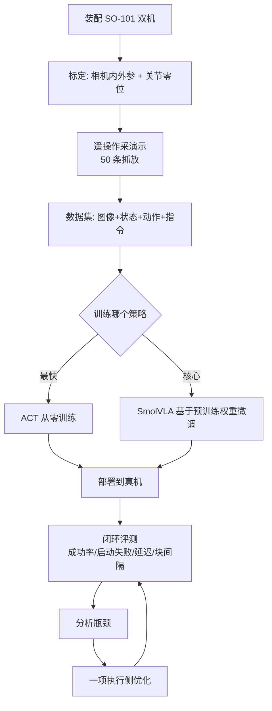

# SO-101 VLA 初期调研报告（易读版）

> **给谁看**：刚开始做科研的本科生本人，以及愿意花 20 分钟了解这个选题的导师。
> **不是什么**：不是已完成的实验报告，不是最终开题报告。所有"我们的数字"都不存在。
> **日期**：2026-11-04｜**证据等级**：🟦 已核实 / 🟨 推断 / 🟥 待核实

---

## 1. 研究背景与个人目标

### 1.1 我要做的到底是什么

一句话：**买一套便宜的机械臂，用自己的手教它抓东西，然后用"视觉—语言—动作模型"（Vision-Language-Action model，下文简称 VLA）让它自己抓，并且研究"它抓得慢不慢、能不能更快"。**

VLA 是什么：一个把"看到的画面 + 一句人话"直接变成"机械臂每个关节该转到多少度"的神经网络。和传统"先识别、再规划、再控制"的流水线不同，它一个网络端到端全干。

### 1.2 为什么这件事现在值得做

2024—2026 年，VLA 从"能不能用"转向"能不能实时用"。在真实机器人上，网络推理要花时间（几十毫秒到几百毫秒），而这期间世界在变。**推理慢 → 机器人停顿 → 观测过时 → 抓空。** 这条链是所有做真机部署的人都要面对的。

### 1.3 我的目标（与博士方向对齐）

未来博士方向是 **OpenFleX 轮式双臂机器人 + VLA + 推理加速**。所以这份毕设我最想带走的不是"一个能抓东西的机器人"，而是三样东西：

1. 一套**测得住、可复用**的延迟与成功率评测工具；
2. 一套**能换平台直接复用**的执行调度思路；
3. 一份**真实硬件的调试经验**（布线、标定、时序、抖动）。

### 1.4 我对"机械设计"的态度（重要）

我不想以机械结构设计为主线。但机械工程的毕业要求里有一条**「机械系统设计」**（第 3.3 项指标），它需要用实物兑现。所以我采取的策略是：

> **不做"重新设计一个夹爪"，改做"围绕真实机器人系统的机械件"**——相机支架、定位工装、末端快换接口、台面。这些东西每一个都有存在于研究之外的理由，也是博士阶段真会重复用到的。

**这一节的结论能不能成立，必须由导师和学院确认，我不能自己认定。**

---

## 2. SO-101 平台介绍

### 2.1 它是什么

SO-101 是一个**开源、低成本、桌面级的 5—6 自由度机械臂**，属于 LeRobot 生态（Hugging Face 主导的开源机器人学习项目）。它之所以适合本科，是因为三件事：

- 结构件可 **3D 打印**，电机是常见的总线舵机；
- 官方提供了**完整的装配、标定、遥操作、数据采集、训练、部署**流程；
- 社区里已经有人用它做 VLA 实验（见第 5 节）。

### 2.2 为什么需要两台臂

这是最容易忽略、也最影响预算的一点：

```
人握住「Leader 臂」拖动
        │  （角度同步）
        ▼
   「Follower 臂」同步运动
        │
        ▼
  同时录下：相机画面 + 关节角度 + 动作 + 语言指令
        ▼
      训练数据
```

一台臂只能"回放自己的动作"，采不到**带同步视觉的演示**。而 ACT / SmolVLA 这类模仿学习策略，吃的就是这种数据。

> 🟥 **本轮未核实**：具体自由度、舵机型号、每臂电机数量、额定负载、官方 BOM 价格。原因：本机代理为 fake-ip 模式，`huggingface.co` 与 `raw.githubusercontent.com` 均被解析成非公网地址而无法访问。**我不会用"相似型号"去凑数字。** 核实方法见 `模型与硬件可行性矩阵.md` 第 6 节。

### 2.3 这套平台够不够做"桌面抓放"

够。桌面抓放（pick-and-place）是 LeRobot 生态里最标准、资料最多的任务，也是最容易复现的。它不需要移动底盘，不需要灵巧手，变量少——**变量少是本科毕设的优点，不是缺点**。

**这对我的毕设意味着**：平台选型不要追求"高级"，要追求"能快速跑通并且能重复"。便宜的代价是定位精度差、重复性差——而这恰好可以变成你的研究变量（见第 7 节）。

---

## 3. 从演示采集到 VLA 训练

### 3.1 数据长什么样

LeRobot 的数据集本质上是**按时间对齐的多路序列**：

| 字段 | 含义 | 举例 |
|---|---|---|
| `observation.images.*` | 多路相机画面 | 前置相机、腕部相机 |
| `observation.state` | 关节角度/夹爪开合 | 6 个数值 |
| `action` | 目标动作（下一步关节值） | 6 个数值 |
| `task` / 语言指令 | 任务描述 | "pick up the red block" |
| `timestamp` / `frame_index` / `episode_index` | 对齐与时序 | — |

**关键的坑**：图像帧率与关节采样率往往不同；**时间戳对齐做错，训练出来的策略会"学傻"**。这是复现失败最常见的原因之一。🟨

### 3.2 训练与部署的完整链路



### 3.3 从零训练 vs 微调

| | 从零训练（ACT） | 微调预训练（SmolVLA） |
|---|---|---|
| 需要数据 | 少（几十条可起步）🟨 | 多一些（但也不需海量）🟨 |
| 训练时长 | 单卡数小时 🟨 | 更长，受基座大小影响 |
| 显存 | 12 GB 够 🟨 | 12 GB 需要留意，A100 更稳 |
| 失败原因 | 数据质量、对齐、超参 | 动作空间不匹配、预处理不一致 |
| 适合 | **先跑通全链路** | **做效率/架构对比** |

**这对我的毕设意味着**：**ACT 必须先做**。它是最短路径——如果 ACT 都跑不出稳定抓取，后面所有评测都是空中楼阁。

### 3.4 演示条数该采多少

| 条数 | 适合研究什么 | 说明 |
|---|---|---|
| ~25 | 能不能跑通（可行性） | 只够验证流水线 |
| 50 | **基线成功率**、执行策略对比 | 本项目建议量 |
| 100 | 数据量敏感性 | 时间成本翻倍 |
| 200+ | 规模效应研究 | 不建议本科做，且已有论文做过 12—200 的扫描 🟦 |

> 🟦 Cowling（2026）在**一台 SO-101** 上用 **12—200 条嵌套子集**、**70 次训练**、**700 个 checkpoint** 做过数据量研究。**这意味着"数据量—成功率"这条线不要重复做。**

---

## 4. 不同模型的可行性比较

（详见 `模型与硬件可行性矩阵.md`，此处只给结论）

| 模型 | 一句话定位 | 建议 | 主要风险 |
|---|---|---|---|
| **ACT** | 轻量、从零训练、动作分块的鼻祖 | ✅ **必做** | 数据采集质量 |
| **Diffusion Policy** | 扩散策略，慢但稳 | ⚠️ 可选 | 推理步数多，延迟高 |
| **SmolVLA** | 小体量 VLA，官方支持消费级 GPU | ✅ **必做** | 动作空间/相机规格要适配 |
| **π₀.₅** | 强，但依赖 openpi 整套栈 | ❌ **建议砍掉** | 环境重、显存紧、工期风险大 |
| **OpenVLA-OFT** | 7B，你本地有源码审计价值 | ⚠️ 仅作"语义"论据，不跑 | 12 GB 装不下 bf16 🟦 |

**最重要的一句**：

> **同一个硬件能跑多个策略 ≠ 现成的多个 checkpoint 能直接比较。** 动作维度、相机数量与分辨率、归一化方式不一致时，必须先适配；否则比的是"接口差异"而不是"模型差异"。🟦

---

## 5. 当前领域研究现状

### 5.1 三篇"必须知道"的新论文（都在 2026 年 10—11 月）

| 论文 | 做了什么 | 对我意味着什么 |
|---|---|---|
| **Cowling（2026-10-30，21 页）** | 一台 SO-101 上训练 ACT/DP/SmolVLA/π₀.₅，评 82 个 checkpoint，930 次真机 rollout，检验"离线指标能否预测真机成功" | **我的"平台+复现"部分它已经做过**；但它发现了"启动失败"这个被忽视的现象 |
| **VLA-HWBench（2026-10-27，21 页）** | 18 个 VLA 模型在 Jetson/AMD 上的 **7 阶段延迟分解** | "测推理延迟"已被系统化；"参数量解释 ≤15% 方差"否掉了朴素比较 |
| **VLALagBench（2026-11-02，31 页）** | 五因子（任务类型/目标速度/策略/**执行模式**/**受控延迟**）研究延迟对成功率的影响，并给出"标定→预测→选配置"模型 | **我的"统一评测 + 同步/异步对比"已被覆盖** |

### 5.2 一句决定性的原文

VLALagBench 第 3 页指出：静态环境的基准里，"**更长的推理延迟会增加任务完成时间，但不会直接影响任务结果**"。

> **这句话同时是坏消息和机会。**
> 坏消息：如果你的任务是静态桌面抓放，"扫延迟看成功率"注定是一条平线，做出来不新。
> 机会：**没有人在低成本真机上回答"既然延迟不改变成功率，那什么才是瓶颈"**。

### 5.3 所以我的位置在哪

**两个真实的差异点**：**低成本平台** + **机械变量**。其余都是在别人的框架里做测量。

---

## 6. 可以尝试的算法优化

按"本科能不能做完"排序，逐项给判断（完整表见 `创新性审查.md` 第 4 节）。

| 方向 | 别人做到哪 | 我还剩什么 | 判断 |
|---|---|---|---|
| **A 延迟感知的执行调度** | LagBench 已把"执行模式 × 动作时域"当决策变量 | 只有**加上机械精度或实现语义**才有空间 | ⭐ 推荐（有条件） |
| **B 推理与执行协同优化** | RTC / FutureRTC / SmolVLA 异步栈 | 几乎没有 | ❌ 不推荐 |
| **C 部署加速（量化等）** | HWBench 的 4-bit + kernel fusion；VLAQuantBench / QVLA / BitVLA | 需要 kernel 级工程 | ❌ 本科做不动 |
| **D 统一效率评测** | 三面夹击 | 纯评测已满 | ⚠️ 只能作为"方法"，不能作为"创新点" |
| **E 用真实反馈动态调执行配置** | LagBench 的"标定→预测→选配置"已近似 | 在线自适应 + 机械耦合仍空 | ⭐ 备选 |

**最推荐 A（带机械/语义变量），备选 D+G1 的组合。**

---

## 7. 研究创新性与主要风险

### 7.1 三条候选创新点

| # | 候选 | 一句话 | 风险 |
|---|---|---|---|
| **1** | 静态抓放的"延迟不敏感"边界 + 主导变量排序 | 既然延迟不改变成功率，那失败由什么主导？给排序 | 低 |
| **2** | 执行语义（前缀/后缀）作为必控因子 | 实现执行的是块的前缀还是后缀？会不会污染既有结论 | 中 |
| **3** | 机械定位精度 vs 延迟预算的联合准入线 | 精度差能不能被"更短的执行长度"补偿 | 中 |

**核心可证伪假设 H1**：
> 在静态抓放中，把推理延迟从 ~0 提高到 300 ms，成功率变化 < 10 个百分点；而定位误差从 1 mm 提高到 5 mm 时成功率显著下降。

H1 成立 → "低成本平台的延迟预算可以很宽松，钱该花在机械精度上"。
H1 被否证 → "静态任务里延迟同样敏感，原因是机械响应延迟 `l_mech`"。

**两种结果都能答辩**，这是这个设计的最大优点。

### 7.2 三个最大风险

| # | 风险 | 触发信号 | 缓解 |
|---|---|---|---|
| R1 | **被判"只是复现"** | 中期被问"你和 LagBench 的区别" | 把 H1 写进开题；预先声明预测 |
| R2 | **硬件迟迟不能稳定运行** | 12 月底还采不出合格数据 | 先租/借同款平台试装；买套件不散买；预留 4 周调试 |
| R3 | **样本量不足** | 真机吞吐 < 20 trials/小时 | 只做两个策略、两档延迟；结论限定大效应 |

---

## 8. 实验设计与技术路线

（完整版见 `实验设计与路线图.md`）

### 8.1 一个任务、四个旋钮

- **任务**：桌面抓放（固定 3 类物体：圆柱 / 方块 / 薄片）
- **旋钮**：推理延迟档位、执行长度 `E`、实现语义（前缀/后缀）、定位误差档位

### 8.2 指标（每条都要能算）

| 指标 | 定义 | 为什么必须有 |
|---|---|---|
| 成功率 | 成功 / 总 trial | 基础 |
| **启动失败率** | 臂未离开静止位的比例 | 🟦 Cowling 发现这是**最常见**失败（96% / 47%），且**离线数据里不可能出现** |
| 移动后失败率 | 已启动但未完成 | 与上一条分开报 |
| 推理延迟 `L` | 单次动作块推理的墙钟时间，报 p50/p95 | 自变量 |
| 块边界间隔 | 两次动作块之间的停顿 ms | 比"执行停顿"更可测 |
| 完成时间 | 单 trial 墙钟 | 静态任务里延迟主要影响它 |
| 显存峰值 | `torch.cuda.max_memory_allocated` | 部署约束 |

### 8.3 统计口径（必须提前声明）

- 配对设计 + **McNemar**（同初始态、同物体）；
- 多重比较用 **Holm**；
- **预先声明只判大效应**：n≈30 时置信区间半宽约 ±18 个百分点，**不足以支持 5 个百分点级结论**。🟨

---

## 9. 预算、计算资源与时间

### 9.1 硬件与计算

| 项 | 状态 |
|---|---|
| 本地 GPU | RTX 5070 12 GB，驱动 617.14 🟦（对 50 系显卡足够新） |
| 服务器 | 2×A100 40 GB + 1×RTX 3090 24 GB（用户提供，**使用权限待确认**）🟥 |
| 软件 | 未装 PyTorch / LeRobot 🟦（实测） |
| 机械臂 | 需自购 🟥（价格待核实） |

### 9.2 时间线（对齐学院节点）

| 时间 | 事项 |
|---|---|
| 11-13 前 | 定题 + 下单 |
| 11-28—12-06 | 任务书 |
| 12-18 前 | 开题报告（**必须写死 H1 与判据**） |
| 1 月 | 平台跑通 + 采集 50 条 + ACT 基线 |
| 2 月 | 延迟/执行长度实验（仿真为主） |
| 3 月上 | SmolVLA + 机械定位实验 + 真机验证子集 → **中期答辩** |
| 4 月 | 补实验、出图、撰写 |
| 5 月 | 内审、查重、答辩 |

---

## 10. 本科指标点及导师待确认事项

### 10.1 培养方案要求（据既有笔记，🟦）

"毕业设计"对 **8 个指标点**提供 **H（高度支撑）**：**2.3、3.3、6.2、7.2、8.2、10.3、11.2、12.2**。其中 **3.3「机械系统设计」**是唯一必须靠实物兑现的一条。

### 10.2 本方案怎么兑现

| 指标 | 靠什么 | 强度 |
|---|---|---|
| **3.3 机械系统设计** | 相机支架 + 定位工装 + 快换接口 + 台面（系统级集成） | 中（**需导师认可"系统"口径**） |
| 4.2/4.3 实验系统与分析 | 自建真机平台 + 全部闭环实验 | 强 |
| 2.3 多方案比较与文献 | 复现两策略 + 与三篇论文的差异分析 | 强 |
| 6.2/7.2/11.2 | 安全标准、能耗、成本—性能决策 | 中，需各补 1—2 页 |
| 8.2/10.3/12.2 | 诚信与可复现、英文摘要与文献、技术追踪 | 天然 |

### 10.3 必须问导师的 3 件事（指标层面）

1. **"系统集成 + 自做支架/工装"能否替代"机械单元设计"** 来兑现 3.3？
2. 学院是否接受**评测/判定型**结论（若 H1 为负结果）？
3. 机械部分的工作量下限，学院的口径是什么（图纸张数？是否需要受力校核？）？

---

## 11. 推荐选题与下一步行动

### 11.1 推荐题目

> **面向低成本平台的机械臂抓取系统设计与执行策略优化**

### 11.2 用一个真实抓方块的例子理解整个项目

假设你要抓一块 2 cm 的红色方块。

1. **装平台**：把 follower 臂固定在桌面上，摄像头架在臂的前上方（这个支架就是你的第一件机械设计）。
2. **标定**：让相机知道"方块在画面里那个位置"对应"桌面上哪个物理坐标"；让关节零位对准。标定做歪，后面全部白做。
3. **采第一条数据**：你握住 leader 臂，把 follower 牵引到方块上方 → 下降 → 闭合夹爪 → 抬起 → 放到右侧框里。全程相机在录。
4. **重复 50 次**：故意让方块位置略有不同、抓取角度略有不同，这叫"演示多样性"。太单一的数据训出来的策略只会记住一条轨迹。
5. **训练 ACT**：喂进 50 条数据，几个小时后得到一个模型。
6. **第一次自主抓取**：把方块放到新位置，让模型自己动。**大概率第一次会失败**——最常见的现象是"臂一动不动"（🟦 这正是 Cowling 报告的启动失败）。
7. **拆失败**：把结果分成"启动失败 / 移动后失败 / 成功"三类。这一步就决定了你论文的可信度。
8. **换旋钮**：把执行长度从"整块执行"改成"执行一半"，再看成功率怎么变。
9. **加延迟**：人为让推理慢 100 ms / 300 ms，观察成功率是否变化（按 H1 的预测，静态任务里应该变化很小）。
10. **加机械变量**：把方块的位置工装从"松配合"换成"紧配合"（定位误差 5 mm → 1 mm），再跑一遍，看成功率是否显著上升。
11. **得出排序**：延迟、执行长度、定位精度、策略本身，谁的贡献最大。
12. **优化**：选贡献最大的那一个，做一次改动，再跑一遍对照。

**注意第 9 步和第 10 步的顺序**：**先测延迟，再测精度**。因为如果延迟不敏感（很可能），你就有了写论文的第一句话。

### 11.3 如果我是这个项目的本科生，接下来具体应该做什么

**第 1 天（今天，2 小时）**
- [ ] 把 `START_HERE_先读这份.md` 发给导师，约 20 分钟当面讨论（问题已列好）
- [ ] 在本机打开 HuggingFace 的 LeRobot 文档（关掉代理或加直连规则），把 SO-101 的 **BOM、自由度数、舵机型号、负载**抄下来填进 `模型与硬件可行性矩阵.md` 的空位

**第 2—3 天**
- [ ] 装环境（独立 venv，别装进系统 Python）：
  `py -3.12 -m venv D:\bishe\venv` → 激活 → 装 PyTorch（cu128，对 5070）→ 装 lerobot
- [ ] 跑一条验证命令：确认 `torch.cuda.is_available()` 为 True 且设备算力为 `(12, 0)`

**第 4—7 天**
- [ ] 读三篇论文的**方法节**（不是全文）：Cowling 第 1—2 页、LagBench 第 2—4 页、HWBench 第 2—3 页
- [ ] 写出 300 字的"我与这三篇的差异"，这是开题报告的核心段落

**第 8—10 天（取决于到货）**
- [ ] 下单（双机套件 + 打印 + 相机）
- [ ] 同时**不碰硬件**地做：在仿真里把一个策略跑通，把评测脚本写好

**每天的习惯**
- [ ] 记录"今天测了什么、什么不通、下一步"（200 字），这就是后来的《教师指导记录表》素材

---

## 附录：四个最容易做错的技术细节

> 放在附录，因为它们只有在真正动手时才会咬人。以下 🟨 标记的属于我的推断或工程经验，不是论文结论。

### A. "人为加延迟"该怎么加（这是最容易出错的一步）

你要研究"推理慢会怎样"，就必须能**人为让推理变慢**。三种常见做法，只有一种在真机上是对的：

| 做法 | 真机是否有效 | 为什么 |
|---|---|---|
| 在推理代码里 `time.sleep(0.1)` | ✅ 有效 | 真机时刻在走，世界不会等你 |
| 通过网络转发到远端再回来 | ✅ 有效 | 但引入不可控抖动，要单独标定 |
| 在**仿真**里 `sleep` | ❌ **无效** | 步进式仿真在等待时不推进世界，等于什么都没发生 🟦 |

第三条是我在上一轮源码审计里确认过的问题：仿真"世界"只在 `step()` 时前进。**所以仿真的延迟实验必须按"让世界按时钟推进 + 显式定义保持上一动作的策略"来做**，不能靠睡眠。

**对你的含义**：如果你打算"仿真做主线、真机做验证"，那么延迟注入在两边的实现方式**根本不同**，必须分别写清楚，否则两边数据没法放一起。

### B. 时间戳对齐：三个时间轴必须分清

一次抓取里至少有三个时钟：**相机帧时间**、**关节采样时间**、**动作下发时间**。三者不同源、不同频率。

- 常见错误：用"读文件的顺序"当时间，结果图像比关节晚 2 帧，训练出来的策略会"提前动作"；
- 建议做法：**采集时统一打一个单调时钟的时间戳**（不要用系统墙钟），训练前做一次"图像—状态"的互相关检查，确认偏移接近 0。

🟨 我无法在本轮验证 LeRobot 具体如何处理这一点（文档不可达），所以这条属于"必须实测确认"的项。

### C. 标定做到什么程度就够

本科阶段不要追求"完美标定"，只要求**可重复**：

1. 相机内参（一次即可）；
2. 相机到桌面的位姿（手眼标定，一次）；
3. 关节零位（每次开机确认）；
4. **重复定位误差**（用千分表打 20 次，取标准差）——这一项不是"标定"，而是你的**实验自变量**。

第 4 项特别重要：它既是机械设计的验收数据，又是 H1 的关键输入。

### D. "启动失败"怎么自动判定

原文（Cowling 2026）用的是"臂未离开静止位"，但没有给数值阈值。你可以这样操作化 🟨：

- 记录每个 trial 的关节角轨迹；
- 若**全程所有关节的角度变化都小于**一个很小的阈值（例如各关节都 < 1°）且持续到超时，记为**启动失败**；
- 否则记为**已启动**，再按是否完成分成功/移动后失败。

**阈值必须写进开题报告并固定**，不能事后调——否则会被质疑"挑数据"。

---

## 12. 参考文献（本轮核实过的核心条目）

> 仅列本报告直接引用的；完整 33 条见 `references.bib`。作者-年份制，避免编号错位。

1. **Cowling, S.** *Does Validation Loss Predict Real-Robot Success? Evidence from Four Imitation-Learning Policies on a Low-Cost Arm.* arXiv:2611.00283v1, 2026-10-30. 🟦（本地 PDF 第 1 页核实；摘要级）
2. **Xu, B., Tan, H., Jiang, W., He, B., Wu, M., Zeng, J., Heinrich, M.** *VLA-HWBench: Where the Time Goes When VLA Models Run on Edge Hardware.* arXiv:2610.34717v2, 2026-10-27. 🟦（本地 PDF 第 1 页核实；摘要级）
3. **Wen, Q., Xu, B., Amro, H., Tan, H., Lin, H., Ruan, C., Liu, S., Yang, G., Liu, Y., Duan, J., He, B., Clemons, J., Kozyrakis, C., Jiang, W.** *VLALagBench: Understanding When and Why VLA Inference Latency Matters.* arXiv:2611.03103v1, 2026-11-02. 🟦（本地 PDF 第 1—3 页核实）
4. **Zhao, T. Z., Kumar, V., Levine, S., Finn, C.** *Learning Fine-Grained Bimanual Manipulation with Low-Cost Hardware* (ACT). arXiv:2304.13705, 2023. 🟦
5. **Black, K., Galliker, M. Y., Levine, S.** *Real-Time Execution of Action Chunking Flow Policies* (RTC). arXiv:2506.07339, 2025. 🟦
6. **Xu, R., Shan, X., Dai, S., Wang, Y., Yu, J.** *Knowing When to Stop: Adaptive Action Chunking via Internal Cross-Attention Dynamics in VLAs.* arXiv:2609.00908, 2026. 🟦
7. **Shukor, M., et al.** *SmolVLA: A Vision-Language-Action Model for Affordable and Efficient Robotics.* arXiv:2506.01844, 2025. 🟦
8. **Kim, M. J., Finn, C., Liang, P.** *Fine-Tuning Vision-Language-Action Models: Optimizing Speed and Success* (OpenVLA-OFT). arXiv:2502.19645, 2025. 🟦

> ⚠️ 第 1—3 条为 2026 年 10—11 月 arXiv 预印本，**非正式发表论文**；venue 仅在其自述中提及，本报告未核实。
