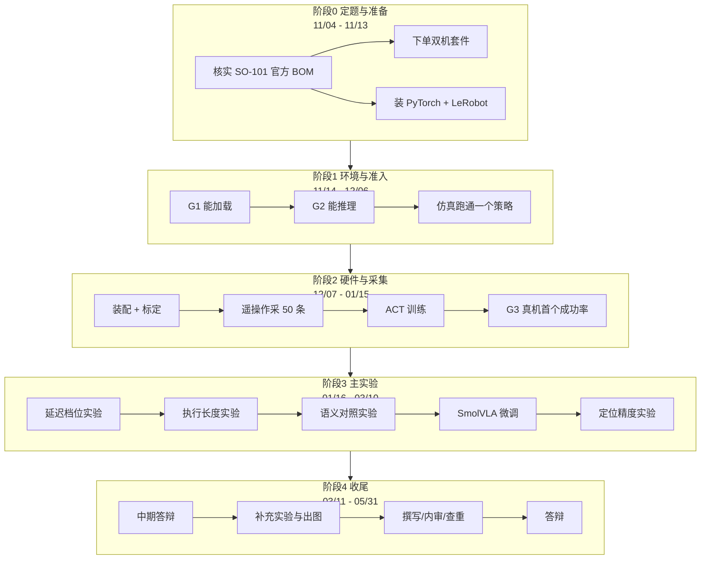

# 实验设计与路线图

> 日期：2026-11-04｜🟦 已核实｜🟨 推断｜🟥 待核实
> 目标：给出一个**在 2026-12-18 前能写进开题报告、在 2027-03 中期前能跑出数据**的实验方案。

---

## 1. 技术路线图



---

## 2. 三层目标（每层都写清验收与降级路线）

### 2.1 最低完成目标（保底，必须做到）

| 项 | 内容 |
|---|---|
| **必备条件** | 双机装配完成、标定通过、能采到可训练数据 |
| **工作量** | 装配+标定 2—3 周；采集 1—2 天；训练 1—2 天；首次真机 3—5 天 🟨 |
| **数据需求** | 50 条演示（单任务、3 类物体） |
| **计算资源** | 本地 12 GB 足够 ACT 🟨 |
| **需要写的代码** | 采集脚本（可基于官方）+ 评测脚本（自己写，约 300—500 行）🟨 |
| **对照实验** | 无（这是保底层） |
| **失败风险** | 标定做不对、时间戳错位 |
| **验收标准** | **连续 20 次自主抓取，成功 ≥ 8 次**（40%）🟨（阈值需按实测调整） |
| **降级路线** | 若真机始终不稳 → 改用仿真做全部实验，真机仅作演示；论文叙事转为"仿真基准 + 真机可行性报告" |

### 2.2 主要研究目标（这才是"研究型毕设"）

| 项 | 内容 |
|---|---|
| **必备条件** | 最低目标达成 |
| **工作量** | 额外 4—6 周 🟨 |
| **数据需求** | 同一份 50 条数据（不新增采集） |
| **计算资源** | SmolVLA 微调用 A100 更稳（权限 🟥） |
| **需要写的代码** | 统一执行层（100—200 行）+ 延迟分解与记录（100—200 行）🟨 |
| **对照实验** | 见第 4 节实验矩阵 |
| **失败风险** | 真机吞吐不足；样本量撑不起小效应 |
| **验收标准** | 完成 **≥ 8 个实验格 × 20 trials**，且 H1 得到明确判定（成立/否证） |
| **降级路线** | 若吞吐不足 → 砍到 4 格 × 20 trials，只判大效应 |

### 2.3 扩展研究目标（有余力）

| 项 | 内容 |
|---|---|
| **内容** | 加入 π₀.₅（或复用他人 checkpoint）验证结论的架构普适性 |
| **风险** | 高（环境重、工期不可控） |
| **判断** | 若 2 月底主线仍未跑完，**直接放弃**，不要挤占撰写时间 |

---

## 3. 任务定义（最小变量原则）

**唯一任务**：桌面抓放（pick-and-place）

| 要素 | 设定 |
|---|---|
| 物体 | 3 类：圆柱（易抓）、方块（基准）、薄片（难抓） |
| 初始位置 | 由**定位工装**约束（这是机械自变量之一） |
| 目标位 | 固定投放框 |
| 语言指令 | 固定一句，避免语言变量 |
| 每 trial | 复位 → 放置物体 → 发指令 → 等待结束/超时（建议 30 s）🟨 |

**为什么只做一个任务**：本科生最容易犯的错是"想测五个任务"。任务一多，每个任务的样本量都不够，最后每个结论都是"看起来有差别"。

---

## 4. 实验矩阵

### 4.1 变量

| 类型 | 变量 | 取值 | 说明 |
|---|---|---|---|
| **自变量 1** | 推理延迟 `L` | ≈0 / 100 / 300 ms（人为注入） | 需注明注入方式（排队/网络/睡眠只在"世界不推进"的前提下有效）🟦 |
| **自变量 2** | 执行长度 `H`（=E） | `K`、`K/2`、`1` | `H=K` 为两语义重合点（内部锚点） |
| **自变量 3** | 实现语义 | 前缀 corrected / 后缀 original | 仅对 `H<K` 有意义 |
| **自变量 4** | 定位误差 | 松（≈5 mm）/ 紧（≈1 mm） | 由工装决定，用来测 H1 |
| **控制量** | 策略 | ACT（主）、SmolVLA（副） | 先固定策略再扫其它 |
| **控制量** | 物体 | 3 类 | 分层报告 |
| **控制量** | 初始状态集 | 固定 10 个初始位 × 2 次 | 保证配对 |

### 4.2 分组（每格 20 trials，共 8—12 格）

| 组 | 因子组合 | 回答什么 | 优先级 |
|---|---|---|---|
| **F0 基线** | `H=K`，`L≈0`，松工装，ACT | 基线成功率 | 必须 |
| **F1 延迟** | `L ∈ {0,100,300}` × `H=K` | **H1 的主证据**（静态任务里延迟是否敏感） | 必须 |
| **F2 执行长度** | `H ∈ {K, K/2, 1}` × `L≈0` | 执行长度效应 | 必须 |
| **F3 语义** | `H=K/2` × {前缀, 后缀} | 语义是否可分辨 | 必须（便宜） |
| **F4 机械精度** | `L=100` × {松, 紧} | **H1 的第二证据**（精度是否比延迟更重要） | 必须 |
| **F5 SmolVLA** | 复跑 F0/F1 两格 | 结论是否跨模型 | 主要目标 |
| **F6 交叉** | `L=100` × `H=K/2` × {前缀, 后缀} × {松, 紧} | 交互效应 | 可选 |

### 4.3 消融与"不要做"的清单

**不要做**（要么已被做，要么工期不允许）：

- ❌ 多模型大横评（HWBench 已比 18 个）
- ❌ 数据量扫描（Cowling 已做 12—200）
- ❌ 静态任务的"延迟—成功率"曲线当作新发现（LagBench 已指出静态任务延迟不影响结果）
- ❌ 量化/剪枝（需 kernel 工程）
- ❌ 异步执行实现（RTC/FutureRTC/SmolVLA 已有）

---

## 5. 指标定义（每一条都要能算出来）

| 指标 | 操作化定义 | 采集方式 |
|---|---|---|
| 成功率 | 成功 trial / 总 trial | 人工判定 + 日志 |
| **启动失败率** | 臂全程未离开静止位 / 总 trial | 由关节角轨迹阈值自动判 🟨 |
| 移动后失败率 | 已启动但未完成 / 已启动 trial | 同上 |
| 推理延迟 `L` | 单次动作块推理墙钟，报 p50/p95 | `torch.cuda.Event` |
| 块边界间隔 | 上一块最后一步执行完 → 下一块第一步开始的 ms | 时间戳 |
| 完成时间 | trial 墙钟 | 时间戳 |
| 显存峰值 | `torch.cuda.max_memory_allocated()` | 代码 |
| 机械响应延迟 `L_mech` | 指令下发 → 夹爪实际闭合的时间 | 高速相机或电流/位置响应 🟥（方法待定） |
| 重复定位误差 | 同一指令 20 次到位偏差的标准差 | **千分表打表** |
| 运动平滑度 | jerk（加加速度）均方根 | 由轨迹差分计算 |

---

## 6. 统计计划（必须提前写进开题报告）

| 项 | 方案 |
|---|---|
| 设计 | 配对（同初始位、同物体） |
| 主检验 | **McNemar**（成功/失败配对） |
| 等效/非劣性 | 用非劣性框架，**不要用置信区间重叠判等效** 🟦 |
| 多重比较 | **Holm** |
| 效应量 | 成功率差（百分点）+ 相对风险 |
| **样本量预先声明** | n≈30 时 CI 半宽约 ±18 个百分点 🟨；**只判大效应**（≥15—20 pp），不判 5 pp |
| 失败数据 | **不丢弃**，按类型分类统计 |

---

## 7. 验收门槛与降级方案

| 时间点 | 门槛 | 未达标时怎么办 |
|---|---|---|
| 12-18（开题） | 题目定稿 + H1 与判据写死 + 环境 G1 通过 | 若 G1 不通 → 开题写"仿真优先"，硬件降为演示 |
| 01-15 | 采到 50 条 + ACT 训练完成 + 一次真机成功 | 若未成功 → 转仿真主线，真机转可行性报告 |
| 02-15 | F0—F4 至少完成 4 格 | 若不足 → 砍到 4 格 × 20 trials，结论限定大效应 |
| 03-10（中期） | 有 F1/F4 两组数据支撑或否证 H1 | 若数据不足 → 中期改为"阶段报告 + 计划调整" |
| 04-20 | 全文 ≥15000 字 + 图纸齐全 | 若不足 → 用仿真数据补足，明确标注 |

---

## 8. 机械设计部分如何进入因果链（不是搭台子）

| 机械件 | 在实验里的角色 | 对应指标 |
|---|---|---|
| **定位工装**（松/紧两版） | **自变量 4**，直接进入 F4 | 3.3、4.3 |
| **末端快换接口** | 换物体/换夹爪时保证重复定位；其误差作为控制量 | 3.2 |
| 相机支架 | 保证各组观测一致（否则观测漂移污染结论） | 3.2、4.2 |
| 台面与走线 | 系统集成 | 3.1、3.3 |

**判据**：如果换掉工装，被测量（成功率）**必须**变化。若不变，说明机械设计没进入因果链，需要重设实验。

---

## 9. 每周检查点

每周日晚写 200 字 + 1 张图，存 `03_周报/`：

```
本周测了什么 →
什么不通（具体报错/现象）→
下周第一步 →
需要导师/设备支持的事项 →
```

作用：① 攒《教师指导记录表》素材；② 中期检查表直接摘；③ 答辩"工作过程"有据可依。
