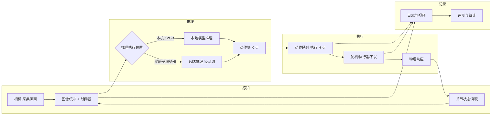
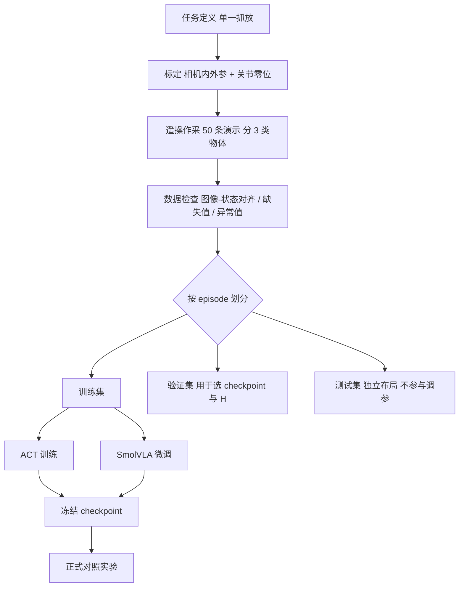

# 研究问题与实验方案

> 日期：2026-11-04｜状态：**讨论稿**，方法未验证、硬件未采购、模型未训练。
> 标注约定：🟦 已核实｜🟨 推断/估计｜🟥 待核实

---

## 1. 系统架构

**架构的关键设计点**（也是任务 2 的交付物）：
1. **时间戳基准统一**：相机帧、请求发出、动作下发、物理响应四类事件共用一条单调时钟；
2. **超时与保持策略显式化**：队列空时是"保持上一目标""保持当前位置"还是"终止"，必须事先定义并记录；
3. **推理位置可切换**：本地 / 远端作为实验档位，而非临时凑合。

---

## 2. 复现与部署安排

| 阶段 | 内容 | 前置条件 | 判定 |
|---|---|---|---|
| G1 可加载 | 两个策略均能 import、载入 checkpoint、打印配置 | 无（不需要硬件） | 输出形状符合预期 |
| G2 可推理 | 同一观测下输出 `(K, D)` 动作块，无 NaN，夹爪通道非常数 | 无（不需要硬件） | 数值范围合理 |
| G3 可评测 | 真机或仿真上完成 5—10 次 trial | 平台可用 | 成功率不为 0 |

| 模型 | 角色 | 训练方式 | 说明 |
|---|---|---|---|
| **ACT** | 模仿学习基线（**非 VLA**） | 少量演示从零训练 | 用于验证整条流水线；不作为 VLA 结论依据 |
| **SmolVLA** | 主 VLA | 预训练权重微调 | 核心对象 |
| π₀.₅ | 可选第二 VLA | 资源允许时 | 用于检验结论是否只对 SmolVLA 成立；**不作为必做** |

> 🟥 **重要提醒**：现成 checkpoint 的动作维度、相机路数、归一化方式未必与 SO-101 一致。**"同一硬件能跑多个策略"不等于"现成权重可直接比较"**，必须自己采数据、各自训练/微调。

---

## 3. 数据采集与训练流程

**规范要求**（写进开题报告）：
- 归一化只在训练集计算；
- 测试布局**另行采样或预先固定**，不能用采集过的 50 条当独立测试；
- 冻结 checkpoint 后不再调参；冻结后改参必须在文中说明并重跑。

---

## 4. 软件与硬件约束

| 项 | 现状 | 风险 |
|---|---|---|
| 本机 GPU | RTX 5070 12 GB（🟦 实测 12227 MiB，驱动 617.14） | 大模型吃紧；SmolVLA 可行，π₀.₅ 需验证 |
| 服务器 | 2×A100 40 GB + 1×3090 24 GB（用户提供，**配额与权限 🟥**） | 排队影响进度 |
| 软件 | 未安装 PyTorch / LeRobot（🟦 实测） | 需从零搭；版本锁定很重要 |
| 机械臂 | 未采购 🟥 | 到货 2—3 周 🟨，且需装配调试 |
| 场地 | 待确认 | 需固定台面与照明 |

**版本锁定**：一旦确定 LeRobot 版本与 PyTorch 版本，写进任务书附录；换版本必须重跑基线。

---

## 5. 指标定义（每条都要能算出来）

| 指标 | 操作化定义 | 采集方式 |
|---|---|---|
| 成功率（主） | 成功 trial / **全部开始的 trial** | 人工判定 + 日志 |
| 启动失败率 | 全程关节变化低于阈值即判为启动失败 | 关节角轨迹阈值（阈值须预先固定） |
| 失败分类 | 抓取失败 / 掉落 / 放置失败 / 超时 / 保护停止 / 设备故障 | 逐 trial 标注 |
| 推理延迟 `L` | 单次动作块推理墙钟，报 p50 / p95（+ 样本数） | 单调时钟；GPU 侧另用 CUDA Events 作归因 |
| 动作队列覆盖率 | 队列非空的时长占比 | 时间戳 |
| 控制周期抖动 | 相邻动作下发间隔的分布 | 时间戳 |
| 完成时间 | 全 trial 到终止或截止的墙钟（不只报成功样本） | 时间戳 |
| 显存峰值 | `torch.cuda.max_memory_allocated()` | 代码 |

> **口径纪律**：① 所有开始的测试都进分母；② 不把 GPU kernel 时间当作机器人闭环墙钟；③ 小样本不报 p99。

---

## 6. 基线（baseline）

| 级别 | 基线 | 作用 |
|---|---|---|
| B0 | 官方**同步**执行 | 最基础对照 |
| B1 | 官方**异步**执行（若框架提供） | 主要强基线；避免只战胜人为削弱的同步 |
| B2 | 固定 `H = K`（整块执行） | 执行长度效应的参照点 |
| B3 | 已公开的延迟感知执行方法（若可运行） | 强基线；不可运行时须在文中说明原因 |

---

## 7. 候选优化问题（三选一，**须在开题报告前定**）

| 候选 | 已有研究到哪一步 | 待验证问题 | 评价指标 | 失败降级 |
|---|---|---|---|---|
| **C1 尾部延迟感知的执行调度**（推荐） | 已有同步/异步执行、延迟鲁棒拼接、自适应执行长度 | 对"短时延迟波动"是否减少队列耗尽与超期失败，且不掉成功率 | 队列空转次数、超时率、成功率、请求率 | 退为"测量 + 边界结论" |
| C2 推理与动作执行协同（预取/重叠） | RTC / FutureRTC / 官方异步栈已做 | 在固定算力下，重叠带来的收益与"请求率上升"的代价如何权衡 | 请求率、GPU 占用、成功率 | 退为系统性能/成本报告 |
| C3 部署加速（量化等） | VLAQuantBench / QVLA / BitVLA / VLA-HWBench | 在 12 GB 上，量化带来的显存收益是否伴随延迟恶化 | 显存、延迟、成功率 | 只报误差不报加速（模拟量化） |

> **红线**：**不能把"普通异步执行"当作新算法**。C2 若与官方实现无实质差异，只能作为系统对比，不得写成方法贡献。

---

## 8. 对照实验与消融

| 实验 | 因子 | 规模 | 回答什么 |
|---|---|---|---|
| E1 主对照 | 优化前 / 优化后（同模型、同 checkpoint、同布局） | 每格 20—30 trial 🟨 | 是否有可重复改善 |
| E2 延迟分布 | 平稳 / 突发（均值尽量匹配） | 2 档 × 主对照 | 收益是否只在突发下出现 |
| E3 执行长度 | `H = K` / `K/2` / 1 | 3 档 | 效应是否来自执行长度而非调度 |
| E4 独立复核 | 独立测试布局 + 不同日期 | 1 轮 | 结论是否过拟合 |

**消融**（至少两项）：去掉触发余量；去掉时间对齐；固定 `H` 为常数。

**统计**：
- 单配置成功率：计数/总数 + **Wilson 95% CI**；
- 同布局优化前后：**配对**风险差 + 配对 CI，合适时用 exact McNemar；
- "不掉成功率"：预先设定有工程意义的**非劣界 δ**，检验差值下界是否高于 −δ；
- 多格比较：预定义主对比，其余 Holm；
- **不把 p > 0.05 写成等效**；不把 CI 重叠写成等效。

> **第二轮补充（🟦 已核验）**：真机试验昂贵、样本有限时，多策略排序应改用**序贯检验**方法。**AnyRank**（arXiv:2610.14603v2，2026-10-10，自述 CoRL 2026）可在任意停止时刻给出（部分）排序并控制错误概率，支持用仿真/世界模型作先验，据称比现有严格方法**少最多 50% 真机试验**。本方案的多格比较宜引用该方法，而不是自造排序规则。
> 另：评测框架可直接复用 **vla-eval**（arXiv:2603.13966v3，14 个仿真基准 + 6 个模型服务端，含 WebSocket 解耦与并行分片），把工作量集中在"执行/延迟维度"而非框架本身。

---

## 9. 成功标准与验收门槛

| 层级 | 验收标准 | 备注 |
|---|---|---|
| 最低 | 平台可用；ACT 与 SmolVLA 各完成一次完整训练与部署；一次稳定的自主抓放 | 成功率门槛**由导师按任务难度确定**，不由我自定 |
| 主要 | 完成 E1—E3 至少 6 格；定位到明确瓶颈；给出带 CI 的对照结论 | 不要求"优化一定有效" |
| 扩展 | 独立布局复核 + 第二 VLA（π₀.₅）一致性检查 | 时间不足可放弃 |

> **不得擅自引用"20 次至少 8 次"之类的通用合格线**。若预实验显示失败率极高（>80%），先诊断数据/适配问题，不继续扫参数。

---

## 10. 硬件失败时的仿真降级方案

| 级别 | 形态 | 保住的成果 | 丢失 |
|---|---|---|---|
| L1 | 仿真 + 真机验证子集（20—30 trial 锚点） | 结论可信度 + 实物证据 | — |
| L2 | 纯仿真闭环 + 真机可行性记录（装配/标定/回放视频） | 完整实验数据 + 系统实现 | 真实成功率 |
| L3 | 纯仿真 + 公开数据软件验证 | 方法、测量协议、边界结论 | 一切真机证据 |

**必须遵守**：仿真与真机结果**分列报告，不合并样本量**；仿真结论须写明"在此仿真配置下成立"。
**注意**🟦：在步进式仿真里用 `sleep` 模拟延迟是无效的（世界不推进）；必须让世界按时钟推进并显式定义"保持上一动作"策略。

---

## 11. 待测收益的表述纪律

本方案中**没有任何"已取得"的性能提升**。凡涉及收益的表述，一律写成：

> "拟验证：在 X 条件下，方案 A 相比基线 B 是否使指标 M 改善 / 不劣于 δ"

开题报告与论文中不得出现"提升了 N%"这类未实测数字。
