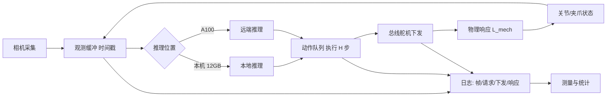

# 本科毕设综合研究方案

**学生**：刘鑫宇（2023212129，机械工程（机器人试验班）2023 级）
**导师**：王强 教授（信息与通信工程学院）
**候选题目**：面向多自由度机械臂操作的视觉语言动作模型高效推理与执行优化研究
**日期**：2026-11-04｜**性质**：导师决策用综合方案。全部结论均标注证据等级，未做的实验一律标"待做"。

证据等级：**🟦 已核实**（arXiv 元数据 / 本地 PDF 正文 / 官方文档）｜**🟨 推导或据外部线索推断**｜**🟥 未核实**

---

## 1. 执行摘要：结论与推荐

### 1.1 五条硬结论

1. **"调执行长度/做异步执行"已不构成创新。** 2026-10-31 至 11-03 四天内出现四篇直接工作：PTS（训练无关执行层，吞吐 +33%/+104%）、ARP（可训练异步架构）、Reflex（块缓存+校正）、Leap-VLA（缓存年龄条件化 + 无梯度 RTC 改写）。🟦
2. **"量化能加速"在 batch=1 的闭环场景下多数不成立。** LoopQ 用 18 万+ episode、三块硬件给出：省显存稳定 2—3×，但 H100 上没有任何量化配置更快（慢 1.06—1.58×），且标准 LIBERO 掩盖了 1.5—4.3 分的真实损失。🟦
3. **"自建评测框架"没有必要。** vla-eval（14 仿真基准/6 模型服务端/47× 加速）与 RoboScope Kit（500 episode 从 359.7 min 压到 14.4 min，比 vla-eval 再快 1.52×）已覆盖。🟦
4. **低成本 SO-101 平台本身也不是空白。** SO-101 Bench（Isaac Lab 数字孪生，仿真-真机排序 ρ=1.00）、Yu & Qiu（真机四策略失败与恢复分析，"执行不稳定"为最主要失败源）、Cowling（930 次 rollout，启动失败占 DP 96%/SmolVLA 47%）。🟦
5. **仍未被任何一篇同时覆盖的三元组**：真实低成本舵机臂 × 执行层优化 × 机械侧执行器约束（伺服响应延迟、回程间隙、重复定位误差）。这是本课题唯一可能的立足点。🟨（依据为对 17 篇直接相关工作的逐篇条件比对）

### 1.2 推荐方案

**主方向（A）：现有 VLA 高效执行方法在真实低成本机械臂上的部署、适配与边界检验。**

核心问题（可证伪）：
> 在注入等价延迟的条件下，PTS 一类训练无关执行层在**舵机驱动的低成本臂**上带来的吞吐增益，相对其在高精度/仿真平台上的增益会衰减多少？衰减部分能否被**伺服响应延迟 `L_mech`** 与**路径可行域收紧**解释？

**备选方向（C，低风险）：统一时序测量层 + 部署配置选择**，以复用 vla-eval/RoboScope 为前提，不自建框架。

**明确不做**：训练新基础模型、新 VLA 架构、自建评测框架、以机械结构设计为主线；模型级算子优化（方向 B）**延后到博士阶段**，理由见 §5。

### 1.3 需要导师决定的三个问题

1. 是否接受"**边界检验 + 系统实测**"作为毕设的主要贡献形态（若要求新方法，本方案需重构）。
2. 3.3 指标点能否以"机器人控制系统方案 + 传感—计算—执行接口 + 失效处理 + 真机验收"兑现，是否需要补实物件。
3. 资源：A100 配额与排队规则；SO-101 采购经费（官方零件表参考：舵机 ￥97.72/个、每臂 6 个）。

---

## 2. 毕设约束与研究目标

| 约束 | 内容 | 对选题的直接限制 |
|---|---|---|
| 专业 | 机械工程（机器人试验班） | 必须能论证 3.3（机械系统或工艺流程设计），见 §11 |
| 时间 | 开题 2026-12-07—2027-01-01；研究 01-04—03-12；中期 03-15—03-26；答辩 05-17—06-11 | 真机可用窗口实际约 **8—10 周**（扣春节与到货）🟨 |
| 算力 | 本机 RTX 5070 12 GB（实测 12227 MiB，驱动 617.14）；A100 40 GB 配额待确认 | 7B 级 BF16 不可行；SmolVLA 量级可行 🟨 |
| 硬件 | SO-101 未采购 | 仿真必须能独立成线，真机为增强 |
| 能力 | 无独立完成 VLA 真机微调经验 | 排除"自研算法"路线，优先"成熟实现 + 受控实验" |

**研究目标（可交付物导向）**：一套可复用的时序测量与执行适配代码、一组带置信区间的对照结果、一份明确的适用边界、一份系统设计文档（供 3.3 举证）。

---

## 3. 技术现状：四条路线的边界

每条路线按"前人解决了什么 → 验证条件 → 明确限制 → 本课题还能做什么"组织。

### 3.1 路线 A：模型级高效推理

**已解决**：动作生成过程的并行化解码（OFT 并行解码 + 分块 + L1 头，LIBERO 76.5%→97.1%，动作生成吞吐 26×🟦）；训练无关的视觉 token 复用（VLA-Cache，CUDA 延迟 1.7×、控制频率 +15%🟦）；通道级比特分配（QVLA，29.2% 显存、1.98× 加速🟦）；1-bit 权重量化（BitVLA，显存 11×、延迟 4.4×，自述 work in progress🟦）。

**验证条件与限制（关键）**：这些数字多在 4090/H100、特定 kernel、特定 batch 下取得。**LoopQ（2026-11-03）在同一 checkpoint/layer/engine 上只变方法与 kernel，用 18 万+ episode 证明**：4-bit 下 RTN/AWQ/GPTQ 追平或超过 VLA 专用 ActQuant/QuantVLA；H100 batch=1 下**无任何量化配置更快**（1.06—1.58× 更慢）；**引擎本身可改变延迟 2.1×**；π0.5 的动作专家占 GPU 时间 **63%** 但只占参数 **13%**，且仍是 16 位。🟦

**本课题还能做什么**：在 12 GB 消费卡上做"**动作专家**（memory-bound）与 **backbone**（compute-bound）的分离测量"，判断哪一侧才是本机瓶颈——但注意：这需要算子级工作，**本科阶段只做到"测量并给出归因表"，不承诺加速**。

### 3.2 路线 B：执行级优化（本课题原本的主战场，现已拥挤）

| 工作 | 机制 | 关键结果 | 条件与限制 |
|---|---|---|---|
| **RTC**（2506.07339, NeurIPS 2025 自述） | 执行当前块时生成下一块，冻结"确定执行"的动作、其余 inpainting；免重训 | 对推理延迟鲁棒；Kinetix 12 任务 + 6 真机双臂 | 改变执行架构；其"延迟鲁棒"依赖异步前提 |
| **FutureRTC**（2607.24008） | 预测执行时刻观测与状态 + 策略一致性损失 | 轨迹更平滑、成功率更高 | plug-and-play 适配层，需额外模型 |
| **KWS**（2609.00908） | 交叉注意力熵趋于平台→在线截断，训练无关 | π0.5/X-VLA，LIBERO/RoboTwin2.0 + 3 真机 | 未讨论"执行前缀还是后缀"的实现语义 |
| **AAC**（2604.04161, CVPR 2026 自述） | 动作熵决定块大小 + 最小动作幅值约束 | 优于固定块长 | 同上 |
| **PTS**（2611.01390, 2026-11-01，单人作者） | **路径层**：确定性一步解码，按推理期间消耗的进度接入；**时间层**：累加增量、夹爪运动时手臂保持 1×、按执行器线性范围与块可行性限速 | 注入延迟下吞吐 **+33%（π0.5）/ +104%（SmolVLA）**，成功率不降或更好；**超过零延迟 1×**；相对异步 1× 再 +28%/+38% | 摘要级阅读；22 页；**未见在舵机臂上验证** |
| **ARP**（2611.05155, 2026-11-03） | 低频 VLM 更新语义记忆 + 高频轻量动作专家；**训练时显式加入陈旧度与执行延迟** | Franka 准静态 +18% SR、−20% 时间；动态仿真 3—5×；VLM 可跑 1/10 频率 | 需要重新训练；架构特殊，**能否迁移到 SmolVLA 未核实** 🟥 |
| **Reflex**（2611.00524, 2026-10-31） | 缓存完整动作块绕过 backbone + 两级（动作级残差 / 执行级刷新）校正 | 延迟 1.4—11×、吞吐 2.0—2.2× | 指出"复用中间去噪状态"收益有限；backbone 占 GPU 时间约 70% |

**限制的共性**：四篇的状态估计都建立在**仿真或高精度平台**；`L_mech` 从未作为变量出现。**这正是本课题的立足点。**

### 3.3 路线 C：部署与系统架构

**已解决**：本地/服务器/云端三档推理下的延迟—成功模型（VLALagBench，标定模型 RMSE 5.7—7.8%🟦）；机群服务的 KV 抖动与准入控制（brain 上下文 215k token、Astra 请求中位 7.78 s 而环境步仅 1.0 s、并发 20→32 吞吐 2.4→0.6 req/s🟦）。

**限制**：这些工作不涉及**低成本执行器的物理约束**（总线舵机的位置环带宽、回程间隙、掉电保持），而这恰恰决定"执行层优化能不能落地"。

### 3.4 路线 D：效率评测

**已解决**：七阶段延迟分解 + 参数只解释 ≤15% 方差（VLA-HWBench，18 模型、Thor/AMD🟦）；延迟敏感性五因子基准（VLALagBench）；量化闭环评测（LoopQ）；统一评测框架（vla-eval：14 基准/6 服务端/47×；RoboScope Kit：再快 1.52×，500 episode 14.4 min🟦）；有限试验下的策略排序（AnyRank，序贯检验，最多省 50% 真机试验🟦）；具身效率度量批判（Embodied Efficiency：降算力的方法常增加端到端成本🟦）。

**限制**：**没有一种度量把执行器物理特性纳入**。所有"延迟"都在软件侧或 GPU 侧定义。

---

## 4. 最新论文与研究重叠矩阵

### 4.1 高价值文献对照表（14 篇）

| # | 论文（年） | 作者/机构 | 方法 | 实验平台 | 关键结果（含条件） | 局限 | 对本课题影响 |
|---|---|---|---|---|---|---|---|
| 1 | **PTS**（2026-11） | F. Chen（机构未声明🟥） | 训练无关执行层：路径 + 时间 | LIBERO，两冻结 VLA，注入延迟 | 吞吐 +33%/+104%（π0.5/SmolVLA），超零延迟 1×；LIBERO-Dynamic 比 stop-and-wait +38% | 摘要级；未见舵机臂；未见 `L_mech` | **主竞品**；其"按执行器线性范围限速"是最接近执行器约束的处理 |
| 2 | **ARP**（2026-11） | Dey, Van Gool, Paudel（项目页 → INSAIT🟨） | 双频架构，训练含陈旧度 | Franka + 动态仿真 | +18% SR、−20% 时间；VLM 1/10 频率无损 | 需重训；架构耦合（能否接 SmolVLA 未核实） | 说明"异步"已有训练级解法 |
| 3 | **Reflex**（2026-10） | Z. Lin 等（机构未声明🟥） | 整块缓存 + 两级校正 | 真实机器人 | 延迟 1.4—11×、吞吐 2.0—2.2× | 缓存命中依赖观测相似性 | 块复用的上限参考 |
| 4 | **Leap-VLA**（2026-10） | L. Yang 等（机构未声明🟥） | 低频 VLM + 高频流匹配专家；缓存年龄 τ 经 AdaLN；soft-nudge | LIBERO 四套件，异步栈 | LIBERO-Spatial 61.4%→95.5%（2 s 刷新）；soft-nudge 97.1% 零额外延迟 | 需训练；年龄函数设计复杂 | RTC 思路已被无梯度重写 |
| 5 | **LoopQ**（2026-11） | Bukhari, Almgren, Ali-Eldin（未声明🟥） | 闭环量化对比（同 checkpoint/layer/engine） | H100/L4/Thor，180k+ episode | 省显存 2—3×；batch=1 无量化更快；引擎改延迟 2.1×；动作专家占 GPU 63%、参数 13% | 未涉执行层 | **推翻"量化=加速"的简化说法** |
| 6 | **VLALagBench**（2026-11） | Wen, Xu, Amro 等（NUS/NTU/Stanford/NVIDIA🟦） | 五因子延迟敏感性 + 经验模型 | MuJoCo/Isaac/真机；Jetson Thor 72.8 ms；4090+WiFi7 37.8→20.0 ms | 100 ms 使成功率 71.5%→40.5%（另一任务 86.5%→74.0%）；标定 RMSE 5.7—7.8%；静态基准延迟只影响完成时间 | 未含执行器物理项 | 提供延迟—成功的量化框架 |
| 7 | **VLA-HWBench**（2026-10） | Xu, Tan, Jiang, He（NUS）；Wu, Zeng, Heinrich（2G Labs）🟦 | 7 阶段分解 | Thor + AMD | 动作生成在 14/19 配置为最大阶段；延迟跨度 82×/157×；参数解释 ≤15% 方差；4-bit fusion 仅两模型两平台 2.6—2.9× | 无闭环任务 | 提供归因方法 |
| 8 | **SO-101 Bench**（2026-10） | T. Hickok（未声明🟥） | Isaac Lab 数字孪生 | 真实 SO-101 + 仿真 | 排序 ρ=1.00、MMRV=0.000；仿真高估成功率；最佳学习策略≈61%；LLM agent 83.2% | 仿真绝对数不可直接外推 | **支持"仿真为主"** |
| 9 | **Yu & Qiu**（2026-06） | Y. Yu, X. Qiu（未声明🟥） | 真机四策略 + 失败分类学 | 真实 SO-101 | 4 任务；π0.5/SmolVLA/Wall-X/ACT；**"执行不稳定"为最主要失败源** | 未把不稳定落到调度层 | 与我方问题最接近的失败证据 |
| 10 | **Cowling**（2026-10） | S. Cowling（fysical.ai, 丹麦🟦） | 离线指标 vs 真机 | 单台 SO-101，930 rollout | 启动失败占 DP 96%/SmolVLA 47%；跨策略排名反转 ρ=+0.90；hold-out loss 升 2—5× 而动作误差降 29% | 未研究执行策略 | 强制拆分"启动失败" |
| 11 | **SmolVLA**（2025-06） | Shukor 等（HuggingFace）🟦 | 小 VLA + 异步推理栈 | 仿真 + 真机 | 单卡可训、消费级可部署；官方异步栈解耦预测与执行 | 异步带来请求增加 | 主对象兼强基线 |
| 12 | **OFT**（2025-02, RSS 2025 自述） | Kim, Finn, Liang🟦 | 并行解码 + 分块 + L1 | LIBERO + ALOHA | LIBERO 76.5→97.1；吞吐 26× | 7B；吞吐≠控制频率 | 代码基座之一 |
| 13 | **RTC**（2025-06, NeurIPS 2025 自述） | Black, Galliker, Levine🟦 | 冻结 + inpainting | Kinetix + 真机双臂 | 对延迟鲁棒、吞吐提升 | 需异步架构 | 强基线 |
| 14 | **AnyRank**（2026-10, 自述 CoRL 2026） | Badithela 等🟨 | 序贯检验多策略排序 | 仿真 + 真机基准 | 最多省 50% 真机试验，任意时刻给部分排序并控错 | 不解决测量本身 | 我的统计方案应改用它 |

### 4.2 研究重叠矩阵（★=正面对撞，△=部分重叠，○=可共存）

| 维度 | PTS | ARP | Reflex | Leap-VLA | RTC | VLALag | LoopQ | SO-101 Bench | Yu&Qiu |
|---|---|---|---|---|---|---|---|---|---|
| 训练无关执行层 | ★ | — | △ | — | △ | ○ | — | ○ | ○ |
| 异步/双频架构 | △ | ★ | ○ | ★ | ★ | △ | — | — | — |
| 块缓存/复用 | ○ | ○ | ★ | ○ | △ | — | — | — | — |
| 延迟敏感性量化 | ○ | ○ | ○ | ○ | △ | ★ | △ | ○ | ○ |
| 量化/模型压缩 | — | — | — | — | — | — | ★ | — | — |
| 低成本真机（SO-101） | — | — | — | — | — | ○ | — | ★ | ★ |
| **执行器物理约束** | ○ | — | — | — | — | — | — | — | ○ |
| **闭环墙钟 + 队列层测量** | △ | ○ | ○ | ○ | ○ | △ | △ | ○ | ○ |

**读法**：最后两行几乎全空。**"执行器物理约束"是本矩阵中唯一在所有列都接近空格的行**——这是本课题的位置；但注意它下一行"闭环墙钟"也稀疏，说明这块本身缺乏对照基线，做起来没有可比对象，这也是风险。

---

## 5. 三个候选方向与取舍

| 维度 | **A 部署与适配优化**（推荐） | B 推理计算瓶颈优化 | C 端到端评测与配置选择 |
|---|---|---|---|
| 研究问题 | 执行层优化在舵机臂上衰减多少、由什么解释 | 本机 12 GB 下哪一段是真瓶颈、能否小规模加速 | 配置选择与测量协议能否给出可复用结论 |
| 最接近论文 | PTS / Reflex / ARP / Yu&Qiu | LoopQ / VLA-HWBench / OFT | vla-eval / RoboScope / AnyRank |
| 实质差异 | 引入 `L_mech` 与执行器可行域，做**跨平台衰减对照** | 聚焦"动作专家（memory-bound）vs backbone（compute-bound）"的分离 | 不自建框架，做执行/延迟维度的扩展 |
| 需新算法 | 否 | 否（但要算子级工作） | 否 |
| 代码修改范围 | 执行层适配 + 测量（约 800—1200 行🟨） | 需 profiling + 可能的 kernel 级改动 | 适配 + 统计脚本（约 400—600 行🟨） |
| 数据/模型 | ACT + SmolVLA，50—100 episode | 预训练权重即可 | 预训练权重 + 少量真机 |
| 硬件 | SO-101 + 相机（必需） | 12 GB 本机可做 | 仿真即可起步 |
| 最低实验 | 2 平台 × 2 规则 × 2 延迟 × n | 6 段分解 + 3 组配置 | 3 配置 × 3 指标 |
| 主要风险 | 增益不衰减 → 退化为复现 | 算子工作超本科范围 | 被判"只是评测" |
| 3.3 举证力 | **强**（控制系统+接口+失效处理） | 弱 | 中 |
| 论文潜力 | 中（边界结论） | 中高（若找出真瓶颈） | 低—中 |
| 博士复用 | **高**（接口/测量/边界认知） | 最高 | 高 |
| **结论** | **主方向** | 延后到博士 | **低风险备选** |

**改变推荐的触发条件**：① 导师要求必须有算法新方法 → A 不成立，转 B（但工期须延到 5 月后段并确保算力）；② SO-101 到货不确定 → 先启动 C 的仿真部分，A 降级为 L2；③ 若 PTS 原文已明确讨论过舵机约束（**待核实**）→ A 的位置消失，改走 C。

---

## 6. 推荐课题的具体问题与技术方案

### 6.1 三个可检验假设

| 编号 | 假设 | 证伪方式 | 若成立的意义 |
|---|---|---|---|
| **H1（衰减）** | 同一执行层规则在高精度平台上的吞吐增益，在舵机臂上至少衰减一半 | 两平台增益比值 < 0.5 即成立 | 说明执行层优化受执行器限制，为低成本部署给出实用边界 |
| **H2（归因）** | 衰减可由 `L_mech` 与路径可行域收紧解释（回归残差 < 20%） | 残差过大即不成立 | 给出可预测的部署判据 |
| **H3（无差别）** | 在低成本臂上，PTS 类规则与"简单缩短执行长度"无显著差异 | 配对检验显示差异 < 非劣界 δ | 说明在低端硬件上复杂调度不划算——同样是可交付结论 |

三条假设覆盖"有效/部分有效/无效"三种结局，**任一结局都能答辩**。

### 6.2 系统架构



### 6.3 推理—执行时序（关键时序点）

```
t0 曝光   t1 读帧   t2 请求发出   t3 动作块返回   t4 开始下发   t5 关节到位
|----相机----|----传输----|------推理 L------|--队列--|--L_mech--|
端到端闭环延迟 = t5 − t0   （不是 GPU kernel 时间）
```

**必须显式定义**：队列耗尽时是保持上一目标、保持当前位、还是终止。此定义直接决定 H1 的比较是否公平。

### 6.4 从零开始的工程步骤

1. 环境准入（不上硬件）：两个策略可加载、可推理，输出形状 `(K, D)` 正确 — **先做这步，失败则整题转向 C**
2. 平台装配与标定：相机内外参、关节零位、限位与急停
3. 单一任务演示采集：桌面抓放，3 类物体，50 条起；记录前 20 次的完整工时用于估算
4. ACT 基线训练（链路验证，非 VLA）
5. SmolVLA 微调（主对象）
6. 接入统一执行层：`K/H` 可配、执行槽序号、时间戳
7. 六段延迟测量 + 队列覆盖率 + 抖动
8. 延迟注入（真机 `sleep`/网络；仿真必须推进世界，不得用 `sleep` 冻结）
9. 实现/接入执行层规则，做对照与消融
10. 独立布局复核 + 失败分类 + 边界结论

---

## 7. 平台、数据与训练

**SO-101 官方规格（🟦 取自官方 BOM 与 README 文本）**：STS3215 舵机，**每臂 6 个**（Leader：3×1/147 `C046`、2×1/191 `C044`、1×1/345 `C001`；Follower：6×1/345）；堵转扭矩 7.4 V 版 **16.5 kg·cm @6 V**、12 V 版 30 kg·cm；官方 BOM 参考价 **￥97.72/个**；调试可用 Feetech 软件或 `FT_SCServo_Debug_Qt`。

**这一点对本课题特别重要**：SO-101 是**总线舵机 + 位置环**结构，`L_mech` 与回程间隙都是**可测量且不可忽略**的量，正是 H2 的自变量来源。**（这是我判断 A 方向仍有余地的核心理由，也是唯一需要靠实测确认的前提。）**

数据计划：50 条起步（用于链路与基线）、100 条用于主实验（🟨 估计）；按 episode 与采集批次划分训练/验证/测试；**测试布局不参与调参**；归一化只在训练集计算。

---

## 8. 统一评测：指标、基线与消融

| 指标 | 定义 | 采集 |
|---|---|---|
| 推理延迟 `L` | 单块推理墙钟，p50/p95（报样本数） | 单调时钟；GPU 侧另用 CUDA Events 仅作归因 |
| 端到端延迟 | t5 − t0（曝光→关节到位） | 时间戳 |
| 任务完成时间 | 全 trial 到终止/截止（不只成功样本） | 时间戳 |
| 成功率 | 成功 / **全部开始的 trial**，Wilson 95% CI | 日志 + 判定 |
| 启动失败率 | 关节变化低于预先固定阈值 | 轨迹判据 |
| 控制周期抖动 | 相邻下发间隔分布 | 时间戳 |
| 队列耗尽率 | 非空时长占比 | 时间戳 |
| 显存/算力 | `max_memory_allocated`、GPU 时间占比 | 代码 |

**基线**：B0 官方同步；B1 官方异步（若框架提供）；B2 固定 `H=K`；B3 PTS 类规则（可运行则纳入，不可运行须说明原因）。
**消融**：去掉进度对齐、去掉限速、固定 `H`。
**统计**：配对设计；Wildon CI；配对风险差；"不降成功率"用**预设非劣界 δ**；多格比较预定义主对比 + Holm；排序用 **AnyRank** 类序贯方法而非反复看 p 值。

---

## 9. 创新性、工程价值与风险

**创新性（严格限定）**：不主张新方法。可能的增量是**"执行层优化在高 `L_mech` 平台上的衰减与归因"**这一边界结论；在本次检索范围内未见同条件对照（检索式与命中数见附录）。**不得写作"首次""唯一"。**

**工程价值（不依赖创新成立）**：统一执行层与六段测量代码、可复用日志 schema、低成本平台的部署判据表、系统设计与失效处理文档（3.3 举证）。

**三个最大风险**
1. **增益不衰减** → H1 被否证，题目退化为"复现 PTS"，价值取决于导师是否接受。
2. **真机吞吐不足** → 单 trial 含复位约 3—6 分钟🟨，240 trial 即 12—24 小时纯操作；若 <20 trial/天则只能判大效应。
3. **仿真-真机不可比** → SO-101 Bench 显示排序可迁移但**仿真高估成功率**，故绝对成功率不可混报。

---

## 10. 资源、预算与工作量

| 项 | 状态 |
|---|---|
| 本机 | RTX 5070 12 GB，驱动 617.14 🟦；PyTorch/LeRobot **未安装** 🟦 |
| 服务器 | 2×A100 40 GB + 1×3090 24 GB；配额 🟥 |
| 采购 | SO-101 双臂 + 相机 + 打印 + 台面；官方零件参考约 ￥1300 量级（不含相机与打印）🟦 |
| 工时 | 采集 1—2 天、ACT 数小时、SmolVLA 更长；真机评测为主要瓶颈 🟨 |

---

## 11. 机械工程毕业指标与院外申请

**3.3 原文**（培养方案 p54/印刷 p51）："能够针对机械工程领域复杂工程问题的特定需求，进行**机械系统或生产制造工艺流程设计**，并在设计中体现创新意识"；其支撑课程明确包含**机器人控制系统设计、工业机器人系统综合应用实训**。培养方案"毕业设计"行对 3.3 标 **H**，**未对 3.2（零部件设计）作任何标注**。

**可提交的工程证据**：需求与约束表、系统架构图、通信时序图、传感—计算—执行接口定义（观测格式/动作维度/归一化/时间戳基准/保持与终止策略）、控制与失效处理方案、方案比选理由、真机验收数据。

**仍需学院确认**：① 上述交付物是否足以兑现 3.3；② 是否需要自制件及其最小工作量；③ 指标点选项集替换是否被接受（原模板印的是信通院/电子信息工程的 3.1/3.3/4.1/4.3/5.1/6.2/10.1/10.2/10.3/12.1，我已替换为机械工程 H 支撑的 2.3/3.3/6.2/7.2/8.2/10.3/11.2/12.2）。

**其他指标**：2.3（方案比较与可替代路线）、6.2（失效处理与安全）、7.2（本地 vs 远端能耗）、8.2（可复现与诚信）、10.3（英文摘要与文献）、11.2（12 GB/40 GB 成本—性能决策）、12.2（版本适配与技术追踪）。

**院外申请**：申请表已填（不来源于科研项目、不需要院内第二导师），导师性别/学历/出生日期/联系方式待本人提供；所有意见栏与签字栏留空，不代拟。

---

## 12. 时间安排与导师待决事项

| 阶段 | 时间 | 交付 |
|---|---|---|
| 定题与准备 | 11-04—11-13 | 题目定稿、导师三项决策、下单与询价 |
| 环境准入 | 11 中—12 上 | 两策略 G1/G2 通过；方案设计初稿 |
| 开题 | 12-07—01-01 | 开题报告；架构与时序图 v1 |
| 平台与基线 | 01-04—02-10 | 装配标定、演示采集、ACT 基线 |
| 主实验 | 02-11—03-12 | SmolVLA 微调、六段测量、H1 第一轮 |
| 中期 | 03-15—03-26 | 中期材料 + 1/2 论文框架 |
| 复核与撰写 | 03-29—04-23 | 独立布局复核、论文初稿 |
| 内审查重 | 04-26—05-14 | 查重与格式合格 |
| 答辩 | 05-17—06-11 | 定稿与归档 |

**导师待决**：① 贡献形态（边界检验是否可接受）；② 3.3 口径；③ 算力与经费；④ 是否纳入 π0.5；⑤ 硬件延误时的降级方案是否批准。

---

## 13. 参考文献与证据说明

完整 48 条见 `文献证据附录.md` 与 `references.bib`。核心 12 条：

[1] PTS. arXiv:2611.01390, 2026-11-01. ｜[2] ARP. arXiv:2611.05155, 2026-11-03. ｜[3] Reflex. arXiv:2611.00524, 2026-10-31. ｜[4] Leap-VLA. arXiv:2611.01011, 2026-10-31. ｜[5] LoopQ. arXiv:2611.05093, 2026-11-03. ｜[6] VLALagBench. arXiv:2611.03103, 2026-11-02. ｜[7] VLA-HWBench. arXiv:2610.34717, 2026-10-27. ｜[8] SO-101 Bench. arXiv:2610.36420, 2026-10-27. ｜[9] Yu & Qiu. arXiv:2606.08881v2, 2026-06-11. ｜[10] Cowling. arXiv:2611.00283, 2026-10-30. ｜[11] SmolVLA. arXiv:2506.01844, 2025-06-02. ｜[12] RTC. arXiv:2506.07339, 2025-06-09.

**证据说明**：全部条目元数据经 arXiv API 或本地 PDF 核验；**无一篇读到全文**（除 OFT/SmolVLA 相关章节在早前会话读过）。凡"摘要级"结论已逐处标注。venue 仅转述论文自述，未作第三方核实。
