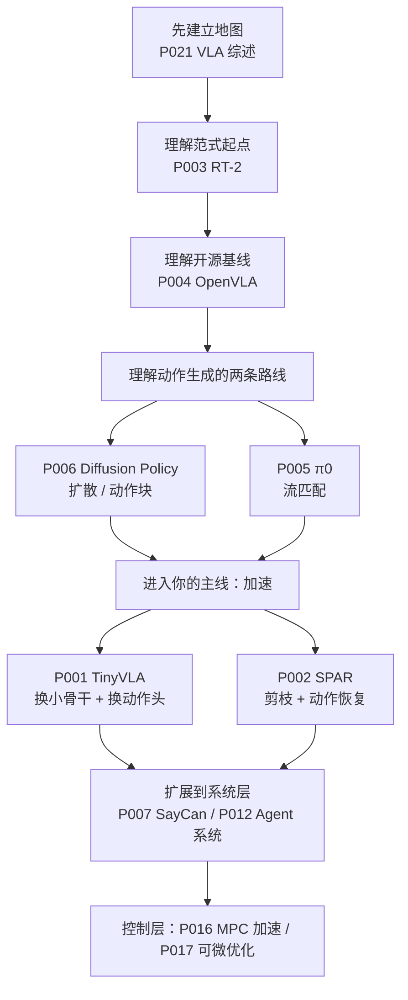

---
title: 00 文献总索引
type: index
tags:
  - 索引
  - 具身智能
  - VLA
created: 2026-11-05
updated: 2026-11-05
---

# 00 文献总索引

> [!info] 这个文件是什么
> 这是 `Literature_Notes/` 的总入口。每篇论文一个文件夹（`Paper_XXX_简称/`），文件夹内固定 5 个笔记。
> 所有笔记中的关键结论都要能追溯到原文的**章节号 / 图号 / 表号 / 公式号**；追溯不到的地方会明确写「原文未给出」或「推断」。
>
> **全部 24 篇完成后，另有一份横向比较：[[00_横向比较与总结]]**（24 篇总表、六条主线、三个正交坐标 + 第 4 条线、十二条可复用判断、研究定位与推荐切入点）。

---

## 一、证据标注约定（读任何一篇笔记前请先看这里）

我在笔记里用下面 5 种标记区分"证据强度"，这是本知识库最重要的阅读规则：

| 标记 | 含义 | 例子 |
|---|---|---|
| `【原文·§IV-B】` | 论文正文里直接写了 | 成功率的定义、模块的名字、超参数 |
| `【原文·Fig.2】` `【原文·Table IV】` | 来自图或表（我用页面渲染逐格核对过） | 推理延迟 14 ms |
| `【推断】` | 我根据原文的合理推论，**不是**作者说的 | "这个设计可能对双臂也有效" |
| `【原文未给出】` | 论文没有报告，我不补造 | 动作块长度、扩散步数、学习率 |
| `【外部】` | 来自其他论文/网页，需另外核验 | 某个 baseline 的原始超参 |

> [!warning] 我不会做的事
> - 不用标题或摘要去"猜"正文的方法细节。
> - 不把常见模块（Transformer、LoRA、扩散头）说成作者的原创。
> - 不编造期刊分区、影响因子、会议等级、录用情况。
> - 表格数字一律以渲染后的原表为准；若正文表述与表格计算结果不一致，我会同时写出两者并标注差异。

---

## 二、论文清单（24 篇）

**状态图例**：✅ 已完成深度精读 ｜ 🚧 进行中 ｜ ⬜ 待整理

| 编号 | 简称 | 分类目录 | 年份 / 出处 | 一句话主题 | 与我的方向相关度 | 状态 |
|---|---|---|---|---|---|---|
| P001 | [[Paper_001_TinyVLA/01_论文精读\|TinyVLA]] | `ral` | 2025 / IEEE RA-L 10(4) | 小 VLM + 扩散动作头，把 VLA 推理从 292 ms 压到 14 ms | ★★★★★ 推理加速 | ✅ |
| P002 | [[Paper_002_SPAR/01_论文精读\|SPAR]] | `new` | 2026 / 预印本 | 双维度结构化剪枝 + PPO 恢复，LLM 2.34B→0.09B | ★★★★★ 模型压缩 | ✅ |
| P003 | [[Paper_003_RT-2/01_论文精读\|RT-2]] | `classic` | 2023 / arXiv:2307.15818 技术报告 | 把动作当文本 token，让 VLM 直接输出动作，定义 VLA | ★★★★★ 范式起点 | ✅ |
| P004 | [[Paper_004_OpenVLA/01_论文精读\|OpenVLA]] | `classic` | 2024 / arXiv:2406.09246 | 开源 7B VLA：LoRA 微调 + int4 量化，打赢 55B 闭源 | ★★★★★ 可复现基线 | ✅ |
| P005 | [[Paper_005_pi0/01_论文精读\|π0]] | `classic` | 2024/2026 / arXiv:2410.24164 | PaliGemma 3B + 流匹配动作专家，H=50 动作块，支撑 50 Hz | ★★★★★ 执行调度 | ✅ |
| P006 | [[Paper_006_DiffusionPolicy/01_论文精读\|Diffusion Policy]] | `classic` | 2024 / IJRR（arXiv:2303.04137） | 动作序列扩散 + 动作块（T_p=16, T_a=8）+ 滚动时域 | ★★★★★ 执行调度 | ✅ |
| P007 | [[Paper_007_SayCan/01_论文精读\|SayCan]] | `classic` | 2022 / CoRL（arXiv:2204.01691） | LLM 打分 × 价值函数可供性，101 条指令零样本 | ★★★★☆ 分层架构 | ✅ |
| P008 | [[Paper_008_CueTheFlow/01_论文精读\|Cue the Flow]] | `new` | 2026 / CoRL 2026（PDF 页脚） | 冻结流匹配 VLA + 空间线索调制速度场，0.02% 参数 | ★★★★☆ 策略引导 | ✅ |
| P009 | [[Paper_009_TrajWAM/01_论文精读\|TrajWAM]] | `new` | 2026 / 预印本 | 物体掩码轨迹引导世界模型 + 三段蒸馏到 1 步 | ★★★★★ 世界模型 | ✅ |
| P010 | [[Paper_010_DiPLO/01_论文精读\|DiPLO]] | `new` | 2026 / 预印本 | 人形移动操作：特权信息自蒸馏 + DA:PPO 后训练 | ★★★★★ 蒸馏范式 | ✅ |
| P011 | [[Paper_011_MAVP/01_论文精读\|MAVP]] | `new` | 2026 / 预印本 | 地图坐标系下的底盘位姿目标 + 反馈，替代速度控制 | ★★★★☆ 动作表示 | ✅ |
| P012 | [[Paper_012_CrackingMM/01_论文精读\|Cracking MM]] | `new` | 2026 / 预印本 | 失败诊断 → 对症 Agent 干预，19% → 47% | ★★★★★ 系统架构 | ✅ |
| P013 | [[Paper_013_OmniVTLA/01_论文精读\|OmniVTLA]] | `ral` | 2026 / IEEE RA-L 11(9) | 语义对齐触觉 + 双编码器接入 π0，插孔 +33.3 点 | ★★★★☆ 多模态 | ✅ |
| P014 | [[Paper_014_YOPO/01_论文精读\|YOPO]] | `ral` | 2024 / IEEE RA-L 9(7) | 四旋翼单阶段规划：基元锚点 + 引导学习，1.6 ms | ★★★☆☆ 单阶段架构 | ✅ |
| P015 | [[Paper_015_ATE/01_论文精读\|Anisotropic Exploration]] | `ral` | 2026 / IEEE RA-L 11(10) | 各向异性地形代价 + 图像域感知，侧倾降 20-30% | ★★☆☆☆ 导航 | ✅ |
| P016 | [[Paper_016_NeuromorphicQP/01_论文精读\|Neuromorphic QP]] | `ram` | 2025 / IEEE RAM | Loihi 2 上解 QP：MPC 的 EDP 改善 2 个数量级 | ★★★★☆ 硬件加速 | ✅ |
| P017 | [[Paper_017_ACMPC/01_论文精读\|Actor-Critic MPC]] | `tor` | 2026 / IEEE T-RO 42 | 网络输出 MPC 代价 + 可微优化出动作，21 m/s | ★★★★★ 学习+优化 | ✅ |
| P018 | [[Paper_018_FLORA/01_论文精读\|FLORA (Beyond Pixels)]] | `torl` | 2026 / IEEE T-RL | 5 条示范学符号势函数奖励，OOD 零样本迁移 | ★★★★☆ 奖励学习 | ✅ |
| P019 | [[Paper_019_Koopman/01_论文精读\|Koopman 综述]] | `tor` | 2026 / IEEE T-RO 42 | Koopman 算子：全局线性化的综述 | ★★☆☆☆ 理论工具 | ✅ |
| P020 | [[Paper_020_EuROBIN/01_论文精读\|euROBIN 配送]] | `ram` | 2025 / IEEE RAM | 8 台异构机器人接力配送 + 真实教训 | ★★★☆☆ 系统集成 | ✅ |
| P021 | [[Paper_021_VLASurvey/01_论文精读\|VLA 综述 (Ma)]] | `classic` | 2026 / IEEE TNNLS | **第一篇 VLA 综述**：三线分类 + 九条挑战 | ★★★★★ 入门地图 | ✅ |
| P022 | [[Paper_022_DexterousSurvey/01_论文精读\|灵巧操作综述 (Li)]] | `ram` | 2026 / IEEE RAM | 灵巧操作：数据 × 学习二维地图 + 三条挑战 | ★★★★☆ 综述 | ✅ |
| P023 | [[Paper_023_DGMSurvey/01_论文精读\|生成模型综述 (Urain)]] | `tor` | 2026 / IEEE T-RO 42 | 五类生成模型 + 速度/表达力 trade-off | ★★★★★ 动作生成 | ✅ |
| P024 | [[Paper_024_MiningSurvey/01_论文精读\|采矿自动化综述 (Leung)]] | `ram` | 2025 / IEEE RAM | 露天采矿九步流程 + 自动化地图 | ★☆☆☆☆ 工业应用 | ✅ |

> [!note] 关于分类目录
> 表格里的"分类目录"沿用 `papers/` 下的原始子目录（`classic / new / ral / ram / tor / torl`），**不代表**论文等级或质量。`ram`、`tor`、`ral`、`torl` 是 IEEE 期刊/杂志缩写；`classic`、`new` 是你自己的归类。
>
> [!warning] 关于表格里的"年份 / 出处"
> **只有 P001、P002 两行的书目信息是逐页核对过的**（P001 来自 IEEE RA-L 页眉与 DOI，P002 来自 PDF 首页且确认 PDF 上并无会议/期刊名）。其余各行的年份与出处来自**文件名和引用记录**，尚未打开 PDF 核验，读到对应论文时会更正。请不要在正式写作中直接引用这些未核验的出处。

---

## 三、推荐的阅读顺序（针对"科研初学者 + VLA 加速"）



- **只有 30 分钟**：读 P021 的架构分类表 → 读 P001 的 Fig.1、Fig.2、Table IV。
- **想快速找到可做的题**：P001 的"证据缺口"清单（动作块长度、控制频率、真实闭环延迟）几乎每一篇 VLA 文章都没写清楚，这就是可做的空间。
- **想动手复现**：P001（1.3B 以下、单卡可跑）+ P006（扩散策略，代码最成熟）。

---

## 四、文件组织约定

```
Literature_Notes/
├── 00_文献总索引.md          ← 你在这里
├── Paper_001_TinyVLA/
│   ├── 01_论文精读.md         基本信息、摘要、结论、阅读建议
│   ├── 02_核心创新与方法.md    创新点分级、算法流程、训练/推理拆解
│   ├── 03_架构图与流程图.md    Mermaid 图 + 逐节点解释 + 原文出处
│   ├── 04_术语和公式解释.md    术语表、五层解释、逐公式讲解
│   └── 05_科研启发与复现建议.md 与我的方向结合、案例、复现路线
└── Paper_002_.../
```

**命名规则**
- 文件夹：`Paper_三位编号_英文简称`，编号即本索引的编号，**改编号等于改所有链接**，所以编号一旦确定不再改。
- 笔记内互相引用用 Obsidian 双链：`[[Paper_001_TinyVLA/02_核心创新与方法|核心创新]]`。
- 跨论文引用用索引锚点：`[[00_文献总索引#P004 OpenVLA]]`（该锚点在对应笔记完成后才有效）。

**写作规则（自我约束）**
1. 先读原文再写，摘要级分析会显式标注"仅摘要级"。
2. 每个数字都要能指回某张表/某张图/某一行正文。
3. Mermaid 图中的每个节点都必须能在原文找到对应物；推断出来的连接要单独画成虚线并注明。
4. 教学用的数字例子会写明"教学示例，非作者实验"。

---

## 五、横向比较（待全部完成后填写）

| 论文 | 动作表示 | 动作块 | 推理延迟 / 频率 | 显存 | 训练成本 | 开源 | 鲁棒性评测 |
|---|---|---|---|---|---|---|---|
| P001 TinyVLA | 连续（扩散去噪） | 图 2 标了 a⁰…aᵗ，**长度未给** | 14 ms 单次动作（A6000，约 20×） | 未报告 | 单卡可做 | ❌ | 有泛化实验，样本量小 |
| P002 SPAR | 连续（π0.5 流匹配） | **未给** | 295 → 149 ms 整机（Jetson，1.98×） | 7.10 → 2.63 GiB | SFT + RL 8×A800 | ❌ | LIBERO-Plus，掉 27.64 点 |
| P003 RT-2 | 离散 token（256 bin，min–max） | **无（单步）** | 1–3 Hz（55B，云端） | 未报告 | 55B×80K steps | ❌ | 无系统评测 |
| P004 OpenVLA | 离散 token（256 bin，1%–99% 分位） | **无（单步）** | ~6 Hz（4090 bf16）；int4 显存减半 | 16.8 → 7.0 GB（int4） | 21,500 A100-hours | ✅ | 有 OOD 任务，无系统鲁棒性 |
| P005 π0 | 连续（流匹配） | **H=50，执行 16/25 步** | 73 ms（4090，整块）；占空比 9% | 未报告 | 1 万小时数据 | ❌ | 无系统评测 |
| P006 Diffusion Policy | 连续（DDPM 去噪） | **T_p=16，执行 T_a=8** | 未报 ms（训练 100 步 / 真机推理 16 步 DDIM） | 未报告 | 单卡可做 | ✅ | 有延迟实验（容忍 4 步） |
| P007 SayCan | 离散（技能序列） | **技能 = 最粗粒度的块** | 不做低层控制；规划延迟未报告 | 不适用 | 551 技能训练成本 | 部分（tabletop Colab） | 无（101 指令族评测） |
| P009 TrajWAM | 连续（1 步流匹配） | **T_a=32，执行 8 步** | 108.5 ms（DOMINO）；占空比约 68%（我的估算） | 未报告（单卡 5090） | H200 训练 + 三段蒸馏 | ❌（仅项目页） | 有掩码来源鲁棒性（图 7） |
| P010 DiPLO | 连续（扩散运动块） | **规划 n 帧、执行 m ≤ n（具体值未给）** | 规划 12.5 Hz、控制 50 Hz（并行） | 未报告 | 2048 并行环境 | ❌ | 有先验/增广消融（表 I、图 4） |
| P011 MAVP | 底盘：地图位姿目标；手臂：关节（ACT 30 步 / DP-FM 24 步） | **手臂有块，底盘走连续反馈** | 未报告 | 未报告 | 6 任务 × 30k 步 | ❌ | 有定位噪声鲁棒性（表 III） |
| P012 Cracking MM | 子任务指令（底层 VLA 执行） | **子任务 = 最粗粒度；2–15 个/任务** | 未报告（依赖多个大模型调用） | 未报告 | 冻结子策略，只做编排 | 将开源 | 有完整失败归因（图 2、图 5） |
| P013 OmniVTLA | 连续（π0 流匹配头） | 夹爪 10 维 / 灵巧手 25 维（**维度**，块长未给） | 未报告（视觉 2×256 + 触觉 2×256 token） | 未报告 | π0 底座 + 触觉编码器 | ❌ | 有 6 变体对照（表 II） |
| P014 YOPO | 连续多项式（三轴独立） | **2 s 轨迹，只执行 1/30（≈66 ms）** | **1.6 ms**（RTX 3060）/ 16 ms（Xavier NX） | 未报告 | 100K 样本 / 50 epochs | ✅（TJU-Aerial-Robotics/YOPO） | 有安全/平滑度指标（表 II） |
| P015 Anisotropic Exploration | 不输出动作（输出探索目标） | 无（高层规划 30 ms，低层另算） | 30 ms（高层，i5 CPU） | 未报告 | 无需训练 | ❌ | 有侧倾角/累计偏航（表 I） |
| P016 Neuromorphic QP | QP 解（控制序列，非动作块） | 无（滚动时域，执行 20–30 ms） | **< 10 ms**（Loihi 2 求解） | 不适用（8 位权重/24 位状态） | 无训练（求解器） | Lava 框架 | 无闭环验证 |
| P017 Actor-Critic MPC | 控制指令（经可微 MPC） | **无动作块，每步解一次 MPC** | 未报告（RTI 保证实时） | 未报告 | 仿真 RL 训练 | ✅（acmpc_public） | 有强扰动/动力学变化实验（表 I） |
| P018 FLORA | 不输出动作（输出奖励程序） | 无（奖励每帧计算） | 每帧几毫秒级（符号程序，**未测**） | 未报告 | 离线学奖励（LLM + BO） | ❌ | 三种 OOD + 真机（表 I） |
| P019 Koopman 综述 | 不直接输出动作（提供线性模型） | 不适用 | 矩阵乘法级（$N\times N$） | 单矩阵（$N^2$ 参数） | 只需数据拟合（EDMD） | ✅ 教程代码 | 综述：无统一基准 |
| P020 euROBIN 配送 | 任务级接力（8 台异构机器人） | **无动作块；任务级交接** | 未报告（整链 18 min） | 未报告 | 真实集成（5 天黑客松） | 部分 | 无量化评测（N=1） |
| P021 VLA 综述 | 不输出动作（分类体系） | 综述：未把动作块列为维度 | 综述：§VI-f 提"实时响应"权衡 | 未涉及 | 不适用 | Awesome-VLA 仓库 | 综述：无统一基准 |
| P022 灵巧操作综述 | 综述：多指手关节 | 综述：未讨论块长；**接触密集任务需短块**（我的推论） | 综述：数十毫秒已"太慢" | 未涉及 | 综述 | ❌ | 综述：三条挑战 |
| P023 生成模型综述 | 综述：位姿/位移/轨迹/布局 | 综述：未讨论块长 | 综述：**1 步 vs 多步 vs MCMC** | 未涉及 | 综述 | ❌ | 综述：五类定性对比 |
| P024 采矿综述 | 不输出动作（工业导论） | 工业：连续作业 + 调度 | 未涉及 | 未涉及 | 工业已部署 | ❌ | 综述：无量化 |

> 表格随精读推进补齐。**注意口径不同不可直接比较**：TinyVLA 报"单次动作预测延迟"，SPAR 报"整机全策略延迟"，OpenVLA 报"模型前向频率"，π0 报"一次 50 步动作块的推理时间"。硬件分别是 A6000 / Jetson AGX Orin / RTX 4090 / RTX 4090。
>
> **一个贯穿五篇的结论**：判断 VLA 能不能实时，看**占空比**（推理时间 / 执行窗口），而不是单看延迟。RT-2 是 ~100%，π0 是 ~9%。

---

## 六、论文速查（按编号，供锚点跳转）

> 这一节的每个三级标题就是一个 Obsidian 锚点，其他笔记里用 `[[00_文献总索引#P001 TinyVLA]]` 这样的写法跳转到这里。

### P001 TinyVLA

IEEE RA-L 2025｜小 VLM（0.42B/0.74B/1.3B）+ 扩散策略头｜真实机器人 94.0% vs OpenVLA 68.3%，延迟 292 → 14 ms。
笔记：[[Paper_001_TinyVLA/01_论文精读|01 精读]] ｜ [[Paper_001_TinyVLA/02_核心创新与方法|02 创新]] ｜ [[Paper_001_TinyVLA/03_架构图与流程图|03 图]] ｜ [[Paper_001_TinyVLA/04_术语和公式解释|04 术语]] ｜ [[Paper_001_TinyVLA/05_科研启发与复现建议|05 启发]]

### P002 SPAR

2026 预印本（南京大学）｜π0.5 双维度结构化剪枝 + PPO 恢复｜LLM 2.34B → 0.09B（−96%），整机 3.37B → 1.12B，LIBERO 84.55% → 93.45%（+8.90），整机 1.98× 加速。
笔记：[[Paper_002_SPAR/01_论文精读|01 精读]] ｜ [[Paper_002_SPAR/02_核心创新与方法|02 创新]] ｜ [[Paper_002_SPAR/03_架构图与流程图|03 图]] ｜ [[Paper_002_SPAR/04_术语和公式解释|04 术语]] ｜ [[Paper_002_SPAR/05_科研启发与复现建议|05 启发]]

### P003 RT-2

2023-08-01 技术报告（arXiv:2307.15818，26 页）｜动作 = 8 个整数的文本 token，VLM 混合微调直接输出动作｜RT-2-PaLI-X-55B 未见条件平均 62% vs RT-1 32%；涌现能力 60% vs 17%；55B 仅 1–3 Hz。
笔记：[[Paper_003_RT-2/01_论文精读|01 精读]] ｜ [[Paper_003_RT-2/02_核心创新与方法|02 创新]] ｜ [[Paper_003_RT-2/03_架构图与流程图|03 图]] ｜ [[Paper_003_RT-2/04_术语和公式解释|04 术语]] ｜ [[Paper_003_RT-2/05_科研启发与复现建议|05 启发]]
> 注：工作区内的 PDF 为中英对照裁切图，无法抽取文本；本笔记依据 arXiv 版全文并用渲染页核对表 1/4/5/6。

### P004 OpenVLA

2024 预印本（arXiv:2406.09246，37 页，全部开源）｜Prismatic-7B（SigLIP+DINOv2 融合 + Llama 2）+ 分位数分箱｜BridgeData V2 70.6% vs RT-2-X 50.6%；Google Robot 85.0% vs 78.3%；LoRA 1.4% 参数追平全量；int4 显存 16.8→7.0 GB 且成功率不降；RTX 4090 约 6 Hz。
笔记：[[Paper_004_OpenVLA/01_论文精读|01 精读]] ｜ [[Paper_004_OpenVLA/02_核心创新与方法|02 创新]] ｜ [[Paper_004_OpenVLA/03_架构图与流程图|03 图]] ｜ [[Paper_004_OpenVLA/04_术语和公式解释|04 术语]] ｜ [[Paper_004_OpenVLA/05_科研启发与复现建议|05 启发]]
> 注：工作区 PDF 为中英对照裁切图；本笔记依据 arXiv 版全文并用渲染页核对表 1/2/4/5/6/7/12。**这是全部 24 篇里最值得动手复现的一篇。**

### P005 π0 (pi-zero)

arXiv:2410.24164（工作区为 v4, 2026-01-08）｜PaliGemma 3B + 300M 流匹配动作专家 = 3.3B｜H=50 动作块、10 步欧拉积分｜4090 上 73 ms（14+32+27），每 0.8 s / 0.5 s 推理一次，执行 16/25 步｜1 万小时、7 构型、68 任务。
笔记：[[Paper_005_pi0/01_论文精读|01 精读]] ｜ [[Paper_005_pi0/02_核心创新与方法|02 创新]] ｜ [[Paper_005_pi0/03_架构图与流程图|03 图]] ｜ [[Paper_005_pi0/04_术语和公式解释|04 术语]] ｜ [[Paper_005_pi0/05_科研启发与复现建议|05 启发]]
> 这是 24 篇里**唯一给出完整执行调度策略**（块长/执行步数/重规划间隔/延迟分解）的论文；结果全在图里，无表格。

### P006 Diffusion Policy

IJRR 2024 版式（arXiv:2303.04137，19 页）｜把策略表示成条件动作序列去噪｜15 任务平均**相对**提升 46.9%｜$T_o=2$、$T_p=16$、$T_a=8$；训练 100 步去噪、真机 16 步 DDIM｜**延迟容忍 4 步**、位置控制优于速度控制、视觉编码器必须微调（从头训仅 22%）。
笔记：[[Paper_006_DiffusionPolicy/01_论文精读|01 精读]] ｜ [[Paper_006_DiffusionPolicy/02_核心创新与方法|02 创新]] ｜ [[Paper_006_DiffusionPolicy/03_架构图与流程图|03 图]] ｜ [[Paper_006_DiffusionPolicy/04_术语和公式解释|04 术语]] ｜ [[Paper_006_DiffusionPolicy/05_科研启发与复现建议|05 启发]]
> **"动作块"机制的原始出处**，π0 的 H=50 与执行 16/25 步是它的直接后裔。46.9% 是相对提升，勿写成绝对百分点。

### P007 SayCan

2022 预印本 / CoRL 2022（arXiv:2204.01691，正文 12 页 + 附录）｜LLM 打分 × 价值函数可供性｜101 条指令、7 个族｜规划 **84%** / 执行 **74%**（训练环境）；真实厨房 81% / 60%｜消融：无可供性 67%、BC 基线 0%｜LLM 换 PaLM-540B → FLAN-137B 掉到 70/61。
笔记：[[Paper_007_SayCan/01_论文精读|01 精读]] ｜ [[Paper_007_SayCan/02_核心创新与方法|02 创新]] ｜ [[Paper_007_SayCan/03_架构图与流程图|03 图]] ｜ [[Paper_007_SayCan/04_术语和公式解释|04 术语]] ｜ [[Paper_007_SayCan/05_科研启发与复现建议|05 启发]]
> 摘要称"接近翻倍"，但表 2 可核对的规划对照是 84% vs 67%（No VF），执行侧无非接地基线——笔记已标注该口径问题。

### P008 Cue the Flow

PDF 标注 CoRL 2026（9 页）｜冻结 π0.5 + 热图条件适配器调制速度场 $\tilde v=v\odot(1+\gamma)+\beta$｜桌上 38.9 → **72.2**（+86%），移动 44.4 → **63.9**（+44%）｜难度最高的 Setting III：桌上 66.7 vs 29.2、移动 41.7 vs 8.3｜适配器仅 0.02% 参数、单卡 15 Hz。
笔记：[[Paper_008_CueTheFlow/01_论文精读|01 精读]] ｜ [[Paper_008_CueTheFlow/02_核心创新与方法|02 创新]] ｜ [[Paper_008_CueTheFlow/03_架构图与流程图|03 图]] ｜ [[Paper_008_CueTheFlow/04_术语和公式解释|04 术语]] ｜ [[Paper_008_CueTheFlow/05_科研启发与复现建议|05 启发]]
> 表 2 在文本抽取时被打散，我用"列重建 + 均值验算"还原并与正文叙述交叉核对；每格仅 12 次试验且无置信区间，笔记已标注。

### P009 TrajWAM

2026 预印本（8 页）｜目标掩码轨迹引导 Wan2.2-5B 想象未来 + 三段解耦蒸馏（10+10 步 → 1+1 步）｜DOMINO **43.54%** SR / 54.07 MS（最强基线 29.30/42.50），延迟 **108.5 ms**｜真机 480 次试验：**74.2%**（π0.5 49.2%、Fast-WAM 28.8%）｜T_a=32、执行 8 步。
笔记：[[Paper_009_TrajWAM/01_论文精读|01 精读]] ｜ [[Paper_009_TrajWAM/02_核心创新与方法|02 创新]] ｜ [[Paper_009_TrajWAM/03_架构图与流程图|03 图]] ｜ [[Paper_009_TrajWAM/04_术语和公式解释|04 术语]] ｜ [[Paper_009_TrajWAM/05_科研启发与复现建议|05 启发]]
> 表 III(a) 的反常最值得记：**错误引导（复制当前掩码 20.90%）比不给引导（全零 32.00%）更糟**。表 III(b)：动作蒸馏 DMD 仅 1.08%、CD 18.42%、rollout 42.25%。

### P010 DiPLO

2026 预印本（10 页正文 + 附录）｜人形（Unitree G1）移动操作｜扩散规划器 + RL 追踪器｜数据 29 段（2.7 分钟）→ 898（SBTO）→ 7,184（对称）｜pick-carry-place 任务成功 **51.9% → 98.8%**｜Kick 34.4 → 68.1、Push/Pull 23.3 → 52.7｜规划 12.5 Hz / 控制 50 Hz。
笔记：[[Paper_010_DiPLO/01_论文精读|01 精读]] ｜ [[Paper_010_DiPLO/02_核心创新与方法|02 创新]] ｜ [[Paper_010_DiPLO/03_架构图与流程图|03 图]] ｜ [[Paper_010_DiPLO/04_术语和公式解释|04 术语]] ｜ [[Paper_010_DiPLO/05_科研启发与复现建议|05 启发]]
> 核心范式：**特权信息（IK 参考）只在训练时可用 → 用 SD:DPO 蒸馏掉**；对照组 No-prior 只有 74.1% 存活 / 67.0% 成功，证明"先给强先验再蒸馏"优于"一开始就不给"。

### P011 MAVP

2026 预印本（9 页）｜轮式双臂 + 共享静态地图｜底盘动作从"速度"改成"地图坐标系位姿目标" + 前馈/反馈追踪｜6 任务 × 3 策略族（ACT/DP/FM）全部提升（+4 到 +52 点）｜Disassemble 38% → **90%**、Lidded Box 44% → **88%**｜建图消融：去掉手臂掩码完整地图 6/6 → 3/6。
笔记：[[Paper_011_MAVP/01_论文精读|01 精读]] ｜ [[Paper_011_MAVP/02_核心创新与方法|02 创新]] ｜ [[Paper_011_MAVP/03_架构图与流程图|03 图]] ｜ [[Paper_011_MAVP/04_术语和公式解释|04 术语]] ｜ [[Paper_011_MAVP/05_科研启发与复现建议|05 启发]]
> 最有洞察的对照：**"里程计位姿"只有 16%，比"无锚速度"38% 还差**——显式目标必须配**稳定坐标系**才有用。表 II–VI 在文本抽取时被打散，已用列重建 + 交叉验算还原。

### P012 Cracking Mobile Manipulation

2026 预印本（11 页正文 + 附录）｜RoboCasa365 的 20 个移动操作复合任务｜**子任务 VLA 80% → 长任务只有 19%**｜失败归因：规划 21.0% / 导航与底盘 25.9% / 局部操作 53.1%（κ=0.86）｜四个外挂（技能卡、视觉记忆、可达性检查+底盘调整、末端几何修正）把成功率推到 **47%**（留出集 18% → 49%）｜BEHAVIOR-1K 14% → 37%；真机 5/20 → 13/20。
笔记：[[Paper_012_CrackingMM/01_论文精读|01 精读]] ｜ [[Paper_012_CrackingMM/02_核心创新与方法|02 创新]] ｜ [[Paper_012_CrackingMM/03_架构图与流程图|03 图]] ｜ [[Paper_012_CrackingMM/04_术语和公式解释|04 术语]] ｜ [[Paper_012_CrackingMM/05_科研启发与复现建议|05 启发]]
> 核心洞察：**"失败前沿会移动"**——修好规划与导航后，局部操作重新成为主要失败。底盘调整是最大单步增益（29→40）。**底层 VLA 全程冻结**，全部提升来自系统编排。

### P013 OmniVTLA

IEEE RA-L 2026, 11(9), pp.10146–10153｜DOI 10.1109/LRA.2026.3710060｜在 π0 上加"语义对齐触觉编码器"（SA-ViT）+ 双编码器｜自建 ObjTac（56 物体 / 13.5 万三模态样本）｜夹爪抓放 **96.9%**（+21.9）、灵巧手 **100%**（+6.2）、插孔 **83.3%**（+33.3）｜完成时间更短。
笔记：[[Paper_013_OmniVTLA/01_论文精读|01 精读]] ｜ [[Paper_013_OmniVTLA/02_核心创新与方法|02 创新]] ｜ [[Paper_013_OmniVTLA/03_架构图与流程图|03 图]] ｜ [[Paper_013_OmniVTLA/04_术语和公式解释|04 术语]] ｜ [[Paper_013_OmniVTLA/05_科研启发与复现建议|05 启发]]
> 方法学最值一提：**参数匹配的六变体对照**（Pre-Pre 81.3%、Pre-Tac 84.4% vs OmniVTLA 96.9%），把"参数变多"和"多一路模态"两个混淆因子都排除，只剩"语义对齐"。注意：**表 VII 的软物体结论与数值方向存疑**，且离线 MSE 最低的模型在线不是最好。

### P014 You Only Plan Once

IEEE RA-L 2024, 9(7), pp.6083–6090｜DOI 10.1109/LRA.2024.3399589｜把"建图 + 前端搜索 + 后端优化"三段式压成一个网络（基元锚点 + 逐格回归）｜**引导学习**：用 ESDF 数值梯度反传，不用专家示范｜推理 **1.6 ms**（RTX 3060）/ **16 ms**（Xavier NX）vs TopoTraj 61.9 ms｜安全性最好（1.63 m），平滑度不如 MPPI｜网络平均代价 **0.050 < 专家 0.078**（打破了模仿学习上界）。
笔记：[[Paper_014_YOPO/01_论文精读|01 精读]] ｜ [[Paper_014_YOPO/02_核心创新与方法|02 创新]] ｜ [[Paper_014_YOPO/03_架构图与流程图|03 图]] ｜ [[Paper_014_YOPO/04_术语和公式解释|04 术语]] ｜ [[Paper_014_YOPO/05_科研启发与复现建议|05 启发]]
> 最有用的两条：① **加速最有效的方式是"取消一个环节"**（本文取消建图，61.9→1.6 ms）；② **当监督信号来自代价而非示范时，模型有机会超过示范上界**。注意"1.6 ms 是桌面 GPU，真机 16 ms"。

### P015 Anisotropic Terrain-Aware Exploration

IEEE RA-L 2026, 11(10), pp.11062–11069｜DOI 10.1109/LRA.2026.3723311｜3D 点云 → 2.5D 高程图 + Sobel 卷积（$O(N^3)\to O(N^2)$）+ 迟滞分类 → 稀疏拓扑图｜**Euler Cost**：方向 × 梯度的各向异性代价（横穿重罚）｜起伏地形最大侧倾 **23.54° → 18.46°**、**25.73° → 17.68°**；效率略降、延迟 +10 ms（30 vs 20）。
笔记：[[Paper_015_ATE/01_论文精读|01 精读]] ｜ [[Paper_015_ATE/02_核心创新与方法|02 创新]] ｜ [[Paper_015_ATE/03_架构图与流程图|03 图]] ｜ [[Paper_015_ATE/04_术语和公式解释|04 术语]] ｜ [[Paper_015_ATE/05_科研启发与复现建议|05 启发]]
> 核心洞察："方向是一个被忽略的代价维度"。**消融有一处反常**：去掉 Euler Cost 的侧倾（22.84/25.31）反而比去掉朝向一致性（19.65/18.68）更差，与叙事部分冲突，笔记已标注。

### P016 Neuromorphic QP MPC

IEEE RAM（DOI 10.1109/MRA.2024.3415005；在线 2024-06，当前版 2025-06）｜把凸 QP 的"梯度下降 + 约束反弹"动力学映射到 **Intel Loihi 2**（128 核、8 位突触、事件驱动）｜ANYmal 四足 MPC 的 QP｜**EDP 比 OSQP 改善 2 个数量级以上**，最大规模 **520×**｜**TTS < 10 ms**｜N=100 的 MPC 只需 **7,248 神经元**（单芯片约 100 万）。
笔记：[[Paper_016_NeuromorphicQP/01_论文精读|01 精读]] ｜ [[Paper_016_NeuromorphicQP/02_核心创新与方法|02 创新]] ｜ [[Paper_016_NeuromorphicQP/03_架构图与流程图|03 图]] ｜ [[Paper_016_NeuromorphicQP/04_术语和公式解释|04 术语]] ｜ [[Paper_016_NeuromorphicQP/05_科研启发与复现建议|05 启发]]
> **最大空白：只报求解器指标（TTS/ETS/EDP），没有报 ANYmal 的闭环控制性能。** 另注意：RAM 双栏排版导致公式在 PDF 抽取中严重错乱，笔记中的公式是重建版并已标注。

### P017 Actor-Critic MPC

IEEE T-RO 2026, 42, pp.673–｜DOI 10.1109/TRO.2025.3644945｜把**可微 MPC** 作为 actor 最后一层：网络输出二次代价 $Q_k,p_k$，MPC 用动力学解 QP 出控制，梯度穿过求解器回传｜无人机竞速 **21 m/s**、与最强无模型 RL 同级｜**分布外**（训练无扰动，测试 1.5× 自重风）：AC-MPC **83.33%** vs L1-MPC 41.66%、AC-MLP 与跟踪 MPC 完全失败｜扩展：MPVE、Hessian≈$Q_N$ 的实证、对角矩阵最好。
笔记：[[Paper_017_ACMPC/01_论文精读|01 精读]] ｜ [[Paper_017_ACMPC/02_核心创新与方法|02 创新]] ｜ [[Paper_017_ACMPC/03_架构图与流程图|03 图]] ｜ [[Paper_017_ACMPC/04_术语和公式解释|04 术语]] ｜ [[Paper_017_ACMPC/05_科研启发与复现建议|05 启发]]
> 核心设计选择：**让网络学"目标"（代价），让优化器学"怎么到达"（约束下的解）**。代价层的存在使分布外有了"最后的保险"。代码已开源（uzh-rpg/acmpc_public）。

### P018 Beyond Pixels

IEEE Transactions on Robot Learning（已录用，作者版）｜DOI 10.1109/TRL.2026.3735467｜FLORA：物体中心运动流 + LLM 符号势函数 + BO 调参 + PBRS 里程碑｜仅 5 条示范｜Meta-World 8 任务进度对齐 0.97（次优 0.89）；位置/视角/物体三种 OOD 0.81–0.88｜真机 Franka 3 任务。
笔记：[[Paper_018_FLORA/01_论文精读|01 精读]] ｜ [[Paper_018_FLORA/02_核心创新与方法|02 创新]] ｜ [[Paper_018_FLORA/03_架构图与流程图|03 图]] ｜ [[Paper_018_FLORA/04_术语和公式解释|04 术语]] ｜ [[Paper_018_FLORA/05_科研启发与复现建议|05 启发]]
> 最刺眼的一行：LIV 零样本进度对齐 -0.13——视觉奖励模型直接用在操作任务上比随机还差。核心洞察："不变量不是学出来的，是选出来的"。注意：本 PDF 为纯图像，通过渲染第 1/2/4/6 页精读；§VI-B/C/D 与附录未核实。

### P019 Koopman Operators in Robot Learning

IEEE T-RO 2026, 42, pp.1088–｜DOI 10.1109/TRO.2026.3654384｜**综述**（无新算法、无自有实验）：把非线性动力学提升到可观测量空间，得到严格线性的 $z_{t+1}=Kz_t$｜六层结构：理论 → EDMD/HVOK 估计 → 带输入 → 数据/提升函数 → 任务（控制/估计/规划/鲁棒）→ 五类平台｜配套教程代码 KoopmanRobo。
笔记：[[Paper_019_Koopman/01_论文精读|01 精读]] ｜ [[Paper_019_Koopman/02_核心创新与方法|02 框架]] ｜ [[Paper_019_Koopman/03_架构图与流程图|03 图]] ｜ [[Paper_019_Koopman/04_术语和公式解释|04 术语]] ｜ [[Paper_019_Koopman/05_科研启发与复现建议|05 启发]]
> 与 VLA 主线**交集最小**（不涉及 VLA/大模型/触觉），笔记中已如实说明。可迁移的提问方式："能不能换一组坐标让非线性变线性？"§VI 的四条开放问题（约束、混合动力学、不确定性、代价设计）恰好覆盖机器人最需要的四件事。

### P020 Door-to-Door Parcel Delivery

IEEE RAM（DOI 10.1109/MRA.2024.3501954；在线 2024-12，当前版 2025-09）｜euROBIN 首届黑客松（2023-05，塞维利亚）：**8 台异构机器人**（FR3 工业臂 / Centauro / 空中操作臂 / ANYmal on Wheels / 两台人形 / 两台 TIAGo）接力完成"打包→运输→送达→拆包"，**18 分钟**，无直接人工干预但**空中交接与开门用了遥操作**。
笔记：[[Paper_020_EuROBIN/01_论文精读|01 精读]] ｜ [[Paper_020_EuROBIN/02_核心创新与方法|02 集成]] ｜ [[Paper_020_EuROBIN/03_架构图与流程图|03 图]] ｜ [[Paper_020_EuROBIN/04_术语和公式解释|04 术语]] ｜ [[Paper_020_EuROBIN/05_科研启发与复现建议|05 启发]]
> 最有价值的是**逐队 lessons learned**：下洗气流在 <1 m 吹跑纸箱（前 3 次失败）、空箱钟摆效应、泡沫地板致关节过热、Wi-Fi 被手机干扰、卡车运输震坏关节。**"系统失败的原因往往不是算法，而是地板、气流和 Wi-Fi。"** 表 3 逐任务时间未核对。

### P021 VLA Survey (Ma)

IEEE TNNLS（DOI 10.1109/TNNLS.2025.3650584；arXiv 2405.14093）｜作者自称**第一篇 VLA 综述**｜**三线分类**：组件（9 类）/ 底层控制策略（9 类）/ 任务规划器（单体式 vs 模块化）｜资源清单（数据集/仿真器/基准）｜**九条挑战**（安全、基准、泛化、多模态、长任务、**实时响应**、多智能体、伦理、应用）。
笔记：[[Paper_021_VLASurvey/01_论文精读|01 精读]] ｜ [[Paper_021_VLASurvey/02_核心创新与方法|02 分类体系]] ｜ [[Paper_021_VLASurvey/03_架构图与流程图|03 图谱]] ｜ [[Paper_021_VLASurvey/04_术语和公式解释|04 术语]] ｜ [[Paper_021_VLASurvey/05_科研启发与复现建议|05 启发]]
> **这份笔记的特殊价值**：02 笔记用它的三线体系**逐篇校验了我前 20 篇的分类**（17/20 可直接定位，其余 3 篇在其边界之外），并补出第 4 条线"**执行调度**"（综述未覆盖 = 我的空间）。最值得记的一句（§VI-f）："**如果推理跟不上环境变化，模型会反复生成过时的动作**"——这把加速从工程问题提升为控制正确性问题。

### P022 Dexterous Manipulation Survey (Li)

IEEE RAM（DOI 10.1109/MRA.2025.3642671；在线 2025-12，当前版 2026-03）｜**综述**：机器人操作三阶段（机械编程 → 闭环视觉 → 具身智能）｜三种数据范式（仿真 / 人类示范 / 遥操作）与 IL/RL 两类框架｜**三条开放挑战**：① 高质量多指数据稀缺（信息熵低、缺力/触觉、控制频率仅数十毫秒）② 静态学习框架不鲁棒（二值反馈表达不了"程度"）③ 端到端泛化差（需分层，但缺灵巧手+力觉）。
笔记：[[Paper_022_DexterousSurvey/01_论文精读|01 精读]] ｜ [[Paper_022_DexterousSurvey/02_核心创新与方法|02 框架]] ｜ [[Paper_022_DexterousSurvey/03_架构图与流程图|03 图]] ｜ [[Paper_022_DexterousSurvey/04_术语和公式解释|04 术语]] ｜ [[Paper_022_DexterousSurvey/05_科研启发与复现建议|05 启发]]
> 最值得记的判断：**"灵巧操作的瓶颈是数据，不是模型"**。它纠正了我的阅读偏差——前 21 篇里只有 4 篇真正处理"数据从哪来"。另：**灵巧操作对延迟极敏感（数十毫秒就太慢）**，为加速研究提供了最苛刻的场景。

### P023 Deep Generative Models Survey (Urain)

IEEE T-RO 2026, 42, pp.60–（Survey Paper）｜用"学一个条件密度 $\rho_\theta(a\mid c)$"统一动作生成，分**五类**：采样模型（VAE/GAN/流，推理极快）、EBM（打分 + MCMC，可组合性最强）、扩散（迭代去噪，质量高但慢）、分类模型（$k$ 个 bin，含 GPT 式与动作价值图）、混合密度（GMM，最轻量）｜三种泛化手段：组合 / 特征提取 / 对称性｜四条未来方向：长任务、视频、合成数据、泛化。
笔记：[[Paper_023_DGMSurvey/01_论文精读|01 精读]] ｜ [[Paper_023_DGMSurvey/02_核心创新与方法|02 五类对比]] ｜ [[Paper_023_DGMSurvey/03_架构图与流程图|03 图谱]] ｜ [[Paper_023_DGMSurvey/04_术语和公式解释|04 术语]] ｜ [[Paper_023_DGMSurvey/05_科研启发与复现建议|05 启发]]
> 价值：把零散的"动作生成"论文统一成"五种表示多峰分布的方式"，并把**推理代价**写进分类 → **我的加速研究就是在这条"表达力 vs 速度"曲线上做文章**。注意术语陷阱：这里的 "multimodality" 指**动作分布多峰**，不是"视觉+触觉"。

### P024 Surface Mining Automation (Leung)

IEEE RAM Sept. 2025, pp.164–（DOI 10.1109/MRA.2023.3328457）｜**综述**（面向无采矿背景的工程读者）：西澳皮尔巴拉露天铁矿｜三大板块（资源开发与矿山 / 铁路 / 港口）｜**九步流程**（地质评估 → 规划 → 钻探化验 → 爆破挖掘 → 运输 → 破碎筛分 → 堆存装车 → 铁路调配 → 矿车翻卸）｜六类平台（自主钻机、矿卡、挖掘机、输送机、无人机、自动列车/船舶）。
笔记：[[Paper_024_MiningSurvey/01_论文精读|01 精读]] ｜ [[Paper_024_MiningSurvey/02_核心创新与方法|02 九步流程]] ｜ [[Paper_024_MiningSurvey/03_架构图与流程图|03 图]] ｜ [[Paper_024_MiningSurvey/04_术语和公式解释|04 术语]] ｜ [[Paper_024_MiningSurvey/05_科研启发与复现建议|05 启发]]
> 与主线**交集最小**（不涉及 VLA/学习型策略）。可迁移的一句：**"走出实验室"不是把成功率从 80% 提到 90%，而是换一套约束（连续作业、硬安全、多机互联）**。注意：PDF 为中英对照图像版，我**只精读了第 1–2 页**，其余 18 页未读。

---

## 七、进度日志

- 2026-11-05：建立知识库骨架；完成 P001 TinyVLA 深度精读（5 个笔记）。
- 2026-11-05：完成 P002 SPAR 深度精读（5 个笔记）；核对表 I–VI 全部数值，发现式 (10) 量纲疑问与真机未做 RL 等问题。
- 待办：P005 π0 及其他 PDF 的核对；RT-2/OpenVLA 因工作区 PDF 为图片型，已改用 arXiv 版全文 + 渲染页核对。
- 2026-11-05：完成 P003 RT-2（26 页全文 + 表 1/4/5/6 逐格核对）与 P004 OpenVLA（37 页全文 + 表 1/2/4/5/6/7/12 逐格核对）。发现两处口径问题：RT-2 无（表格自洽）；OpenVLA 摘要称超 RT-2-X 16.5 点，按表 4/6 等权平均为 14.5 点。
- 2026-11-05：完成 P005 π0（17 页，含附录 A–E）。唯一给出完整执行调度策略的论文：H=50、执行 16/25 步、每 0.8/0.5 s 推理；表 I 给出 14/32/27/73 ms 延迟分解。结果为柱状图而非表格，笔记中已标注近似值。
- 2026-11-05：完成 P006 Diffusion Policy（19 页 IJRR 版；表 1/2/3/4/7/8 逐格核对）。"动作块"机制的原始出处：T_p=16、T_a=8、延迟容忍 4 步；46.9% 是相对提升而非绝对百分点。
- 2026-11-05：完成 P007 SayCan（正文 12 页 + 附录；表 1/2/3 逐格核对）。分层派标杆：规划 84%/执行 74%；发现摘要"接近翻倍"与表 2 口径不一致；错误归因 65% LLM / 35% 可供性；作者自认"瓶颈是技能库"。
- 2026-11-05：完成 P008 Cue the Flow（CoRL 2026，9 页）。"不重训改行为"的代表：冻结 π0.5 + 热图条件适配器调制速度场，0.02% 参数；桌上 72.2%（+86%）、移动 63.9%（+44%）；两个对比损失贡献最大（16.7→33.3→41.7）。表 2 用列重建 + 均值验算核对。
- 2026-11-05：完成 P009 TrajWAM（2026 预印本，8 页；表 I/II/III 逐格核对）。世界模型 + 蒸馏路线：物体掩码轨迹引导 + 三段解耦蒸馏（10+10 → 1+1 步）；DOMINO 43.54%（+14.24 点）、延迟 108.5 ms、真机 74.2%。关键教训：① 错误引导（复制掩码 20.90%）比无引导（32.00%）更糟；② 动作蒸馏必须匹配结果（rollout 42.25%）而非分布（DMD 1.08%）。
- 2026-11-05：完成 P010 DiPLO（2026 预印本；表 I–V 逐格核对）。人形移动操作的"特权信息蒸馏"范式：29 段（2.7 分钟）→ 898（SBTO）→ 7,184（对称）；SD:DPO 去掉对 IK 参考的依赖（学生 57.7% → 100% 存活），DA:PPO 提成功率（pick-place 51.9% → 98.8%）。No-prior 对照仅 74.1%/67.0%，证明"先给强先验再蒸馏"优于"不给"。规划 12.5 Hz / 控制 50 Hz 并行。
- 2026-11-05：完成 P011 MAVP（2026 预印本；表 II–VI 用列重建 + 交叉验算还原）。移动操作的动作表示研究：把底盘动作从速度改成"地图坐标系位姿目标" + 前馈/反馈追踪，6 任务 × 3 策略族（ACT/DP/FM）全部提升（+4 到 +52 点）。最有洞察的对照：里程计位姿 16% < 无锚速度 38%——显式目标必须配稳定坐标系。建图消融：去手臂掩码 6/6 → 3/6。
- 2026-11-05：完成 P012 Cracking Mobile Manipulation（2026 预印本；表 1/2 与图 2/4/5 核对）。**系统架构层的"诊断学派"**：子任务 80% → 长任务 19%；失败归因（规划 21.0% / 导航 25.9% / 操作 53.1%，κ=0.86）→ 四个外挂 → 47%（留出 49%）；底层 VLA 全程冻结。核心洞察"失败前沿会移动"。
- 2026-11-05：完成 P013 OmniVTLA（IEEE RA-L 2026；表 I–VII 与图 4 逐格核对）。唯一的触觉 VLA：语义对齐触觉编码器 SA-ViT + 双编码器接入 π0；夹爪抓放 96.9%（+21.9）、灵巧手 100%（+6.2）、插孔 83.3%（+33.3）。方法学上最值一提的是参数匹配的六变体对照（Pre-Pre 81.3 / Pre-Tac 84.4 vs Omni 96.9）。发现两处疑点：表 VII 的软物体解释与数值方向矛盾；离线 MSE 最低的模型在线不是最好。
- 2026-11-05：完成 P014 YOPO（IEEE RA-L 2024；表 I/II 与图 7 核对）。四旋翼单阶段规划：基元锚点 + 逐格回归把"建图+前端+后端"压成一次前向（61.9 → 1.6 ms）；引导学习用 ESDF 数值梯度反传，网络平均代价 0.050 超过专家 0.078，打破模仿学习上界；密林真机 5.52 m/s（Xavier NX 上 16 ms）。
- 2026-11-05：完成 P015 各向异性地形探索（IEEE RA-L 2026；表 I/II 与图 6 核对）。2.5D 高程图 + Sobel 卷积（O(N³)→O(N²)）+ 迟滞分类 → 稀疏图；Euler Cost（方向 × 梯度的各向异性代价）把起伏地形最大侧倾从 23.54° 降到 18.46°。发现消融反常：去掉 Euler Cost（22.84/25.31）比去掉朝向一致性（19.65/18.68）更不安全，与叙事部分冲突。
- 2026-11-05：完成 P016 神经形态 QP（IEEE RAM；公式因排版抽取错乱，笔记标注为重建版）。把"梯度下降 + 约束反弹"的 QP 动力学映射到 Intel Loihi 2（128 核 / 8 位突触 / 事件驱动），ANYmal MPC 的 EDP 比 OSQP 改善 2 个数量级以上（最大规模 520×）、TTS < 10 ms、N=100 只需 7,248 神经元。最大空白：只报求解器指标，没有闭环控制性能。
- 2026-11-05：完成 P017 Actor-Critic MPC（IEEE T-RO 2026；表 I 与 §V 核对）。"学习 + 可微优化"的范式：actor 输出 MPC 的二次代价、可微 MPC 出动作、梯度穿过求解器。无人机竞速 21 m/s 与最强 RL 同级；分布外（1.5× 自重风）83.33% vs L1-MPC 41.66%、AC-MLP 完全失败。扩展：MPVE、Hessian≈Q_N 的实证、对角矩阵最好。代码已开源。
- 2026-11-05：完成 P018 Beyond Pixels / FLORA（IEEE T-RL 2026；PDF 为纯图像，经页面渲染精读第 1/2/4/6 页）。用"物体中心运动流 + LLM 符号势函数 + PBRS 里程碑"从 5 条示范学不变奖励；Meta-World 8 任务进度对齐 0.97（次优 0.89），三种 OOD 0.81–0.88；LIV 零样本 -0.13 是最刺眼的反例。§VI-B/C/D 与附录未核实。
- 2026-11-05：完成 P019 Koopman 算子综述（IEEE T-RO 2026；§II 式 1–5、EDMD/HVOK、§VI 开放问题）。综述，无新算法无自有实验：把非线性动力学提升到可观测量空间得到严格线性 z_{t+1}=Kz_t；六层结构（理论→估计→输入→数据/提升函数→任务→平台）；配套代码 KoopmanRobo。与 VLA 主线交集最小，笔记已如实说明。
- 2026-11-05：完成 P020 euROBIN 门到门配送（IEEE RAM 2025）。黑客松报告：8 台异构机器人接力打包→运输→送达→拆包，18 分钟，但空中交接与开门用遥操作。最有价值的是逐队 lessons learned（下洗气流吹跑纸箱、泡沫地板致关节过热、Wi-Fi 被手机干扰）。表 3 逐任务时间未核对。
- 2026-11-05：完成 P021 VLA 综述（Ma，IEEE TNNLS 2026）。三线分类（组件 9 类 / 底层策略 9 类 / 任务规划器单体 vs 模块）+ 九条挑战。用它的坐标逐篇校验了前 20 篇（17/20 可定位，其余 3 篇在其边界外），并补出第 4 条线"执行调度"。最值一句（§VI-f）："推理跟不上环境变化 → 反复生成过时动作"。
- 2026-11-05：完成 P022 灵巧操作综述（Li，IEEE RAM 2026）。三阶段演进 + 三种数据范式 × IL/RL 二维地图 + 三条开放挑战（数据稀缺 / 静态框架不鲁棒 / 端到端泛化差）。最大提醒："瓶颈是数据，不是模型"——我前 21 篇里只有 4 篇真正处理数据来源。另：灵巧操作对延迟极敏感（数十毫秒已"太慢"）。
- 2026-11-05：完成 P023 生成模型综述（Urain，IEEE T-RO 2026）。用条件密度统一动作生成，分五类（采样模型 / EBM / 扩散 / 分类 bin / 混合密度），并把推理代价写进分类 → "表达力 vs 速度"trade-off。三种泛化手段（组合 / 特征提取 / 对称性）。术语陷阱：multimodality 指动作分布多峰，非"视觉+触觉"。
- 2026-11-05：完成 P024 采矿自动化综述（Leung，IEEE RAM 2025）。九步流程 + 三大板块 + 六类平台。与主线交集最小；PDF 为中英对照图像版，只精读第 1–2 页。
- 2026-11-05：**全部 24 篇完成**。新增 [[00_横向比较与总结]]：24 篇总表、六条主线、三个正交坐标 + 我的第 4 条线（执行调度）、十二条可复用判断（逐条标原文出处）、我的研究定位与三个推荐切入点、证据完整性说明。进度：**24/24**。
