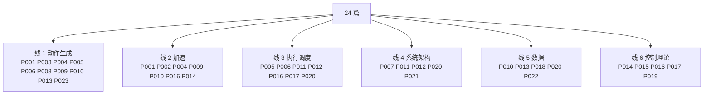
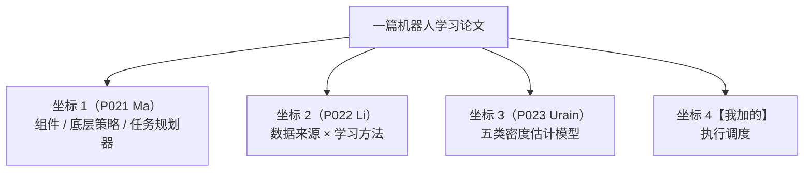
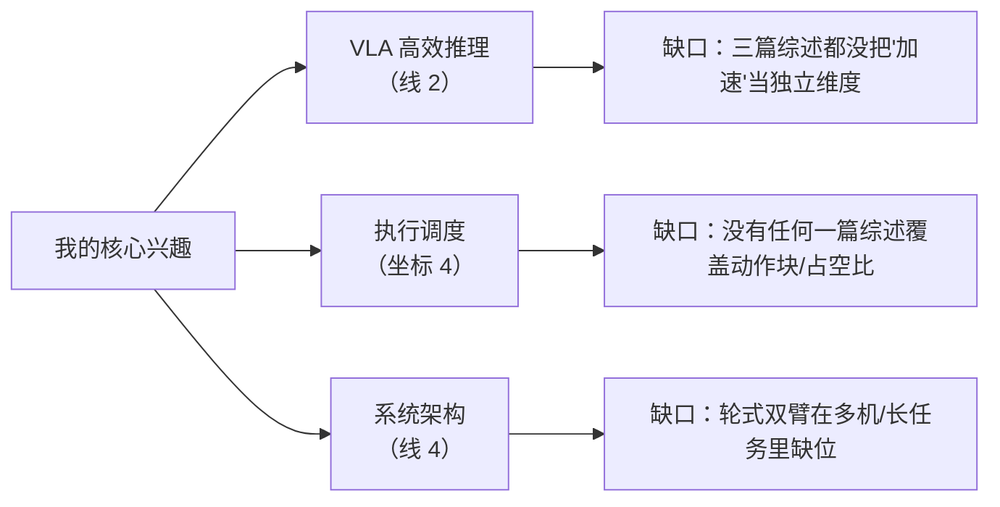
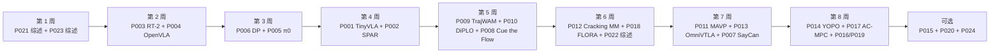

# 横向比较与总结：24 篇文献的一张地图

> [!abstract] 这份文档是什么
> 前面 24 篇、120 个笔记是"逐篇精读"。这份是**把它们放在一起看**：一张总表、六条主线、三个正交坐标、若干条可复用的判断，最后是我自己的研究定位。
> **证据分级**：沿用全库约定——【原文·§X/Fig.N/Table N】= 原文直接给出；【推断】= 我的推理；【原文未给出】= 缺口。

返回 [[00_文献总索引]]

---

## 一、24 篇总表

### 1.1 核心信息

| # | 简称 | 年份/出处 | 一句话贡献 | 动作表示 | 报告延迟 | 开源 |
|---|---|---|---|---|---|---|
| P001 | TinyVLA | 2025 RA-L | 换小视觉编码器 + 扩散头，10× 快 | 扩散（连续） | ✅ | ✅ |
| P002 | SPAR | 2026 预印本 | 双维度结构化剪枝 + PPO 恢复 | 离散 token | ✅ | ❌ |
| P003 | RT-2 | 2023 CoRL | VLA 一词的提出者，动作即语言 token | 离散 token（256 bin） | ✅ | ❌ |
| P004 | OpenVLA | 2024 CoRL | 开源 7B VLA，LoRA 微调 | 离散 token | ✅ | ✅ |
| P005 | π0 | 2024/2026 | 流匹配动作头 + 动作块 | 流匹配 | ✅ | ✅ |
| P006 | Diffusion Policy | 2023 RSS | 扩散策略范式，T_a=8 步 | 扩散 | ✅ | ✅ |
| P007 | SayCan | 2022 CoRL | LLM 打分而非生成，接地到技能 | 技能序列 | ❌ | ❌ |
| P008 | Cue the Flow | 2025 CoRL | 热图引导流匹配，无需重训 | 流匹配 + 引导 | ✅ | ✅ |
| P009 | TrajWAM | 2026 预印本 | 轨迹级世界模型 + 动作 rollout 蒸馏 | 流匹配 + 蒸馏 | ✅ | ❌ |
| P010 | DiPLO | 2026 预印本 | 特权信息自蒸馏（SD:DPO）+ DA:PPO | 扩散 | ✅ | ❌ |
| P011 | MAVP | 2026 预印本 | 底盘动作改成"地图位姿目标" | 混合（臂块 + 底盘反馈） | ❌ | ❌ |
| P012 | Cracking MM | 2026 预印本 | 失败诊断 → 四个外挂，19%→47% | 子任务指令 | ❌ | 将开源 |
| P013 | OmniVTLA | 2026 RA-L | 语义对齐触觉 + 双编码器 | 流匹配 | ❌ | ❌ |
| P014 | YOPO | 2024 RA-L | 单阶段规划，建图+搜索+优化合一 | 多项式轨迹 | ✅ 1.6/16 ms | ✅ |
| P015 | Anisotropic Expl. | 2026 RA-L | 方向 × 梯度的各向异性代价 | 探索目标 | ✅ 30 ms | ❌ |
| P016 | Neuromorphic QP | 2025 RAM | QP 映射到 Loihi 2，EDP 好 2 个量级 | QP 解 | ✅ <10 ms | 部分 |
| P017 | AC-MPC | 2026 T-RO | 网络输出代价，可微 MPC 出动作 | 控制指令 | ❌ | ✅ |
| P018 | FLORA | 2026 T-RL | 5 条示范学符号势函数奖励 | 奖励程序 | ❌ | ❌ |
| P019 | Koopman 综述 | 2026 T-RO | 全局线性化的六层地图 | 线性模型 | 矩阵乘 | ✅ 教程 |
| P020 | euROBIN 配送 | 2025 RAM | 8 台异构机器人接力配送 18 min | 任务级接力 | ❌ | 部分 |
| P021 | VLA 综述 (Ma) | 2026 TNNLS | 三线分类 + 九条挑战 | 分类体系 | — | 仓库 |
| P022 | 灵巧操作综述 (Li) | 2026 RAM | 数据 × 学习二维地图 + 三条挑战 | 综述 | — | ❌ |
| P023 | 生成模型综述 (Urain) | 2026 T-RO | 五类密度估计 + 速度/表达力 trade-off | 综述 | — | ❌ |
| P024 | 采矿综述 (Leung) | 2025 RAM | 露天采矿九步流程 + 自动化地图 | 工业导论 | — | ❌ |

### 1.2 按"对我方向的价值"排序

| 层级 | 论文 |
|---|---|
| **必读（★★★★★）** | P021 综述（坐标）、P006 扩散、P005 π0、P009 TrajWAM、P010 DiPLO、P023 生成模型综述 |
| **强相关（★★★★）** | P001 TinyVLA、P002 SPAR、P003 RT-2、P004 OpenVLA、P008 Cue the Flow、P012 Cracking MM、P013 OmniVTLA、P014 YOPO、P017 AC-MPC、P018 FLORA、P022 灵巧综述 |
| **背景（★★★）** | P007 SayCan、P011 MAVP、P016 神经形态 QP、P020 euROBIN |
| **外围（★★ 及以下）** | P015 各向异性探索、P019 Koopman、P024 采矿 |

---

## 二、六条主线

### 2.1 线 1：动作生成（最厚，10 篇）

**五种表示方式**（对齐 P023 综述的五类）：

| 表示 | 代表 | 推理代价 | 优点 | 缺点 |
|---|---|---|---|---|
| 离散 token（256 bin） | RT-2、OpenVLA、SPAR | 1 步 | 复用 LLM 全套工具 | 离散化误差、输出层大 |
| 扩散 | DP、TinyVLA、DiPLO | 多步（8–100） | 多峰表达力强 | 慢 |
| 流匹配 | π0、Cue the Flow、TrajWAM、OmniVTLA | 10 步左右 | 比扩散更直（直线插值） | 仍需多步 |
| 混合/回归 | MAVP 的 ACT 分支 | 1 步 | 快 | 多峰表达弱 |
| 奖励/代价（不直接出动作） | FLORA、AC-MPC | — | 可解释、可组合 | 需下游优化 |

**关键判断**：**"多峰"是模仿学习的核心难点**（P023 §II）。左绕/右绕的平均值是"撞上去"——所以必须用生成模型，不能用 MSE 回归。

### 2.2 线 2：加速（7 篇）

**四类手段**：

| 手段 | 代表 | 效果（原文数字） |
|---|---|---|
| **取消一个环节** | YOPO（P014）取消建图 | 61.9 → 1.6 ms（建图占 78%） |
| **换更小的组件** | TinyVLA（P001）换视觉编码器 | 10× 快 |
| **减步数（蒸馏）** | TrajWAM（P009）、DiPLO（P010）、TinyVLA | 步数 100 → 1–4 |
| **压参数 / 低精度** | SPAR（P002）剪枝、OpenVLA（P004）int4 | -96% 参数 / 显存降 |
| **换硬件** | 神经形态 QP（P016）Loihi 2 | EDP 好 2 个量级 |

> [!important] 我的核心判断
> **加速最有效的方式是"取消一个环节"，而不是"把每步做快"。**
> YOPO 的 78% 时间花在"建图"上——取消它，胜过任何模型优化。

### 2.3 线 3：执行调度（7 篇，我加的第 4 维）

**占空比 = 推理时间 / 执行窗口**（我在这个知识库里定义的量化指标）：

| 系统 | 决策周期 | 块长 | 占空比 |
|---|---|---|---|
| RT-2（P003） | 每步 | 1 | ~100% |
| MPC（P016/P017） | 10 ms | 无块 | ~100% |
| YOPO（P014） | 15 Hz | 2 s 轨迹，只执行 1/30 | ~1.6 ms / 66 ms ≈ **2.4%** |
| TrajWAM（P009） | — | 执行 8 步 | ~68%（估算） |
| π0（P005） | — | 50 步执行 16/25 | **9% / 32%–50%** |
| DP（P006） | — | T_a=8 / T_p=16 | **50%** |
| MAVP（P011） | 混合 | 臂 30/24 步 + 底盘连续反馈 | 分部件 |

**三条结论**：
1. **动作块是"用开环换吞吐"**——块越长，占空比越低，但开环漂移风险越大；
2. **平台速度决定块长**：四旋翼 5.5 m/s → 只敢开环 66 ms（YOPO）；机械臂慢 → 可以开环 0.8 s（π0）；
3. **接触密集任务需要更短的块**（P022 推论）：灵巧操作对延迟极敏感，几十毫秒就错过接触窗口。

### 2.4 线 4：系统架构（5 篇）

| 架构 | 代表 | 核心主张 |
|---|---|---|
| 分层 + 技能库 | SayCan（P007） | LLM **打分**而非生成，减少幻觉 |
| 诊断 + 外挂 | Cracking MM（P012） | 先量化失败分布，再对症下药 |
| 混合调度 | MAVP（P011） | 不同部件用不同执行方式 |
| 异构多机 | euROBIN（P020） | 串行链 + 遥操作兜底 |
| 分类体系 | VLA 综述（P021） | 组件 / 策略 / 规划器三线 |

**关键判断**：
- **"失败前沿会移动"**（P012）：修好规划，导航暴露；修好导航，操作暴露。
- **串行链的可靠度是各段乘积**（P020 + P024）→ 解法是"插缓冲/解耦"，不是"让每环更强"。

### 2.5 线 5：数据（5 篇）

| 数据策略 | 代表 | 关键数字 |
|---|---|---|
| 自建专用数据集 | OmniVTLA（P013） | 56 物体 / 13.5 万样本 |
| 少量示范 | FLORA（P018） | **5 条**示范 |
| 合成 / 增广 | DiPLO（P010） | 29 段 → 898 → 7,184 |
| 遥操作 | π0、MAVP、euROBIN | 40–50 条/任务 |
| 综述视角 | 灵巧综述（P022） | "瓶颈是数据，不是模型" |

> [!important] 我的一处自我纠正
> 我前 21 篇里只有 4 篇真正处理"数据从哪来"——**我的阅读重心偏向模型，而领域瓶颈在数据**（P022 §Open Challenges）。

### 2.6 线 6：控制理论（5 篇）

| 方法 | 代表 | 与学习的结合方式 |
|---|---|---|
| 单阶段规划 + 引导学习 | YOPO（P014） | 代价梯度做监督 |
| 各向异性代价 | 各向异性探索（P015） | 无学习 |
| 硬件求解 QP | 神经形态 QP（P016） | 无学习 |
| 可微优化 + RL | AC-MPC（P017） | 网络输出代价 |
| 全局线性化 | Koopman（P019） | 无学习 |

**关键判断**：**"学习 + 优化"有三种分工**——
1. 优化器提供**训练信号**（YOPO）；
2. 优化器**执行**网络给的代价（AC-MPC）；
3. 网络**不参与**，优化器全包（神经形态 QP）。

---

## 三、三个正交坐标 + 我的第四条线

三篇综述刚好给了三个正交的分类维度：

**任何一篇论文都能在这四个坐标里各取一个值。**

例：
| 论文 | 坐标 1 | 坐标 2 | 坐标 3 | 坐标 4 |
|---|---|---|---|---|
| π0（P005） | 组件=VLM / 策略 / 不分层 | 遥操作 × IL | 流匹配 | 块长 50，执行 16/25 |
| FLORA（P018） | 组件=奖励学习 | 5 条人类示范 × IL+RL | 不适用（学奖励） | 每帧打分 |
| YOPO（P014） | 策略=单阶段规划 | 仿真 × 非学习 | 不适用 | 2 s 轨迹，执行 1/30 |
| Cracking MM（P012） | 规划器=模块化 | 遥操作 × 冻结策略 | 不适用 | 子任务级接力 |

**坐标 4 是我加的**，因为三篇综述都没覆盖"动作块 / 重规划频率 / 占空比"——而这恰好是我的研究兴趣。

---

## 四、十二条可复用的判断（全库精华）

> 每条都标注了出处；标【推断】的是我的推理。

| # | 判断 | 证据 |
|---|---|---|
| 1 | **加速最有效的方式是"取消一个环节"** | YOPO 取消建图，占 78% 时间（P014 表 II）【原文证明】 |
| 2 | **当监督信号来自代价而非示范时，模型可超过示范上界** | YOPO 平均代价 0.050 < 专家 0.078（P014 表 I）【原文证明】 |
| 3 | **显式目标必须配稳定坐标系** | MAVP：里程计位姿 16% < 无锚速度 38%（P011 表 II）【原文证明】 |
| 4 | **失败前沿会移动** | Cracking MM：修好规划/导航后操作成为主因（P012 §5.2）【原文证明】 |
| 5 | **信息质量 > 信息数量** | Cracking MM：均匀给 32 帧（35%）比 8 帧（37%）差；按需检索 16 帧达 47%（P012 表 2）【原文证明】 |
| 6 | **不变量不是学出来的，是选出来的** | FLORA：LIV 零样本 −0.13，运动流表示 0.97（P018 表 I）【原文证明】 |
| 7 | **理论保证 ≠ 工程可用** | PBRS 保证最优策略不变，但在长任务里"势能坍塌"（P018 §IV-C）【原文证明】 |
| 8 | **先把强先验给进去，再蒸馏掉** 优于 "从不够" | DiPLO：99.5/98.8 vs 74.1/67.0（P010）【原文证明】 |
| 9 | **离线指标不能替代闭环成功率** | OmniVTLA：离线 MSE 最低的模型在线仅 84.4%/43.3%（P013 图 4 vs 表 II/V）【原文证明】 |
| 10 | **视觉编码器必须微调** | OpenVLA：冻结 47.0 vs 微调 69.7（P004）【原文证明】 |
| 11 | **过时的动作 = 正确性问题** | VLA 综述 §VI-f："推理跟不上变化 → 反复生成过时动作"（P021）【原文证明】 |
| 12 | **串行链的可靠度是乘积，解法是插缓冲** | euROBIN 用遥操作兜底 + 采矿用堆存缓冲（P020/P024）【推断 + 原文】 |

**另外三条我反复引用的量化对照**：
- **占空比**：π0 9% vs RT-2 ~100% —— 动作块把延迟摊薄了 11 倍（P005 vs P003）【原文 + 我的计算】；
- **灵巧操作对延迟极敏感**：数十毫秒已"太慢"（P022 §Open Challenges）【原文证明】；
- **执行时长 ∝ 1/平台速度**：四旋翼 66 ms、机械臂 0.8 s（P014 vs P005）【推断】。

---

## 五、我的研究定位

### 5.1 三个坐标上的位置

### 5.2 三个最推荐的切入点

#### 切入点 A：把"生成步数 × 执行块长"联合优化（最推荐）

| 项目 | 内容 |
|---|---|
| **为什么** | 三篇综述都没碰这个交叉点；而它直接决定端到端延迟与闭环质量 |
| **假设** | 最优块长 $\propto$ 生成步数；接触密集任务需要更短块 |
| **设计** | 二维扫描（步数 1/4/10/50 × 块长 1/4/16/32），测成功率与延迟 |
| **指标** | 闭环成功率、端到端延迟、占空比 |
| **风险** | 需要统一的实验平台 |

#### 切入点 B：以"闭环成功率"为指标的加速评估协议

| 项目 | 内容 |
|---|---|
| **为什么** | 现有加速论文多报 FPS/延迟；P021 §VI-f 指出延迟是正确性问题 |
| **设计** | 同一加速方法，在静态与动态（移动目标/扰动）任务上各测成功率 |
| **指标** | 成功率、延迟、**两者联合** |
| **价值** | 给领域一个更严格的协议 |

#### 切入点 C：因果/诊断式的失败归因用于 VLA 加速

| 项目 | 内容 |
|---|---|
| **为什么** | P012 的"失败归因"方法论 + P021 §VI-b "需要成功率之外的指标" |
| **设计** | 把 Cracking MM 的归因流程搬到 VLA：加速后哪类失败增加？ |
| **指标** | 失败分布的变化 |
| **价值** | 解释"为什么某个加速方法在某个任务上失效" |

### 5.3 我不建议做的（避免踩坑）

| 方向 | 原因 |
|---|---|
| 纯 Koopman / 控制理论 | 社区不同、评审不同（P019 交集小） |
| 工业级系统集成 | 需要真实硬件与团队（P020/P024 不可复现） |
| 从零训大 VLA | 算力门槛（P003/P004 复盘） |

---

## 六、24 篇的阅读路线（推荐）

**理由**：先建坐标（两篇综述），再读"动作生成"三族（token / 扩散 / 流匹配），再读加速与数据，最后读系统与控制。

---

## 七、证据完整性说明（重要）

### 7.1 读了全文/主要内容的（21 篇）

P001–P017、P020–P023 中的绝大多数：通过文本抽取 + 渲染表格核对。

### 7.2 只读了部分的（3 篇）

| 论文 | 原因 | 我读了什么 |
|---|---|---|
| **P018 FLORA** | PDF 为纯图像 | 渲染第 1/2/4/6 页；§VI-B/C/D 与附录**未核实** |
| **P024 采矿** | PDF 为中英对照图像版 | 渲染第 1–2 页；其余 18 页**未核实** |
| P003/P004（RT-2/OpenVLA） | 本地 PDF 为图像版双语裁剪 | 用 arXiv 全文 + 渲染表格，**已核对** |

### 7.3 全库标注为"未给出/未核实"的主要缺口

| 论文 | 缺口 |
|---|---|
| P011 MAVP | 推理延迟未报告 |
| P012 Cracking MM | 逐任务延迟、中间集成点数值 |
| P013 OmniVTLA | 推理延迟；表 VII 指标方向存疑 |
| P015 各向异性探索 | 感知模块单独耗时；消融反常未解释 |
| P016 神经形态 QP | **无闭环控制性能**；公式在 PDF 中错乱（已标注重建） |
| P020 euROBIN | 表 3 逐任务时间未逐格核对 |
| P024 采矿 | 18 页未读 |

---

## 八、一句话收尾

> **这 24 篇给我最重要的三件事：**
> ① **一个坐标系**——三篇综述给了三个正交维度，我补了第四条（执行调度）；
> ② **十二条可复用的判断**——每一条都有原文位置，能直接引用；
> ③ **一个清醒的自我定位**——我的兴趣在"加速 + 调度"，而这两者的交叉点（生成步数 × 块长）**目前没人系统做过**。
>
> 如果只让我留一句话：**"VLA 加速的最终指标不是 FPS，而是动态任务上的闭环成功率。"**
