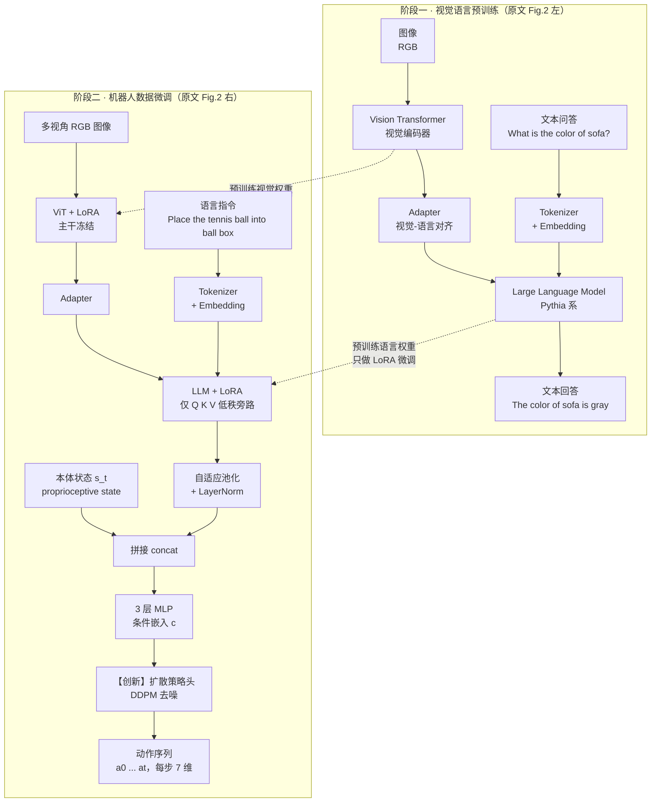
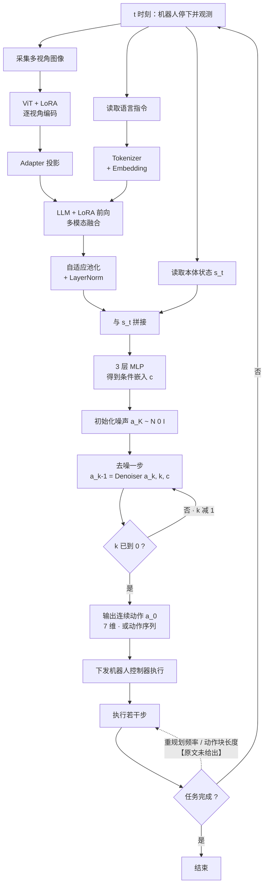
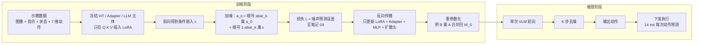
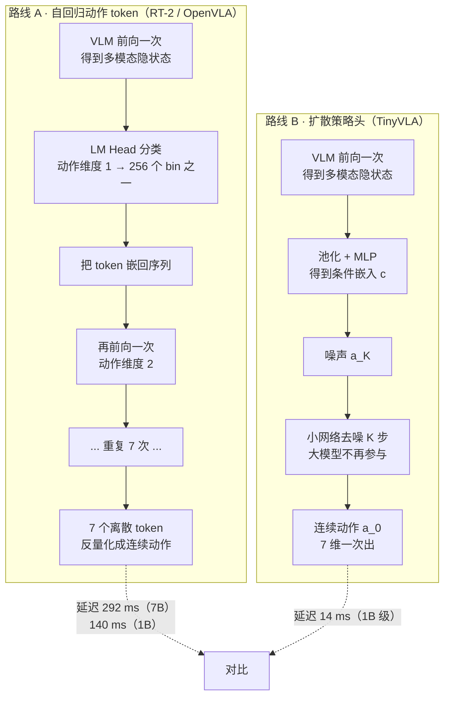
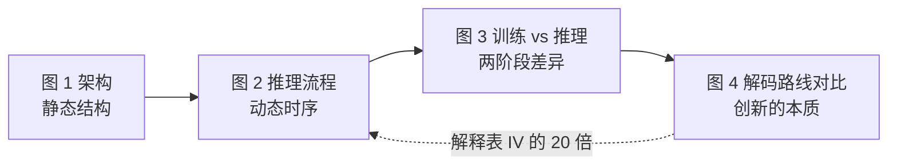

# P001 · 架构图与流程图

> 本文共 4 张图：
> **图 1 方法架构** ／ **图 2 推理运行流程（含闭环）** ／ **图 3 训练与推理对比** ／ **图 4 两条动作解码路线对比**
> 每张图后面都附：逐节点解释 → 数据如何流动 → 核心创新在哪 → 原文出处。
> 节点里的【创新】标记 = 我认为相对前人**新增**的部分；标【原文未给出】的节点 = 论文没说、我按架构必要性补的。
>
> 导航：[[Paper_001_TinyVLA/01_论文精读|01 精读]] ｜ [[Paper_001_TinyVLA/02_核心创新与方法|02 创新]] ｜ [[Paper_001_TinyVLA/04_术语和公式解释|04 术语]] ｜ [[Paper_001_TinyVLA/05_科研启发与复现建议|05 启发]]

---

## 图 1 · 方法架构（两阶段）



### 1.1 逐节点解释

| 节点 | 中文含义 | 职责 | 是否训练 |
|---|---|---|---|
| A1 / B1 | 输入图像 | 单臂 2 视角、双臂 3 视角 | — |
| A2 / B2 | 视觉编码器 ViT | 图像切成 patch，输出视觉 token | A2 全训；B2 冻结，仅 LoRA |
| A3 / B3 | 文本输入 | 阶段一是"看图问答"，阶段二是"操作指令" | — |
| A4 / B4 | 文本分词与嵌入 | 字符串 → 向量序列 | 词嵌入随模型 |
| A5 / B5 | Adapter | 把视觉 token 投影到语言模型的语义空间（LLaVA 的关键部件） | 训练 |
| A6 / B6 | 大语言模型 | 多模态融合 + 语义理解 | 冻结，仅 Q/K/V 上加 LoRA |
| A7 | 文本输出 | 阶段一的学习目标：证明模型"看懂了" | — |
| B7 | **自适应池化 + LayerNorm** | 把变长 token 序列压成定长向量 | 原文未说明是否可训 |
| B8 | 本体状态 | 关节位置等机器人自身状态 | — |
| B9 | 拼接 | $[z ; s_t]$，让策略知道"我现在在哪" | — |
| B10 | 3 层 MLP | 融合视觉语义与本体状态，得到条件嵌入 $c$ | 全参数训练 |
| B11 | **【创新】扩散策略头** | 在 $c$ 条件下把噪声去噪成动作 | 全参数训练 |
| B12 | 动作输出 | 连续 7 维（位置 3 + 欧拉角 3 + 夹爪 1） | — |

### 1.2 数据如何流动

1. **图像支路**：图像 → ViT → 视觉 token（每视角一组）→ Adapter → 与文本 token 拼成一条序列 → LLM。
2. **语言支路**：指令 → 分词 → 嵌入 → 同一条序列。
3. **融合点**：LLM 内部的自注意力（视觉 token 与文本 token 在此互相"看见"）。
4. **读出点**：LLM 最后层的隐状态 → 池化 → LayerNorm → 定长 $z$。**这是全篇最容易被忽略的一步**：因为 LLM 输出是变长的，而后续 MLP 需要定长输入。
5. **条件构造**：$z$ 与本体状态 $s_t$ 拼接 → MLP → $c$。
6. **动作生成**：扩散头以 $c$ 为条件，从噪声 $a_K \sim \mathcal{N}(0,I)$ 出发，迭代去噪得到 $a_0$。

### 1.3 核心创新在哪

- **唯一真正的创新节点是 B11**（扩散策略头）。
- B2/B6 上的 LoRA 是"配套措施"：没有它，小 VLM 微调后语义先验会被破坏，B11 再好也没用。
- B7 的池化是"必要的胶水"：没有它接不上 MLP，但它本身不是创新。
- 图上用虚线表示的两个箭头（A2→B2、A6→B6）是**两阶段之间的唯一联系**：阶段一只负责"教会模型看图说话"，阶段二完全不继承阶段一的输出头（因为输出头被换掉了）。

### 1.4 原文出处

| 图 1 中的内容 | 原文位置 |
|---|---|
| 左右两栏结构（VLM 预训练 / 策略微调） | Fig. 2 |
| 图中 $a^0 \cdots a^t$ 的动作序列标注 | Fig. 2 右 |
| "adopt diffusion policy as our policy head" | §III-A 末、§III-B |
| LoRA 加在 Q/K/V 上、占 5.0% | §III-B 第 1 段 |
| 自适应池化 + LayerNorm → 拼接 → 3 层 MLP | §III-B 第 2 段 |
| 7 维动作定义 | §IV-A（Data collection） |
| ViT + LoRA / Adapter / LLM + LoRA 的标注 | Fig. 2 右（图上直接写了 "ViT+LoRA" "LLM+LoRA"）|

---

## 图 2 · 算法实际运行流程（推理 + 闭环）



### 2.1 逐节点解释

| 节点 | 含义 | 说明 |
|---|---|---|
| S0 | 控制循环的起点 | 每一步都要重新观测（这是 VLA 的"闭环"体现） |
| S1/S2/S3 | 三类输入 | 图像、指令、本体状态 |
| P1/P2/P3 | 感知与编码 | 每个视角单独过 ViT，再把 token 拼起来 |
| F1 | 多模态融合 | LLM 内部注意力完成；这是延迟最大的一环 |
| R1 | 特征压缩 | 变长 → 定长 |
| C1/M1 | 条件构造 | 把"看到的世界"和"自己的身体"合起来 |
| D0-D2 | 扩散去噪循环 | $K$ 步迭代，**$K$ 原文未给出** |
| O1 | 动作输出 | 连续值，不是 token |
| X1/X2 | 执行 | 交给控制器；执行多少步后重新规划**原文未给出** |
| Q1 | 终止判断 | 由外部逻辑（人或检测器）判断 |

### 2.2 数据如何流动（时间顺序）

```
观测 → 编码 → 融合 → 压缩 → 条件化 → 迭代去噪 → 动作 → 执行 → 再观测 → ...
        ↑                                    ↓
        └──────────── 闭环反馈 ───────────────┘
```

关键点有两个：
1. **动作不是"一步"而是"一段"**：图 2 右标的是 $a^0 \cdots a^t$，说明一次推理产生多步动作。但**这一段执行完再重新推理，还是执行 1 步就重新推理，原文没说**。
2. **闭环频率取决于三件事的乘积**：LLM 前向时间（大头）+ 去噪步数 $K$ + 控制器执行时间。论文只给了第一项的部分证据（14 ms），另外两项缺失。

### 2.3 核心创新在哪

- **D1（去噪循环）替代了传统 VLA 的"自回归解码循环"**。两者都是"循环"，但成本结构完全不同：
  - 自回归：每次循环都要过一次**大模型**（因为要重新计算上下文）；
  - 去噪：每次循环只过一次**小网络**（大模型只在前面前向一次）。
- 这个"把循环从大模型内部搬到小网络内部"的动作，就是 20 倍加速的来源。

### 2.4 原文出处

| 内容 | 原文位置 |
|---|---|
| 每步重新观测、图像+指令→动作 | Fig. 2（数据流画法） |
| "VLM backbone encodes raw observations and language instructions into multimodal embedding vectors" | §III-B |
| 池化 + LayerNorm + 拼接 + 3 层 MLP | §III-B |
| 扩散头用 DDPM 预测噪声 | §III-B |
| 输出 $a^0 \cdots a^t$ | Fig. 2 右 |
| K 步数、执行步数、控制频率 | **【原文未给出】** |

---

## 图 3 · 训练阶段 vs 推理阶段



### 3.1 逐节点解释

| 节点 | 阶段 | 说明 |
|---|---|---|
| T1 | 训练 | 遥操作数据，每任务 100 条轨迹 |
| T2 | 训练 | **冻结策略**是本文"不遗忘"的关键 |
| T3 | 训练 | 与推理的前 4 步完全相同（训练/推理共享"编码-条件化"路径） |
| T4 | 训练 | DDPM 前向加噪，把干净动作变成带噪动作 |
| T5 | 训练 | 用网络预测所加的噪声（详见笔记 04） |
| T6 | 训练 | 梯度只流向 LoRA + Adapter + MLP + 扩散头 |
| T7 | 训练后 | 重参数化：$W = W_0 + BA$ 变成一个普通权重矩阵，推理零开销 |
| I1-I4 | 推理 | 没有反向传播、没有加噪、没有标签 |

### 3.2 数据如何流动（两阶段差异）

- **训练**：动作标签 $a_0$ **主动被加噪**成 $a_k$，网络学"从 $a_k$ 里把噪声抠出来"。这是一个"人为制造监督信号"的过程。
- **推理**：没有真实动作可用，于是**从纯噪声开始**，反复调用同一个去噪网络，把噪声一步步"抠掉"。
- **两者的接口必须是同一个网络**：训练时喂 $a_k$ 和步数 $k$，推理时同样喂 $a_k$ 和 $k$。这也是为什么扩散模型的推理天然是"多步循环"。

### 3.3 核心创新在哪

- **T2 的"冻结 + LoRA"**：让"语义先验"和"动作技能"分工——VLM 管看懂，动作头管动手。
- **T7 的重参数化**：这是论文里最容易漏读、但在工程上很实用的一招。LoRA 训练时是两条支路（$W_0 x + BAx$），合并后只有一条（$Wx$），**推理时省掉一次矩阵乘**。

### 3.4 原文出处

| 内容 | 原文位置 |
|---|---|
| 冻结 + LoRA，占 5.0% | §III-B 第 1 段 |
| "we apply re-parameterization techniques to integrate the LoRA module seamlessly into the standard language model, thereby enhancing inference speed" | §III-B 第 1 段末 |
| DP 头全参数训练 | §III-B 末 |
| "DP ... predicts the noise instead of direct actions" | §III-B |
| 训练超参、步数、rank | **【原文未给出】** |

---

## 图 4 · 两条动作解码路线对比（理解创新的关键图）

这张图不是论文里的原图，是我为了讲清"创新到底改了什么"而画的**教学对比图**（依据：§I 对 RT-2/OpenVLA 的描述 + §III-B 对 DP 头的描述）。



### 4.1 逐节点解释

| 节点 | 含义 |
|---|---|
| RA1 | 大模型只前向一次，但之后每生成一个 token 都要把整个序列再喂一遍（工程上可用 KV cache 缓解，但仍是串行） |
| RA2 | 把连续动作量化成 256 个 bin 的分类问题 |
| RA3-RA5 | 自回归的核心：**上一步的输出是下一步的输入**，因此无法并行 |
| RA6 | 反量化：bin 索引 → 连续值，这里会引入量化误差 |
| DB1-DB2 | 大模型只前向一次 |
| DB3-DB4 | 去噪循环发生在**小网络**内部，与大模型解耦 |
| DB5 | 7 维一次性输出，没有串行依赖 |

### 4.2 数据如何流动的差异

- **路线 A 的瓶颈在"循环体内是大事"**：每次循环都要过 7B 模型。
- **路线 B 的瓶颈在"循环体外的一次前向"**：循环体内只是 3 层 MLP 级别的网络。
- 这就是为什么"换小骨干"只带来 2 倍加速，而"换解码方式"带来 10 倍（表 IV）。

### 4.3 核心创新在哪

**创新 = 把"循环"从大模型搬到小模型。** 这句话可以作为你面试/答辩时的一句话总结。

### 4.4 原文出处

| 内容 | 原文位置 |
|---|---|
| RT-2 用离散 token 化 | §III-B "as has been done in RT-2" |
| token 化的三个问题（难训练 / 需大量数据 / 塌缩到单一状态） | §III-B，引 [31]-[34] |
| OpenVLA 延迟 292 ms、换 1B 骨干 140 ms | 表 IV |
| TinyVLA 14 ms | 表 IV |
| "avoids the computationally expensive autoregressive generation of action tokens" | §V-C |

---

## 五、四张图之间的关系



- **图 1 回答"系统长什么样"**；
- **图 2 回答"一次动作是怎么产生的"**；
- **图 3 回答"训练和推理哪里不一样"**；
- **图 4 回答"凭什么比别人快"**——这是四张图里唯一直接对应实验结论的。

---

## 六、自检：这些图里哪些是"原文有"，哪些是"我补的"

| 图中元素 | 性质 |
|---|---|
| 阶段一/阶段二两栏结构 | 【原文·Fig.2】 |
| ViT+LoRA、Adapter、LLM+LoRA、Policy Head 的标注 | 【原文·Fig.2】 |
| 自适应池化 → LayerNorm → 拼接 → 3 层 MLP | 【原文·§III-B 文字】 |
| $a^0 \cdots a^t$ 动作序列 | 【原文·Fig.2】 |
| 去噪循环 $K$ 步的具体画法 | 【推断】依据 "DDPM predicts the noise" |
| 闭环箭头（执行→再观测） | 【推断】依据 VLA 的通用工作方式 |
| 重规划频率、动作块长度 | **【原文未给出】**，图中用虚线标注 |
| 图 4 整张 | 【教学图】我画的，不是原文 |
| 张量形状 | 【推断】原文未给 |
