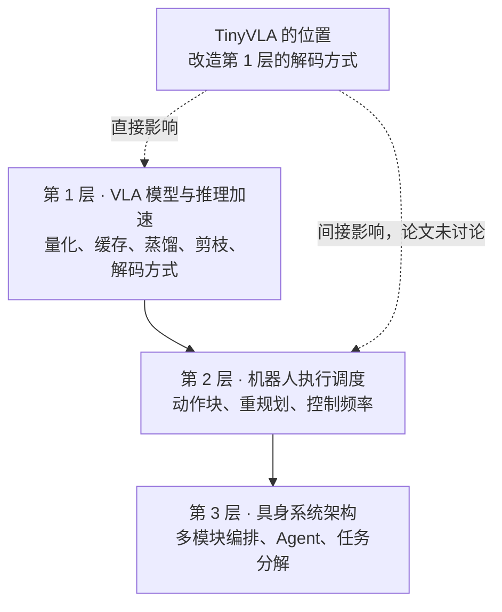

# P001 · 科研启发与复现建议

> 这一篇回答"**这篇论文对我有什么用**"。
> 所有结论分三级标注：**【原文证明】**（论文里有直接实验）、**【合理推测】**（我基于原文的推理）、**【待验证】**（必须做实验才知道）。
>
> 导航：[[Paper_001_TinyVLA/01_论文精读|01 精读]] ｜ [[Paper_001_TinyVLA/02_核心创新与方法|02 创新]] ｜ [[Paper_001_TinyVLA/03_架构图与流程图|03 图]] ｜ [[Paper_001_TinyVLA/04_术语和公式解释|04 术语]]

---

## 一、先把我的三个研究方向摆出来

你的兴趣可以拆成三层，TinyVLA 落在最底下一层：

**TinyVLA 只动了第 1 层**，而且只动了第 1 层里的"解码方式"。它对第 2、3 层几乎没有讨论——这既是它的局限，也是你的机会。

---

## 二、A–H 八问（严格区分证据等级）

### A. 对 VLA 推理加速有什么启发？

**【原文证明】的三条**

1. **加速要先归因，再动手。** 表 IV 把 20 倍拆成"换骨干 2 倍"和"换解码 10 倍"，这是本文最有方法论价值的部分。你做加速实验时应该复制这个设计：**固定一个变量，只改一个部件，测延迟**。
2. **最大的加速来自改结构，不是改实现。** 换更小的骨干只是线性收益；把"7 次大模型前向"变成"1 次大模型前向 + K 次小网络前向"是结构性收益。→ **选题启示：优先找"循环体在大模型内部"的地方下手。**
3. **训练期技巧可以在推理期免费。** LoRA 重参数化让推理时完全没有额外分支（§III-B）。这类"训练时贵一点、推理时零成本"的技巧，在部署论文里非常有说服力。

**【合理推测】**

4. TinyVLA 的 14 ms 里，**VLM 前向仍是主要成本**（因为 K 次小网络去噪很便宜）。如果这个推断成立，那么对 1B 级 VLM 做**量化（INT8/INT4）+ KV cache 优化**，应该还能再降。→ 这是一个**几乎没人做过的组合**（TinyVLA + 量化），见下面研究点 #1。
5. 扩散头的去噪步数 $K$ 是"精度-延迟"旋钮，但原文没调。**如果 K 从 10 降到 3，延迟能降多少、成功率掉多少**——这是一个便宜且容易发论文的消融。

**【待验证】**：以上都需要实测。

---

### B. 对动作分块 / 执行调度有什么启发？

**这是本文最薄弱的环节，也是最有价值的研究缺口。**

| 问题 | 原文状态 | 为什么重要 |
|---|---|---|
| 一次推理输出几步动作（$T$）？ | 图 2 画了 $a^0\cdots a^t$，正文未说 | 决定"推理延迟"能被摊薄多少 |
| 执行几步后重新推理？ | **未给** | 决定闭环响应速度与漂移风险 |
| 控制频率多少 Hz？ | **未给** | 决定能不能上真机做动态任务 |
| 动作是绝对位姿还是增量？ | **未给** | 决定误差累积方式 |

**【合理推测】**：TinyVLA 之所以敢把延迟压到 14 ms，很可能是因为**它根本不需要靠"快"来保证闭环**——只要动作块足够长，即使 292 ms 的 OpenVLA 也能跑（这也是 Diffusion Policy 能工作的原因）。换句话说：

> **"VLA 慢"这个问题，一部分是模型问题，一部分是调度问题。TinyVLA 用模型手段解决了模型那一半，但没有碰调度那一半。**

这句话可以直接作为你博士期间一个研究方向的立论：**联合优化"模型延迟 × 动作块长度 × 重规划策略"**。见研究点 #2。

---

### C. 对量化、缓存、模型压缩是否有帮助？

**【原文证明】**：TinyVLA 没有做任何量化、缓存或压缩。它用的是"换小模型"这条最朴素的路。

**【合理推测 / 有价值的空白】**：

| 技术 | 能否用在 TinyVLA 上 | 潜在问题 |
|---|---|---|
| 权重量化（INT8/INT4） | 能，VLM 部分最适合 | 视觉 token 的激活值分布可能很宽，需 per-channel |
| KV cache 压缩 | 部分能——但注意 TinyVLA 只前向一次，没有自回归生成，**KV cache 的收益比 OpenVLA 小得多** | 这是一个反直觉的点：**去掉了自回归，也就去掉了 KV cache 加速的用武之地** |
| 结构化剪枝 | 能，见 P002 SPAR | 剪枝后 VLM 语义能力下降，可能重演 TinyVLA-S 的失败 |
| 蒸馏 | 能：用大 VLA 蒸馏小 VLA | 教师模型的动作分布是多峰的，蒸馏到单峰 MLP 会失真；扩散头天然适合蒸馏（可以匹配去噪轨迹）|
| 扩散步数蒸馏（consistency / shortcut） | **非常适合**——这是扩散模型领域的成熟加速手段，但 VLA 领域用得少 | 可能损失动作多模态性 |

> **一个我认为很有潜力的组合**：把「扩散步数蒸馏（4 步 → 1 步）」+「VLM INT8 量化」一起用在 TinyVLA 上，理论上能把 14 ms 再压到个位数。**但要注意**：一旦 $K=1$，扩散头就退化成普通回归头，表 V 里 MLP 全 0 的现象可能会重演——**这正是需要实验验证的关键点**（【待验证】）。

---

### D. 是否能用于轮式双臂机器人？

**【原文证明】**：TinyVLA 已经在**双臂 UR5** 上做过实验（表 III），三个双臂任务成功率分别为 76.7% / 36.7% / 30.0%。
**【原文证明】**：OpenVLA 在双臂任务上全 0，作者归因于 OpenX 只有单臂数据（§IV-D）。

**【合理推测】**：

- TinyVLA 的架构**天然支持双臂**：动作维度从 7 扩到 14 即可，扩散头对输出维度没有限制。这是它相对"token 化"方案的一个隐性优势——**token 化方案要为每个新维度设计新的 token 词表位置**。
- 但双臂的成功率并不高（StackCubes 36.7%、PlaceTennisBag 30%），说明**双臂协调本身很难**，不是换个动作头就能解决。
- **轮式底盘 + 双臂**会引入第三个问题：**移动与操作的耦合**（base 在动，机械臂怎么补偿）。TinyVLA 完全没有处理这个（它的实验都是固定基座）。→ 这正是 P011 MAVP、P012 Cracking Mobile Manipulation 这类工作要解决的。见 [[00_文献总索引]]。

**【待验证】**：轮式双臂上的动作维度设计（底盘 3 维 + 双臂 14 维 = 17 维？）、action space 归一化、以及移动带来的视觉分布漂移。

---

### E. 是否需要真实硬件？

| 阶段 | 需要什么 | 成本量级（估算，非原文） |
|---|---|---|
| 只复现仿真结果 | 1 张 24G 显卡（如 4090） | 低 |
| 复现真实单臂 | Franka Panda + 2 台 ZED2 | 高（数十万元级） |
| 复现双臂 | 2 台 UR5 + 3 台 RealSense | 很高 |
| **替代方案** | 用 MetaWorld / RoboSuite / ManiSkill 仿真 + 开源低成本臂（SO-100/ALOHA 类） | 中低 |

**【合理推测】**：TinyVLA 的**核心主张（解码方式影响延迟）在仿真里就能验证**，不需要真机。真机主要用来验证"泛化"和"闭环稳定性"。所以对本科阶段，**仿真足够**。

---

### F. 能否在仿真中先复现？

**【合理推测】可以，而且应该。** 三条理由：
1. MetaWorld 是公开 benchmark（50 任务），表 I 给了完整的按难度分组数字，可对齐。
2. 仿真里可以**精确测延迟**（不受真实相机、通信影响）。
3. 仿真里可以**扫动作块长度 $T$**——这在真机上很贵。

**但要注意一个陷阱**：MetaWorld 是**低维状态 + 短回合**的任务，与真实操作差距大。表 I 里 TinyVLA-H 在 Very Hard 上只有 15.8%，说明连仿真都没做好。**不要用 MetaWorld 的高分去推断真机表现。**

---

### G. 本科阶段能否完成小规模实验？

**【我的判断】能，但要缩到"一个变量"。** 推荐的最小可行实验：

> **题目**：在 MetaWorld 的 5 个任务上，比较「MLP 动作头」「扩散动作头（K=10）」「扩散动作头（K=3）」的**成功率与推理延迟**，骨干固定为同一个开源小 VLM。

- 数据集：MetaWorld 官方示范（公开）。
- 变量：只有"动作头"。
- 指标：成功率 + 单次动作延迟 + 训练时间。
- 预期结论：【合理推测】K=10 与 K=3 成功率接近，但延迟差 2–3 倍；MLP 头显著差于扩散头（复现表 V 的趋势）。
- 风险：MLP 头可能不像原文那样全 0（原文结果过于极端），这本身就是有价值的"复现差异"发现。

见下面"研究点 #3"的详细设计。

---

### H. 博士阶段能否进一步拓展？

能，而且有至少三条互相独立的线：

1. **加速线**：TinyVLA + 量化 + 扩散步数蒸馏（研究点 #1）。
2. **调度线**：延迟感知的动作块调度（研究点 #2）——这条线最"空白"，也最贴合你的"执行调度"兴趣。
3. **系统线**：把 TinyVLA 作为"快系统"、把大 VLA 作为"慢系统"，做双系统架构（类似快慢思考）——这与 P005 π0 的思路有关，但我**未核实** π0 是否采用这种结构，需读原文后再判断。

---

## 三、六个可落地的研究点（含实验设计）

### 研究点 #1：TinyVLA 的"再加速"——量化 + 扩散步数蒸馏

| 项目 | 内容 |
|---|---|
| **动机** | 表 IV 显示 14 ms 中主要是 VLM 前向，量化应有效；扩散步数 $K$ 原文未调 |
| **假设** | INT8 量化 VLM + 4 步蒸馏扩散头，可把 14 ms 降到 ≤6 ms，成功率下降 <3 个百分点 |
| **变量** | ① 量化位宽（FP16 / INT8 / INT4）② 去噪步数（10 / 4 / 1） |
| **指标** | 单次动作延迟、成功率、动作平滑度（jerk） |
| **证据等级** | 【待验证】 |
| **风险** | 低比特量化可能破坏视觉 token 的细粒度定位能力（对应图 10 里"Inaccurate Positioning"这类失败） |
| **工作量** | 硕士/博士初期 3–6 个月 |

### 研究点 #2：延迟感知的动作块调度（我最推荐）

| 项目 | 内容 |
|---|---|
| **动机** | TinyVLA 完全没讨论"输出 $T$ 步、执行 $m$ 步、何时重规划"。而这三者的组合决定了**实际闭环频率**，比单次推理延迟更接近"机器人快不快" |
| **假设** | 存在一个最优 $(T, m)$ 使得"任务成功率 / 单位时间完成数"最大，且该最优点随模型延迟 $\tau$ 变化 |
| **设计** | 固定 TinyVLA-H 权重，在仿真里扫 $T \in \{1,4,8,16,32\}$、$m \in \{1,\dots,T\}$，画"成功率-延迟"帕累托前沿 |
| **关键指标** | 有效控制频率 $f_{\text{eff}}$、任务完成时间、扰动下的恢复率（人为推一下机械臂） |
| **证据等级** | 【待验证】，但理论依据来自动作块的通用原理（见笔记 04 §2.7） |
| **为什么值得做** | 这是一个**模型无关**的结论，可以套用到任何 VLA 上；而且实验便宜（纯仿真 + 固定权重，不需要训练） |
| **风险** | 可能得出"$T$ 越大越好"的平凡结论——那就需要加入扰动/动态任务来制造 trade-off |

### 研究点 #3：复现表 V（策略头消融），并解释"MLP 全 0"

| 项目 | 内容 |
|---|---|
| **动机** | 表 V 中 MLP 头 5 个任务全 0，原文没有解释。这种极端结果通常意味着**实现细节**而非"扩散更好" |
| **假设** | MLP 全 0 是因为输出层初始化/归一化/学习率与扩散头不匹配，而不是容量不足 |
| **设计** | 固定骨干，只换头：MLP（不同宽度/深度/归一化）、ACT、扩散（不同 $K$）；统一调学习率 |
| **价值** | 如果能把 MLP 调到 50%+，就说明原文结论被夸大；如果不能，就坐实"扩散头的结构性优势" |
| **证据等级** | 【待验证】 |
| **工作量** | 本科毕业设计可做 |

### 研究点 #4：把 TinyVLA 扩展到轮式双臂（17 维动作）

| 项目 | 内容 |
|---|---|
| **动机** | 表 III 双臂只有 30–76%，说明双臂协调仍是难点；轮式底盘又引入基座运动 |
| **设计** | 动作 = 底盘 $(v, \omega)$ + 双臂各 7 维；观察加入底盘位姿；在仿真（如 ManiSkill / RoboSuite）里做移动抓取 |
| **风险** | 高。动作维度上升后扩散头的条件建模变难；数据采集成本高 |
| **建议** | 先只做"固定基座 + 双臂"，再加底盘 |

### 研究点 #5：TinyVLA 的失败模式再分析

| 项目 | 内容 |
|---|---|
| **动机** | 图 10 做了很好的示范：把失败分类（定位不准/误解指令/未到目标/夹爪失败），能定位能力瓶颈 |
| **设计** | 在你自己的复现里做同样的失败分类，并**加上"动作平滑度"和"重规划次数"两个维度** |
| **价值** | 失败分析是低成本高产出的工作，适合作为一篇论文的"诊断章节" |

### 研究点 #6：VLM 骨干选择的系统性消融

| 项目 | 内容 |
|---|---|
| **动机** | 原文只试了 3 档自家 VLM + PaliGemma。而 2024–2026 年出现了很多小 VLM（SmolVLM、Qwen2-VL-2B、PaliGemma-3B 等） |
| **设计** | 固定扩散头与数据，换 4–5 个开源小 VLM，测成功率/延迟/显存 |
| **价值** | 工程性强、易复现，能直接回答"做 VLA 该选哪个骨干" |
| **证据等级** | 【待验证】；【外部】各 VLM 的具体规格需另行核验 |

---

## 四、一个具体案例：桌面抓取（教学示例）

> [!warning] 案例性质说明
> 下面这个案例是**我为理解原理构建的教学示例**，不是 TinyVLA 的原始实验。
> TinyVLA 的原始实验任务是：CloseDrawer / StackCubes / OpenBox / PlaceTennis / FlipMug（单臂），TransferBread / PlaceTennisBag / StackCubes（双臂）——见 §IV-A。
> 本案例的"抓取蓝色方块"最接近原文的 **StackCubes**，但相机配置、物体、指令都是我假设的。

**场景**：机械臂前方桌面，有一个蓝色方块和一个红色杯子。指令："把蓝色方块抓起来"。

### 时间线

| 时刻 | 发生了什么 | 对应 TinyVLA 的哪个模块 |
|---|---|---|
| $t_0$ | 2 台相机拍下桌面（左右视角各一张 RGB） | 输入 |
| $t_1$ | 两张图分别过 ViT，各自变成一组视觉 token；同时在每个 token 上叠加 LoRA 的低秩修正 | ViT + LoRA（图 1 B2） |
| $t_2$ | 指令"把蓝色方块抓起来"被分词成若干 token，嵌入成向量 | Tokenizer（图 1 B4） |
| $t_3$ | 视觉 token 与文本 token 拼成一条序列，进 LLM。注意力机制让"蓝色"这个词 attend 到图像中蓝色区域 | LLM + LoRA（图 1 B6） |
| $t_4$ | LLM 最后一层输出一串隐状态（长度取决于图像 patch 数 + 指令词数） | 隐状态 $h$ |
| $t_5$ | 自适应池化把这串隐状态压成一个 2048 维向量（示意值），再做 LayerNorm | 图 1 B7 |
| $t_6$ | 拼接机械臂当前 7 个关节角度（本体状态），得到 2055 维向量 | 图 1 B9 |
| $t_7$ | 3 层 MLP 把它压成 256 维条件向量 $c$ | 图 1 B10 |
| $t_8$ | 从纯噪声（7 维随机数）开始，用 $c$ 作条件去噪 $K$ 次 | 扩散头（图 1 B11） |
| $t_9$ | 得到动作：例如 $[0.42,\ -0.11,\ 0.08,\ 0.02,\ 0.01,\ -0.03,\ 0.9]$（位置增量 + 微小旋转 + 夹爪张开 0.9） | 输出 |
| $t_{10}$ | 下发给控制器，机械臂朝蓝色方块移动 | 执行 |
| $t_{11}$ | 机械臂移动一小段后停下，重新拍照 → 回到 $t_0$ | 闭环 |

### 关键理解点

- **"把蓝色方块抓起来"这句话起作用的位置是 $t_3$**，而不是 $t_8$。扩散头在 $t_8$ 时已经"看不见"语言了，它只看到一个条件向量 $c$。所以**语言理解的能力完全由 VLM 决定**——这解释了为什么 TinyVLA-S（0.42B）会"误解指令"（图 10）。
- **"机械臂现在在哪"起作用的位置是 $t_6$**。如果没有本体状态，模型只能从图像推断机械臂位置，误差大得多。
- **动作是 7 维的，一次出**——这就是与 OpenVLA 最本质的区别。

---

## 五、复现路线（分四步，按成本递增）

### 第 0 步：只测延迟（1 周，零训练）

- 拿一个开源 1B 级 VLM + 一个随机初始化的 3 层 MLP 扩散头，测"1 次 VLM 前向 + K 次去噪"的延迟。
- 目标：验证 14 ms 这个数量级是否可信。
- **这一步就能产出一个有价值的观察**：延迟到底花在 VLM 还是去噪头上。原文没拆开，你可以拆开。

### 第 1 步：动作头消融（1–2 个月）

- 骨干固定（建议直接用现成小 VLM，跳过 LLaVA 预训练）。
- 数据：MetaWorld 公开示范。
- 对比：MLP / ACT / 扩散（K=3,10,50）。
- 产出：复现表 V 的趋势 + 自己的延迟-精度曲线。

### 第 2 步：端到端（3–6 个月）

- 加 LoRA 微调，复现表 II 的量级。
- 难点：小 VLM 的视觉分辨率、池化方式、动作归一化都没写在论文里，需要自己试。

### 第 3 步：闭环（6 个月以上）

- 仿真（ManiSkill/RoboSuite）或低成本真机。
- 加扰动实验，测"动作块长度 vs 恢复能力"。

---

## 六、复现时会踩的坑（提前告诉你）

| 坑 | 说明 | 建议 |
|---|---|---|
| **动作归一化方式未知** | 原文只说夹爪 ∈ [0,1]，其余 6 维如何归一化没说 | 用训练集统计量做 z-score 或 min-max，并记录 |
| **池化方式未知** | 平均池化？取最后 token？池化到多少维？ | 做小消融，别默认 |
| **$K$ 未知** | 直接影响延迟 | 从 10 开始，扫 3/10/50 |
| **双臂动作维度未知** | 14 维怎么排？两个夹爪分别归一化？ | 自己定，写清楚 |
| **延迟测量口径** | 原文是"单次动作预测"，不含通信/控制 | 你自己测时要说清 warm-up、batch、是否含数据搬运 |
| **"5.5 倍少参数"的口径** | 总参数 vs 可训练参数 | 报告时两个都给 |
| **表 III 与正文 44.5% 不一致** | 复现对齐时以表 III 计算值 47.8% 为准，并注明差异 | — |

---

## 七、与后续论文的关系（读这篇之后该读什么）

| 下一篇 | 为什么读 | 与本篇的关系 |
|---|---|---|
| [[00_文献总索引#P002 SPAR]] | 同样做 VLA 加速，但走**剪枝**路线 | 互补：TinyVLA 换结构，SPAR 压已有结构 |
| [[00_文献总索引#P003 RT-2]] | 理解"自回归动作 token"的原始设计 | TinyVLA 的对立面 |
| [[00_文献总索引#P004 OpenVLA]] | 本文的主要 baseline，理解它的 7B/970K 从哪来 | 对照 |
| [[00_文献总索引#P005 π0 (pi-zero)]] | 另一条连续动作路线：**流匹配** | 同类替代：扩散 vs 流匹配 |
| [[00_文献总索引#P006 Diffusion Policy]] | TinyVLA 动作头的来源 | 前置必读 |
| [[00_文献总索引#P012 Cracking Mobile Manipulation]] | 从"失败诊断"到"Agent 系统" | 本篇只做单模型，那篇做系统 |

---

## 八、一句话总结对我的价值

> **TinyVLA 教会我的不是"用扩散头"，而是"如何把'慢'这个模糊感受拆成可测量的部件，再用一个受控实验证明哪个部件贡献最大"（表 IV）。**
> 它留下的空白——动作块长度、重规划频率、闭环延迟、$K$ 的影响——恰好是我可以低成本切入的地方：**不需要新模型，只需要把"模型延迟"和"执行调度"放在同一个实验里测。**
