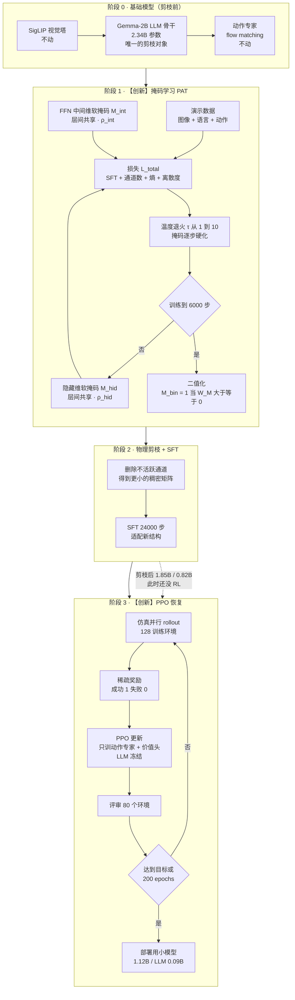
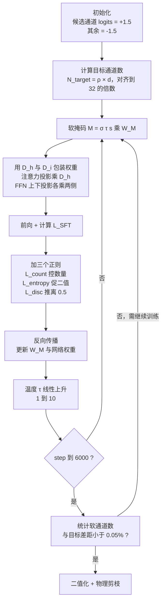
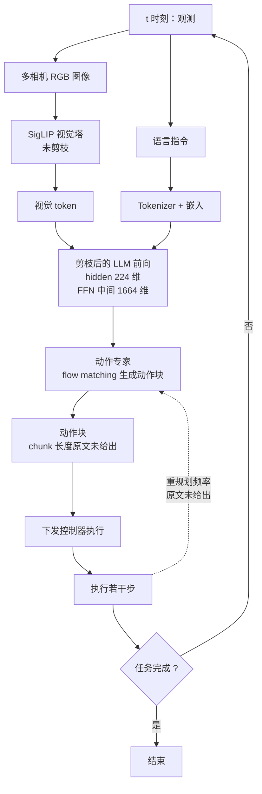
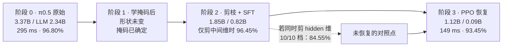
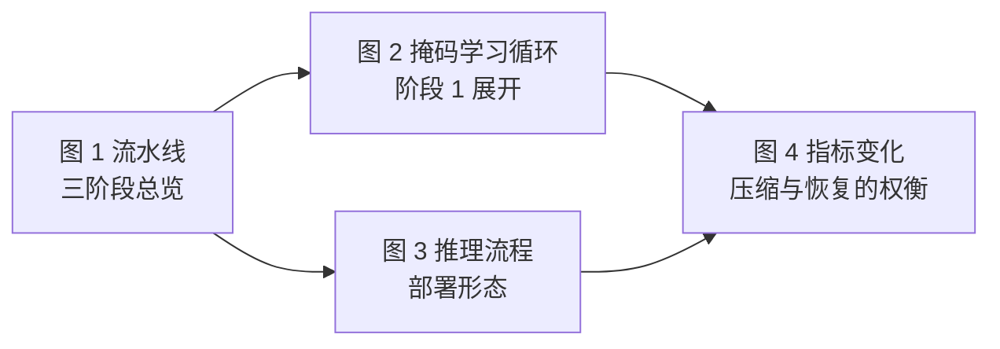

# P002 · 架构图与流程图

> 本文共 4 张图：
> **图 1 系统架构与三阶段流水线** ／ **图 2 掩码学习训练循环** ／ **图 3 部署后推理流程** ／ **图 4 各阶段的模型状态与指标变化**
> 每张图后附：逐节点解释 → 数据流 → 核心创新位置 → 原文出处。
>
> 导航：[[Paper_002_SPAR/01_论文精读|01 精读]] ｜ [[Paper_002_SPAR/02_核心创新与方法|02 创新]] ｜ [[Paper_002_SPAR/04_术语和公式解释|04 术语]] ｜ [[Paper_002_SPAR/05_科研启发与复现建议|05 启发]]

---

## 图 1 · 系统架构与三阶段流水线

### 1.1 逐节点解释

| 节点 | 含义 | 关键点 |
|---|---|---|
| V0 | SigLIP 视觉塔 | **不剪**。所以整机加速（1.98×）远低于 LLM 的参数压缩比（96%） |
| L0 | Gemma-2B 语言骨干 | 唯一被剪的对象，2.34B → 0.09B |
| A0 | 动作专家 | π0.5 的 flow-matching 动作头，**不剪**；RL 阶段是它被训练 |
| MH / MI | 两个软掩码 | 核心创新所在；**层间共享**保证残差通道一致 |
| M1 | 总损失 | $L_{SFT} + L_{count} + L_{entropy} + L_{disc}$（式 11） |
| T1 | 温度退火 | 让掩码从"0.5 附近模糊"逐渐变成"0 或 1" |
| B1 | 6000 步的判定 | 与 SFT 的 24000 步合计 30000 步（§IV-c） |
| BN | 二值化 | 用 logits 的符号判定，等价于掩码 0.5 阈值 |
| P1 | 物理删除 | 真删行/列，得到**更小的稠密矩阵**，不是稀疏掩码 |
| P2 | 剪后 SFT | 让剩余权重适配新结构 |
| R1-R4 | PPO 循环 | 稀疏奖励 + 并行环境；**LLM 冻结** |
| OUT | 最终模型 | 1.12B 总参 / 0.09B LLM（表 II 的 10/10 档） |

### 1.2 数据如何流动

1. **权重流**：预训练权重 → （被掩码乘）→ （被物理切片）→ 变小 → （被 SFT 调）→ （被冻结）→ 部署。
2. **梯度流**：阶段 1 梯度流向**掩码 logits + 全部权重**；阶段 2 只流向权重；阶段 3 只流向动作专家与价值头。
3. **容量流**：3.37B → 1.85B（只剪中间维）或 1.12B（两个都剪）→ 最终部署。

> 一个容易忽略的点：**阶段 1 结束时模型还是大的**（掩码只是乘上去，矩阵形状没变，只是很多列被乘成 0）。真正变小发生在 P1。所以图 1 里我用虚线标注了"剪枝后才 1.85B/0.82B"。

### 1.3 核心创新在哪

- **MH + MI 双掩码（阶段 1）** 是方法层创新：两个维度、两个保留率。
- **阶段 3 的 RL 恢复** 是流程层创新：把"压缩"和"恢复"连接成一条流水线。
- 注意：**图上的 S1→S2→S3 是严格串行、不可交换的**，这也是 SPAR 与"先剪后训"朴素做法的主要区别（朴素做法没有 S1 的联合学习）。

### 1.4 原文出处

| 图 1 内容 | 原文位置 |
|---|---|
| 三阶段（PAT → 剪枝+SFT → RL） | 图 2 的总览图、§III 开头 |
| "PAT only" / "PAT+RL" 命名 | §III 开头 |
| 双掩码、层间共享、分离保留率 | §III-A |
| 温度 1→10、$r_{stop}=0.8$ | §III-B-a、式 5 |
| 二值化 $M_{bin}=\mathbb{1}[W_M\ge0]$ | §III-B-a |
| 6000 + 24000 步 | §IV-c |
| PPO、稀疏奖励、冻结骨干 | §III-C、式 12、§IV-d |

---

## 图 2 · 掩码学习训练循环（阶段 1 展开）

### 2.1 逐节点解释

| 节点 | 含义 |
|---|---|
| I0 | 掩码 logits 初始化：想保留的通道给 +1.5（sigmoid 后 ≈0.82），其余 −1.5（≈0.18） |
| I1 | 目标通道数按保留率算，并**对齐到 32 的倍数**（图 3 题注给出 224 和 1664） |
| L1 | 式 (4)：软掩码 $M(s)=\sigma(\tau(s)W_M)$ |
| L2 | 式 (2)(3)：把掩码变成对角矩阵乘到权重上 |
| L3 | 策略的监督损失（模仿学习） |
| L4 | 三个正则：数量（式 7）、熵（式 9）、离散度（式 10） |
| L5 | 梯度同时改掩码和权重——**这是 PAT 的核心思想：选通道与适配权重联合进行** |
| L6 | 温度退火（式 5），让 $M$ 逐渐逼近 0/1 |
| Q1 | 步数判定 |
| Q2 | 收敛检验（§III-B-c：3000 步时软计数已在目标 0.05% 内） |
| F1 | 二值化后真删 |

### 2.2 数据如何流动

- **前向**：权重 $\times$ 掩码 → 有效子网络 → 损失。
- **反向**：梯度经 sigmoid 导数（式 6）流向 logits。式 6 说明一个细节：**靠近 0.5 的通道梯度最大，靠近 0/1 的通道梯度小**——所以退火越到后期，掩码越"冻住"，改动越少。这是"软→硬"的自然结果。
- **调度**：温度与步数同步，形成"先探索、后确定"的节奏。

### 2.3 核心创新在哪

- **L2 这一步的双维度包装**（式 2、3）是全文最需要理解的技术细节：hidden 掩码乘在"列"（输入）和"行"（输出）两侧，中间维掩码只乘在 FFN 的对应侧。
- **L4 的三个正则是"软硬过渡"的工程保障**，但它们的贡献很小（表 VI：0.35–0.75 点）。

### 2.4 原文出处

| 内容 | 原文位置 |
|---|---|
| logits ±1.5、二值化规则 | §III-B-a |
| 式 (4)(5)(6) | §III-B-a |
| 式 (7)(8) 数量惩罚 | §III-B-b |
| 式 (9) 熵、式 (10) 离散度、式 (11) 总目标 | §III-B-b |
| 224 / 1664 的 32 对齐目标 | 图 3 题注 |
| 3000 步内 <0.05% | §III-B-c |

---

## 图 3 · 部署后推理流程

### 3.1 逐节点解释

| 节点 | 说明 | 是否被压缩 |
|---|---|---|
| SigLIP 视觉塔 | 图像编码 | ❌ 不剪 → 整机加速被它拖住 |
| LLM | 多模态融合 + 语义 | ✅ 剪了 hidden 与 FFN 中间维 |
| 动作专家 | 生成动作块（flow matching） | ❌ 不剪（RL 时训练它） |
| 动作块 | π0.5 的输出单位，也是 PPO 的语义单位 | — |

### 3.2 数据如何流动

图像 + 指令 → 视觉 token + 文本 token → 剪小后的 LLM → 动作专家 → 动作块 → 控制器 → 再观测（闭环）。

**关键观察**：整机延迟 295 → 149 ms，但 LLM 参数少了 96%。这个"参数压缩比 ≫ 延迟压缩比"的差距，就是**Amdahl 定律**的现场演示——视觉塔、动作专家、数据搬运这些"没剪的部分"成了新的瓶颈。

### 3.3 核心创新在哪

不在推理流程里，而在**推理流程的输入**：LLM 的那两个维度被永久变小了。推理流程与普通 VLA 完全相同——这其实是好事，意味着**不需要专用推理引擎或自定义 kernel**，标准 TensorRT 就能部署。

### 3.4 原文出处

| 内容 | 原文位置 |
|---|---|
| 全策略延迟/显存（TensorRT on Jetson AGX Orin） | 表 V |
| 动作块是 PPO 的聚合单位 | §III-C |
| 视觉塔/动作专家不剪 | 图 2 与 §III-C（只训动作专家与价值头）的间接证据 |
| 动作块长度、控制频率 | **【原文未给出】** |

---

## 图 4 · 各阶段的模型状态与指标变化

### 4.1 逐节点解释

| 节点 | 参数 | 延迟 | LIBERO 平均 |
|---|---|---|---|
| A 原始 π0.5 | 3.37B / 2.34B | 295.04 ms | 96.80% |
| B 学完掩码 | 形状未变（掩码乘上去） | — | — |
| C 剪枝 + SFT | 1.85B / 0.82B（仅中间维）或 1.12B / 0.09B（双维） | 170.64 / 148.71 ms | 96.45%（仅中间维）/ 84.55%（双维 10/10） |
| D PPO 恢复 | 1.12B / 0.09B | 148.71 ms | 93.45% |
| E 未恢复对照 | 同上 | 同 | 84.55% |

### 4.2 这张图想说明什么

**同一套剪枝结果，有两种命运**：只剪中间维 → 几乎不掉点但加速有限（1.73×）；双维都剪 → 加速最大（1.98×）但必须靠 RL 才能回到 93.45%。**"压缩强度"和"恢复手段"必须一起选**，这是本文最实用的工程结论。

### 4.3 原文出处

- 参数/延迟：表 I、表 II、表 V
- 成功率：表 I、表 II
- RL 增益：表 II 括号内数字

---

## 五、四张图的关系

- **图 1** 回答"这套方法由哪些步骤组成"；
- **图 2** 回答"最难的那一步内部怎么转"；
- **图 3** 回答"剪完的模型跑起来是什么样"；
- **图 4** 回答"每一步之后数字怎么变"——这是判断"值不值得做"的关键。

---

## 六、自检：哪些是原文有，哪些是我补的

| 元素 | 性质 |
|---|---|
| 三阶段流水线、PAT/PAT+RL 命名 | 【原文·图 2、§III】 |
| 双掩码、层间共享、分离保留率 | 【原文·§III-A】 |
| 式 (2)(3) 的掩码作用位置 | 【原文·§III-A】 |
| 温度退火、三个正则 | 【原文·§III-B】 |
| 224/1664 通道目标 | 【原文·图 3 题注】 |
| 6000/24000 步、A800、PPO 配置 | 【原文·§IV-c、§IV-d】 |
| 图 3 中"视觉塔/动作专家不剪" | 【原文未明说，但从图 2 与"只训动作专家"可推】 |
| 动作块长度、控制频率、重规划 | **【原文未给出】**，图 3 用虚线标注 |
| 图 4 的"参数/延迟/成功率"组合 | 【原文表格数据，我做了整合】 |
