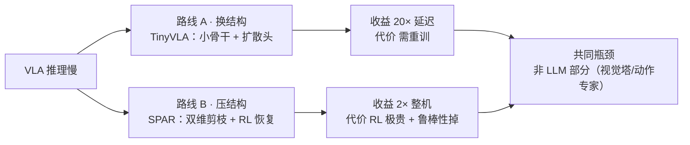
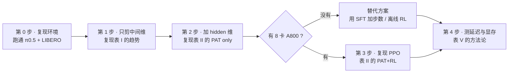

# P002 · 科研启发与复现建议

> 证据分级：**【原文证明】** / **【合理推测】** / **【待验证】**。
> 导航：[[Paper_002_SPAR/01_论文精读|01 精读]] ｜ [[Paper_002_SPAR/02_核心创新与方法|02 创新]] ｜ [[Paper_002_SPAR/03_架构图与流程图|03 图]] ｜ [[Paper_002_SPAR/04_术语和公式解释|04 术语]]

---

## 一、和 TinyVLA 摆在一起看：两条加速路线的分工

| 维度 | TinyVLA（P001） | SPAR（P002） |
|---|---|---|
| 路线 | 重新设计架构 | 压缩已有模型 |
| 加速对象 | 解码方式（自回归 → 扩散） | LLM 宽度（hidden + FFN） |
| 延迟 | 292 → 14 ms（约 20×，单次动作） | 295 → 149 ms（1.98×，整机） |
| 参数 | 7.2B → 1.3B | 3.37B → 1.12B |
| 训练成本 | 单卡可做（1.3B） | SFT 单机 + **RL 8×A800** |
| 鲁棒性 | 未系统评测 | **掉了 27.64 点**（表 III） |
| 共同结论 | 加速瓶颈最终落在"没改的那部分" | 同左 |

> **这两篇放在一起，能得出一个对选题很有用的判断**：无论是"重新设计"还是"压缩"，单点优化都会撞上 Amdahl 定律。**下一个有意义的加速点，很可能不在 LLM 里，而在视觉塔、动作专家、或"模型之外的调度"上。**

---

## 二、A–H 八问

### A. 对 VLA 推理加速的启发

**【原文证明】**
1. **"压缩比 ≠ 加速比"**：LLM 参数 −96%，整机只快 1.98×（表 II vs 表 V）。这是全文最诚实、也最有用的一条数据。
2. **平台要写清楚**：TensorRT on Jetson AGX Orin，报告**中位数**全策略延迟，并明确声明"不能与 EcoVLA 的 RTX 3090 数字比"。这套报告规范值得你直接照抄。
3. **显存收益大于延迟收益**：7.098 → 2.627 GiB（−63%），比延迟的 −49.6% 更显著。对边缘部署来说，**显存往往是硬约束，延迟是软约束**。

**【合理推测】**
4. 如果视觉塔占整机延迟的相当比例（从 1.98× 反推，非 LLM 部分至少占 30%+），那么**视觉 token 剪枝（SP-VLA/DART 路线）+ LLM 剪枝（SPAR 路线）应该叠加**，可能突破 2×。这个组合我没在原文看到，是一个明显空白。
5. 动作专家（flow matching）本身是**迭代采样**的，和扩散头一样有多步开销。SPAR 没剪它，但它是下一个显然的目标。

**【待验证】**：视觉塔占比、动作专家占比的实际拆解。

### B. 对动作分块 / 执行调度的启发

**【原文证明】**
1. **动作块是 RL 的语义单位**："Rewards and log-probabilities are aggregated at the action-chunk level"（§III-C）。这说明在 π0.5 这类模型里，**"一步决策 = 一个动作块"**，而非一个控制周期。

**【合理推测】**
2. 这条信息对调度研究的价值是：**动作块长度同时影响三件事**——推理频率（越长的块，推理越少）、RL 的信用分配粒度（块太长，一个块里混了成功和失败，奖励难归因）、以及闭环响应速度。SPAR 完全没讨论这三者的耦合。
3. 一个可做的实验：**固定剪枝后的模型，扫动作块长度，看 RL 收益如何变化**。假设：块太短 → RL 学不到长程策略；块太长 → 信用分配困难、鲁棒性差。这条曲线没人画过。

**【待验证】**。

### C. 对量化、缓存、模型压缩的启发

**【原文证明】**：SPAR 是"结构化剪枝"路线的代表，它证明了**剪枝能真的减小显存**。

**【合理推测】压缩技术的"正交性"分析**：

| 技术 | 与 SPAR 是否正交 | 理由 |
|---|---|---|
| 量化（INT8/INT4） | ✅ 高度正交 | 剪枝改形状，量化改数值精度，可叠加 |
| 蒸馏 | ⚠️ 部分冲突 | 都靠"小模型学大模型"，叠加收益递减 |
| 视觉 token 剪枝 | ✅ 正交 | 作用在不同模块 |
| 动态跳层（MoLe-VLA） | ❌ 冲突 | SPAR 要"永久变小"，跳层是"按需跳过"，二者哲学相反 |
| KV cache 压缩 | ⚠️ 取决于动作生成 | π0.5 用 flow matching，KV cache 收益有限 |

**【待验证】**：结构化剪枝 + INT8 量化的叠加效果，以及"剪枝后模型是否对量化更敏感"（通常更敏感，因为容错空间更小）。

### D. 是否能用于轮式双臂机器人？

**【原文证明】**：SPAR 已在 **AgileX 双臂平台**上测过 6 个任务（表 IV），剪枝后 63.33% vs 基线 70.83%。
**【合理推测】**：轮式底盘会引入新的动作维度与视觉分布漂移，但**剪枝方法与机器人形态无关**——它只关心"LLM 的哪些通道可以删"。所以迁移成本主要在数据与动作头，不在剪枝本身。
**【待验证】**：移动操作场景下，剪枝后的鲁棒性下降会不会更严重（因为底盘运动会放大视觉扰动）。

### E. 是否需要真实硬件？

| 阶段 | 需求 | 成本 |
|---|---|---|
| 复现表 I（只剪中间维 + SFT） | 单张 A800/A100（可降级到 4090，减步数） | 中 |
| 复现表 II（含 RL） | **8×A800 + 128 并行仿真环境** | 极高 |
| 复现表 IV（真机） | AgileX 双臂平台 | 极高 |
| 测表 V（延迟） | Jetson AGX Orin + TensorRT | 中 |

**【合理推测】**：对学生最友好的切口是 **表 I**——它只需要剪枝 + SFT，而且结论（中间维冗余）本身就有科学价值。

### F. 能否在仿真中先复现？

**【原文证明】**：全部主实验都在 LIBERO（仿真）上，只有表 IV 是真机。
**【合理推测】**：LIBERO 是公开 benchmark，配合 OpenPI 的 π0.5 实现，**理论上可以复现**。但要注意：
- π0.5 的权重是否公开、许可证如何——**【外部】需核实**；
- LIBERO 已饱和（基线 96.80），复现时你的数字可能都在 95–97 之间，**区分度很低**。建议改用更难的任务或 LIBERO-Plus。

### G. 本科阶段能否完成小规模实验？

**【我的判断】可以，但要把规模缩到"一个维度、一个小模型"**：

> **题目**：在 SmolVLA（2.25B，最接近的公开小 VLA）上，只做"FFN 中间维剪枝 + SFT"，验证"中间维冗余"这个结论是否在小模型上依然成立。

- 变量：$\rho_{int}\in\{100\%,50\%,30\%,10\%\}$。
- 指标：成功率 + 显存 + 延迟。
- 预期：【合理推测】小模型上冗余度会下降（因为参数本来就少），可能出现"剪到 30% 就掉点"的转折——**如果这个转折存在，本身就是一个可发表的观察**。
- 风险：SmolVLA 的架构与 π0.5 不同（没有 flow matching 动作专家？需核实），掩码作用位置要重新推导。

### H. 博士阶段能否进一步拓展？

三条独立线：

1. **"剪枝 + 量化"联合压缩**（工程性强，容易出结果）。
2. **压缩与鲁棒性的张力**（科学性强）：为什么标准任务无损、扰动下崩？能否用"扰动感知的剪枝目标"缓解？这是一个有理论深度的问题。
3. **RL 恢复的成本-收益分析**：SPAR 花了 8×A800 换 8.90 点，这笔账划不划算？有没有更便宜的恢复手段（如 DAgger、专家干预、课程学习）？

---

## 三、四个可落地的研究点

### 研究点 #1：视觉塔 + LLM 的联合压缩（填补 Amdahl 缺口）

| 项目 | 内容 |
|---|---|
| **动机** | 表 V 显示 LLM 参数 −96% 只换来整机 1.98×，说明非 LLM 部分是大头 |
| **假设** | 视觉 token 剪枝（保留 30%）+ LLM 双维剪枝（10/10）可把整机加速从 1.98× 推到 2.5× 以上 |
| **设计** | 固定 LLM 剪枝配置，扫视觉 token 保留率；测整机延迟、显存、成功率 |
| **指标** | 端到端延迟、显存、LIBERO-Plus Overall |
| **风险** | 视觉 token 少了会直接打击空间定位（TinyVLA 图 10 里"Inaccurate Positioning"那类失败） |
| **证据等级** | 【待验证】 |

### 研究点 #2：动作块长度 × RL 恢复的耦合（我最推荐）

| 项目 | 内容 |
|---|---|
| **动机** | SPAR 明确说 RL 以动作块为单位，但完全没扫块长 |
| **假设** | 存在最优块长 $T^*$，使"RL 收益 / 训练成本"最大；$T^*$ 随剪枝强度变化（剪得越狠，越需要短块来精细调整） |
| **设计** | 固定 10/10 剪枝配置，$T\in\{5,10,20,50\}$，每个 $T$ 跑 PPO，记录成功率、样本效率、鲁棒性 |
| **指标** | LIBERO 成功率、达到目标所需环境步数、LIBERO-Plus Overall |
| **价值** | 把"执行调度"和"模型压缩"两个通常分开研究的领域连起来 |
| **风险** | RL 实验贵；建议先用小模型 + 少环境快速验证趋势 |
| **证据等级** | 【待验证】 |

### 研究点 #3：扰动感知的剪枝目标

| 项目 | 内容 |
|---|---|
| **动机** | 表 III 是全文最大的坏消息：标准任务 93.45，扰动下 56.81 |
| **假设** | 在掩码学习阶段加入"扰动不变性"约束（如对同一观测的扰动版本要求掩码选择一致），可以缓解鲁棒性下降 |
| **设计** | 在 $\mathcal{L}_{total}$ 上加一个一致性项；对比"无约束 / 有约束"在 LIBERO-Plus 上的 Overall |
| **价值** | 直接针对已识别的痛点，故事完整 |
| **风险** | 可能只是把标准任务的分数挪到鲁棒性上（零和） |
| **证据等级** | 【待验证】 |

### 研究点 #4：廉价恢复手段的对比

| 项目 | 内容 |
|---|---|
| **动机** | PPO 要 8×A800；对学生不现实 |
| **设计** | 对比四种恢复：① SFT 加步数 ② DAgger（用专家纠正）③ 离线 RL ④ 小规模 PPO |
| **指标** | 恢复后的成功率 / 训练 GPU 小时 |
| **价值** | 如果 SFT 加步数就能拿到 80% 的收益，那 SPAR 的 RL 必要性就被削弱了——这是一个值得证伪的假设 |

---

## 四、一个具体案例：桌面抓取（教学示例）

> [!warning] 案例性质
> 这是**教学示例**，不是 SPAR 的原始实验。SPAR 的原始任务是 LIBERO 的四类任务（Spatial/Object/Goal/Long）与 AgileX 的 6 个真机任务（Bottle/Cubes/Cup/Block/Sorting/Backpack）。

**场景**：AgileX 双臂，桌面有蓝方块、红杯子、篮子。指令："把蓝方块放到红杯右边"（这是 LIBERO 的 Spatial 套件风格）。

| 时刻 | 发生了什么 | 对应 SPAR 的哪个环节 |
|---|---|---|
| 部署前 | 模型已剪到 hidden 224 维、FFN 中间 1664 维，动作专家保留 | 阶段 2 完成 |
| $t_0$ | 双相机拍照，SigLIP 编码（**这一层没剪，所以耗时不变**） | 图 3 的 E1 |
| $t_1$ | 视觉 token + 指令 token 进剪小的 LLM | 图 3 的 F1 |
| $t_2$ | LLM 输出多模态特征，动作专家生成一个动作块（例如 10 步） | 图 3 的 A1 |
| $t_3$ | 控制器执行整个块 | 图 3 的 X2 |
| $t_4$ | 块执行完，重新观测，回到 $t_0$ | 闭环 |
| 出问题时 | 因为 hidden 维被剪，"细微位姿修正"能力下降，抓取偏一点就掉了 | 对应表 III 的鲁棒性损失 |

**关键理解**：SPAR 的加速发生在 $t_1$（LLM 变快），但 $t_0$ 的视觉编码时间没变。如果你的机器人卡在"图像处理"而不是"语言推理"，SPAR 帮不了你。**做加速之前，先测各模块耗时占比。**

---

## 五、复现路线

### 各步的关键检查点

| 步骤 | 检查点 | 如果不对，可能是 |
|---|---|---|
| 第 0 步 | π0.5 在 LIBERO 上能否到 96% 左右 | 权重版本、评测协议、动作块长度 |
| 第 1 步 | $\rho_{int}=10\%$ 是否仍在 96% 附近 | 掩码是否层间共享、32 对齐是否做了 |
| 第 2 步 | $\rho_{hid}=10\%$ 是否掉到 84% 附近 | 式 (2)(3) 的左右乘是否搞反 |
| 第 3 步 | RL 收益是否随压缩变大 | 奖励是否稀疏、块级聚合是否实现 |
| 第 4 步 | 整机加速是否 ~1.7–2.0× | 是否只测了 LLM 而不是全策略 |

---

## 六、复现时会踩的坑

| 坑 | 说明 | 建议 |
|---|---|---|
| **式 (10) 量纲** | 不除以 $d$，$\lambda_3$ 对两个维度强度不同 | 先做尺度归一化，或分别设 $\lambda_3$ |
| **32 对齐** | $N_{target}$ 不对齐会拖慢 GPU | 必须对齐 |
| **层间共享** | 实现时容易写成逐层独立掩码 | 全局一个 $M_{hid}$、一个 $M_{int}$ |
| **左右乘方向** | 式 (2)(3) 搞反会导致残差维度错 | 记住"左行右列" |
| **饱和基准** | LIBERO 96.80 已接近上限 | 加 LIBERO-Plus 或更难任务 |
| **无方差** | 原文没报种子方差 | 自己至少跑 3 个种子 |
| **RL 环境版本** | RLinf + LIBERO 的版本匹配 | 先在单环境跑通再扩 |
| **π0.5 权重可得性** | 未核实 | 先确认许可证与下载 |

---

## 七、与后续论文的关系

| 下一篇 | 关系 |
|---|---|
| [[00_文献总索引#P001 TinyVLA]] | 另一条加速路线（换结构 vs 压结构） |
| [[00_文献总索引#P005 π0 (pi-zero)]] | SPAR 的被剪对象是 π0.5，其前身是 π0；读 π0 才能懂动作专家 |
| [[00_文献总索引#P010 DiPLO]] | 也用"自蒸馏"做加速，与剪枝互补 |
| [[00_文献总索引#P012 Cracking Mobile Manipulation]] | 从"失败诊断"到"系统设计"，与 SPAR 的失败分析呼应 |

---

## 八、一句话总结对我的价值

> **SPAR 给了两个我可以直接引用的"硬事实"：① VLA 的 FFN 中间维剪掉 90% 几乎不掉点；② LLM 参数减 96% 只换来整机 1.98× 加速。第一个告诉了我"哪里可以省"，第二个告诉了我"省了也不一定快"。**
> 更重要的是它暴露的矛盾：**标准任务上的无损，掩盖了扰动下的崩塌**。如果我要做 VLA 加速，必须从一开始就把鲁棒性纳入评测——否则我的"2× 加速"可能只是把失败推迟到了真实世界。
