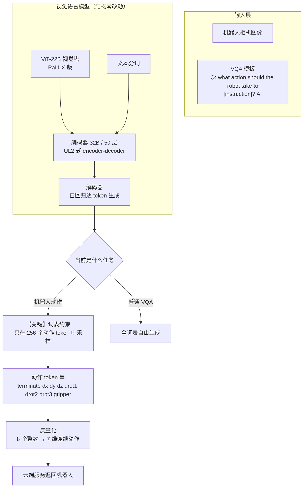
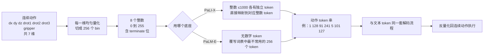
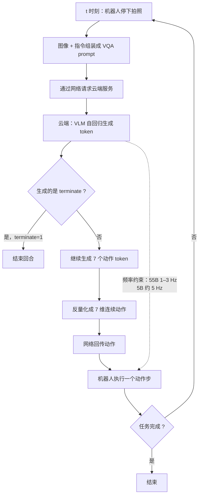
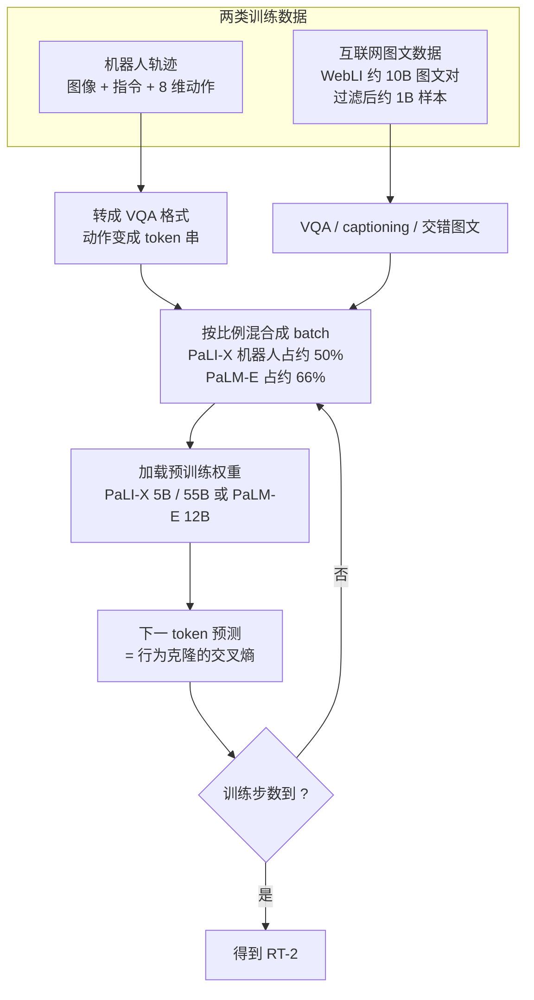
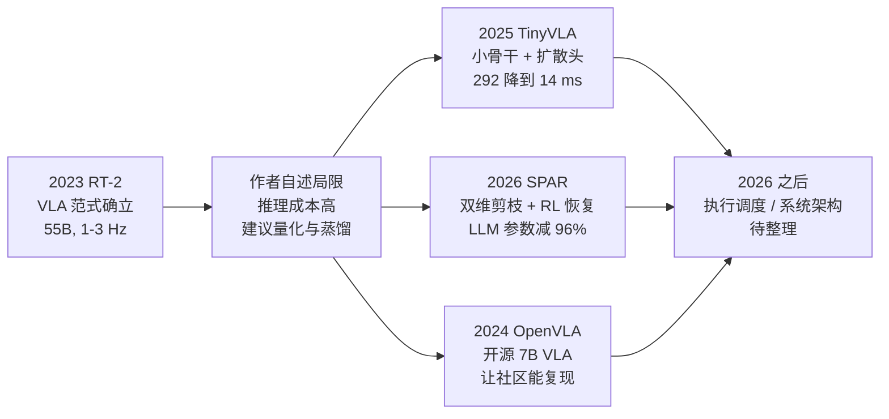
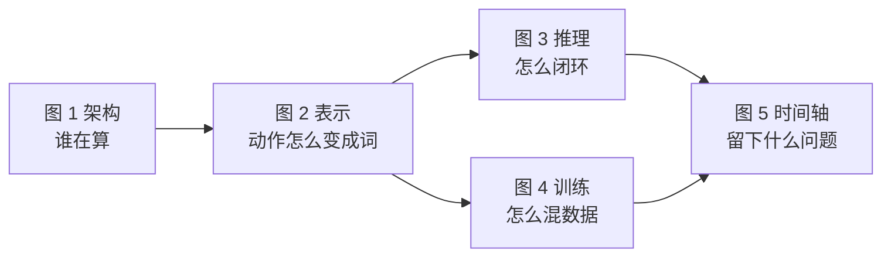

# P003 · 架构图与流程图

> 本文共 5 张图：
> **图 1 系统架构** ／ **图 2 动作 → token 化流水线** ／ **图 3 推理闭环（云端）** ／ **图 4 训练流程（混合微调）** ／ **图 5 从局限到后续工作的时间轴**
> 每张图后附：逐节点解释 → 数据流 → 核心创新位置 → 原文出处。
>
> 导航：[[Paper_003_RT-2/01_论文精读|01 精读]] ｜ [[Paper_003_RT-2/02_核心创新与方法|02 创新]] ｜ [[Paper_003_RT-2/04_术语和公式解释|04 术语]] ｜ [[Paper_003_RT-2/05_科研启发与复现建议|05 启发]]

---

## 图 1 · 系统架构



### 1.1 逐节点解释

| 节点 | 含义 | 是否改动 |
|---|---|---|
| I1 / I2 | 图像 + 标准 VQA 格式 prompt | 输入格式是新的，但内容无新参数 |
| V1 | ViT-22B（PaLI-X）或 ViT-4B（PaLM-E） | 不动 |
| E1 | 32B、50 层的 UL2 式编码器 | 不动 |
| D1 | 自回归解码器 | 不动 |
| C1/C2 | **输出约束**：机器人任务时限定词表 | ★ 本文的工程贡献之一 |
| O1 | 动作 token 串（8 个位置） | ★ 核心表示创新 |
| O2 | 反量化 | 推理侧新增（无参数） |
| O3 | 云端返回 | 部署方案 |

### 1.2 数据如何流动

```
图像 ──ViT──┐
            ├── 编码器 ── 解码器 ── 动作 token 串 ── 反量化 ── 7 维动作
指令 ──分词──┘
```

**关键观察**：整条链路上**没有任何"动作专用"的模块**。这是 RT-2 最反直觉、也最关键的地方——动作只是一串"特殊的词"。

### 1.3 核心创新在哪

- **O1 的那 8 个 token 位置**：全文创新就浓缩在这里。
- **C2 的词表约束**：保证模型不说"胡话"。
- 注意 V1/E1/D1 全部是"别人的模型"，这正好说明**本文的创新在接口，不在结构**。

### 1.4 原文出处

| 图 1 内容 | 原文位置 |
|---|---|
| VQA 输入模板 | §3.2："Q: what action should the robot take to [task instruction]? A:" |
| 结构零改动、无 action-only 层 | §2："without introducing action-only model layer components" |
| 词表约束 | §3.2 "Output Constraint" |
| 动作串格式（terminate 在最前） | §3.2 |
| 云端服务 | §3.3 |

---

## 图 2 · 动作 → token 化流水线（本文最核心的图）



### 2.1 逐节点解释

| 节点 | 说明 | 数字 |
|---|---|---|
| A1 | 动作空间 | 6 DoF 位移 + 夹爪 + 终止 = 8 维 |
| A2 | 量化 | 256 bins 均匀 |
| A3 | 整数表示 | 0–255 |
| B2 | PaLI-X 的便利 | 整数 ≤1000 有独立 token |
| B3 | PaLM-E 的妥协 | 覆写 256 个最不常用 token（= symbol tuning） |
| C1 | 目标串 | 例 `1 128 91 241 5 101 127` |
| C3 | 反量化 | 整数 → 连续值 |

### 2.2 数据如何流动

连续动作 →（量化）→ 8 个整数 →（词表映射）→ 8 个 token →（与文本同一套自回归）→ 生成 →（反量化）→ 连续动作。

### 2.3 核心创新在哪

**A2 + B2/B3 这两步**是整个 VLA 范式的"接缝"：它把"控制问题"翻译成"语言问题"。后续所有 VLA 的改进（TinyVLA 换扩散头、π0 换流匹配）都是在**拆这个接缝**。

### 2.4 原文出处

| 内容 | 原文位置 |
|---|---|
| 6 DoF + 夹爪 + 终止，8 个整数 | §3.2 |
| 256 bins 均匀离散 | §3.2 |
| PaLI-X 用整数 token | §3.2 |
| PaLM-E 覆写 256 个最不常用 token | §3.2 |
| 目标串格式与示例 | §3.2（示例 `1 128 91 241 5 101 127`） |
| symbol tuning 的引用 | §3.2 引 Wei et al., 2023 |

---

## 图 3 · 推理闭环（云端部署）



### 3.1 逐节点解释

| 节点 | 说明 |
|---|---|
| S0-S1 | 每步都要重新观测并组 prompt |
| S2 | **网络往返**：这是 RT-2 特有的成本项 |
| S3 | 自回归生成，串行 |
| S4 | 终止判断：`terminate` 在最前，所以第一步就能决定是否结束 |
| S5-S7 | 生成剩余 7 个 token 并回传 |
| S8 | 执行**一个**动作步（不是动作块） |

### 3.2 数据如何流动

观测 → prompt → 云端 → token 串 → 动作 → 执行 → 再观测。**每一步都要完整走一遍**。

### 3.3 核心创新在哪

不在这条流程里——流程本身是"最朴素"的闭环。创新在图 2 的表示层。但这条流程暴露了**为什么 RT-2 慢**：单步动作 + 自回归 + 网络往返，三者叠加。

### 3.4 原文出处

| 内容 | 原文位置 |
|---|---|
| 云端多 TPU 服务、网络查询 | §3.3 |
| 55B 1–3 Hz、5B 约 5 Hz | §3.3 |
| 闭环控制 | 图 1 题注 "enabling closed loop control" |
| 单步动作（无动作块） | 【推断】基于 §3.3 频率描述与图 1 流程 |
| 网络延迟具体数值 | **【原文未给出】** |

---

## 图 4 · 训练流程（混合微调）



### 4.1 逐节点解释

| 节点 | 说明 | 数字 |
|---|---|---|
| R1 | 机器人数据 | 13 台机器人、17 个月、7 类技能 |
| W1 | 互联网数据 | WebLI 约 10B 图文对（109 语言）→ 1B |
| P1 | 动作 → 文本 | 8 个整数 |
| M1 | 混合采样 | 50% / 66% |
| T1 | 起点 | 预训练权重（关键！从零训练只有 9%） |
| T2 | 目标函数 | 下一 token 预测 |
| Q1 | 步数 | 55B: 80K；5B: 270K；PaLM-E: 1M |

### 4.2 数据如何流动

两条数据流在 batch 里汇合 → 同一套自回归目标 → 同一个模型。**这就是"权重完全共享"的实现方式**。

### 4.3 核心创新在哪

- **M1 的混合比例**：这是"第二个创新"（第一个是图 2 的表示）。表 6 证明它在 55B 上值 +11 点。
- **T1 的起点**：从预训练权重出发是前提，不是选择。

### 4.4 原文出处

| 内容 | 原文位置 |
|---|---|
| WebLI 规模与过滤 | 附录 B |
| 机器人数据 13 台/17 个月 | §4 |
| 混合比例 50% / 66% | 附录 B |
| 训练超参 | 附录 E |
| 从零训练 vs 微调 vs 混合微调 | §4.3、表 6 |
| 7 类技能清单 | 附录 B |

---

## 图 5 · 从 RT-2 的局限到后续工作（跨论文时间轴）



### 5.1 这张图想说明什么

RT-2 的 §5  Limitations 里，作者**自己点名了量化与蒸馏**。这句话是后面三年 VLA 加速研究线的"出生证明"。你在写综述或开题报告时，可以把这条线索画出来：**问题不是后人发现的，是作者自己写下来的。**

### 5.2 原文出处

- RT-2 的局限与建议：§5 第 2 段（"An exciting direction for future research is to explore quantization and distillation techniques..."）。
- TinyVLA 与 SPAR 的数据见各自笔记：[[Paper_001_TinyVLA/01_论文精读]]、[[Paper_002_SPAR/01_论文精读]]。

---

## 六、五张图的关系



- **图 1** 回答"系统由什么组成"（答案是：什么都没加）；
- **图 2** 回答"创新的实质"（动作 = 词）；
- **图 3** 回答"跑起来多慢"（1–3 Hz 的来源）；
- **图 4** 回答"怎么训"（混合微调）；
- **图 5** 回答"这篇论文留下了什么"。

---

## 七、自检：哪些是原文有，哪些是我补的

| 元素 | 性质 |
|---|---|
| VQA 模板、8 token、256 bin、词表约束 | 【原文·§3.2】 |
| PaLI-X / PaLM-E 的两套 token 映射 | 【原文·§3.2】 |
| 云端 TPU、1–3 Hz、5 Hz | 【原文·§3.3】 |
| 混合比例 50%/66%、WebLI 规模 | 【原文·附录 B】 |
| 训练超参 | 【原文·附录 E】 |
| 表 4/5/6 数字 | 【原文·第 23、24 页，已逐格核对】 |
| "每步一个动作、无动作块" | 【推断】依据 §3.3 频率与图 1 流程 |
| 图 5 的时间轴 | 【我的整理】跨论文，非原文 |
| 网络延迟 | **【原文未给出】** |
