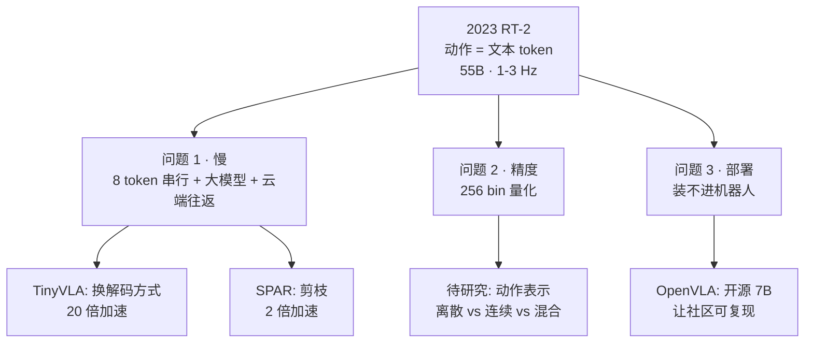

# P003 · 科研启发与复现建议

> 证据分级：**【原文证明】** / **【合理推测】** / **【待验证】**。
> 导航：[[Paper_003_RT-2/01_论文精读|01 精读]] ｜ [[Paper_003_RT-2/02_核心创新与方法|02 创新]] ｜ [[Paper_003_RT-2/03_架构图与流程图|03 图]] ｜ [[Paper_003_RT-2/04_术语和公式解释|04 术语]]

---

## 一、RT-2 在你的研究地图里的位置：它是"问题的定义者"

**一句话**：**RT-2 不是"要被改进的方法"，它是"所有改进的坐标系"。** 你以后写任何加速论文，第一句话几乎都会是"RT-2/OpenVLA 这类 VLA 模型推理慢"。

---

## 二、A–H 八问

### A. 对 VLA 推理加速的启发

**【原文证明】的三条事实**

1. **1–3 Hz 是这条研究线的起点数字**（§3.3）。55B 模型每次决策 333–1000 ms。
2. **作者自己点名了量化与蒸馏**（§5）："An exciting direction for future research is to explore quantization and distillation techniques that might enable such models to run at higher rates or on lower-cost hardware."
3. **"实时推理可能成为主要瓶颈"**（§5）——这句在 2023 年就被写下来了。

**【合理推测】RT-2 的延迟可以拆成四项**

$$T_{\text{step}} = \underbrace{T_{\text{vision}}}_{\text{ViT-22B}} + \underbrace{8\times T_{\text{decode}}}_{\text{自回归}} + \underbrace{T_{\text{net}}}_{\text{云端往返}} + T_{\text{act}}$$

- TinyVLA 攻击的是第 2 项（8× → 1× + K 次小网络）；
- SPAR 攻击的是第 2 项里的"每次 decode 的成本"；
- **第 1、3、4 项几乎没人系统研究过**——这就是我在 [[Paper_002_SPAR/05_科研启发与复现建议]] 里说的 Amdahl 缺口。

**【待验证】**：第 3 项（网络往返）在真实部署中占多少？论文没测。如果占 30%+，那"模型加速"的收益会被网络吞掉一大半——这本身就是一个值得做的实证研究。

### B. 对动作分块 / 执行调度的启发

**【原文证明】**
1. RT-2 是**单步动作**闭环：每个控制步都要一次完整推理（§3.3 + 图 1）。
2. 因此控制频率 = 推理频率 = 1–3 Hz。**没有动作块来"摊薄"延迟。**

**【合理推测：一个简单的算术】**
- 一个抓取放置任务约需 20–40 个控制步；
- 1 Hz 下就是 **20–40 秒**；
- 若用动作块（一次预测 10 步、执行 10 步），推理次数从 40 次降到 4 次，**同样的 14 ms 推理可以支持更高的有效频率**。

> **这就是动作块（action chunking）为什么在 VLA 里如此重要：它不是"加速技巧"，而是"把慢模型变成可用系统的唯一办法"。**
> RT-2 没有用它；Diffusion Policy（[[00_文献总索引#P006 Diffusion Policy]]）把它变成了标准做法。

**【待验证】**：RT-2 为什么不用动作块？是当时没想到，还是"每步一个动作"对语义推理更有利？原文没有讨论。

### C. 对量化、缓存、模型压缩的启发

**【原文证明】**：作者明确建议量化与蒸馏（§5）。

**【合理推测】四条可攻击路径**

| 路径 | 对 RT-2 的适用性 | 说明 |
|---|---|---|
| **权重量化**（INT8/INT4） | ✅ 高 | 55B → 14B 显存，可能让边缘部署成为可能 |
| **KV cache 优化** | ✅ 高 | 自回归解码天然吃 KV cache；8 步解码里前 7 步的 KV 可复用 |
| **投机解码 / 并行解码** | ✅ 高 | 8 个动作 token 之间**没有语义依赖**（不同维度独立），理论上可以并行 |
| **动作量化**（256 bin） | ⚠️ 已被使用 | 但这是"输出量化"，不是"权重压缩"，两者不是一回事 |

> [!tip] 一个很干净的选题
> **"8 个动作 token 能不能并行输出？"**
> 直觉上可以：x 方向的位移和夹爪开合没有因果关系，不需要"看完前一个再决定后一个"。但自回归把它们串起来了。
> 如果做**非自回归的并行动作解码**（一次前向出 8 个 token），理论上能把这部分延迟降到 1/8。
> 【外部·待核实】SPAR 的相关工作提到 OpenVLA-OFT "uses parallel decoding and action chunking"（SPAR §II-A 引 [18]），说明这条路已经有人走了。**我尚未读 OpenVLA-OFT 原文，不能确认细节。**

### D. 是否能用于轮式双臂机器人？

**【原文证明】**：RT-2 的平台是**7DoF 移动操作臂**（单臂 + 底盘），不是双臂。
**【合理推测】**：
- 动作 token 数是 8（7 维 + 终止）。双臂需要 15 个（14 维 + 终止）——**解码步数几乎翻倍，延迟也翻倍**。
- 底盘运动会让动作语义变成"基座坐标系 vs 世界坐标系"的问题，token 化的动作对此没有显式建模。
- 所以 RT-2 的表示方式**在双臂/移动场景下会加速恶化**。这正好解释了为什么后来的工作要么用动作块（摊薄），要么用连续动作头（TinyVLA/π0）。

**【待验证】**：15 token 的自回归延迟实测。

### E. 是否需要真实硬件？

| 目标 | 需求 | 可行性 |
|---|---|---|
| 复现 RT-2 | 55B 权重 + 云端 TPU + 13 台机器人数据 | ❌ 不可能 |
| 复现"混合微调"效应 | 开源小 VLM + 仿真数据 | ✅ 可行 |
| 复现动作 token 化 | 任意 VLA 代码库 | ✅ 容易 |

**【我的判断】**：RT-2 的价值不在"复现它"，而在"复现它的一个论点"。最便宜、最有价值的可复现论点是：**混合微调是否真的能提升泛化**。见研究点 #1。

### F. 能否在仿真中先复现？

**【原文证明】**：RT-2 自己就在 Language-Table 仿真上做了（表 1），用的是 PaLI-3B。
**【合理推测】**：Language-Table 环境是开源的（Lynch et al., 2022），配合一个 3B 级开源 VLM，是**最接近原论文设置的可复现路径**。
**风险**：Language-Table 的动作空间是 2D（"X Y" 两个 token），比 7DoF 简单得多，复现出来的结论未必能外推到 7DoF。

### G. 本科阶段能否完成小规模实验？

**【我的判断】能。** 推荐题目：

> **题目**：在 Language-Table 或自建 2D 仿真上，用 PaliGemma-3B 复现"动作 token 化 + 混合微调 vs 纯机器人微调"的对比，验证混合微调是否提升分布外泛化。

- 变量：训练数据配比（0% / 25% / 50% / 75% 互联网数据）。
- 指标：分布内成功率、分布外成功率。
- 预期：【合理推测】存在一个最优点，且最优点随模型规模变化（大模型更吃混合数据）。
- 风险：3B 模型在单卡上微调需要 LoRA + 梯度检查点；Language-Table 数据需自行下载（未核实可得性）。

### H. 博士阶段能否进一步拓展？

三条线：

1. **动作表示的系统研究**：离散 token（RT-2）vs 连续回归（MLP）vs 扩散（TinyVLA）vs 流匹配（π0）——**同一骨干、同一数据、同一评测**下的公平对比，目前**没有人做过完整版**。这是一个"综述级实验"。
2. **并行动作解码**（见 C 的选题）。
3. **端到端延迟分解**：把 T_vision / T_decode / T_net / T_act 分开测，找出真正的瓶颈。这条线工程性强但价值高。

---

## 三、四个可落地的研究点

### 研究点 #1：混合比例的"甜点"在哪？（原文空白）

| 项目 | 内容 |
|---|---|
| **动机** | RT-2 用了 50%/66%，但**从未扫过**这个比例 |
| **假设** | 存在最优 $p_{\text{robot}}^*$，且随模型规模与机器人数据量变化 |
| **设计** | 固定模型与数据，扫 $p_{\text{robot}}\in\{0.1,0.25,0.5,0.75,0.9\}$；测分布内/分布外成功率 |
| **指标** | 成功率、遗忘程度（用 VQA 基准测语义能力保留） |
| **价值** | 直接补上原文最重要的超参空白，实验便宜（小模型可做） |
| **证据等级** | 【待验证】 |

### 研究点 #2：并行动作解码

| 项目 | 内容 |
|---|---|
| **动机** | 8 个动作 token 之间无强依赖，却被自回归串起来 |
| **假设** | 并行（一次前向出全部 token）可把解码延迟降到 1/8，而成功率几乎不降 |
| **设计** | 对比：串行自回归 / 并行（类似 MaskGIT 的迭代细化）/ 混合（先并行再串行修正） |
| **指标** | 单步延迟、成功率、动作平滑度 |
| **风险** | 维度间可能有隐含依赖（比如"先移动再闭合夹爪"），并行会破坏时序一致性 |
| **证据等级** | 【待验证】；【外部·待核实】OpenVLA-OFT 可能已做过 |

### 研究点 #3：动作量化的自适应 bin

| 项目 | 内容 |
|---|---|
| **动机** | RT-2 对每一维用**均匀** 256 bin，但不同维度的实际分布差异很大（旋转 vs 位移 vs 夹爪） |
| **假设** | 按分位数（quantile）分箱比均匀分箱精度更高，尤其在小数据下 |
| **设计** | 对比均匀分箱 / 分位数分箱 / 学习式分箱（VQ-VAE） |
| **指标** | 重建误差（动作空间）、下游成功率 |
| **价值** | 小而干净，适合作为一篇短文 |
| **证据等级** | 【待验证】 |

### 研究点 #4：端到端延迟分解

| 项目 | 内容 |
|---|---|
| **动机** | RT-2 只报"1–3 Hz"，没拆解各环节；后续论文报"单次动作延迟"，口径不一致 |
| **设计** | 在一个可部署的 VLA 上，分别测量视觉编码、LLM 前向、解码、通信、执行五段耗时 |
| **价值** | 建立一套**可复用的延迟报告规范**（类似 SPAR 表 V 的做法，但更细） |
| **证据等级** | 【原文证明】RT-2 未拆解；【合理推测】拆解后会改变优化优先级 |

---

## 四、一个具体案例：把苹果放到"3"上面（教学示例）

> [!warning] 案例性质
> 这是**教学示例**，用于解释"符号理解"这类涌现能力是怎么发生的。
> 它对应 RT-2 表 5 的 **Symbol Understanding** 类别（原文指令如 "move apple to 3"、"push coke can on top of heart"），但具体场景与物体是我假设的，不是原文实验。

**场景**：桌面有一张印着数字 1/2/3 的纸，一个苹果，一个橙子。指令："把苹果放到 3 上面"。

| 时刻 | 发生了什么 | 说明 |
|---|---|---|
| $t_0$ | 拍照 + 组 prompt：`Q: what action should the robot take to put the apple on 3? A:` | 标准 VQA 模板 |
| $t_1$ | ViT 把图像编码成 patch token | 视觉塔不动 |
| $t_2$ | 编码器把图文融合；模型"注意"到数字 3 的位置和苹果的位置 | **这一步用到了互联网学来的"数字识别"能力** |
| $t_3$ | 解码器输出第一个 token：`0`（不终止） | 终止位在最前 |
| $t_4$ | 继续输出 7 个动作 token，如 `128 91 241 5 101 127 200` | 自回归，串行 |
| $t_5$ | 反量化成连续动作：向数字 3 的方向移动 | 执行一个动作步 |
| $t_6$ | 重新拍照，回到 $t_0$ | 闭环 |
| 约 20–40 步后 | 苹果被放到 3 上 | 1 Hz 下约 20–40 秒 |

**关键理解点**：
- "3 是什么"这个知识**不在机器人数据里**，而在 VLM 的预训练里。RT-2 的贡献就是让这个知识能"流"到动作上。
- 但"怎么移动手臂"这个技能**只在机器人数据里**。RT-2 并没有让机器人学会新动作（作者在 §5 明确承认）。
- 所以 RT-2 的能力 = **VLM 的语义 × 机器人数据的技能**，两者缺一不可。这也解释了表 6 里"从零训练只有 9%"。

---

## 五、复现路线（按"能做什么"排序）

| 步骤 | 做什么 | 难度 | 产出 |
|---|---|---|---|
| 0 | 读 OpenVLA 或 LeRobot 的代码，理解动作 token 化实现 | 低 | 环境跑通 |
| 1 | 在仿真（如 Language-Table、MetaWorld）复现"动作 → token → 动作" | 低 | 端到端跑通 |
| 2 | 扫混合比例，看泛化曲线 | 中 | **研究点 #1 的结果** |
| 3 | 加分段计时 | 低 | **研究点 #4 的结果** |
| 4 | 改并行解码 | 中高 | **研究点 #2 的结果** |

---

## 六、复现时会踩的坑

| 坑 | 说明 | 建议 |
|---|---|---|
| **动作取值范围未公开** | 256 bin 的分辨率取决于 $v^{\min}, v^{\max}$，原文没给 | 用训练集统计量（1%–99% 分位）定范围，并记录 |
| **终止位的语义** | `terminate=1` 时其他 token 是否有意义？原文未说明 | 训练时对 terminate 样本只算一个 token 的损失 |
| **词表覆写的副作用** | PaLM-E 版覆写了 256 个词，会破坏原语义 | 复现时优先用"有数字 token"的底座 |
| **混合比例的采样实现** | 是"过采样机器人"还是"下采样网络数据"？效果不同 | 明确记录实现方式 |
| **延迟口径** | 原文是"端到端 Hz"，含网络；后续论文常报"单次推理 ms" | 报告时写清含不含网络/执行 |
| **"涌现"的评测标准** | 三类任务的划分是作者自定义的 | 复现时要说清自己的划分 |
| **数据不可得** | RT-1 数据未公开 | 用 OpenX 子集替代，并说明差异 |

---

## 七、与前后论文的关系

| 论文 | 关系 |
|---|---|
| [[00_文献总索引#P001 TinyVLA]] | 直接回应 RT-2 的"慢"：把自回归 token 换成扩散头 |
| [[00_文献总索引#P002 SPAR]] | 回应 RT-2 的"大"：把骨干剪小 |
| [[00_文献总索引#P004 OpenVLA]] | 回应 RT-2 的"闭源"：开源 7B VLA，让社区能复现 |
| [[00_文献总索引#P005 π0 (pi-zero)]] | 回应 RT-2 的"离散化精度损失"：改用流匹配出连续动作 |
| [[00_文献总索引#P006 Diffusion Policy]] | 提供"动作块"这个 RT-2 缺失的关键机制 |
| [[00_文献总索引#P007 SayCan]] | RT-2 的对立面：分层规划 + 低层控制器 |

---

## 八、一句话总结对我的价值

> **RT-2 教我的不是"把动作变成 token"，而是"如何用最小的改动撬动最大的能力迁移"。**
> 它的方法简单到几乎不像一篇顶会论文，但它做对了一个判断：**VLM 的输出空间是可以被"征用"的**。这个判断让机器人学习从"自己训模型"变成"借别人的模型"。
> 而它留下的三个数字——**1–3 Hz、8 个 token、256 个 bin**——就是我后面所有加速研究的靶子。
