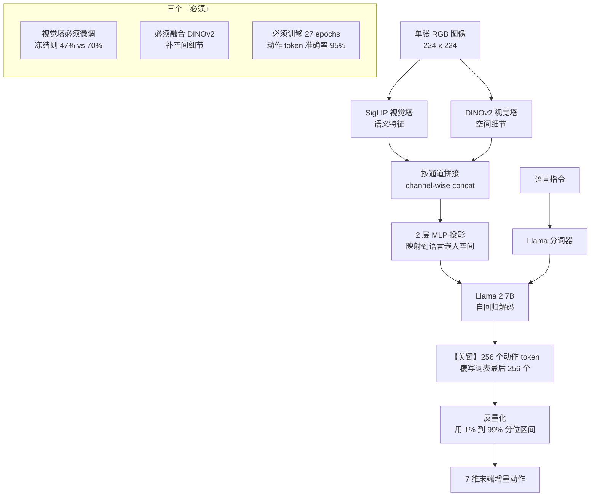
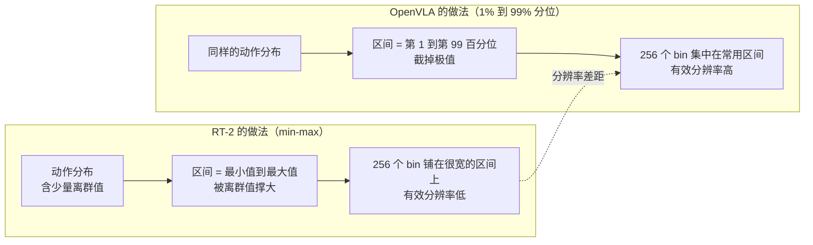
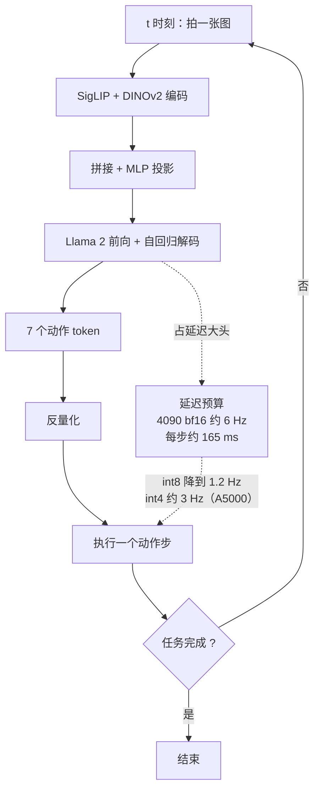
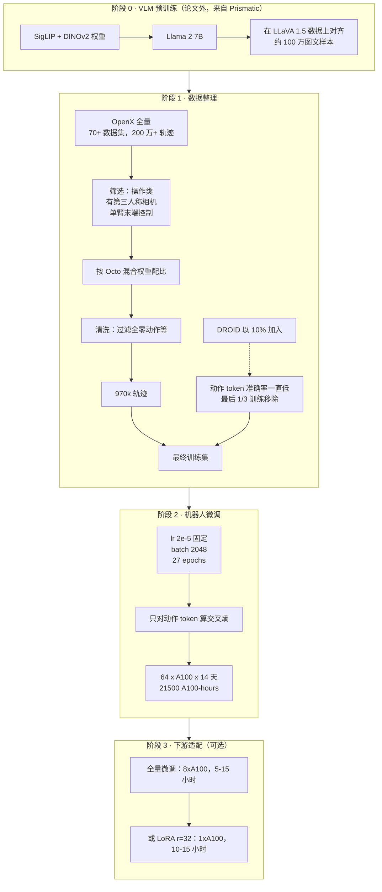
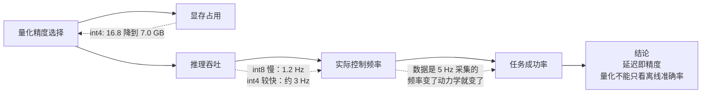
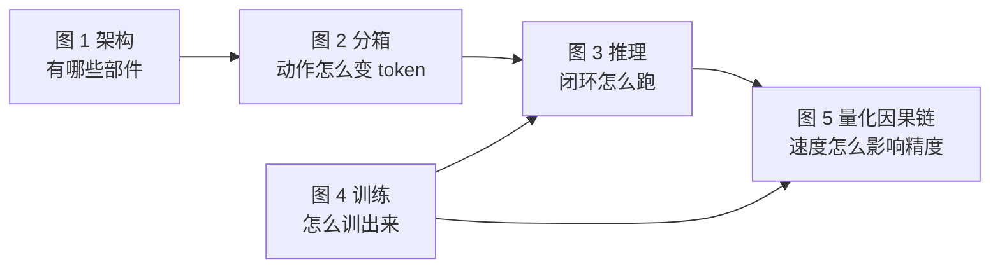

# P004 · 架构图与流程图

> 本文共 5 张图：
> **图 1 模型架构** ／ **图 2 动作分箱（分位数 vs min–max）** ／ **图 3 推理闭环与延迟预算** ／ **图 4 训练三阶段** ／ **图 5 量化—频率—成功率 的因果链**
> 每张图后附：逐节点解释 → 数据流 → 核心创新位置 → 原文出处。
>
> 导航：[[Paper_004_OpenVLA/01_论文精读|01 精读]] ｜ [[Paper_004_OpenVLA/02_核心创新与方法|02 创新]] ｜ [[Paper_004_OpenVLA/04_术语和公式解释|04 术语]] ｜ [[Paper_004_OpenVLA/05_科研启发与复现建议|05 启发]]

---

## 图 1 · 模型架构

### 1.1 逐节点解释

| 节点 | 含义 | 是否训练 |
|---|---|---|
| V1 SigLIP | 语义特征（图文对齐训练而来） | **必须微调** |
| V2 DINOv2 | 空间/几何细节（自蒸馏训练而来） | **必须微调** |
| C1 通道拼接 | 两个特征直接拼在一起（不求和、不注意力） | — |
| P1 2 层 MLP | 投影到 Llama 的嵌入维度 | 训练 |
| L1 Llama 2 7B | 多模态融合 + 自回归生成 | 全量或 LoRA |
| O1 动作 token | 256 个占位 token | 复用词表 |
| O2 反量化 | 分位数区间 → 连续值 | 无参数 |

### 1.2 数据如何流动

**图像分两路并行编码 → 拼接 → 投影 → 与文本拼成一条序列 → 自回归出动作 token → 反量化 → 动作。**

关键点：**视觉端不是"取一个更强的编码器"，而是"取两个互补的编码器拼起来"**。SigLIP 擅长"这是什么"，DINOv2 擅长"在哪里、什么姿态"。对机器人控制来说后者同样重要。

### 1.3 核心创新在哪

- **C1 的融合**（相对同期 VLM 只用 CLIP/SigLIP 是改进）；
- **"视觉塔必须微调"这个训练决策**（表 1 的 47.0 vs 69.7）——这是本文最反直觉的发现；
- 动作 token 化本身**不是**创新（来自 RT-2）。

### 1.4 原文出处

| 内容 | 原文位置 |
|---|---|
| 三部件架构（视觉编码器 + 投影 + LLM） | §3.1、图 2 |
| SigLIP + DINOv2 通道拼接 | §3.1 |
| 600M 视觉塔、2 层 MLP、Llama 2 7B | §3.1 |
| 视觉塔必须微调 | §3.4、表 1 |
| 224×224 分辨率 | §3.4 |
| 27 epochs | §3.4 |

---

## 图 2 · 动作分箱：分位数 vs 最小最大

### 2.1 逐节点解释

| 节点 | 说明 |
|---|---|
| A1/A2 | RT-2 用数据的实际 min/max 定区间 |
| A3 | 离群值把区间拉宽 → 每个 bin 更宽 → 量化更粗 |
| B1/B2 | OpenVLA 用 1%/99% 分位，把极端动作排除 |
| B3 | 同样的 256 个 bin 覆盖更窄的区间 → 分辨率更高 |

### 2.2 数据如何流动

动作分布 → 统计分位数 → 定区间 → 均匀切 256 份 → 训练时把动作映射到 bin → 推理时从 bin 还原。

### 2.3 核心创新在哪

这是一个**小而实用的改进**：不是新算法，而是"鲁棒归一化"的正确位置选择。它直接提升动作精度，且几乎零成本。

### 2.4 原文出处

- §3.2："we set the bin width to uniformly divide the interval between the 1st and 99th quantile of the actions in the training data... allows us to ignore outlier actions"。

---

## 图 3 · 推理闭环与延迟预算

### 3.1 逐节点解释

| 节点 | 说明 | 是否可加速 |
|---|---|---|
| S1 视觉编码 | 600M 双塔，**不可忽略** | 可（换塔/蒸馏/剪枝） |
| S2 投影 | 小 MLP | 影响小 |
| S3 Llama 前向 + 解码 | 7B，**主要成本** | 可（量化/LoRA 合并/投机解码） |
| S5 反量化 | 无算力 | — |
| S6 执行 | 一个动作步 | — |

### 3.2 数据如何流动

观测 → 编码 → 融合 → 自回归解码 → 动作 → 执行 → 再观测。**每步都要付一次完整前向**。

### 3.3 核心创新在哪

不在流程，而在**流程的"频率"这一列**：OpenVLA 用量化把 6 Hz 变成 3 Hz（int4）或 1.2 Hz（int8），而频率又反过来影响成功率（图 5）。

### 3.4 原文出处

| 内容 | 原文位置 |
|---|---|
| ~6 Hz on RTX 4090（bf16，无编译/投机解码） | §3.5 |
| 15 GB bf16 显存 | §3.5 |
| int8 在 A5000 上 1.2 Hz、int4 约 3 Hz | §5.4 |
| 5 Hz 控制器（Bridge 数据采集） | §5.4、§5.2 脚注 3 |

---

## 图 4 · 训练三阶段

### 4.1 逐节点解释

| 阶段 | 关键点 |
|---|---|
| 阶段 0 | Prismatic 已经在 LLaVA 1.5 数据上做过视觉-语言对齐（约 1M 样本） |
| 阶段 1 | **本篇最耗人力的一步**：筛选规则 + Octo 权重 + 清洗 |
| 阶段 2 | 27 epochs、固定 lr、只算动作 token 损失 |
| 阶段 3 | 下游只有 10–150 条示范也能微调 |

### 4.2 数据如何流动

预训练权重 → 筛选后的 970k 轨迹 → 微调 → 下游小数据微调。

**关键观察**：OpenVLA 的"数据工程"占了论文很大篇幅（§3.3 + 附录 A/C），但**这部分很难复现**——这也是它虽然开源、但复现"预训练"仍然昂贵的原因。

### 4.3 核心创新在哪

- **阶段 1 的筛选**（相对 RT-2-X 的 350k，OpenVLA 用 970k 且更干净）；
- **阶段 2 的 27 epochs**（反直觉）；
- **阶段 3 的 PEFT 研究**（表 1）。

### 4.4 原文出处

| 内容 | 原文位置 |
|---|---|
| Prismatic 在 LLaVA 1.5 上对齐 | §3.1 |
| 筛选条件与 Octo 权重 | §3.3 |
| DROID 10% 权重与移除 | §3.3 |
| lr、batch、epochs | §3.4 |
| 21,500 A100-hours | §3.5 |
| 下游微调成本 | §5.3 |

---

## 图 5 · 量化 → 频率 → 成功率 的因果链（本文最有教学价值的一条）

### 5.1 逐节点解释

| 节点 | 说明 |
|---|---|
| Q | bf16 / int8 / int4 |
| M | 显存：16.8 / 10.2 / 7.0 GB |
| T | 吞吐：int8 因量化算子开销反而更慢；int4 因显存带宽减少而更快 |
| F | 实际频率：bf16 ~5 Hz、int8 1.2 Hz、int4 ~3 Hz（A5000） |
| S | 成功率：71.3 / 58.1 / 71.9 |

### 5.2 数据如何流动（因果，不是数据）

量化 → 改变显存与吞吐 → 改变控制频率 → 改变系统动力学 → 改变成功率。
**这是一条"性能指标 → 任务指标"的传导链**，中间隔着"频率"这个容易被忽略的变量。

### 5.3 核心创新在哪

这是本文**最值得反复读的一节**（§5.4）。它说明：
- 量化不是"精度 vs 显存"的两难，而是"精度 vs 显存 vs 速度"的三难；
- 而且速度会**通过闭环频率**影响任务成功率，所以离线 token 准确率不足以评估量化。

### 5.4 原文出处

| 内容 | 原文位置 |
|---|---|
| 三种精度的显存与成功率 | 表 2、表 5 |
| int8 变慢的原因（量化算子开销） | §5.4 |
| 1.2 Hz vs 5 Hz 导致掉点 | §5.4 正文 |
| "离线 token 准确率相当" | §5.4 脚注 5 |

---

## 六、五张图的关系

- **图 1** 回答"模型长什么样"；
- **图 2** 回答"一个细节改进"；
- **图 3** 回答"跑起来多快"；
- **图 4** 回答"怎么训"；
- **图 5** 回答"为什么快慢会影响成败"——这是对你研究方向最有价值的一张。

---

## 七、自检：哪些是原文有，哪些是我补的

| 元素 | 性质 |
|---|---|
| SigLIP+DINOv2 拼接、2 层 MLP、Llama 2 | 【原文·§3.1】 |
| 分位数分箱、词表覆写、只算动作 token 损失 | 【原文·§3.2】 |
| 224 分辨率、必须微调视觉、27 epochs、lr 2e-5 | 【原文·§3.4】 |
| 6 Hz、15 GB | 【原文·§3.5】 |
| 表 1/2/4/5/6/7/12 的数字 | 【原文·第 10、26、28、32、37 页，已逐格核对】 |
| 无动作块、每步一个动作 | 【推断】依据 §6 把 chunking 列为未来工作 |
| 图 3 的"每步约 165 ms" | 【我的换算】1/6 Hz ≈ 167 ms |
| 图 5 的因果箭头 | 【我的整理】依据 §5.4 的文字描述 |
| 动作维度是 7 还是 8 | **【原文表述不清】**，见 02 笔记 §五.6 |
