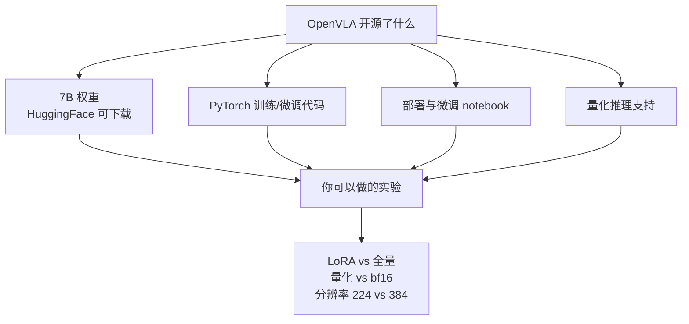
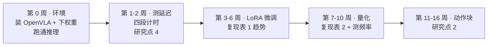

# P004 · 科研启发与复现建议

> 证据分级：**【原文证明】** / **【合理推测】** / **【待验证】**。
> 导航：[[Paper_004_OpenVLA/01_论文精读|01 精读]] ｜ [[Paper_004_OpenVLA/02_核心创新与方法|02 创新]] ｜ [[Paper_004_OpenVLA/03_架构图与流程图|03 图]] ｜ [[Paper_004_OpenVLA/04_术语和公式解释|04 术语]]

---

## 一、为什么这篇对你最重要

前面三篇（TinyVLA / SPAR / RT-2）你都**跑不起来**：TinyVLA 没代码、SPAR 要 8×A100、RT-2 权重不公开。
**OpenVLA 是这 24 篇里唯一一篇"你今天就能下载、明天就能微调"的论文。**

---

## 二、A–H 八问

### A. 对 VLA 推理加速的启发

**【原文证明】的五条**

1. **第一个"可复现的加速基线"**：bf16 15 GB、RTX 4090 上 ~6 Hz（§3.5）。以后你做任何加速，都可以拿它当对照。
2. **int4 是"免费的午餐"**：71.9% vs bf16 71.3%，显存 16.8 → 7.0 GB（表 2）。这是**目前最省力的 VLA 加速手段**。
3. **int8 不是**：58.1%，因为慢到 1.2 Hz（§5.4）。**"更低的比特" ≠ "更快的推理"**。
4. **作者自己点名了两条加速路线**：动作分块（action chunking）与投机解码（speculative decoding）（§6）。
5. **视觉塔不可忽略**：600M 双塔必须微调，意味着它必须是"活的"——不能简单冻结或换小。这为"视觉端加速"留下了空间，也留下了约束。

**【合理推测】延迟预算的粗略拆分**（教学估算，非原文）
- 7B Llama 前向（7 个 token 自回归，含 KV cache）：占大头；
- 600M 双塔视觉编码：单帧，可能占 10–20%；
- 数据搬运与量化算子：int8 时显著。
→ 这解释了为什么"只量化"的收益有限（Amdahl）。

**【待验证】**：各段实际占比。**这是我认为最值得先做的一个测量实验**（见研究点 #4）。

### B. 对动作分块 / 执行调度的启发

**【原文证明】的三条**
1. **OpenVLA 没有动作块**，每步一个动作（§6 把 chunking 列为未来工作）。
2. **作者在两个不同控制频率的平台上做了实验**：Franka-Tabletop **5 Hz**、Franka-DROID **15 Hz**（§5.2）。这本身就是一个"频率"的自然实验。
3. **int8 掉点的根因被归到频率**（1.2 Hz vs 数据采集的 5 Hz，§5.4）。

**【合理推测】一个很重要的推论**
> 如果 int8 的问题只是"太慢导致频率不匹配"，那么**加上动作块**（一次推理执行多步）之后，int8 的劣势应该会大幅缩小——因为动作块把"推理频率"与"控制频率"解耦了。
> 也就是说：**动作块与量化是互补的，不是替代的。**

这是一个**很干净、可证伪、成本不高**的假设。见研究点 #2，我认为这是本文能催生的最好的一个实验。

### C. 对量化、缓存、压缩的启发

**【原文证明】**
- int4 有效、int8 反而有害（在 A5000 上）；
- 量化实验用的是**较小模型**（脚注 4：SigLIP-only + Octo 数据混合），外推需谨慎。

**【合理推测】四条可攻击路径**

| 路径 | 依据 | 预期 |
|---|---|---|
| **频率感知的量化评测** | int8 的掉点被归因于频率，但没有对照实验 | 高价值、低成本（研究点 #1） |
| **KV cache 优化** | 7 个动作 token 自回归，前 6 步的 KV 可复用 | 中等收益 |
| **投机解码** | 作者点名（§6）；动作 token 之间依赖弱 | 可能 2–3× |
| **视觉塔蒸馏/剪枝** | 600M 双塔，且必须"活着" | 与 SPAR 思路结合 |

> [!tip] 关于"缓存"的一个重要区别
> LLM 里的 KV cache 是"跨请求复用前缀"；VLA 里每步的**图像都变**，前缀无法复用。所以 VLA 的 KV cache 只能在"一次动作序列的 7 个 token 之间"复用——**收益远小于 LLM 场景**。这是做 VLA 加速必须意识到的一个坑。

### D. 是否能用于轮式双臂机器人？

**【原文证明】**：OpenVLA **只支持单张图像、无本体状态、单臂末端控制**（§3.3 筛选条件、§6）。
**【合理推测】**：
- 双臂需要 14 维动作 → 14 个 token → 解码步数翻倍、延迟翻倍；
- 轮式底盘需要额外维度 + 基座位姿输入；
- 所以**直接用不行，必须改输入输出接口**。作者自己把"多图像 + 本体状态 + 历史"列为未来工作。
**【待验证】**：改动后的性能与延迟。

### E. 是否需要真实硬件？

| 目标 | 需求 | 可行性 |
|---|---|---|
| 跑通推理 | 1 张 ≥8 GB 显卡（int4） | ✅ 很容易 |
| LoRA 微调 | 1×A100（10–15 小时）或 4090（更久） | ✅ 可行 |
| 全量微调 | 8×A100 | ⚠️ 有门槛 |
| 预训练复现 | 64×A100×14 天 | ❌ 不可能 |
| 真机评测 | WidowX / Franka | ⚠️ 有门槛 |

**【我的建议】**：先用**仿真 + 公开数据**做微调实验，真机留到有平台时再说。

### F. 能否在仿真中先复现？

**【原文证明】**：作者自己在 LIBERO 上做了（表 12），但优势很小（76.5 vs 75.1 vs 72.4）。
**【合理推测】**：这说明**仿真是可以做微调实验的**，但**不要期待复现出真机上的 20 点优势**。如果你的研究只需要"相对比较"（A 方法 vs B 方法），仿真完全够用。

### G. 本科阶段能否完成小规模实验？

**【我的判断】能，而且这是最适合本科毕设的一篇。** 三个候选题目（按难度排序）：

1. **复现表 1 的 LoRA vs 全量**（最简单）：在 LIBERO 的一个套件上微调，比较成功率与显存。
2. **复现表 2 的 int4 量化 + 测频率**（中等）：量化后测 Hz 与成功率，验证"int4 无损"。
3. **int8 + 动作块**（较难但最有价值）：见研究点 #2。

### H. 博士阶段能否进一步拓展？

三条线：
1. **频率感知的 VLA 评测协议**（方法论贡献，影响面广）；
2. **动作块 × 量化 × 投机解码的联合优化**（系统贡献）；
3. **视觉端的加速**（600M 双塔是目前没人碰的空白）。

---

## 三、四个可落地的研究点

### 研究点 #1：验证"int8 掉点是频率的锅"（最便宜、最有诊断价值）

| 项目 | 内容 |
|---|---|
| **动机** | 作者归因于频率，但**没有做"同频率 bf16"的对照**（§5.4 脚注只说离线 token 准确率相当） |
| **假设** | 把 bf16 人为限速到 1.2 Hz 后，成功率也会掉到 ~58% |
| **设计** | 三组：bf16@6Hz / bf16@1.2Hz（人为加 sleep）/ int8@1.2Hz；同任务、同初始状态 |
| **指标** | 成功率、平均完成时间 |
| **预期** | 若 bf16@1.2Hz ≈ 58%，则作者的解释成立；若仍 ~70%，则 int8 还有别的伤害 |
| **价值** | 这是一个"证伪/证实"型实验，结论无论正负都有意义 |
| **成本** | 低（只需推理，不需训练） |

### 研究点 #2：动作块能否"救回" int8？（我最推荐）

| 项目 | 内容 |
|---|---|
| **动机** | 若 int8 的问题只是频率，那么用动作块摊薄推理次数后，int8 的劣势应缩小 |
| **假设** | int8 + 动作块（T=8）的成功率接近 bf16 + 动作块，而显存只有一半 |
| **设计** | 2×2 矩阵：{bf16, int8} × {无块, 块长 8}；测成功率、有效控制频率、显存 |
| **指标** | 成功率、$f_{\text{eff}}$、显存 |
| **预期** | 【推断】int8+块 明显优于 int8 无块；bf16+块 最优但显存高 |
| **价值** | 直接把"压缩"与"调度"两个通常分开的领域连起来 |
| **风险** | 需要自己实现动作块（OpenVLA 原生不支持），改动量中等 |

### 研究点 #3：投机解码用于动作 token

| 项目 | 内容 |
|---|---|
| **动机** | 作者点名投机解码（§6）；7 个动作 token 之间语义依赖弱，适合并行/投机 |
| **设计** | 用一个小 draft 模型（或前一步的动作）猜 7 个 token，大模型验证 |
| **指标** | 接受率、加速比、成功率 |
| **风险** | 动作 token 的"正确性"不像语言那样宽容，猜错会导致动作跳变 |
| **证据等级** | 【待验证】 |

### 研究点 #4：延迟分解（最基础的测量）

| 项目 | 内容 |
|---|---|
| **动机** | 论文只给端到端 ~6 Hz，未拆解视觉塔 / LLM / 解码 / 后处理 |
| **设计** | 在 4090 上分别计时四段；再测 int4/int8 的各段变化 |
| **价值** | 建立"该优化哪里"的判断依据；也是研究点 #1/#2 的前置 |
| **成本** | 极低 |

---

## 四、一个具体案例：把茄子放进锅里（教学示例）

> [!warning] 案例性质
> 任务名 "Put Eggplant into Pot" 来自 **BridgeData V2 的真实评测任务**（表 4 第 2 行）。
> 但下面这条时间线是我为解释原理构造的**教学示例**，具体数值是假设的。

**场景**：WidowX 机械臂，桌上有茄子和锅。指令："put the eggplant into the pot"。

| 时刻 | 发生了什么 | 说明 |
|---|---|---|
| $t_0$ | 拍一张 224×224 图 | 单图，无历史 |
| $t_1$ | SigLIP 认出"茄子"和"锅"；DINOv2 给出两者相对位置 | 双塔分工 |
| $t_2$ | 特征拼接 + MLP 投影，与指令 token 拼成序列 | 融合 |
| $t_3$ | Llama 2 自回归生成 7 个动作 token | 约 165 ms（6 Hz） |
| $t_4$ | 反量化成末端增量，机械臂移动一小步 | 相对位置控制 |
| $t_5$ | 重新拍照 → 回到 $t_0$ | 闭环 |
| 约 20–40 步 | 茄子进锅，成功 | 6 Hz 下 3–7 秒 |

**如果换成 int8（1.2 Hz）**：每步间隔 833 ms，机械臂移动变得"一顿一顿"，茄子在被夹起后可能滑落——**这就是 §5.4 说的"频率变了动力学就变了"**。

**如果加上动作块（T=8）**：一次推理执行 8 步，推理次数从 40 次降到 5 次；即使单次推理慢，整体也能跑得动——**这就是"调度救模型"的含义**。

---

## 五、复现路线（这是你真正能执行的）

### 各步的关键检查点

| 步骤 | 检查点 | 若不对 |
|---|---|---|
| 第 0 周 | 能否在 4090 上跑出 ~6 Hz | 检查是否 bf16、是否用了编译优化 |
| 第 1-2 周 | 四段耗时加起来 ≈ 1/6 Hz | 检查是否漏了数据搬运 |
| 第 3-6 周 | LoRA 成功率接近全量 | 检查 rank、学习率、epoch 数（OpenVLA 用 27） |
| 第 7-10 周 | int4 成功率不降、int8 下降 | 检查量化库版本、GPU 架构（int4 在 Ada 上收益最大） |
| 第 11-16 周 | 加块后频率提升 | 检查动作块的时间对齐与重规划逻辑 |

---

## 六、复现时会踩的坑

| 坑 | 说明 | 建议 |
|---|---|---|
| **动作维度（7 or 8）** | 原文 §3.2 说 "N integers"，未明确是否含终止位 | 以代码为准，笔记里标注不确定 |
| **分位数区间是否 clip** | 超出 [1%,99%] 的动作怎么处理？原文未说 | 用 clip，并记录 |
| **只算动作 token 损失** | 如何 mask？原文未说 | 用 label=-100 屏蔽非动作位置 |
| **视觉塔必须训** | 很多人会习惯性冻结 | 表 1 明确说冻结会掉到 47% |
| **27 epochs** | 远超常规，容易提前停 | 以"动作 token 准确率 >95%"为停止条件 |
| **int8 反而更慢** | 与直觉相反 | 测速再决定，不要盲信"更低比特更快" |
| **量化实验用的是小模型** | 脚注 4 | 复现时注意模型版本 |
| **LIBERO 优势很小** | 表 12 | 别用仿真结果推断真机 |
| **数据筛选难复现** | §3.3 + 附录 A/C | 若只做微调实验，可跳过预训练复现 |

---

## 七、与前后论文的关系

| 论文 | 关系 |
|---|---|
| [[00_文献总索引#P003 RT-2]] | OpenVLA 的直接前身：沿用其动作 token 化，但改进分箱、加融合视觉塔、并开源 |
| [[00_文献总索引#P001 TinyVLA]] | 把 OpenVLA 当主要 baseline；用扩散头替换它的自回归解码 |
| [[00_文献总索引#P002 SPAR]] | 在 π0.5 上做剪枝；与 OpenVLA 的量化路线互补 |
| [[00_文献总索引#P006 Diffusion Policy]] | OpenVLA 微调实验的主要对手；动作块的代表 |
| [[00_文献总索引#P005 π0 (pi-zero)]] | 另一条"连续动作"路线 |

---

## 八、一句话总结对我的价值

> **OpenVLA 给了我三样东西：一个能跑的基线（6 Hz、15 GB）、一个可复现的实验台（LoRA、量化、分辨率）、以及一个被作者写在明面上的空白（动作块 + 投机解码）。**
> 更重要的是它那句没有说出口的话：**"延迟即精度"**——int8 掉 13 个点不是因为算错了，而是因为变慢了。如果我要做 VLA 加速，**必须用闭环成功率来评价，而不是离线 token 准确率**。这是我从这篇论文里得到的最重要的方法论。
