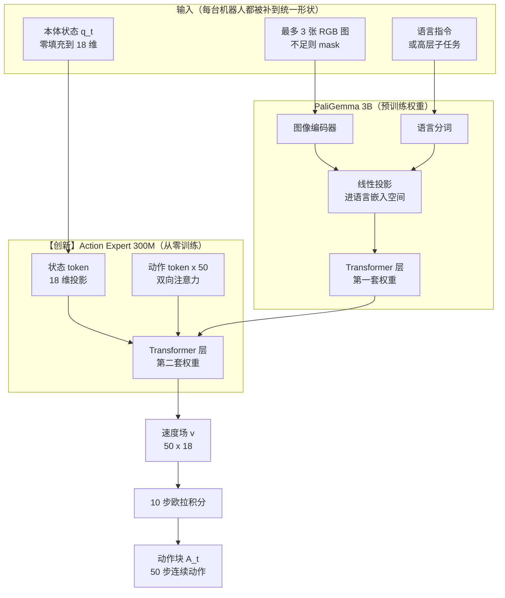
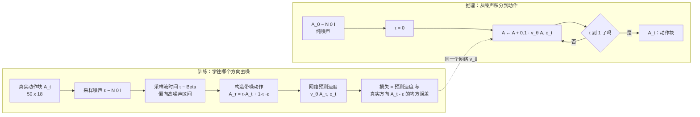
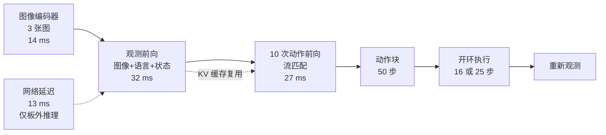
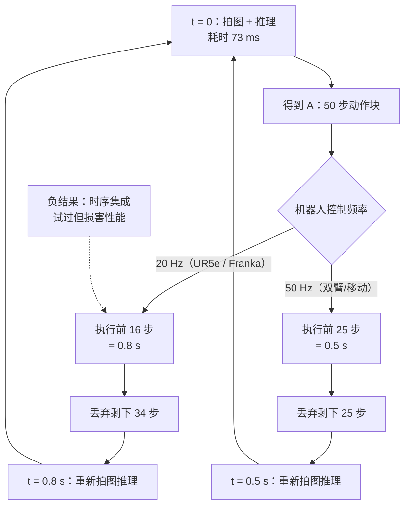
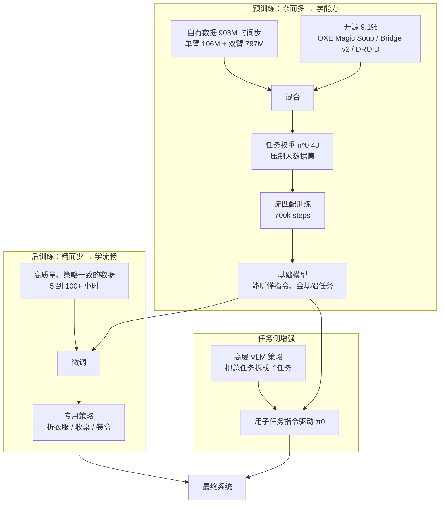
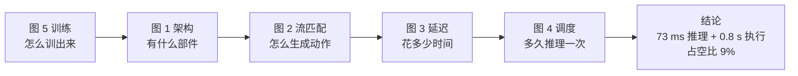

# P005 · 架构图与流程图

> 本文共 5 张图：
> **图 1 模型架构** ／ **图 2 流匹配：训练 vs 推理** ／ **图 3 推理时间预算** ／ **图 4 动作块执行调度（本文最实用的一张）** ／ **图 5 预训练/后训练两阶段**
> 每张图后附：逐节点解释 → 数据流 → 核心创新位置 → 原文出处。
>
> 导航：[[Paper_005_pi0/01_论文精读|01 精读]] ｜ [[Paper_005_pi0/02_核心创新与方法|02 创新]] ｜ [[Paper_005_pi0/04_术语和公式解释|04 术语]] ｜ [[Paper_005_pi0/05_科研启发与复现建议|05 启发]]

---

## 图 1 · 模型架构

### 1.1 逐节点解释

| 节点 | 含义 | 关键点 |
|---|---|---|
| I1 | 2–3 张相机图像 | 不同机器人相机数不同 → 缺失槽位 mask |
| I2 | 语言指令 | 可以是总任务，也可以是子任务 |
| I3 | 本体状态 | **所有机器人都补到 18 维** |
| T1 | VLM 的 Transformer 层 | 处理图像 + 语言 token |
| T2 | **action expert** | 处理状态 + 动作 token，**独立权重** |
| O1 | 速度场 | 流匹配要预测的量（不是动作本身） |
| O2 | 欧拉积分 | 10 步，δ = 0.1 |
| O3 | 动作块 | 50 × 18 |

### 1.2 数据如何流动

**图像与语言走 VLM 的第一套权重；状态与动作走第二套权重；两套权重通过注意力（在同一个 Transformer 序列里）交换信息。**

这正是作者说的"两专家 MoE"：不是两个独立模型，而是**同一序列里，不同 token 用不同参数**。

### 1.3 核心创新在哪

- **T2 那套独立权重**（action expert）——原文明确说这是相对 Transfusion 的改进；
- **O1 的"预测速度场而不是动作"**——流匹配的核心；
- **O3 的 50 步动作块**——支撑高频控制的关键。

### 1.4 原文出处

| 内容 | 原文位置 |
|---|---|
| PaliGemma 3B + 300M action expert | §IV |
| 两套权重、类比两专家 MoE | §IV（"analogous to a mixture of experts with two mixture elements"） |
| 18 维、零填充、图像 mask | §V-A |
| 双向注意力 | §IV（"full bidirectional attention mask"） |
| 流匹配损失 | §IV |

---

## 图 2 · 流匹配：训练 vs 推理

### 2.1 逐节点解释

| 节点 | 说明 |
|---|---|
| T4 | 线性插值：τ=0 是纯噪声，τ=1 是干净动作 |
| T5/T6 | 网络不直接回归动作，而是回归"从带噪到干净"的方向 |
| I2–I4 | 推理时反向积分，10 步 |
| τ 采样 | Beta 分布、偏向低 τ（高噪声），$s=0.999$ 截断 |

### 2.2 数据如何流动

训练：**真实动作 → 加噪 → 网络学方向 → 与真实方向比**。
推理：**噪声 → 积分 → 动作**。

**关键对称性**：训练和推理用的是**同一个速度场网络**，只是数据流方向相反。

### 2.3 核心创新在哪

- **线性概率路径**：让"从噪声到动作"的路更直，所以 10 步就够；
- **τ 采样偏向高噪声区间**：作者的解释是——对机器人来说，"预测条件均值 $\mathbb{E}[A_t|o_t]$"比图像生成更难，因为观测对动作的约束更强（附录 B）；
- **双向注意力**：50 个动作 token 互相可见，保证动作块内部连贯。

### 2.4 原文出处

| 内容 | 原文位置 |
|---|---|
| $\mathcal{L}_\tau=\mathbb{E}\|v_\theta-u\|^2$ | §IV（公式） |
| $q(A^\tau|A)=\mathcal{N}(\tau A,(1-\tau)I)$ | §IV |
| $u=A-\epsilon$ | §IV |
| 10 步欧拉（δ=0.1） | §IV、附录 D |
| Beta 采样、$s=0.999$ | 附录 B、图 14 |
| 双向注意力 | §IV |

---

## 图 3 · 推理时间预算（表 I，RTX 4090，3 相机）

### 3.1 逐节点解释

| 节点 | 时间 | 占比（在板 73 ms） |
|---|---|---|
| 图像编码 | 14 ms | 19% |
| 观测前向 | 32 ms | 44% |
| 10 次动作前向 | 27 ms | 37% |
| 网络延迟（板外） | 13 ms | — |
| **在板合计** | **73 ms** | 100% |
| 板外合计 | 86 ms | — |

### 3.2 数据如何流动

时间沿箭头累加：14 → 46 → 73 ms。**注意 "×10 动作前向" 只花 27 ms（平均 2.7 ms/步）**，因为前缀的 KV 已缓存，每步只算 50 个动作 token。

### 3.3 核心创新在哪

这张表的价值不在创新，而在**可分解性**：它把"VLA 为什么慢"拆成了三段可独立优化的部分。对比：
- TinyVLA 只说"单次动作 14 ms"（没拆）；
- SPAR 只说"整机 149 ms"（没拆）；
- **π0 拆了**——这为后续加速研究提供了基准。

### 3.4 原文出处

表 I（附录 D）。注意原文未说明是否 batch=1、是否含数据预处理。

---

## 图 4 · 动作块执行调度（全篇最实用）

### 4.1 逐节点解释

| 节点 | 说明 | 数值 |
|---|---|---|
| A | 一次推理 | 73 ms |
| B | 动作块 | H = 50 |
| D1 | 20 Hz 下执行 | 16 步 = 0.8 s |
| D2 | 50 Hz 下执行 | 25 步 = 0.5 s |
| E/F | **剩余动作被丢弃** | 34 步 / 25 步 |
| G/H | 重规划 | 每 0.8 s / 0.5 s |

### 4.2 数据如何流动

推理 → 动作块 → **开环执行一段** → 丢弃剩余 → 重新推理。

**关键数字**：推理占空比 = 73 ms / 800 ms ≈ **9%**（20 Hz）；73 / 500 ≈ **15%**（50 Hz）。
也就是说，**模型有 85–91% 的时间是"闲着"的**——它只负责每 0.5–0.8 秒"想一次"。

### 4.3 核心创新在哪

这不是"算法创新"，而是**系统设计上的关键决策**：
- 块长 H=50 给了充足的动作；
- 只执行 16 或 25 步就重规划（执行比例 32% 或 50%）；
- **放弃时序集成**（ACT 的做法），因为实测有害。

> [!important] 这个设计直接回答了前面几篇论文留下的空白
> TinyVLA 没写动作块长度、SPAR 没写重规划频率、OpenVLA 干脆没有动作块。
> **π0 是这四篇里唯一给出完整调度策略的。**

### 4.4 原文出处

附录 D 第 2 段。原文："For the 20Hz UR5e and Franka robots, we run inference every 0.8 seconds (after executing 16 actions), and for all other robots, which run at 50Hz, we run inference every 0.5 seconds (after executing 25 actions)."

---

## 图 5 · 预训练 / 后训练两阶段

### 5.1 逐节点解释

| 阶段 | 关键设计 | 作用 |
|---|---|---|
| 预训练 | 1 万小时、7 构型、68 任务 | 学"世界怎么运转、动作大概怎么做" |
| 加权 | $n^{0.43}$ | 防止折衣服这类大数据任务淹没小任务 |
| 后训练 | 5–100+ 小时精选数据 | 学"这个任务该怎么流畅地做" |
| 高层策略 | VLM 子任务分解 | 解决语义级长程规划 |

### 5.2 数据如何流动

杂数据 → 基础模型 → 两条分支：① 直接提示使用；② 精选数据微调 → 专用策略。
复杂任务额外挂一个高层 VLM 做子任务分解。

### 5.3 核心创新在哪

**"分工"这个想法**：预训练给"恢复能力"，后训练给"流畅性"。作者在 §VII 说得很好：
> "只用高质量数据训会得到一个脆弱、无法从错误中恢复的模型；而只用预训练模型零样本，又不会表现出后训练数据里的流畅策略。"

### 5.4 原文出处

| 内容 | 原文位置 |
|---|---|
| 数据规模与配比 | §V-A、图 4 |
| $n^{0.43}$ 加权 | §V-A |
| 后训练 5–100+ 小时 | §V-A |
| 高层 VLM 策略 | §V-B |
| 预训练/后训练分工的论述 | §VII |

---

## 六、五张图的关系

- **图 1** 回答"模型长什么样"；
- **图 2** 回答"动作怎么从噪声里长出来"；
- **图 3** 回答"时间花在哪"；
- **图 4** 回答"多久推理一次"——**这是四篇 VLA 里唯一给出完整答案的**；
- **图 5** 回答"怎么训"。

---

## 七、自检：哪些是原文有，哪些是我补的

| 元素 | 性质 |
|---|---|
| PaliGemma 3B + 300M expert、两套权重 | 【原文·§IV】 |
| 流匹配损失、线性路径、10 步欧拉 | 【原文·§IV】 |
| Beta 采样、$s=0.999$ | 【原文·附录 B】 |
| 18 维零填充、图像 mask、$n^{0.43}$ | 【原文·§V-A】 |
| 表 I 的 14/32/27/13/73/86 ms | 【原文·附录 D，已核对数值】 |
| H=50、执行 16/25 步、0.8/0.5 s | 【原文·§IV、附录 D】 |
| 时序集成有害 | 【原文·附录 D，仅一句话】 |
| "丢弃剩余动作" | 【推断】按原文"每 0.8 s 重新推理"推得 |
| 占空比 9% / 15% | 【我的计算】73/800、73/500 |
| 图 7/13 中的近似数值 | 【我的读数】原文只有柱状图，无表格 |
