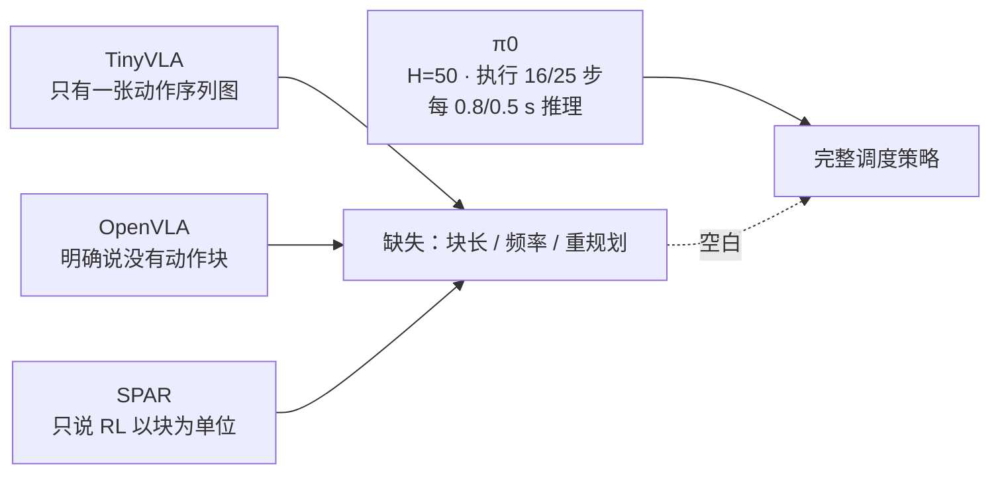

# P005 · 科研启发与复现建议

> 证据分级：**【原文证明】** / **【合理推测】** / **【待验证】**。
> 导航：[[Paper_005_pi0/01_论文精读|01 精读]] ｜ [[Paper_005_pi0/02_核心创新与方法|02 创新]] ｜ [[Paper_005_pi0/03_架构图与流程图|03 图]] ｜ [[Paper_005_pi0/04_术语和公式解释|04 术语]]

---

## 一、为什么这篇对你的"执行调度"方向最重要

前面四篇里，动作块要么没有（RT-2、OpenVLA），要么语焉不详（TinyVLA 只有一张 $a^0\cdots a^t$ 的图）。**π0 是唯一把"块长 / 执行步数 / 重规划间隔 / 推理延迟"四个数字全部写出来的论文。**

### 一张你以后会反复用的表

| 论文 | 单次推理 | 动作块 H | 执行步数 m | 推理间隔 | 有效控制频率 | 占空比 |
|---|---|---|---|---|---|---|
| RT-2（55B） | 333–1000 ms | 1 | 1 | 每步 | 1–3 Hz | ~100% |
| OpenVLA（7B） | ~165 ms | 1 | 1 | 每步 | ~6 Hz | ~100% |
| TinyVLA（1.3B） | 14 ms | **未给** | **未给** | **未给** | **未给** | — |
| SPAR（1.12B） | 149 ms（整机） | **未给** | **未给** | **未给** | **未给** | — |
| **π0（3.3B）** | **73 ms** | **50** | **16 / 25** | **0.8 / 0.5 s** | **20 / 50 Hz** | **9% / 15%** |

> 这张表说明一件事：**"模型快不快"和"机器人跟不跟得上"是两个问题。** RT-2 的 1000 ms 单次推理在占空比 100% 下就是死路；π0 的 73 ms 在占空比 9% 下毫无压力。**决定成败的是占空比，不是延迟本身。**

---

## 二、A–H 八问

### A. 对 VLA 推理加速的启发

**【原文证明】的三条**
1. **延迟可分解**：14 / 32 / 27 ms（表 I）。这给出了明确的优化优先级。
2. **10 步积分只花 27 ms**：因为 KV 缓存前缀，每步只算 50 个动作 token。
3. **占空比只有 9%**：说明在 20 Hz 场景下，π0 **根本不是瓶颈**。

**【合理推测】由此得到的加速优先级**
- 若目标是 **50 Hz 双臂**：73 ms vs 0.5 s 窗口 → 即使慢 3 倍也够。**加速的紧迫性不高**；
- 若目标是 **200 Hz 力控**或 **动作块很短（m=2）**：占空比会升到 30%+，此时才需要加速；
- 若目标是 **端侧部署（无 4090）**：需要量化/剪枝，此时精度敏感度上升。

> **结论**：π0 实际上在说"在它选择的场景下，加速不是刚需"。这提醒你：**做加速研究必须先说清目标场景与占空比要求**，否则容易被问"你加速给谁用"。

### B. 对动作分块 / 执行调度的启发（本篇最有价值）

**【原文证明】**
1. H = 50；执行 16 步（20 Hz）或 25 步（50 Hz）；每 0.8 s / 0.5 s 重规划。
2. **时序集成有害**，改为开环执行。
3. 剩余动作被丢弃（每 0.8 s 重新推理意味着只用了 16/50 = 32%）。

**【合理推测】三个可以直接做的分析**
1. **执行比例**：π0 用了 32%（20 Hz）和 50%（50 Hz）。**为什么不同？** 作者没说。可能与任务速度有关（移动机器人更快、需要更频繁纠正）。
2. **丢弃 68% 的动作是否浪费？** 如果把这部分利用起来（如时序集成），理论上能更平滑；但作者实测有害。**这个矛盾值得深挖**。
3. **H 是否该随任务变？** 折衣服（慢、长）与装鸡蛋（快、精细）对块长的需求显然不同，但 π0 用同一个 50。

**【待验证】**：这三个问题都没有实验答案，**是很好的选题**（见研究点 #1、#2）。

### C. 对量化 / 缓存 / 压缩的启发

**【原文证明】**：π0 本身没做量化，只说"further optimizations, quantization... might further reduce inference times"（附录 D）。

**【合理推测】在 π0 上做加速的特殊性**
| 手段 | 对 π0 的适用性 | 理由 |
|---|---|---|
| KV cache 优化 | ⚠️ 已经在用（前缀缓存） | 进一步压缩的是"动作 token 的 KV"，只有 50 个，收益小 |
| 减少积分步 K | ✅ 直接省 27 ms 的一部分 | 但精度敏感——去噪步数少了动作会糊 |
| 视觉编码加速 | ✅ 14 ms，占 19% | 多相机场景下占比更高 |
| LLM 权重量化 | ✅ 观测前向 32 ms 是大头 | int4 可能有效（参考 OpenVLA） |
| 动作块蒸馏 | ✅ 把 50 步压成更少的"关键帧" | 没人做过 |

> [!warning] 一个反直觉的结论
> **在 π0 这类"长动作块 + 低占空比"的系统里，模型加速的边际收益很低。** 真正的瓶颈可能是"视觉编码"或"数据搬运"，而不是 LLM。这与 TinyVLA/SPAR 的场景（单步推理、高占空比）完全不同。**做加速研究要区分这两类系统。**

### D. 是否能用于轮式双臂机器人？

**【原文证明】**：π0 **已经**在双臂（UR5e / Trossen / ARX / AgileX）和移动平台（Mobile Trossen/ARX、Mobile Fibocom）上训练与评测，动作维度 14–17，统一零填充到 18 维。
**【结论】**：这是 24 篇里**对"轮式双臂"支持最好的一篇**——它就是为异构形态设计的。

**【合理推测】**：如果你想做轮式双臂，π0 的 18 维定义（双臂 12 + 夹爪 2 + 底盘 3 + 躯干 1）是一个可直接借用的规范。

### E. 是否需要真实硬件？

| 目标 | 需求 | 可行性 |
|---|---|---|
| 复现 π0 | 权重 + 1 万小时数据 | ❌ 不可能 |
| 复现"流匹配动作头" | 任一开源 VLA + 仿真 | ✅ 可行 |
| 复现"动作块调度"实验 | 只需推理 + 仿真 | ✅ 很容易 |
| 复现真机灵巧任务 | 双臂/移动平台 + 数百小时数据 | ⚠️ 极高 |

### F. 能否在仿真中先复现？

**【合理推测】**：可以，但要选对问题。
- **适合仿真**：动作块长度 H、执行步数 m、推理间隔的**调度实验**（只改推理逻辑，不改模型）；
- **不适合仿真**：灵巧长任务（折衣服、装盒）——仿真里的可形变物体与真实差距太大。

### G. 本科阶段能否完成小规模实验？

**【我的判断】能，而且有一个非常合适的题目**：

> **题目**：固定一个开源 VLA（如 OpenVLA 或 SmolVLA），在仿真里扫「动作块长度 H × 执行步数 m」，画"成功率 vs 有效控制频率"的帕累托前沿。

- 只改推理与执行逻辑，不改模型 → 计算量小；
- 变量清晰（H, m）；
- 结论对任何 VLA 都适用（模型无关）。

### H. 博士阶段能否进一步拓展？

三条线：
1. **调度理论**：给定延迟分布与任务动态性，如何选 (H, m)？可以做成一个优化问题，甚至自适应（根据观测不确定性动态调整）。
2. **时序集成的再研究**：π0 说它有害，但 ACT 说它有用——**差异在哪？**（块长？重规划间隔？任务速度？）
3. **动作块的压缩/蒸馏**：50 步里有多少是冗余的？能否用更少的关键帧表示？

---

## 三、四个可落地的研究点

### 研究点 #1：H 与 m 的联合扫描（我最推荐）

| 项目 | 内容 |
|---|---|
| **动机** | π0 固定 H=50、m=16/25，从未扫过；作者也没解释为什么两个平台用不同 m |
| **假设** | 存在最优 (H, m) 使"任务成功率 / 完成时间"最大，且最优点随任务动态性变化 |
| **设计** | 固定模型权重，在仿真里扫 $H\in\{10,25,50,100\}$、$m/H\in\{0.2,0.5,0.8,1.0\}$ |
| **指标** | 成功率、完成时间、有效频率、扰动恢复率 |
| **价值** | 模型无关、结论普适；纯推理实验，成本低 |
| **风险** | 可能得出"m 越大越好"的平凡结论 → 需加入扰动/动态任务制造 trade-off |

### 研究点 #2：时序集成到底何时有害？

| 项目 | 内容 |
|---|---|
| **动机** | ACT 说有用，π0 说有害，两个结论直接冲突 |
| **假设** | 有效性取决于"重叠比例"：重叠大 → 平均有益；重叠小 → 引入过时动作 |
| **设计** | 控制重叠步数 $r\in\{0,2,4,8,16\}$，比较"集成 vs 不集成" |
| **指标** | 成功率、轨迹平滑度（jerk）、响应延迟 |
| **价值** | 直接解决一个文献矛盾，故事干净 |
| **风险** | 需要实现 ACT 式集成，改动中等 |

### 研究点 #3：K（积分步数）与精度的关系

| 项目 | 内容 |
|---|---|
| **动机** | π0 固定 K=10，没扫；而 K 是"生成质量 vs 延迟"最直接的旋钮 |
| **假设** | K=4 时精度下降可用"更好的路径"（如高阶积分器）补偿 |
| **设计** | 扫 $K\in\{1,2,4,10,20\}$ × 积分器（欧拉 / 中点 / RK4） |
| **指标** | 动作误差（离线）、成功率（闭环）、延迟 |
| **价值** | 直接对应"加速"主题，且与 TinyVLA 的扩散步数问题同构 |
| **风险** | 需要训练或至少微调，成本高于 #1 |

### 研究点 #4：动作块的"信息冗余"分析

| 项目 | 内容 |
|---|---|
| **动机** | π0 生成 50 步却只用 16–25 步，说明后段动作可能"白算" |
| **假设** | 50 步动作块的有效自由度远小于 50（例如可用 5–10 个关键帧插值表示） |
| **设计** | 对生成的动作块做 PCA / 时间下采样，看多少维/多少帧能保留性能 |
| **价值** | 如果成立，可以把 H 的有效成本降下来，甚至改变输出头设计 |
| **风险** | 可能只是"平滑轨迹本来就低维"的平凡结论 |

---

## 四、一个具体案例：折一件衬衫（教学示例 + 原文任务）

> [!warning] 案例性质
> "Laundry Folding" 是 **π0 的原始实验任务**（图 2、图 13）。
> 但下面的时间线是我为解释"动作块调度"构造的**教学示例**，具体数值（步数、秒数）是假设的。

**场景**：静止双臂 ARX 机器人，篮子里有一件揉皱的衬衫。指令："fold the shirt"。

| 时间 | 发生了什么 | 说明 |
|---|---|---|
| 0.00 s | 拍 3 张图，编码（14 ms）+ 观测前向（32 ms）+ 10 步流匹配（27 ms） | 共 73 ms |
| 0.073 s | 得到 50 步动作块（每步 18 维，实际用 14 维） | H=50 |
| 0.073–0.873 s | **开环执行前 16 步**（20 Hz） | 抓起衣领、抬起 |
| 0.873 s | 重新拍图推理 | 新一轮 |
| ... | 重复约 10–30 轮 | 折一件衣服约 30–60 秒 |
| 期间 | 如果衣服滑落，**要等到下一个推理点才能纠正**（最多 0.8 s 延迟） | 开环的代价 |

**关键理解**：
- **"折衣服"这么复杂的任务，是靠 10–30 次"想一下、动 0.8 秒"完成的**——不是连续闭环；
- 每次推理只用了 16/50 = 32% 的动作，**剩下 68% 被丢弃**；
- 如果衬衫在 0.3 s 时滑落，机器人要等到 0.873 s 才知道——这就是"开环执行"的代价，也是为什么"动作块长度"是个需要权衡的超参。

---

## 五、复现路线

| 步骤 | 内容 | 难度 | 产出 |
|---|---|---|---|
| 0 | 找有流匹配动作头的开源实现（如 LeRobot 系列，**需核实**） | 低 | 跑通 |
| 1 | 在仿真任务上训练流匹配策略 | 中 | 基线 |
| 2 | 扫 H × m | 低（只改推理） | **研究点 #1** |
| 3 | 分段计时 | 低 | 验证 14/32/27 的量级 |
| 4 | 加外部扰动 | 中 | 开环代价曲线 |

---

## 六、复现时会踩的坑

| 坑 | 说明 | 建议 |
|---|---|---|
| **权重不可得** | 原文未开源 | 只能复现思路，不能复现数字 |
| **18 维零填充的实现** | 哪些维对应什么？原文给了大类（双臂/夹爪/底盘/躯干）但没给精确索引 | 自定义并记录 |
| **τ 采样分布** | Beta 的参数（1.5, 1）与 $s=0.999$ | 照抄，别用均匀分布 |
| **双向注意力** | 动作 token 之间不能因果掩码 | 容易写错 |
| **KV cache 的位置** | 只缓存前缀，动作 token 每步重算 | 影响 27 ms 这个数字 |
| **执行步数** | 16/25 是与 H=50 配套的 | 换 H 时要重调 m |
| **图 7/13 无表格** | 只能读柱状图 | 引用时写"约" |
| **时序集成的负结果** | 只有一句话 | 不要以为"照抄 ACT 就行" |

---

## 七、与前后论文的关系

| 论文 | 关系 |
|---|---|
| [[00_文献总索引#P004 OpenVLA]] | π0 的主要 baseline；两者代表"离散 token"与"连续流匹配"两条路线 |
| [[00_文献总索引#P002 SPAR]] | SPAR 剪的正是 π0.5（π0 的后继），所以 π0 是 SPAR 的上游 |
| [[00_文献总索引#P001 TinyVLA]] | 同样用连续动作头（扩散），但用**单步**而非动作块；两者可以互补 |
| [[00_文献总索引#P006 Diffusion Policy]] | 动作块与时序集成的原始出处；π0 明确拒绝了它的时序集成 |
| [[00_文献总索引#P003 RT-2]] | 离散 token 路线的起点，π0 是它的反面 |

---

## 八、一句话总结对我的价值

> **π0 给了我最需要的一个视角：判断一个 VLA 能不能实时，不看它的推理延迟，而看它的"占空比"——推理时间占执行窗口的比例。**
> 73 ms 在 0.8 秒的窗口里只占 9%，所以它"够快"；而 RT-2 的 1000 ms 在每步都要推理的设定下就是死路。这个视角让我能一眼判断：**某个加速工作到底在解决真问题，还是在优化一个本来就不是瓶颈的环节。**
