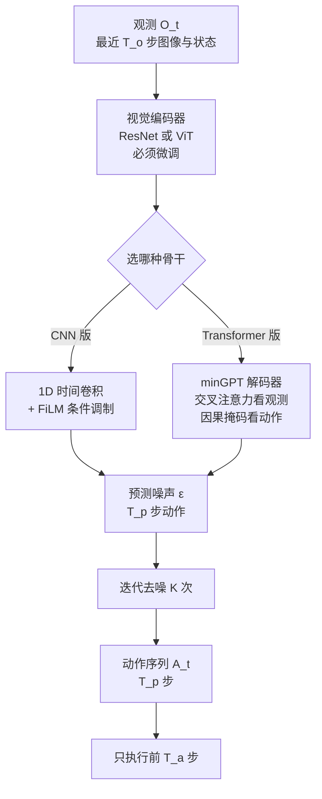
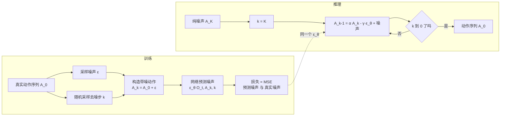
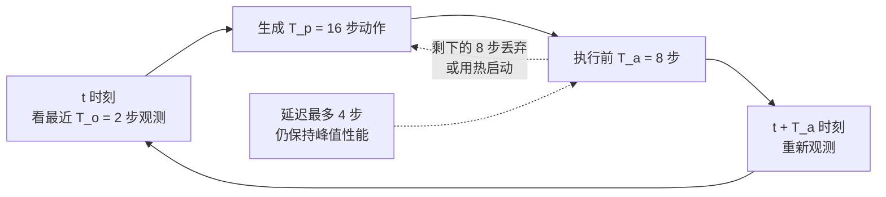
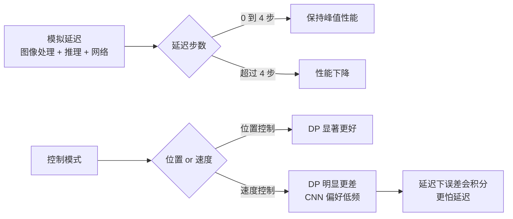
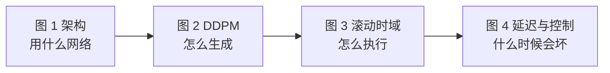

# P006 · 架构图与流程图

> 本文共 4 张图：
> **图 1 两种骨干架构** ／ **图 2 DDPM 训练与推理** ／ **图 3 滚动时域与三个时间尺度（最核心）** ／ **图 4 延迟与成功率、控制模式**
> 每张图后附：逐节点解释 → 数据流 → 核心创新位置 → 原文出处。
>
> 导航：[[Paper_006_DiffusionPolicy/01_论文精读|01 精读]] ｜ [[Paper_006_DiffusionPolicy/02_核心创新与方法|02 创新]] ｜ [[Paper_006_DiffusionPolicy/04_术语和公式解释|04 术语]] ｜ [[Paper_006_DiffusionPolicy/05_科研启发与复现建议|05 启发]]

---

## 图 1 · 两种骨干架构



### 1.1 逐节点解释

| 节点 | 说明 |
|---|---|
| O | 最近 $T_o$ 步观测（多数任务 2 步） |
| VE | 视觉编码器，**必须微调**（从头训只有 22%，冻结也差） |
| A1 | CNN 骨干：时间卷积 + FiLM（特征级线性调制）注入观测条件 |
| B1 | Transformer 骨干：动作 token 之间用**因果掩码**（只能看自己和之前的） |
| N1 | 输出噪声预测，形状 $T_p\times d$ |
| R1 | 迭代 $K$ 次（训练 100，真机 16） |
| EX | 只执行前 $T_a$ 步（多数 8） |

### 1.2 数据如何流动

观测 → 视觉特征 → （FiLM 或交叉注意力）→ 作为条件注入去噪网络 → 输出噪声 → 迭代 → 动作序列 → 执行前 $T_a$ 步。

### 1.3 核心创新在哪

- **"输出是动作序列"这个决定**（不是单步）；
- **两种骨干的对照**给出了"CNN 偏好低频"这个可复用结论（ToolHang 状态版 CNN 0.50 vs Transformer 1.00）。

### 1.4 原文出处

| 内容 | 原文位置 |
|---|---|
| CNN：1D 时间卷积 + FiLM | §3.1、图 2(b) |
| Transformer：minGPT + 交叉注意力 + 因果掩码 | §3.1、图 2(c) |
| CNN 对高频动作表现差 | §3.1 |
| 视觉编码器必须微调 | §3.2、§5.4、表 5 |

---

## 图 2 · DDPM：训练与推理



### 2.1 逐节点解释

| 节点 | 含义 |
|---|---|
| T4 | 训练时"一步加噪"（不是逐步加），靠闭式公式 |
| T6 | 最简单的 MSE 损失，不需要负采样 |
| I3 | 推理时逐步去噪，每步都加一点噪声（DDPM 的随机性） |
| I4 | 循环 $K$ 次（100 或 16） |

### 2.2 数据如何流动

训练：干净动作 → 加噪 → 学"噪声长什么样"。
推理：噪声 → 反复"减去预测的噪声" → 干净动作。

### 2.3 核心创新在哪

**公式 (2) 的视角**：去噪等价于"沿能量函数梯度下降"。这个解释把扩散与能量模型（IBC）统一起来，也解释了为什么扩散比 IBC 稳定——**不需要估计归一化常数**。

### 2.4 原文出处

式 (1)–(5)（§2.1–2.3）；噪声调度见 §3.3。

---

## 图 3 · 滚动时域与三个时间尺度（本文最核心的图）



### 3.1 逐节点解释

| 节点 | 数值（多数任务） | 作用 |
|---|---|---|
| $T_o$ | **2** | 看多少步历史（提供速度/趋势信息） |
| $T_p$ | **16**（CNN）/ 10（Transformer） | 一次生成多长 |
| $T_a$ | **8** | 执行多少步再重规划 |
| 丢弃/热启动 | 剩 8 步 | 滚动时域：下次推理可用上次预测初始化 |

### 3.2 数据如何流动（时间轴）

```
时间 →
观测窗口 T_o=2
    ↓
预测窗口 T_p=16  ████████████████
执行窗口 T_a=8   ████████
                  ↓ 重规划
                  ████████████████
                  ████████
```

**关键比例**：$T_a/T_p = 8/16 = 50\%$（执行一半就重规划）。

### 3.3 核心创新在哪

**这张图就是"动作块"的原始出处。** 后来所有 VLA 的调度设计都是它的变体：

| 工作 | $T_p$ | $T_a$ | 比例 |
|---|---|---|---|
| Diffusion Policy | 16 | 8 | 50% |
| π0 | 50 | 16（20 Hz）/ 25（50 Hz） | 32% / 50% |
| TinyVLA | 未给 | 未给 | — |

**注意 π0 与 DP 的执行比例都落在 32%–50%**——这可能不是巧合，而是一个合理的工程区间（既要平滑，又要响应）。

### 3.4 原文出处

§2.3（三个时域的定义）、§4.3（$T_a$ 的影响）、表 7/8（具体取值）、图 5（延迟容忍）。

---

## 图 4 · 延迟与成功率、控制模式



### 4.1 逐节点解释

| 节点 | 说明 |
|---|---|
| A | 作者用"人为延迟"模拟真实系统的时间开销 |
| C | **4 步**是容忍上限（图 5） |
| G | 位置控制：动作有界、平滑，扩散好学 |
| H | 速度控制：需要高频变化，CNN 时间卷积不擅长 |
| I | 速度误差积分成位置误差 |

### 4.2 数据如何流动

延迟增大 → 执行的动作"过时" → 复合误差 → 成功率下降。**位置控制下误差不累积，速度控制下会累积**。

### 4.3 核心创新在哪

这是**第一次把"延迟"当作实验变量**的工作（在 VLA 领域之前）。它给出的"4 步容忍"是一个可以直接引用的工程经验。

### 4.4 原文出处

图 5（延迟）、图 4（控制模式）、§5.3（相关论述）。

---

## 五、四张图的关系



---

## 六、自检：哪些是原文有，哪些是我补的

| 元素 | 性质 |
|---|---|
| 两种骨干、FiLM、因果掩码 | 【原文·§3.1】 |
| 式 (1)–(5) | 【原文·§2】 |
| $T_o=2, T_p=16, T_a=8$ | 【原文·表 7/8】 |
| 延迟容忍 4 步 | 【原文·图 5】 |
| 位置控制优于速度控制 | 【原文·图 4、§5.3】 |
| 视觉编码器必须微调、22%、50 epochs | 【原文·§5.4、表 5】 |
| 图 3 的时间轴画法 | 【我的整理】依据三个时域定义 |
| "π0 与 DP 执行比例都在 32%–50%" | 【我的观察】跨论文比较 |
| $T_a/T_p=50\%$ | 【我的计算】 |
