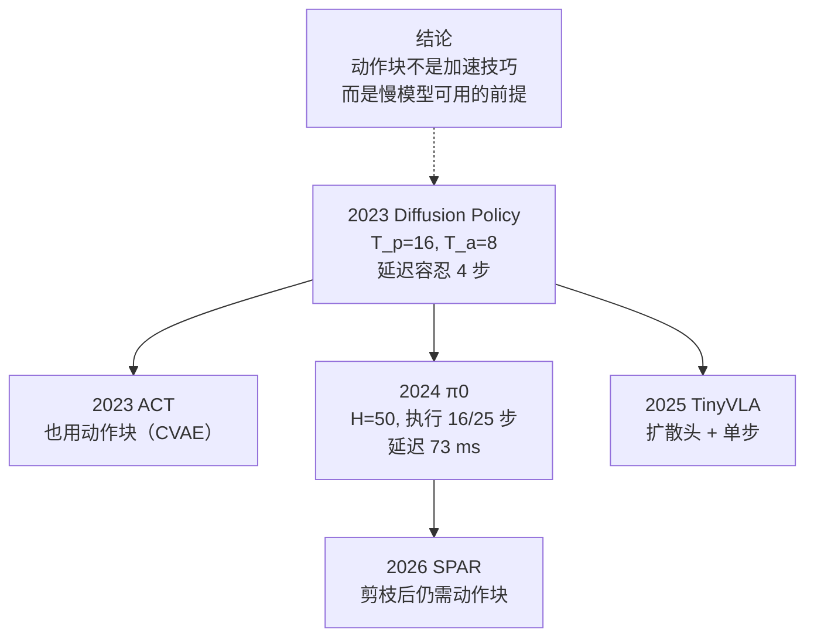
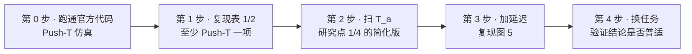

---
title: P006 Diffusion Policy 科研启发与复现建议
paper_id: P006
short: DP
tags:
  - 科研启发
  - 动作块
  - 执行调度
  - 复现
status: done
created: 2026-11-05
---

# P006 · 科研启发与复现建议

> 证据分级：**【原文证明】** / **【合理推测】** / **【待验证】**。
> 导航：[[Paper_006_DiffusionPolicy/01_论文精读|01 精读]] ｜ [[Paper_006_DiffusionPolicy/02_核心创新与方法|02 创新]] ｜ [[Paper_006_DiffusionPolicy/03_架构图与流程图|03 图]] ｜ [[Paper_006_DiffusionPolicy/04_术语和公式解释|04 术语]]

---

## 一、它在你的研究地图里的位置：动作块机制的"祖先"

**一句话**：TinyVLA 的扩散头来自这里，π0 的动作块来自这里，SPAR 的"RL 以动作块为单位"也来自这里。

---

## 二、A–H 八问

### A. 对 VLA 推理加速的启发

**【原文证明】的三条**
1. **推理步数可以远小于训练步数**：训练 100 步，真机推理 **16 步（DDIM）**，性能不崩（表 7）。
2. **延迟容忍 4 步**：图 5 显示，模拟延迟到 4 个控制步，性能仍保持峰值。
3. **位置控制更抗延迟**：速度控制下误差会积分，延迟伤害更大。

**【合理推测】由此得到的加速策略优先级**
| 策略 | 收益 | 风险 |
|---|---|---|
| 减少推理去噪步数（100→16→更少） | 高（线性） | 动作变"糊" |
| 加长动作块（$T_p$ 增大） | 高（摊薄） | 开环变长、响应变慢 |
| 加速视觉编码器 | 中 | 影响精度 |
| 权重量化 | 中 | 见 OpenVLA 的 int8 教训 |

**【待验证】**：DP 没有报推理 ms，所以"16 步 DDIM 到底多快"需要自己测。

### B. 对动作分块 / 执行调度的启发（本篇核心贡献）

**【原文证明】**
1. **三时域定义**：$T_o=2$、$T_p=16$、$T_a=8$。
2. **$T_a=8$ 最优**（§4.3、图 5 左）。
3. **滚动时域 + 热启动**：用上次预测初始化下次推理，改善平滑度。
4. **延迟容忍 4 步**。

**【合理推测】一个可以立刻做的分析**
- DP 的执行比例 $T_a/T_p=50\%$；
- π0 的执行比例是 32%（20 Hz）和 50%（50 Hz），**同样落在 50% 附近**；
- **这暗示"执行一半、丢一半"可能是一个跨模型的稳健选择。**

**【待验证】**：这个"50% 律"是否在更多模型/任务上成立？如果成立，就是一个漂亮的经验规律（见研究点 #1）。

### C. 对量化、缓存、压缩的启发

**【原文证明】**：DP 本身没做量化，但用 DDIM 减少了采样步数——**这本质上是一种"采样加速"，与模型压缩正交。**

**【合理推测】**：
- **采样加速（DDIM / 一致性模型 / 蒸馏）** 与 **模型压缩（量化 / 剪枝）** 可以叠加；
- 但要注意：**动作块已经把推理频率摊薄了，所以单次推理的加速收益会被占空比稀释**（见 π0 的 9% 占空比）。
- **在 DP 这类多步采样模型上，"减少步数"的收益 > "量化权重"的收益**（因为 16 步 × 每步前向是主要成本）。

### D. 是否能用于轮式双臂机器人？

**【原文证明】**：DP 的实验都是单臂（Franka / Push-T 仿真 / Robomimic 单臂或双臂 Transport）。
**【合理推测】**：DP 的架构与机器人形态无关，动作维度可以扩展；但**它没有语言输入**，所以无法做"听指令"的任务——这正是 VLA 要补的。

### E. 是否需要真实硬件？

| 目标 | 需求 | 可行性 |
|---|---|---|
| 复现仿真结果 | 单卡 + Robomimic/Push-T | ✅ 很容易 |
| 复现真机 | Franka + 相机 | ⚠️ 有门槛 |
| 复现 $T_a$ 扫描 | 仿真即可 | ✅ **强烈推荐** |

### F. 能否在仿真中先复现？

**【原文证明】**：15 个任务里 11 个是仿真（Robomimic 5 + Push-T + BlockPush + Kitchen）。
**【合理推测】**：**仿真是复现 DP 的最佳场所**，而且 Robomimic 数据公开、代码成熟。

### G. 本科阶段能否完成小规模实验？

**【我的判断】非常适合。** 推荐题目：

> **题目**：在 Push-T 或 Robomimic 上复现"$T_a$ 扫描"，验证 $T_a=8$ 是否仍是你的设置下的最优，并画出"成功率 vs 有效控制频率"的曲线。

- 只需训练一次，改推理逻辑即可扫多个 $T_a$；
- 计算量小；
- 结论有教学价值（验证 vs 复现）。

### H. 博士阶段能否进一步拓展？

三条线：
1. **自适应动作块**：根据任务阶段/观测不确定性动态调整 $T_a$（现在都是固定值）；
2. **延迟感知的调度**：把"已知延迟"纳入动作块选择（DP 只测了容忍度，没做自适应）；
3. **动作块与压缩的联合优化**：见 C。

---

## 三、四个可落地的研究点

### 研究点 #1：验证"执行比例 50%"是否是跨模型的稳健规律

| 项目 | 内容 |
|---|---|
| **动机** | DP 用 50%（8/16），π0 用 32%/50%，疑似存在稳健区间 |
| **假设** | 在多个模型/任务上，$T_a/T_p\in[0.3,0.6]$ 都是较优区间 |
| **设计** | 固定模型，扫 $T_a/T_p \in\{0.1,0.25,0.5,0.75,1.0\}$，跨 3 个任务 |
| **指标** | 成功率、完成时间、轨迹平滑度 |
| **价值** | 若成立，是一个可直接引用的经验规律 |
| **风险** | 可能是"任务相关"而非"普适" |

### 研究点 #2：延迟感知的自适应 $T_a$

| 项目 | 内容 |
|---|---|
| **动机** | DP/π0 都用固定 $T_a$，但实际延迟会波动（网络、负载） |
| **假设** | 根据实测延迟动态调整 $T_a$，可提升抖动场景下的成功率 |
| **设计** | 对比：固定 $T_a$ / 按延迟查表 / 按观测不确定性调整 |
| **指标** | 成功率、超时率、动作平滑度 |
| **风险** | 需要真实或高保真延迟模拟 |

### 研究点 #3：动作块的"信息冗余"（与 π0 共用）

| 项目 | 内容 |
|---|---|
| **动机** | DP 生成 16 步只执行 8 步，π0 生成 50 步只执行 16–25 步 |
| **假设** | 动作块后段的信息量远低于前段，可用更短的生成 + 插值替代 |
| **设计** | 分析动作块的时间自相关 / PCA 谱；尝试"生成 8 步 + 线性插值到 16 步" |
| **指标** | 成功率、延迟 |
| **价值** | 直接减少生成成本 |

### 研究点 #4：DDIM 步数的下界

| 项目 | 内容 |
|---|---|
| **动机** | DP 用 16 步 DDIM，但没扫过更少（8？4？） |
| **设计** | 扫 $K\in\{2,4,8,16,32,100\}$，测成功率与延迟 |
| **指标** | 成功率、动作平滑度 |
| **价值** | 便宜、直接、可复现 |

---

## 四、一个具体案例：推 T 形块（教学示例 + 原文任务）

> [!warning] 案例性质
> Push-T 是 **DP 的原始实验任务**（表 1、表 2、表 7）。
> 但下面的时间线是为解释"三个时域"构造的**教学示例**，具体数值是假设的。

**场景**：仿真里有一个 T 形块和一个目标区域，要把 T 推到目标位置与朝向。

| 时刻 | 发生了什么 | 对应 |
|---|---|---|
| $t$ | 取最近 $T_o=2$ 帧观测（图像含 T 块与目标） | §2.3 |
| $t$ | 从纯噪声 $A^K$ 开始，16 次 DDIM 去噪（真机） | 式 (4) |
| $t$ | 得到 16 步动作序列 $A_t$ | $T_p=16$ |
| $t$ 到 $t+8$ | 执行前 8 步，**不重新推理** | $T_a=8$ |
| $t+8$ | 重新观测，可用上次预测热启动 | 滚动时域 |
| 重复 | 直到 T 块对齐目标 | — |

**关键理解**：
- **为什么执行 8 步而不是 16 步？** 因为开环太久，T 块被推歪了也发现不了；
- **为什么不是 1 步？** 因为每次推理都要 16 次去噪，太频繁；而且每步单独预测会导致动作抖动；
- **"8" 是这两个约束的平衡点**——这就是"执行调度"的本质。

---

## 五、复现路线

---

## 六、复现时会踩的坑

| 坑 | 说明 | 建议 |
|---|---|---|
| **46.9% 的口径** | 相对提升，非绝对 | 引用时写清 |
| **训练/推理步数不同** | 训练 100、真机 16 | 别用同一个 K |
| **位置 vs 速度控制** | DP 偏好位置控制 | 复现时先确认动作空间 |
| **视觉编码器微调** | 必须训，且 10× 小学习率 | 冻结会崩 |
| **$T_a$ 依赖任务** | 8 只是多数任务的最优 | 自己的任务要重新扫 |
| **CNN vs Transformer** | 结论不稳定（ToolHang 状态 vs 视觉相反） | 两个都试 |
| **真机推理延迟未报** | 表 7 只给 16 步 | 自己测 ms |

---

## 七、与前后论文的关系

| 论文 | 关系 |
|---|---|
| [[00_文献总索引#P001 TinyVLA]] | 借用了 DP 作为动作头，但改成了"单步 + 扩散"（丢掉了动作块） |
| [[00_文献总索引#P005 π0 (pi-zero)|π0]] | 把动作块推到极致（H=50），并明确拒绝 DP/ACT 的时序集成 |
| [[00_文献总索引#P004 OpenVLA]] | 微调实验里 DP 是最强 baseline；两者都发现"视觉必须微调" |
| [[00_文献总索引#P002 SPAR]] | 被剪的 π0.5 继承的是流匹配，不是扩散 |
| [[00_文献总索引#P003 RT-2]] | 完全不同的动作表示路线（离散 token vs 连续扩散） |

---

## 八、一句话总结对我的价值

> **DP 教会我"动作块"不是工程技巧，而是一种"用时间换精度"的设计哲学：模型可以慢，只要它一次想得足够远，然后只走一小段。**
> 它给出的三个数字（$T_p=16$、$T_a=8$、延迟容忍 4 步）构成了"慢模型可用"的量化边界。而我注意到 π0 的执行比例（32%–50%）与 DP（50%）惊人地接近——**如果这个比例是稳健的，那它就是我做调度研究时最好的起点假设。**
