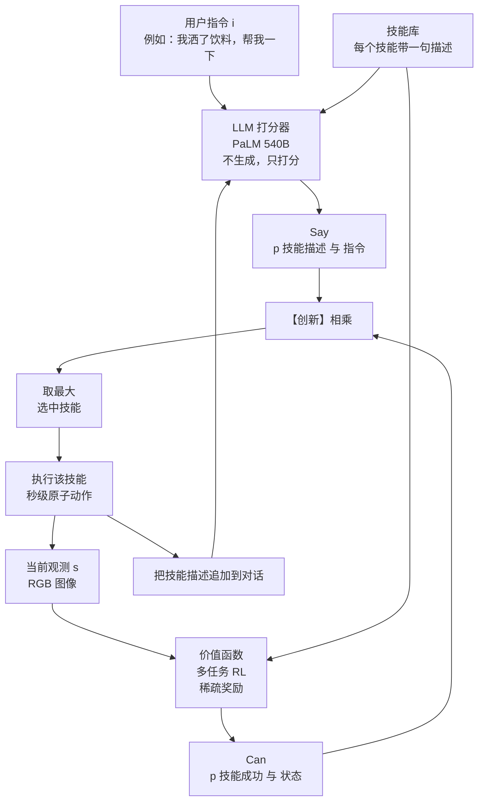
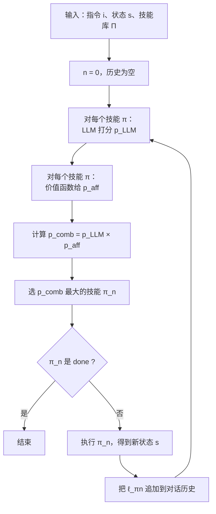
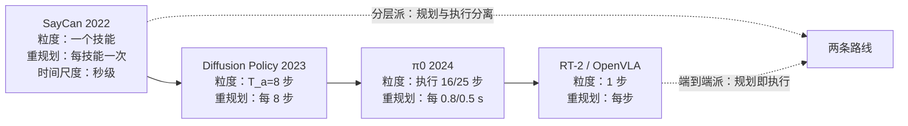
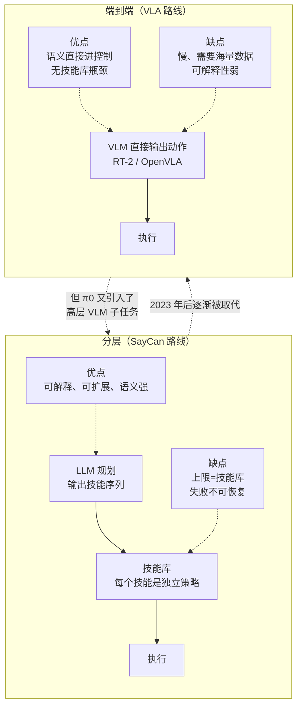
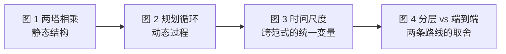

# P007 · 架构图与流程图

> 本文共 4 张图：
> **图 1 两塔相乘架构** ／ **图 2 Algorithm 1 的规划循环** ／ **图 3 时间尺度对比（跨论文，最有洞察）** ／ **图 4 分层 vs 端到端**
> 每张图后附：逐节点解释 → 数据流 → 核心创新位置 → 原文出处。
>
> 导航：[[Paper_007_SayCan/01_论文精读|01 精读]] ｜ [[Paper_007_SayCan/02_核心创新与方法|02 创新]] ｜ [[Paper_007_SayCan/04_术语和公式解释|04 术语]] ｜ [[Paper_007_SayCan/05_科研启发与复现建议|05 启发]]

---

## 图 1 · 两塔相乘架构

### 1.1 逐节点解释

| 节点 | 含义 | 关键点 |
|---|---|---|
| I | 用户指令 | 可长、可抽象、可含歧义 |
| SK | 技能库 | 每个技能 = 策略 + 价值函数 + 一句描述 |
| L1 | LLM | **打分器**，不是生成器 |
| V1 | 价值函数 | 稀疏奖励下 = 可供性 |
| P1 / P2 | 两路概率 | 任务接地 / 世界接地 |
| M1 | **相乘** | 本文的核心 |
| E1 | 执行 | 一个技能执行完才重新规划 |

### 1.2 数据如何流动

指令 + 状态 + 技能库 → 两路打分 → 相乘 → 选一个 → 执行 → 状态更新 + 历史追加 → 再来一轮。

### 1.3 核心创新在哪

**M1 这个乘法**。上下游都是现成的（LLM 现成、价值函数是标准 RL、技能是已有策略），只有"乘起来"是新的。

### 1.4 原文出处

图 3（论文的示意图）、§3、Algorithm 1、式 "$\pi=\arg\max p(c_\pi\mid s,\ell_\pi)p(\ell_\pi\mid i)$"。

---

## 图 2 · 规划循环（Algorithm 1）

### 2.1 逐节点解释

| 节点 | 说明 |
|---|---|
| C | 一次要对**所有**技能打分（551 个） |
| D | 一次要对**所有**技能算价值 |
| E | 两路概率相乘 |
| G | 终止条件是 LLM 选出 "done" |
| I | 执行是**开环**的（技能内部不问规划器） |
| J | 历史追加让 LLM 知道"已经做过什么" |

### 2.2 数据如何流动

每一轮**重新算所有技能的两个分数**——注意这是 $O(|\Pi|)$ 的两次前向（LLM + 价值函数），延迟未报告。

### 2.3 核心创新在哪

- **E（相乘）**；
- **G（用 LLM 自己决定何时停）**——这也是长程任务失败的主要来源（过早终止）。

### 2.4 原文出处

Algorithm 1（§4）、§3。

---

## 图 3 · 时间尺度对比（跨论文，我的整理）

### 3.1 逐节点解释

| 系统 | 重规划的"原子单位" | 隐含的频率 |
|---|---|---|
| SayCan | **一个技能**（如"拿海绵"） | 秒级 |
| Diffusion Policy | 8 个控制步 | 取决于控制频率 |
| π0 | 16/25 个控制步（0.5–0.8 s） | 1.25–2 Hz |
| RT-2 / OpenVLA | 1 个控制步 | 1–6 Hz |

### 3.2 这张图想说明什么

**所有系统都在做同一件事：决定"多久重新想一次"。** 差别只是"原子单位"的定义：
- 分层派用**语义单位**（技能）；
- 端到端派用**时间单位**（步、块）。

而"多久重规划一次"这个问题的答案，直接决定了：
- 系统的响应性（越频繁越灵敏）；
- 计算成本（越频繁越贵）；
- 长程一致性（越稀疏越容易跑偏）。

> [!tip] 这条线索对你的"执行调度"方向非常有用
> **SayCan 的"技能"本质上是一种超长的动作块**——只不过它是离散的、语义的。把 SayCan（技能级）、DP（块级）、RT-2（步级）放在同一根轴上，就能看到"重规划粒度"是一个跨范式的统一变量。

### 3.3 原文出处

SayCan 的技能粒度见 §3、Algorithm 1。其余系统的数字见各自笔记：[[Paper_006_DiffusionPolicy/01_论文精读]]、[[Paper_005_pi0/01_论文精读]]、[[Paper_003_RT-2/01_论文精读]]。

---

## 图 4 · 分层 vs 端到端

### 4.1 逐节点解释

| 路线 | 代表 | 核心假设 |
|---|---|---|
| 分层 | SayCan、PaLM-E | 低层技能可以独立学好，规划是另一个问题 |
| 端到端 | RT-2、OpenVLA、π0 | 一个模型可以同时学"理解"和"控制" |
| 混合 | π0 + 高层 VLM 策略 | 低层端到端，高层仍用 VLM 分解 |

### 4.2 数据如何流动

分层：语言 → 技能序列 → 技能策略 → 动作。
端到端：语言 + 图像 → 动作。
混合：语言 → 子任务语言 → VLA → 动作。

### 4.3 核心创新在哪

SayCan 的创新在"如何把两条信息源合成一个决策"；VLA 的创新在"如何把两条信息源合成一个模型"。**它们是同一个问题的两种答案。**

### 4.4 原文出处

SayCan 的分层设计见 §3、§4；π0 的高层策略见其 §V-B（[[Paper_005_pi0/02_核心创新与方法]]）。

---

## 五、四张图的关系

---

## 六、自检：哪些是原文有，哪些是我补的

| 元素 | 性质 |
|---|---|
| 两路打分相乘、Algorithm 1 | 【原文·§3、§4】 |
| 551 个技能、15 物体、5 位置 | 【原文·§4、§5】 |
| 表 2/表 3 数字 | 【原文·第 9 页，已逐格核对】 |
| 65% LLM / 35% 可供性 错误归因 | 【原文·§5.1】 |
| "技能失败无法恢复" | 【原文·§6】 |
| 图 3 的时间尺度对比 | 【我的整理】跨论文，非原文 |
| 图 4 的分层 vs 端到端 | 【我的整理】，其中"2023 年后被取代"是我的判断 |
| 规划延迟 | **【原文未给出】** |
