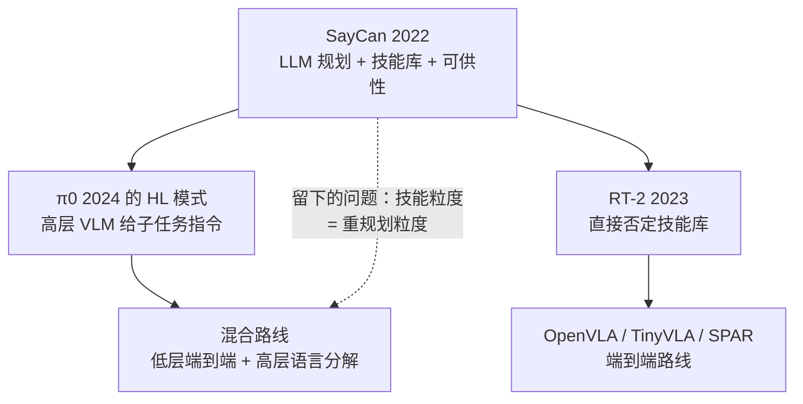

---
title: P007 SayCan 科研启发与复现建议
paper_id: P007
short: SayCan
tags:
  - 科研启发
  - 分层架构
  - 执行调度
  - 复现
status: done
created: 2026-11-05
---

# P007 · 科研启发与复现建议

> 证据分级：**【原文证明】** / **【合理推测】** / **【待验证】**。
> 导航：[[Paper_007_SayCan/01_论文精读|01 精读]] ｜ [[Paper_007_SayCan/02_核心创新与方法|02 创新]] ｜ [[Paper_007_SayCan/03_架构图与流程图|03 图]] ｜ [[Paper_007_SayCan/04_术语和公式解释|04 术语]]

---

## 一、它在你的研究地图里的位置：分层派的"完整答案"



**一句话**：SayCan 是"分层"这条路线的标杆，而 π0 的 `π0-HL` 模式本质上是**它的现代翻版**（用 VLM 代替 LLM，用 VLA 代替技能库）。

---

## 二、A–H 八问

### A. 对 VLA 推理加速的启发

**【原文证明】**：SayCan **不做低层控制**，所以它的"延迟"完全不在毫秒级。
- 每次规划要对全部技能打分（551 个），延迟**原文未报告**；
- 但它的时间尺度是**秒级**（一个技能的执行时间），所以即使规划要几百毫秒也完全够用。

**【合理推测】一个重要的对比**
| 系统 | 决策频率 | 每次决策的成本 | 占空比 |
|---|---|---|---|
| SayCan | 每技能一次（秒级） | 551 次 LLM 打分 + 551 次价值前向 | 未知，但时间尺度宽松 |
| RT-2 | 每步（1–3 Hz） | 1 次 55B 前向 | ~100% |
| π0 | 每 0.5–0.8 s | 73 ms | ~9% |

> **结论**：**"加速"的紧迫性取决于决策频率。** SayCan 这种秒级决策的系统根本不需要模型加速——它需要的是"技能库更强"。这提醒你：做加速研究必须先定义**目标决策频率**。

**【待验证】**：551 个技能的打分如果改成"只对 top-k 候选打分"，能省多少延迟？会不会掉点？

### B. 对动作分块 / 执行调度的启发（本篇核心）

**【原文证明】**
1. **技能就是最粗粒度的"动作块"**：一个技能执行完才重新规划（Algorithm 1）。
2. **技能内部是开环的**：规划器不看技能执行的中间状态。
3. **无法从技能失败中恢复**（作者自认）。

**【合理推测】把三个范式的"重规划粒度"放在一根轴上**
```
粗 ────────────────────────────────────────→ 细
SayCan(技能)   DP(T_a=8)   π0(16/25 步)   RT-2(1 步)
秒级            ~0.4 s      0.5–0.8 s      0.33–1 s
```
有意思的是：**π0 与 RT-2 的重规划频率其实差不多**（都是 1–3 Hz），但 π0 用了动作块，所以**单次推理可以更慢**。SayCan 的重规划间隔比它们都长（秒级），因为它把"原子单位"定义成了语义技能。

**【待验证】**：如果把 SayCan 的技能进一步细分（比如"移到海绵上方"也算一个技能），成功率会升还是降？——这就是"技能粒度"这个超参（见研究点 #1）。

### C. 对量化、缓存、压缩的启发

**【原文证明】**：SayCan 没有任何模型压缩。

**【合理推测】两个可以借鉴的点**
1. **LLM 打分可以只算候选的 log-prob**，不需要生成——这比生成便宜得多（一次前向 vs 自回归多次）。**这本身是一种"推理优化"思路**。
2. **技能库可以按需检索**：不必对全部 551 个技能打分，可以先用检索筛出 top-k。这与"KV cache / 稀疏注意力"是同一类思路。

### D. 是否能用于轮式双臂机器人？

**【原文证明】**：SayCan 用的就是**移动机械臂**（7 DoF 臂 + 移动底盘），动作空间含底盘 $(x,y,\text{yaw})$。
**【合理推测】**：SayCan 的架构与形态无关——只要有技能 + 价值函数就能用。所以它**天然适合轮式双臂**（每只手臂一组技能）。
**【待验证】**：双臂技能的组合爆炸（左臂 × 右臂）会不会让打分变得不现实。

### E. 是否需要真实硬件？

| 目标 | 需求 | 可行性 |
|---|---|---|
| 复现完整系统 | Everyday Robots 平台 + 551 技能 | ❌ 不可能 |
| 复现"相乘"思想 | 仿真 + 2–3 技能 + 开源 LLM | ✅ 容易 |
| 复现 tabletop 版本 | 原文开源了 Colab | ✅ 可以试（需核实环境） |

### F. 能否在仿真中先复现？

**【合理推测】非常适合。** 只需要：
- 一个小仿真环境（如 MetaWorld / Language-Table）；
- 2–5 个技能；
- 一个开源 LLM（本地 7B 即可）；
- 每个技能一个价值函数（可以先用"脚本化的成功率估计"代替）。

### G. 本科阶段能否完成小规模实验？

**【我的判断】能，而且是一个很好的"方法论"型课题**：

> **题目**：在仿真里实现 SayCan 的"相乘"，对比三种规划器：① 只用 LLM 打分 ② 只用可供性 ③ 两者相乘。

- 变量：规划器类型；
- 指标：计划成功率、执行成功率；
- 预期：【合理推测】相乘 > 单用任一（复现表 2 的趋势）；
- 成本：低（不需要训练大模型）。

### H. 博士阶段能否进一步拓展？

三条线：
1. **技能粒度作为可学习的超参**（见研究点 #1）；
2. **可供性的现代替代**：用 VLA 的置信度/价值头代替 RL 价值函数；
3. **分层 + 端到端的混合架构**：π0-HL 已经做了雏形，但"何时该分层、何时该端到端"没有理论。

---

## 三、四个可落地的研究点

### 研究点 #1：技能粒度对规划性能的影响（我最推荐）

| 项目 | 内容 |
|---|---|
| **动机** | SayCan 的技能粒度是人为定的，作者从未讨论"为什么这么切" |
| **假设** | 存在最优粒度：太粗 → 无法纠错；太细 → 组合爆炸、LLM 选错 |
| **设计** | 同一任务集，用 3 种粒度（粗/中/细）定义技能库，比较计划与执行成功率 |
| **指标** | 成功率、平均技能数、规划延迟 |
| **价值** | 这是"执行调度"在**语义层**的版本，与动作块在**时间层**的版本同构 |
| **风险** | 需要手工设计不同粒度的技能库，工作量在环境搭建 |

### 研究点 #2：用 VLA 的置信度替代 RL 价值函数

| 项目 | 内容 |
|---|---|
| **动机** | 训练 551 个价值函数很贵；VLA 本身可能有"成功率"信号 |
| **假设** | 用 VLA 的 token 似然 / 集成方差作为可供性，效果接近 RL 价值函数 |
| **设计** | 对比：RL 价值 / token 似然 / 多次采样一致率 |
| **指标** | 规划成功率、校准误差（预测概率 vs 实际成功率） |
| **价值** | 把"分层"和"端到端"接起来 |
| **风险** | VLA 的置信度可能校准很差 |

### 研究点 #3：失败恢复

| 项目 | 内容 |
|---|---|
| **动机** | 作者明确说系统不能处理"技能失败但价值高" |
| **设计** | 加一个"执行监控"：技能执行后用视觉判断是否真的成功；失败则重规划 |
| **指标** | 长程任务成功率提升 |
| **价值** | 直接针对作者承认的痛点 |

### 研究点 #4：top-k 技能检索以降低规划延迟

| 项目 | 内容 |
|---|---|
| **动机** | 每步对 551 个技能打分，成本未报告但可能不小 |
| **设计** | 先用句向量检索 top-20，再让 LLM 打分 |
| **指标** | 延迟、计划成功率 |
| **价值** | 工程实用，容易做 |

---

## 四、一个具体案例：我洒了饮料（原文例子）

> [!warning] 案例性质
> "I spilled my drink, can you help?" 是**原文 §1 与 §5.1 反复使用的例子**，也是 SayCan 最著名的演示。
> 下面的分数是我构造的**教学数值**，不是原文数据。

**场景**：办公室厨房，机器人有 551 个技能里的一个子集。

| 步骤 | LLM 打分 $p(\ell\mid i)$ | 可供性 $p(c\mid s,\ell)$ | 乘积 | 结果 |
|---|---|---|---|---|
| 1 | "找海绵" 0.62 | 0.85（海绵在台面上） | **0.527** | ✅ 选中 |
| 1 | "拿可乐" 0.30 | 0.90 | 0.270 | |
| 1 | "用吸尘器" 0.08 | 0.00（没有吸尘器） | 0.000 | ❌ 被否决 |
| 2（海绵已找到） | "拿海绵" 0.71 | 0.80 | **0.568** | ✅ 选中 |
| 3（已拿着海绵） | "拿海绵" 0.65 | 0.05（已经拿着了） | 0.033 | ❌ 被可供性否决 |
| 3 | "带给你" 0.70 | 0.95 | **0.665** | ✅ 选中 |
| 4 | "done" — | — | — | 结束 |

**关键理解点**：
- 第 3 步最能说明问题：**指令里还在说"海绵"，但可供性告诉系统"你已经拿到了"**——这就是"世界接地"的价值。
- 第 1 步的"用吸尘器"是经典的反例：**LLM 觉得合理，但可供性为 0**，乘积直接清零。

---

## 五、复现路线


---

## 六、复现时会踩的坑

| 坑 | 说明 | 建议 |
|---|---|---|
| **LLM 概率未校准** | log-prob 不是真实概率 | 用 softmax over 候选，或只用于排序 |
| **候选集合的顺序敏感** | LLM 打分受候选顺序影响 | 固定顺序，或多次打乱取平均 |
| **技能描述措辞影响大** | 作者提到"技能与物体的命名要自然"（附录） | 用自然语言，别用代码式命名 |
| **终止判断** | 由 LLM 决定，容易过早终止 | 可加规则：未满足条件不许选 done |
| **可供性阈值** | 乘积会被小概率主导 | 可先过滤可供性 < 阈值的技能 |
| **评测主观性** | 原文用 3 人 2/3 多数 | 复现时用明确规则 |

---

## 七、与前后论文的关系

| 论文 | 关系 |
|---|---|
| [[00_文献总索引#P003 RT-2]] | 直接否定技能库：VLM 直接出动作 |
| [[00_文献总索引#P005 π0 (pi-zero)|π0]] | π0-HL 模式是 SayCan 的现代翻版（VLM 分解子任务） |
| [[00_文献总索引#P006 Diffusion Policy]] | 同为"模仿学习"，但 DP 是低层策略，SayCan 是高层规划 |
| [[00_文献总索引#P004 OpenVLA]] | 端到端路线的开源代表 |
| [[00_文献总索引#P012 Cracking Mobile Manipulation]] | 从"失败诊断"到"Agent 系统"，可以看作分层思想的延续 |

---

## 八、一句话总结对我的价值

> **SayCan 教我的不是"LLM 能规划"，而是"如何用两个独立概率相乘，把两种完全不同的知识源（语义 / 物理）接在一起"。**
> 这个乘法结构在今天依然有用：**高层用 VLM 给子任务、低层用 VLA 执行**（π0 的 HL 模式就是这么干的）。而且它留下了一个我一直关心的空白——**"技能粒度"本质上就是"重规划粒度"，而没有人系统研究过它。**
