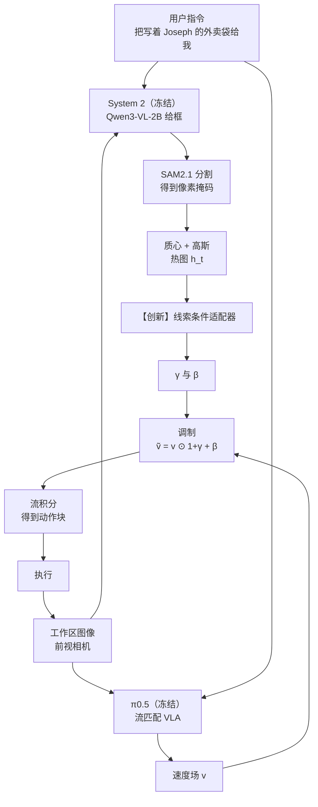
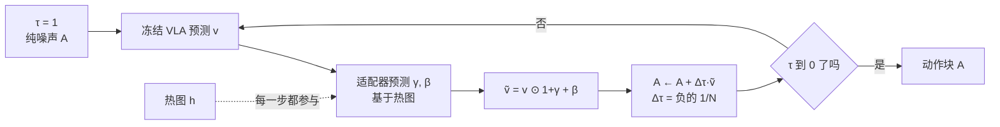
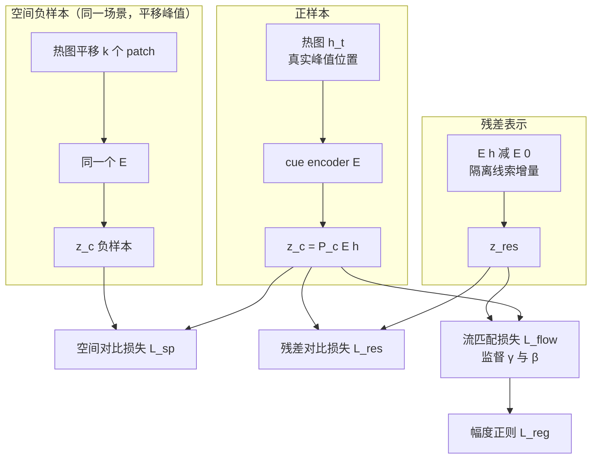
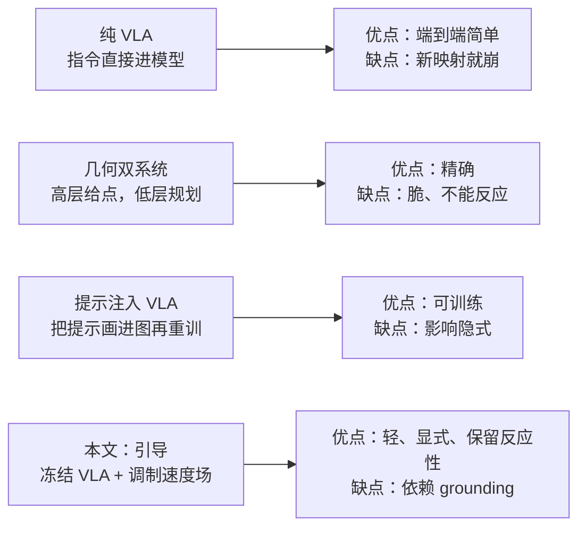

# P008 · 架构图与流程图

> 本文共 4 张图：
> **图 1 双系统架构** ／ **图 2 在积分过程里调制速度场** ／ **图 3 适配器的对比训练** ／ **图 4 四种范式的对比**
> 每张图后附：逐节点解释 → 数据流 → 核心创新位置 → 原文出处。
>
> 导航：[[Paper_008_CueTheFlow/01_论文精读|01 精读]] ｜ [[Paper_008_CueTheFlow/02_核心创新与方法|02 创新]] ｜ [[Paper_008_CueTheFlow/04_术语和公式解释|04 术语]] ｜ [[Paper_008_CueTheFlow/05_科研启发与复现建议|05 启发]]

---

## 图 1 · 双系统架构

### 1.1 逐节点解释

| 节点 | 含义 | 是否训练 |
|---|---|---|
| S2 | grounding 模型（Qwen3-VL-2B） | 冻结 |
| M1 | 分割模型（SAM2.1） | 冻结 |
| H1 | 高斯热图（目标位置） | 无参数 |
| V1 | 流匹配 VLA（π0.5，已用 80 条示范微调） | **冻结** |
| AD | 适配器 | **只训这个** |
| MOD | 公式 (1) 的调制 | 无参数 |

### 1.2 数据如何流动

指令 + 图像 → System 2 → 热图；同时指令 + 图像 → VLA → 速度场；两者在**适配器**汇合 → 调制后的速度场 → 积分 → 动作。

**注意两条支路的连接点**：不是在输入层（像素级提示），也不是在输出层（后处理），而是**在速度场上**。

### 1.3 核心创新在哪

**AD + MOD 这两步**。它们把"目标在哪"直接翻译成"速度该怎么改"。

### 1.4 原文出处

图 1(b)、§3.2、公式 (1)。

---

## 图 2 · 在积分过程里调制速度场（最核心的机制）

### 2.1 逐节点解释

| 节点 | 说明 |
|---|---|
| S1 | 冻结策略在**当前（已被推过的）状态**上重新评估 |
| P1 | 适配器每步重算 $\gamma,\beta$ |
| M1 | 对角缩放（重新加权各维速度）+ 偏移（整体平移） |
| U1 | 用调制后的速度积分 |

### 2.2 数据如何流动

噪声 → （策略 + 适配器）→ 调制速度 → 积分 → 更好的状态 → 再评估……循环 $N$ 步。

**关键点**：**这不是"一次性修正"，而是"每步都纠偏"**。所以轨迹会平滑地被拉向目标，而不是突然拐弯。

### 2.3 核心创新在哪

**"在积分循环内部介入"这个位置。** 对比：
- 输入级提示：只在最开始介入一次；
- 输出级后处理：只在最后修正一次；
- **本方法：每一步都介入**。

### 2.4 原文出处

§3.2 末段（"Because the modulation is re-predicted at every integration step, the frozen policy re-evaluates at the steered state..."）、公式 (1)。

---

## 图 3 · 适配器的对比训练

### 3.1 逐节点解释

| 节点 | 说明 |
|---|---|
| 正样本 | 真实热图 |
| 空间负样本 | **同一张图、把热图峰值平移** → 只改"目标位置"，不改场景外观 |
| 残差表示 | $E(h)-E(0)$，把"线索带来的信息"从"场景信息"里剥出来 |
| $\mathcal{L}_{sp}$ | 让动作表示更接近正确位置的线索，而非平移后的 |
| $\mathcal{L}_{res}$ | 让动作表示对齐"线索增量"而不是整体特征 |
| $\mathcal{L}_{reg}$ | 惩罚 $\gamma,\beta$ 幅度 |

### 3.2 数据如何流动

热图 → 编码 → 三个表示（正确线索、平移线索、残差线索）→ 三个损失 → 梯度只回传到适配器（VLA 冻结）。

### 3.3 核心创新在哪

**"平移热图"这个负样本构造方式**是全文最巧的设计：
- 如果负样本是"换一张图"，编码器可以靠"场景差异"区分，学不到位置；
- 只有"同一帧、不同位置"，才能逼它学**位置**。

消融证明它的价值：加 $\mathcal{L}_{sp}$ 后成功率从 16.7% → 33.3%（+16.6 点）。

### 3.4 原文出处

§3.3、公式 (2)(3)(5)、图 2、图 5。

---

## 图 4 · 四种范式的对比

### 4.1 逐节点解释

| 范式 | 代表 | Setting III（桌上） |
|---|---|---|
| 纯 VLA | Base | **0.0%** |
| 几何双系统 | MOKA | 8.3% |
| 提示注入 | VP-VLA | 4.2% |
| **引导（本文）** | Ours | **66.7%** |

### 4.2 这张图想说明什么

**同一个"目标指定"问题，有四种接口选择，只有第四种在强分布偏移下站得住。**
作者的解释：前三种要么依赖 VLA 内部空间推理（弱），要么依赖几何规划（脆），要么提示影响隐式（不可靠）。

### 4.3 原文出处

表 1（范式对比）、表 2（数字）、§4.2。

---

## 五、四张图的关系

---

## 六、自检：哪些是原文有，哪些是我补的

| 元素 | 性质 |
|---|---|
| 双系统、热图、适配器、调制公式 | 【原文·§3.2、式 (1)】 |
| 两个对比损失、负样本构造 | 【原文·§3.3、式 (2)(3)】 |
| 0.02% 参数、15 Hz、80 条示范 | 【原文·§3.4、§4.1】 |
| 表 2 的数字 | 【原文·表 2，我用均值验算核对过】 |
| 图 5 消融的 8.3→16.7→33.3→41.7 | 【原文·§4.3】 |
| "训练用 GT 线索、部署用预测线索" | 【原文·§3.4 + §4.1，我把它标为风险点】 |
| 图 4 的范式对比 | 【我的整理】，数字来自原文表 2 |
