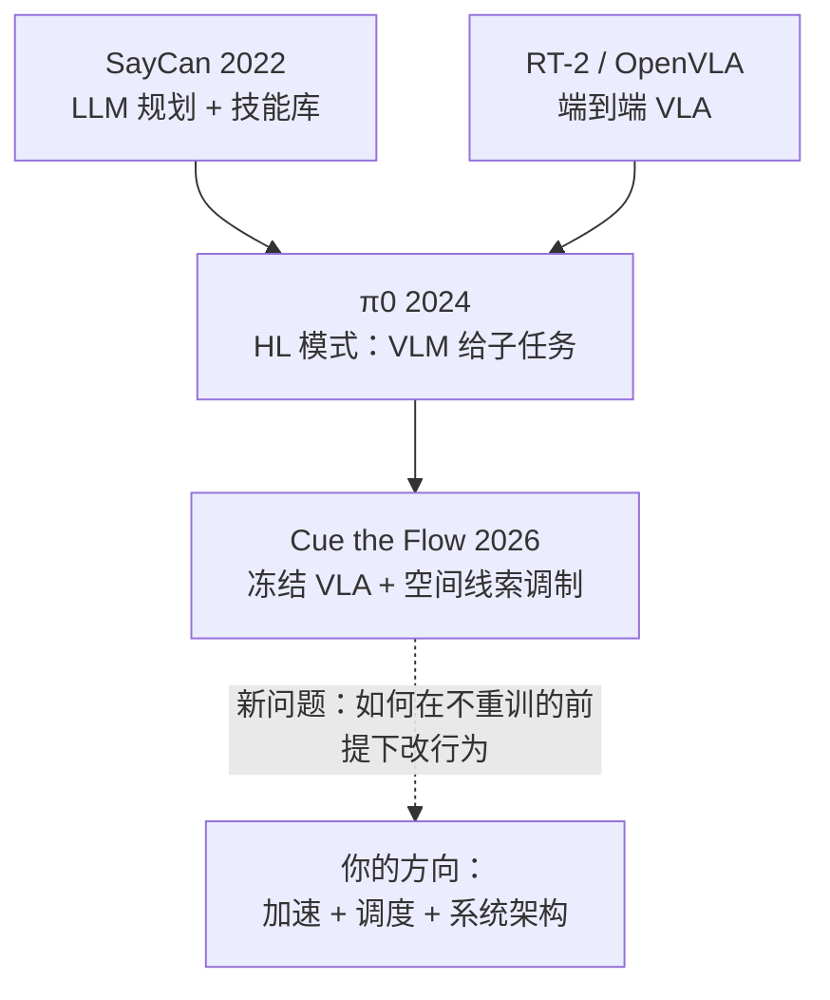

# P008 · 科研启发与复现建议

> 证据分级：**【原文证明】** / **【合理推测】** / **【待验证】**。
> 导航：[[Paper_008_CueTheFlow/01_论文精读|01 精读]] ｜ [[Paper_008_CueTheFlow/02_核心创新与方法|02 创新]] ｜ [[Paper_008_CueTheFlow/03_架构图与流程图|03 图]] ｜ [[Paper_008_CueTheFlow/04_术语和公式解释|04 术语]]

---

## 一、它在你的研究地图里的位置：系统架构层的"第三种答案"

**它的独特价值**：前面几篇都在讨论"怎么把模型做大/做小/做快"，这篇讨论的是**"怎么在不改模型的前提下改它的行为"**——这是系统架构层的一个独立问题。

---

## 二、A–H 八问

### A. 对 VLA 推理加速的启发

**【原文证明】**
1. **适配器只有 0.02% 参数**，延迟"可忽略"（§3.4）。
2. **VLA 15 Hz**，System 2 只在 rollout 开始时跑一次（§3.4、§4.1）。
3. 全部跑在**单张 RTX 5080** 上（§4.1）。

**【合理推测】一条被忽略的加速思路**
> **如果你只需要"改行为"而不需要"改能力"，那么"冻结 + 小适配器"比"微调"便宜几个数量级。**

这与 TinyVLA（重训）、SPAR（剪枝+RL）形成鲜明对比：
| 手段 | 改的是什么 | 成本 |
|---|---|---|
| TinyVLA | 架构（换头） | 需重训 |
| SPAR | 参数（剪枝） | 需 SFT + RL |
| OpenVLA LoRA | 参数（低秩） | 需 1 卡 10–15 小时 |
| **Cue the Flow** | **生成过程（调制）** | **80 条示范 + 小适配器** |

**【待验证】**：调制带来的额外计算在什么样的频率下会变成瓶颈？（0.02% 参数但每步都要跑一次）

### B. 对动作分块 / 执行调度的启发

**【原文证明】**
1. 动作块来自 π0.5（继承其块长），本文**没有讨论**块长。
2. **System 2 每个 rollout 只调用一次**——这是一种"超低频率的调度"。
3. 线索不重算，但 VLA 仍然闭环（每步看观测），所以**"目标指定"和"闭环反馈"被解耦了**。

**【合理推测】一个很好的洞察**
> **"目标"（去哪里）和"控制"（怎么去）可以有不同的更新频率。**
> - 目标：每个任务一次（秒级到分钟级）；
> - 控制：每个控制步一次（10–50 Hz）。
>
> 这与 SayCan（技能级重规划）和 π0（0.5–0.8 s 重规划）形成第三层时间尺度。

**三层时间尺度**：
| 层 | 更新频率 | 例子 |
|---|---|---|
| 目标 / 意图 | 每任务一次 | Cue the Flow 的热图 |
| 子任务 / 技能 | 秒级 | SayCan、π0-HL |
| 动作块 | 0.5–0.8 s | π0、DP |
| 单步动作 | 20–50 Hz | 底层控制器 |

**【待验证】**：如果目标在任务中途改变（用户改口），需要多快重算热图？

### C. 对量化、缓存、压缩的启发

**【原文证明】**：本文没做压缩，但它的"冻结 + 小适配器"本身就是一种**参数效率**方案。

**【合理推测】与压缩的关系**
- **正交**：你可以先量化/剪枝 VLA，再加适配器；
- **但要注意**：剪枝后的 VLA 可能对"速度场调制"更敏感（容错空间小）；
- **一个有趣的组合**：SPAR 剪枝 + Cue the Flow 适配器 —— 剪枝掉了容量，但用外部线索补回"目标指定"能力。

**【待验证】**。

### D. 是否能用于轮式双臂机器人？

**【原文证明】**：本文用**轮式机器狗 + 6-DoF 臂**（单臂），移动底盘在操作时固定，手动导航。
**【合理推测】**：方法本身与形态无关（调制的是动作维度），双臂只需把 $\gamma,\beta$ 扩到 14+ 维。但**底盘运动时目标在图像中的位置会变**，热图需要更频繁更新——这会影响"每任务只算一次"的假设。

### E. 是否需要真实硬件？

| 目标 | 需求 | 可行性 |
|---|---|---|
| 复现完整系统 | 机械臂 + 移动底盘 + 相机 | ⚠️ 有门槛 |
| 复现"调制"思想 | 仿真 + 开源流匹配策略 | ✅ 容易 |
| 复现对比损失 | 同上 | ✅ 容易 |

**【我的判断】**：这是"new"文件夹里**最容易做仿真复现**的一篇——因为核心机制（调制速度场 + 对比损失）与硬件无关。

### F. 能否在仿真中先复现？

**【原文证明】**：作者自己在 LIBERO-PRO 上做了（200 回合，15.5% vs 10.5%）。
**【合理推测】**：仿真里增益小（+5 点），说明：
- 仿真的"新语言-物体映射"难度低于真实配送；
- 或者仿真里的 grounding 更准，留给"引导"的空间更小。
**这对复现是好消息**：仿真能跑通，但别期待复现出 2× 的提升。

### G. 本科阶段能否完成小规模实验？

**【我的判断】能，而且题目很清晰**：

> **题目**：在仿真里对比三种"目标指定"方式：① 把目标位置画进图像（visual prompt）② 把目标位置作为额外通道输入 ③ 调制速度场（本文）。固定同一个流匹配策略。

- 变量：提示的注入位置；
- 指标：成功率、对"新物体"的泛化；
- 预期：【合理推测】③ > ② > ①（复现表 2 的趋势）。

### H. 博士阶段能否进一步拓展？

三条线：
1. **调制接口的系统研究**：缩放/偏移/对角 vs 全矩阵 vs 注意力调制，哪种最好？
2. **多线索融合**：目标位置 + 抓取姿态 + 避障区域，能否同时调制？
3. **与压缩的结合**：见 C。

---

## 三、四个可落地的研究点

### 研究点 #1：调制形式的消融（最便宜）

| 项目 | 内容 |
|---|---|
| **动机** | 本文只用了"对角仿射"，没和别的调制形式比 |
| **假设** | 对角足够（因为动作维度语义独立），全矩阵会过拟合 |
| **设计** | 对比：对角（本文）/ 逐时间位置的对角 / 全矩阵 / 只加偏移（$\gamma=0$）/ 只加缩放（$\beta=0$） |
| **指标** | 成功率、参数增量、训练稳定性 |
| **价值** | 直接回答"为什么用对角"，成本低 |

### 研究点 #2：目标频率 vs 控制频率的解耦

| 项目 | 内容 |
|---|---|
| **动机** | 本文"每任务算一次热图"，但如果目标移动/用户改口呢？ |
| **假设** | 存在最优的"热图重算频率"，与场景动态性相关 |
| **设计** | 扫重算频率（每任务一次 / 每 N 步 / 每步），测成功率与延迟 |
| **指标** | 成功率、System 2 调用次数、端到端延迟 |
| **价值** | 把"执行调度"扩展到**感知层** |

### 研究点 #3：训练/部署线索分布不匹配

| 项目 | 内容 |
|---|---|
| **动机** | 训练用 GT 线索、部署用 Qwen3-VL+SAM2.1 的预测（原文未讨论） |
| **假设** | grounding 误差会显著降低调制效果 |
| **设计** | 人为给 GT 线索加噪声/偏移，测性能退化曲线 |
| **指标** | 成功率 vs 线索误差 |
| **价值** | 揭示方法的真实脆弱点，工程价值高 |

### 研究点 #4：与剪枝/量化的组合

| 项目 | 内容 |
|---|---|
| **动机** | SPAR 剪枝会损失容量；本文的调制能否补回"目标指定"这一块？ |
| **设计** | 在剪枝后的 VLA 上加适配器，对比"剪枝 alone / 剪枝+适配器 / 不剪枝+适配器" |
| **指标** | 成功率、参数、延迟 |
| **价值** | 把两条加速路线（压结构 + 引生成）结合 |

---

## 四、一个具体案例：把写着 Joseph 的外卖袋给我

> [!warning] 案例性质
> "Give me the takeout bag with the name Joseph on it" 是**原文 §1 的例子**。
> 下面的分数与步骤是我构造的**教学示例**，不是原文数据。

**场景**：货架上并排三个外卖袋（无标签 / 写着 Joseph / 写着 Mary），机器人要把 Joseph 那个放进箱子。

| 步骤 | 发生了什么 | 说明 |
|---|---|---|
| 1 | Qwen3-VL 读指令，在图像里框出"写着 Joseph 的袋子" | System 2 一次 |
| 2 | SAM2.1 分割出该袋子，算质心，生成高斯热图 | 一次 |
| 3 | π0.5 从噪声开始积分；每步适配器根据热图预测 $\gamma,\beta$ | 每步 |
| 4 | 速度场被"往热图方向"调 → 动作块偏向 Joseph 袋 | 每步 |
| 5 | 执行动作块；机器人开始伸手 | — |
| 6 | 袋子被碰歪了（位置变了） | 扰动 |
| 7 | **热图没变**，但 π0.5 每步都看新图像 → 自动修正 | 图 6 的反应性 |
| 8 | 抓住 Joseph 袋，放进箱子 | 成功 |

**关键理解**：
- **目标信息（热图）只给一次，但控制是闭环的**——这是本文相对于几何控制器的核心优势；
- 如果换成 MOKA 那种几何控制器，第 6 步的扰动会让它按原轨迹走，可能抓空。

---

## 五、复现路线

---

## 六、复现时会踩的坑

| 坑 | 说明 | 建议 |
|---|---|---|
| **积分方向** | 本文 τ 从 1 到 0，π0 从 0 到 1 | 搞反了调制就变成"反向引导" |
| **γ 的初值** | 若初始化不当，一开始就大幅调制 | 让 $\gamma,\beta$ 初始输出接近 0 |
| **负样本构造** | 平移热图要在**同一 patch 网格**上 | 别跨图像采样 |
| **零热图的定义** | $E(\mathbf{0})$ 要真的全零 | 注意归一化 |
| **λ 未给** | 三个权重都没写 | 自己扫，从小值开始 |
| **训练/部署线索不一致** | 训练 GT、部署预测 | 训练时加噪声做增强 |
| **试验次数少** | 每格 12 次 | 自己复现时多跑几次 |

---

## 七、与前后论文的关系

| 论文 | 关系 |
|---|---|
| [[00_文献总索引#P005 π0 (pi-zero)]] | 本文的基础策略就是 π0.5；继承了它的流匹配与动作块 |
| [[00_文献总索引#P007 SayCan]] | 同为"双系统"，但 SayCan 的低层是技能库，本文是 VLA |
| [[00_文献总索引#P004 OpenVLA]] | 同为 VLA，但 OpenVLA 是离散 token，没法做"速度场调制" |
| [[00_文献总索引#P002 SPAR]] | 剪枝 vs 调制：两种"不改架构改行为"的思路，可以组合 |
| [[00_文献总索引#P001 TinyVLA]] | TinyVLA 用扩散头（也是速度场思想），理论上也能被调制 |

---

## 八、一句话总结对我的价值

> **这篇论文让我意识到：**"泛化"不一定只能通过"训练"获得，也可以通过在生成过程里"引导"获得**。**
> 这对做加速的人是一个很好的提醒：**在动手优化一个模型之前，先问问"这个能力是不是必须由模型自己学"**——如果不是，一个 0.02% 的适配器可能就够了。
> 而且它把"目标指定"和"闭环控制"解耦成两个频率，这为我的"执行调度"研究又加了一层：**不只是动作块要调度，目标更新也要调度。**
