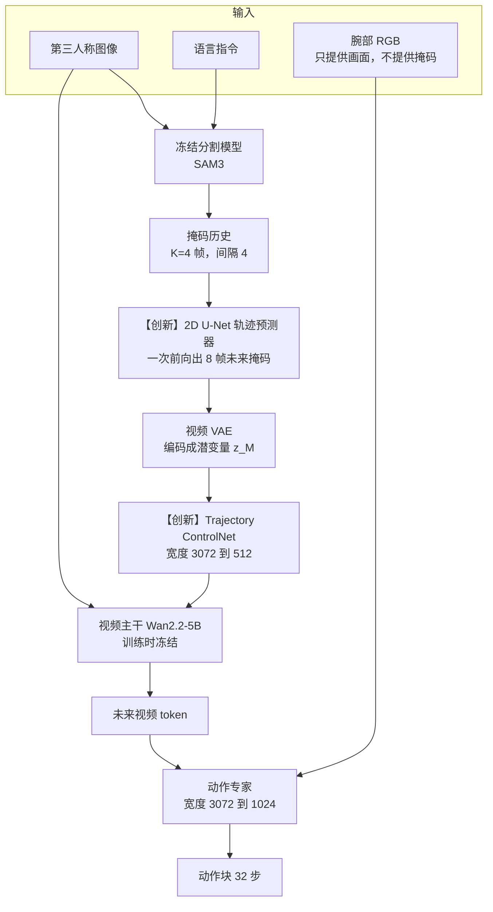
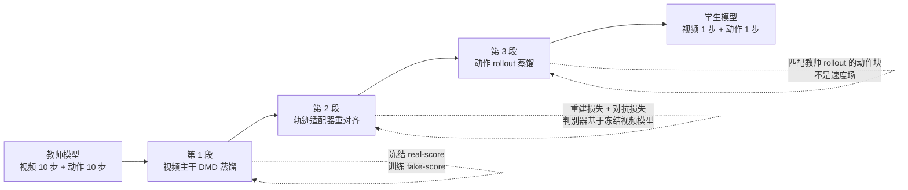
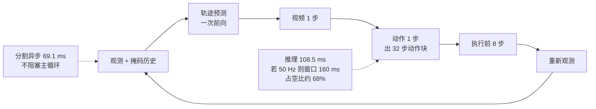
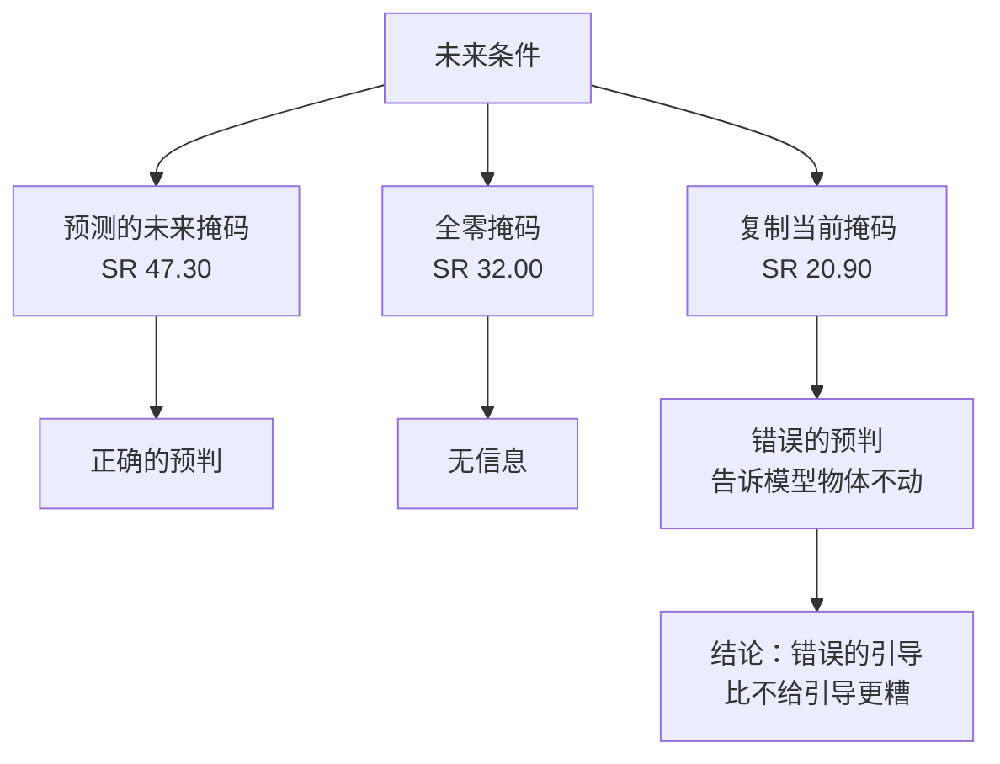
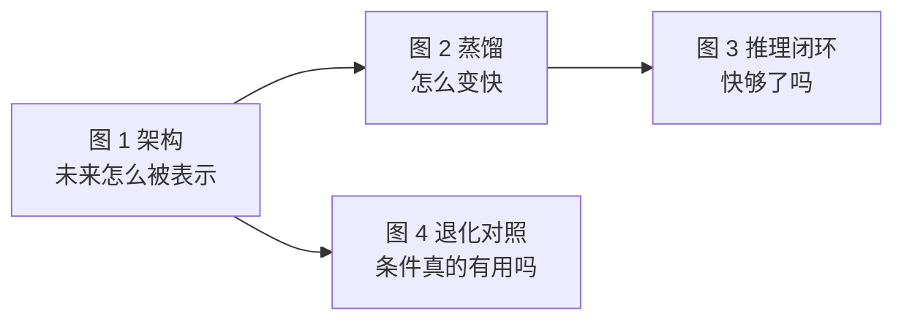

# P009 · 架构图与流程图

> 本文共 4 张图：
> **图 1 双分支架构（轨迹 → 视频 → 动作）** ／ **图 2 三段解耦蒸馏** ／ **图 3 推理闭环与占空比** ／ **图 4 退化对照：谁会失败**
> 每张图后附：逐节点解释 → 数据流 → 核心创新位置 → 原文出处。
>
> 导航：[[Paper_009_TrajWAM/01_论文精读|01 精读]] ｜ [[Paper_009_TrajWAM/02_核心创新与方法|02 创新]] ｜ [[Paper_009_TrajWAM/04_术语和公式解释|04 术语]] ｜ [[Paper_009_TrajWAM/05_科研启发与复现建议|05 启发]]

---

## 图 1 · 双分支架构（训练时）

### 1.1 逐节点解释

| 节点 | 含义 | 备注 |
|---|---|---|
| SEG | 冻结分割模型 | 只从第三人称视角做（腕部视角会抖动、丢目标） |
| MH | 掩码历史 | K=4，时间间隔 4 |
| MP | 轨迹预测器 | **一次前向出 8 帧**，避免自回归误差累积 |
| VAE | 视频 VAE | 冻结 |
| CN | ControlNet | 深度同主干，宽度降到 512 |
| VB | 视频主干 | Wan2.2-5B，训练时冻结 |
| AT | 动作专家 | 宽度 1024，通过非对称注意力读视频 |

### 1.2 数据如何流动

掩码历史 → 未来轨迹 → 视频潜变量 → ControlNet 引导 → 视频未来表示 → 动作。

**关键**：这条链上"未来"被压缩了两次——**先压成掩码轨迹（空间稀疏），再压成 VAE 潜变量**。

### 1.3 核心创新在哪

- **MP**（物体中心的未来表示）；
- **CN**（把轨迹变成对视频生成的逐层控制）；
- **非对称注意力**（图里没画，但它是 AT→VT 的连接方式）。

### 1.4 原文出处

图 2(a)、§III-A（式 1）、§III-B（式 2、3）。

---

## 图 2 · 三段解耦蒸馏

### 2.1 逐节点解释

| 阶段 | 做什么 | 为什么必须分开 |
|---|---|---|
| 第 1 段 | 把多步视频生成器压成一步（DMD） | 视频侧的变化与动作无关，可以独立做 |
| 第 2 段 | 让 ControlNet 适配新的一步生成器 | 一步生成器的中间激活分布变了，旧 ControlNet 会失配 |
| 第 3 段 | 让动作分支适配新的条件通路 | 动作读到的视频表示已经变了，必须重新对齐 |

### 2.2 数据如何流动

教师 → （视频先压）→ （适配器再对齐）→ （动作最后压）→ 学生。

**顺序不可交换**：如果先压动作，动作学到的是"旧视频表示"下的最优映射，等视频一变就又错了。

### 2.3 核心创新在哪

**"分段"这个决定本身**。表 III(b) 给出直接证据：
- 未蒸馏直接 1 步：7.39%
- DMD（用在动作上）：**1.08%**（崩）
- CD：18.42%
- **动作 rollout 蒸馏：42.25%**

### 2.4 原文出处

§III-C、图 3、图 4、式 (5)–(13)。

---

## 图 3 · 推理闭环与占空比（我的整理）

### 3.1 逐节点解释

| 节点 | 说明 |
|---|---|
| A | 用"最新可用的"掩码历史，不等当前帧分割 |
| B | 轨迹预测器（U-Net） |
| C/D | 各 1 步（蒸馏后） |
| E | 执行 8 步（T_a=32 里的前 8 步） |
| G | **我的估算**：108.5 / (8 × 20 ms) ≈ 68%（假设 50 Hz） |
| H | 分割异步，不阻塞 |

### 3.2 为什么这张图重要

**它揭示了 TrajWAM 与 π0 的本质差异**：
- π0：73 ms / 0.8 s 窗口 = **9% 占空比**（模型很闲）；
- TrajWAM：108.5 ms / 160 ms 窗口 ≈ **68% 占空比**（模型很忙）。

同样是"动态/高频"场景，**TrajWAM 的加速压力比 π0 大得多**——这解释了为什么它必须做蒸馏，而 π0 可以不急。

> [!warning] 这是估算，不是原文数字
> 原文没有给控制频率，也没有算占空比。我的 68% 基于"50 Hz + 执行 8 步"的假设，**仅供理解量级**。

### 3.3 原文出处

§IV-A-3（T_a=32、执行 8、SAM3 异步 69.1 ms）、表 I（108.5 ms）。占空比为我的计算。

---

## 图 4 · 退化对照：三种"未来条件"谁更糟（表 III(a) 的可视化）

### 4.1 逐节点解释

| 条件 | SR | 含义 |
|---|---|---|
| 预测 | **47.30** | 正确预判 |
| 全零 | 32.00 | 无信息（模型自己猜） |
| 复制当前 | 20.90 | **错误预判**（暗示物体静止） |

### 4.2 这张图想说什么

**不是所有"额外信息"都有用。** 给一个持续错误的信号（物体静止），比什么都不给更糟——因为模型会**信任**这个信号并据此规划。

作者的原文解释："repeating the current mask imposes an incorrect stationary trajectory that misguides future imagination as the target moves."

### 4.3 原文出处

表 III(a)、§IV-C-2。

---

## 五、四张图的关系

---

## 六、自检：哪些是原文有，哪些是我补的

| 元素 | 性质 |
|---|---|
| 掩码历史 K=4、未来 H_v=8、U-Net、式 (1) | 【原文·§III-A】 |
| ControlNet 宽度 512、式 (2) | 【原文·§III-B】 |
| 非对称注意力、式 (3) | 【原文·§III-B】 |
| 三段蒸馏、表 III(b) 数字 | 【原文·§III-C、§IV-C】 |
| T_a=32、执行 8 步 | 【原文·§IV-A-3】 |
| 108.5 ms、SAM3 69.1 ms | 【原文·表 I、§IV-A-3】 |
| **占空比 68%** | **【我的估算】**，基于 50 Hz 假设 |
| 图 4 的因果解释 | 【原文·§IV-C-2 的文字】+ 我的可视化 |
