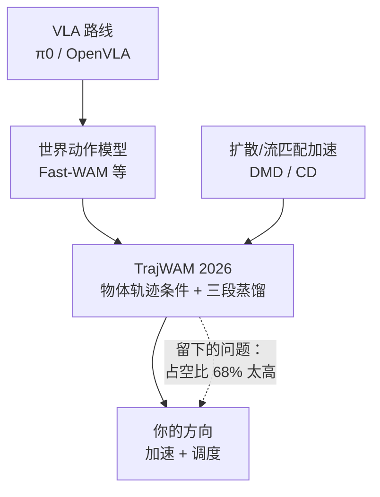
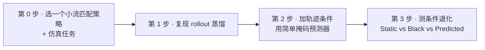

---
title: P009 TrajWAM 科研启发与复现建议
paper_id: P009
short: TrajWAM
tags:
  - 科研启发
  - 世界模型
  - 蒸馏
  - 复现
status: done
created: 2026-11-05
---

# P009 · 科研启发与复现建议

> 证据分级：**【原文证明】** / **【合理推测】** / **【待验证】**。
> 导航：[[Paper_009_TrajWAM/01_论文精读|01 精读]] ｜ [[Paper_009_TrajWAM/02_核心创新与方法|02 创新]] ｜ [[Paper_009_TrajWAM/03_架构图与流程图|03 图]] ｜ [[Paper_009_TrajWAM/04_术语和公式解释|04 术语]]

---

## 一、它在你的研究地图里的位置：世界模型 + 蒸馏

**它的独特价值**：这是 24 篇里**唯一一篇把"世界模型"和"蒸馏加速"绑在一起做**的——而且它的蒸馏不是"为了快而快"，而是"为了保住预判通路"。

---

## 二、A–H 八问

### A. 对 VLA 推理加速的启发

**【原文证明】的三条**
1. **三段解耦蒸馏**：视频 DMD → 适配器重对齐 → 动作 rollout，10+10 步 → 1+1 步。
2. **动作 rollout 蒸馏远胜分布对齐**：42.25% vs CD 18.42% vs DMD 1.08%（表 III(b)）。
3. **108.5 ms** 比同类世界模型（183.7、552.2）快，但**比纯 VLA（π0 52.9）慢**。

**【合理推测】"蒸馏方法要匹配模态"**
- **视频**：可以接受分布级相似（DMD 有效）；
- **动作**：必须匹配最终结果（rollout 蒸馏有效）。
- 这个规律可能对其他"多模态生成"系统也成立：**像素/视觉对模糊宽容，控制/动作对偏差苛刻。**

**【待验证】**：如果把 rollout 蒸馏换成"带感知损失的分布匹配"，能否兼得？

### B. 对动作分块 / 执行调度的启发（重点）

**【原文证明】**
1. **T_a = 32，执行 8 步**（执行比例 25%）。
2. 真机用了 **RTC（Real-Time Chunking）**——边执行旧块边算新块。
3. 分割是**异步**的（69.1 ms），不阻塞主循环。

**【我的计算】占空比**
- 若控制 50 Hz：窗口 = 8 × 20 ms = 160 ms → 108.5/160 ≈ **68%**；
- 若控制 20 Hz：窗口 = 8 × 50 ms = 400 ms → 108.5/400 ≈ **27%**。

> [!important] 对比 π0
> π0：73 ms / 800 ms = **9%**（模型很闲）。
> TrajWAM：108.5 ms / 160 ms ≈ **68%**（模型很忙）。
>
> **同样是"动态"场景，占空比差了 7 倍。** 这说明：
> - π0 用长动作块（50）把推理摊薄；
> - TrajWAM 用短执行（8 步）换取响应性，代价是占空比飙升。
>
> **"执行步数"是调度设计的核心旋钮**：它同时决定响应性和占空比。

**【合理推测】**：TrajWAM 的下一步优化方向应该是"在保持 8 步响应性的前提下降低占空比"——比如把动作块生成也做成"渐进式"（先出前 8 步，后面的在后面补）。

### C. 对量化、缓存、压缩的启发

**【原文证明】**：本文的压缩手段是**蒸馏**，不是量化/剪枝。
**【合理推测】三者可以叠加**：
| 手段 | 对 TrajWAM 的适用性 | 备注 |
|---|---|---|
| 步数蒸馏（已做） | ✅ 已用 | 10+10 → 1+1 |
| 权重量化 | ✅ 未试 | 5B 视频主干量化收益大 |
| 视频 token 剪枝 | ✅ 未试 | 视频分支占了大部分计算 |
| 缓存 | ⚠️ 有限 | 每帧都变，前缀无法复用 |

**【待验证】**：5B 主干 + 1 步推理 + int4 量化，能不能把 108.5 ms 压到 50 ms 以下？

### D. 是否能用于轮式双臂机器人？

**【原文证明】**：真机平台是**两个 AgileX Piper 臂**（近似双臂配置），但任务只用一只臂抓取；移动底盘没有参与。
**【合理推测】**：方法本身与形态无关，但**双臂会让动作 token 翻倍**，1 步生成的动作块更长 → 延迟上升。
**【待验证】**。

### E. 是否需要真实硬件？

| 目标 | 需求 | 可行性 |
|---|---|---|
| 完整复现 | Wan2.2-5B + H200 + DOMINO 数据 | ❌ 很高 |
| 复现"物体轨迹条件" | 小视频模型 + 仿真 | ⚠️ 中等 |
| 复现"rollout 蒸馏" | 任意流匹配策略 | ✅ 可行 |

### F. 能否在仿真中先复现？

**【原文证明】**：主实验就在 DOMINO 仿真（35 任务、1,750 条示范）。
**【合理推测】**：DOMINO 是公开基准，**仿真是可行的**；但 Wan2.2-5B 的训练/蒸馏成本高（H200），学生很难完整复现。

### G. 本科阶段能否完成小规模实验？

**【我的判断】可以做"蒸馏那一半"**：

> **题目**：在一个小的流匹配策略上，比较三种一步蒸馏：直接 1 步 / CD / rollout 匹配，验证"动作必须匹配结果"这个结论。

- 只需要一个小模型 + 一个仿真任务；
- 结论与 TrajWAM 的主线一致；
- 成本可控（单卡）。

### H. 博士阶段能否进一步拓展？

三条线：
1. **条件表示的压缩**：从"整帧"到"物体掩码"再到"几个关键点"，还能压吗？
2. **蒸馏与调度的联合**：占空比 68% 时，如何在"蒸馏"和"减少执行步数"之间分配预算？
3. **动作依赖的动态**：作者自己说这是未来工作（推一下物体它才动）。

---

## 三、四个可落地的研究点

### 研究点 #1：执行步数 m 与占空比的权衡（与 π0 共用）

| 项目 | 内容 |
|---|---|
| **动机** | TrajWAM 用 m=8、π0 用 m=16/25，两者占空比差 7 倍 |
| **假设** | 存在最优 m，使"响应性 / 占空比"综合最优；且随任务动态性变化 |
| **设计** | 固定模型，扫 m∈{4,8,16,32}，测成功率、完成时间、占空比 |
| **指标** | 成功率、有效频率、推理占用率 |
| **价值** | 把 π0 与 TrajWAM 的差异变成可量化的规律 |

### 研究点 #2：动作蒸馏的目标选择

| 项目 | 内容 |
|---|---|
| **动机** | DMD 1.08%、CD 18.42%、rollout 42.25%——差距巨大但只在一组任务上验证 |
| **假设** | "结果匹配"优于"过程匹配"，但混合目标（rollout + 速度）可能更好 |
| **设计** | 对比：纯 rollout / 纯速度 / rollout + 速度正则 / rollout + 分布正则 |
| **指标** | 成功率、动作平滑度、对扰动的鲁棒性 |
| **价值** | 给出"怎么蒸动作模型"的一般性建议 |

### 研究点 #3：条件表示的信息量消融

| 项目 | 内容 |
|---|---|
| **动机** | 表 III(a) 已经证明"错误的轨迹比没有更糟"，但没测"多精确才够" |
| **设计** | 用不同精度/不同超前时长的轨迹作为条件（如只给质心 vs 全掩码；预测 4/8/16 帧） |
| **指标** | 成功率 vs 条件信息量 |
| **价值** | 找到"刚好够用"的条件，从而省算力 |

### 研究点 #4：异步感知的调度

| 项目 | 内容 |
|---|---|
| **动机** | TrajWAM 的 SAM3 是异步的（69.1 ms，不阻塞） |
| **设计** | 研究"感知滞后"对策略的影响，以及"用旧掩码 + 新图像"的最优融合方式 |
| **指标** | 成功率 vs 感知延迟 |
| **价值** | 把"执行调度"扩展到"感知调度"，这是一个很少人做的角度 |

---

## 四、一个具体案例：抓传送带上的香蕉（原文任务）

> [!warning] 案例性质
> "传送带抓取"是**原文的真机任务**（§IV-A-2、图 5a）。下面的时间线是**教学示例**，具体毫秒数来自表 I 与本笔记的估算。

**场景**：传送带以中速向右移动，香蕉在带上滑动。

| 时刻 | 发生了什么 | 说明 |
|---|---|---|
| t=0 | 第三人称相机拍到香蕉；SAM3 异步给出掩码（约 69 ms 后可用） | 感知 |
| t=0 | 用**上一次**的掩码历史（4 帧，间隔 4）预测未来 8 帧掩码 | 轨迹预测 |
| t≈10 ms | 8 帧掩码 → VAE → $z_M$ | 编码 |
| t≈10–90 ms | 视频主干 1 步生成"被轨迹引导的未来画面" | ControlNet 注入 |
| t≈90–108 ms | 动作专家 1 步生成 32 步动作块 | 出动作 |
| t=108 ms | 执行前 8 步（约 160 ms @50 Hz） | 执行 |
| t=268 ms | 重新观测 → 回到 t=0 | 闭环 |

**关键理解**：
- **它预测的是"掩码"，不是"画面"**——所以即使视频生成得不完美，只要掩码对，动作就有正确目标；
- **异步分割**意味着策略用的是"稍旧的掩码"，但配"最新的图像"——这是一种**时间上的错配**，作者用"缓冲历史"来缓解。

---

## 五、复现路线

---

## 六、复现时会踩的坑

| 坑 | 说明 | 建议 |
|---|---|---|
| **Wan2.2-5B 太大** | 训练要 H200 | 用小视频模型替代，只验证机制 |
| **三段蒸馏顺序** | 顺序不可交换 | 严格按 视频→适配器→动作 |
| **DMD 用在动作上会崩** | 表 III(b) 1.08% | 动作必须用 rollout 匹配 |
| **掩码来源** | 训练 GT、部署 SAM3 | 训练时加掩码噪声做增强 |
| **非对称掩码** | 容易写成对称 | 检查"视频 query 是否 attend 动作" |
| **占空比** | 原文没报 | 自己算 $T_{\text{infer}}/(m\Delta t)$ |
| **DOMINO 的 α** | Level 1、α=0.1 | 复现时对齐动态强度 |

---

## 七、与前后论文的关系

| 论文 | 关系 |
|---|---|
| [[00_文献总索引#P005 π0 (pi-zero)]] | TrajWAM 的动作专家继承自 Wan2.2/Fast-WAM 体系，与 π0 同为流匹配；两者占空比差 7 倍 |
| [[00_文献总索引#P006 Diffusion Policy|Diffusion Policy]] | 同为"预测一段动作"，但 DP 没有"未来想象" |
| [[00_文献总索引#P008 Cue the Flow]] | 都用"外部空间线索"引导生成；区别是 Cue 用热图调制速度场，TrajWAM 用掩码轨迹控制视频 |
| [[00_文献总索引#P010 DiPLO]] | 同为"自蒸馏加速"，可以对照看两种蒸馏设计 |
| [[00_文献总索引#P001 TinyVLA]] | 同为"少步生成"，但 TinyVLA 是扩散头、TrajWAM 是蒸馏后的 1 步 |

---

## 八、一句话总结对我的价值

> **TrajWAM 让我看到"世界模型"这条路线的真实代价：它确实更会预判（DOMINO +14 点），但延迟也从 52.9 ms 涨到 108.5 ms，占空比从 9% 涨到 68%。**
> 而它给出的解法——**把未来压缩成"物体轨迹"这种稀疏表示**——是一个非常可迁移的思路：**预测得越聚焦，越容易在被压缩后保留下来。**
> 再加上表 III(b) 那一课（动作蒸馏必须匹配结果，不能只匹配分布），这两条我会直接用到自己的加速实验里。
