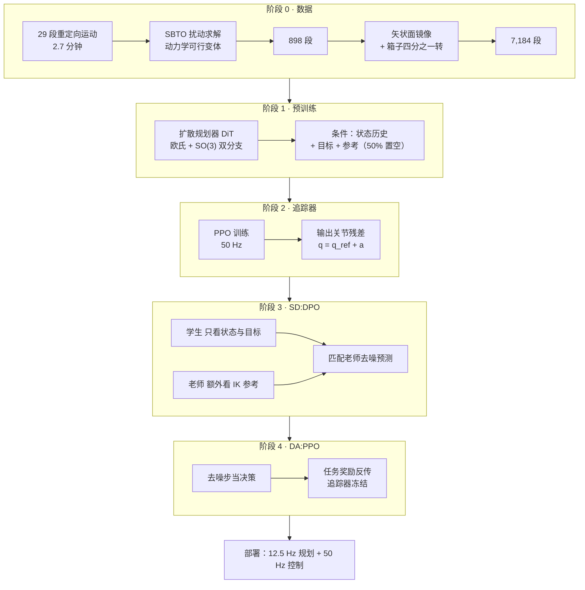
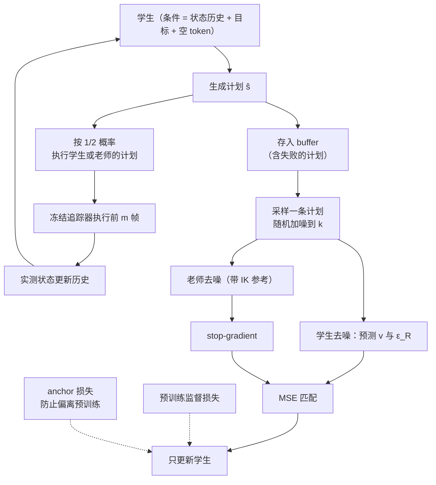
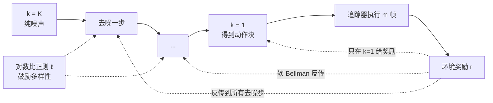
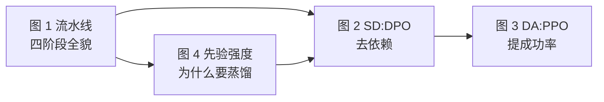

# P010 · 架构图与流程图

> 本文共 4 张图：
> **图 1 完整流水线（四阶段）** ／ **图 2 SD:DPO 的机制** ／ **图 3 DA-MDP：奖励如何在去噪链上反传** ／ **图 4 数据增广与先验强度的关系**
> 每张图后附：逐节点解释 → 数据流 → 核心创新位置 → 原文出处。
>
> 导航：[[Paper_010_DiPLO/01_论文精读|01 精读]] ｜ [[Paper_010_DiPLO/02_核心创新与方法|02 创新]] ｜ [[Paper_010_DiPLO/04_术语和公式解释|04 术语]] ｜ [[Paper_010_DiPLO/05_科研启发与复现建议|05 启发]]

---

## 图 1 · 完整流水线

### 1.1 逐节点解释

| 阶段 | 关键点 |
|---|---|
| 0 | **数据从 29 段变 7,184 段**，这是"小数据"问题的解 |
| 1 | DiT + 双扩散分支（欧氏 / SO(3)）；**50% 概率把参考置空**，为 SD:DPO 铺路 |
| 2 | 追踪器是 RL 学的，不是 BC——这是"抗扰动"的来源 |
| 3 | SD:DPO：学生只拿状态+目标，老师还拿 IK 参考 |
| 4 | DA:PPO：把执行奖励分摊到去噪链 |

### 1.2 数据如何流动

人体动作 → 重定向 → 物理可行化 → 增广 → 预训练规划器 → 蒸馏（去掉参考依赖）→ RL 微调（提高成功率）→ 部署。

### 1.3 核心创新在哪

**阶段 3 与阶段 4**。阶段 0–2 都是"把已有方法用好"，阶段 3–4 才是本文提出的两步后训练。

### 1.4 原文出处

图 2、§IV 各小节。

---

## 图 2 · SD:DPO 的机制

### 2.1 逐节点解释

| 节点 | 说明 |
|---|---|
| A | 学生**看不到**参考，只有状态与目标 |
| B/C | 学生和老师各出一个计划，各 50% 概率被执行 |
| F | **失败的 rollout 也存 buffer**——这些正是需要纠正的样本 |
| G | 对**学生自己的计划**加噪，而不是数据集动作 |
| H1/H2 | 同一带噪输入、同一扩散步，唯一区别是**有没有 IK 参考** |
| H3 | 老师的输出作为目标，不回传梯度 |
| X/Y | 两个附加损失，防止"蒸馏把预训练能力洗掉" |

### 2.2 数据如何流动

学生 rollout → 状态分布（工程上真实的分布）→ 在这些状态上对齐老师的去噪预测。

**关键**：**不是"模仿数据"，而是"模仿老师在我自己会到达的状态上的决策"**。

### 2.3 核心创新在哪

**"在谁的分布上蒸馏"**。作者的原话：这些 rollout "expose the student to the consequences of planning and tracking errors, extending its supervision beyond the contexts represented in the training data."

### 2.4 原文出处

§IV-C、式 (16)(17)、图 2(c)。

---

## 图 3 · DA-MDP：奖励如何在去噪链上反传

### 3.1 逐节点解释

| 节点 | 说明 |
|---|---|
| k=K → 1 | 去噪链，每一步是一个"决策" |
| EX | 只有最后一步（$k=1$）才真正执行、拿到奖励 |
| 反传 | 通过软 Bellman 把奖励分摊到前面所有步 |
| REG | $\ell_\phi=\log[p_\phi/p_{forward}]$，防止去噪路径偏离正向过程 |

### 3.2 数据如何流动

奖励从"执行"往回传到"每一个去噪决策"——**这就是 DA-MDP 区别于普通 PPO 的地方**：普通 PPO 只看到一个动作，DA-MDP 看到 $K$ 个决策。

### 3.3 核心创新在哪

**"折扣只在 k=1 生效"**（$\bar\gamma_k=\gamma$ if $k=1$ else 1）——因为中间的去噪步不改变环境，不该被折扣。

### 3.4 原文出处

§III-C、式 (5)–(8)。

---

## 图 4 · 先验强度 vs 存活率（图 4 的数据化）

### 4.1 逐节点解释

| 条件 | 存活 % | 说明 |
|---|---|---|
| 机器人 + 物体运动 | **96.3** | 全参考（最强） |
| 人类运动 | 87.0 | 未重定向，掉了 9.3 点 |
| 根 + 末端 | 89.1 | 部分参考 |
| 末端 | 85.4 | 只给末端 |
| 稀疏末端 | 84.3 | 每 5 帧给一次，几乎不掉 |
| 仅物体 | 70.6 | 只给物体 |
| 无 | **45.3** | 完全无先验 |

### 4.2 数据如何流动

这是一个"单调递减"的曲线：**信息越少，存活越低**。

### 4.3 核心创新在哪

这张图是**SD:DPO 的动机证明**：它说明"无先验"是灾难（45.3%），所以不能"一开始就不给先验"；但部署时又必须无先验，所以只能"先给再蒸馏"。

### 4.4 原文出处

图 4、§V-B。**注意图 4 的柱状图数值是我从渲染图读出的近似值**。

---

## 五、四张图的关系

---

## 六、自检：哪些是原文有，哪些是我补的

| 元素 | 性质 |
|---|---|
| 四阶段流水线 | 【原文·图 2】 |
| SD:DPO 的双条件匹配、buffer、50% 执行 | 【原文·§IV-C、式 16/17】 |
| anchor 损失、EMA 老师 | 【原文·§IV-C 末、附录 J】 |
| DA-MDP 的奖励/折扣只在 k=1 | 【原文·§III-C】 |
| 图 4 的存活率数值 | 【原文·图 4（渲染图读数）】 |
| "为什么两个后训练互补"的解释 | 【我的整理】 |
| 占空比 | **【原文未给出 $m$，无法计算】** |
