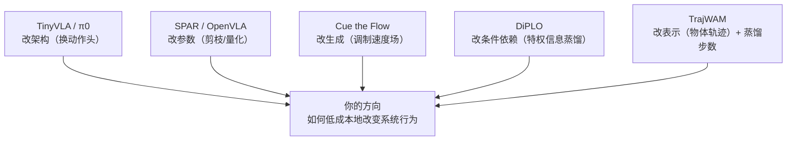

# P010 · 科研启发与复现建议

> 证据分级：**【原文证明】** / **【合理推测】** / **【待验证】**。
> 导航：[[Paper_010_DiPLO/01_论文精读|01 精读]] ｜ [[Paper_010_DiPLO/02_核心创新与方法|02 创新]] ｜ [[Paper_010_DiPLO/03_架构图与流程图|03 图]] ｜ [[Paper_010_DiPLO/04_术语和公式解释|04 术语]]

---

## 一、它在你的研究地图里的位置：第三种"加速/改造"方式

**它的独特价值**：前面几篇的"改造"都针对**模型容量或生成过程**，DiPLO 针对的是**信息依赖**——"训练时能看什么"与"部署时能看什么"之间的差距。

---

## 二、A–H 八问

### A. 对 VLA 推理加速的启发

**【原文证明】**
1. 规划器在硬件上 **12.5 Hz**（§V-D），追踪器 **50 Hz**。
2. 两者**并行进程**运行——规划慢不影响控制快。
3. 作者评论："Although action/state-action diffusion models can plan actions over a longer horizon, the generated actions operate open-loop until the next plan arrives, making it extremely challenging for legged robots to stabilise at such low frequencies."

**【合理推测】这条评论对你有直接启发**
> **分层系统的"加速"目标不是"让每一层都变快"，而是"让慢的那一层不阻塞快的那一层"。**
> DiPLO 的规划器只有 12.5 Hz，但追踪器 50 Hz 一直在跑——**这就是"异步分层"**，比"把规划器加速到 50 Hz"便宜得多。

**【待验证】**：如果规划器掉到 5 Hz，系统还能撑住吗？（$m$ 未给，无法估算缓冲深度）

### B. 对动作分块 / 执行调度的启发

**【原文证明】**
1. 规划 $n$ 帧、执行 $m\le n$ 帧、再重规划（§III-A）。
2. **$m$ 的具体值未给**。
3. 规划 12.5 Hz、控制 50 Hz → 一个规划周期对应 4 个控制步。

**【合理推测】由 12.5 Hz 反推**
- 若规划器周期 80 ms、控制周期 20 ms → 每个规划块至少覆盖 4 个控制步；
- 若 $m=4$，则执行比例取决于 $n$（未给）。
- **这是一个明显的空白**：DiPLO 没报 $n$ 和 $m$，所以无法像 π0 那样算占空比。

**【待验证】**。

### C. 对量化、缓存、压缩的启发

**【原文证明】**：DiPLO 的"压缩"是**蒸馏掉条件依赖**，不是压缩模型。

**【合理推测】三种"蒸馏"的对比**
| 蒸馏类型 | 目的 | 代表 |
|---|---|---|
| 步数蒸馏 | 减少采样步 | TrajWAM、DMD |
| 容量蒸馏 | 小模型学大模型 | 经典 KD |
| **依赖蒸馏** | 去掉部署时不可得的信息 | **DiPLO 的 SD:DPO** |

第三种最少见，但**在机器人里最实用**——因为"训练/部署信息不对称"是常态（仿真有真值、真机没有；训练有动捕、部署只有相机）。

### D. 是否能用于轮式双臂机器人？

**【原文证明】**：DiPLO 用在**人形**（Unitree G1，29 关节）。
**【合理推测】**：轮式双臂的平衡问题比人形简单得多，追踪器更容易学；但"规划器-追踪器"这个分层仍然适用。
**【待验证】**：轮式底盘的"运动学冗余"是否会让规划器更容易？

### E. 是否需要真实硬件？

| 目标 | 需求 | 可行性 |
|---|---|---|
| 完整复现 | 人形 + mjlab + 私有重定向数据 | ❌ 很高 |
| 复现 SD:DPO | 任意"有特权信息"的仿真环境 | ✅ 可行 |
| 复现 DA:PPO | 任意扩散策略 + RL 环境 | ⚠️ 中等 |

### F. 能否在仿真中先复现？

**【原文证明】**：除了最后的真机演示，**全部结果都在仿真里**。
**【合理推测】**：这是好消息——SD:DPO 与 DA:PPO 都能在仿真里验证，不需要人形硬件。

### G. 本科阶段能否完成小规模实验？

**【我的判断】能做一个"SD:DPO 的玩具版"**：

> **题目**：在一个有"特权信息"的小环境里（例如仿真中可拿到真实物体速度、部署只给位置），比较三种学生：① 从头不用特权信息训练 ② 用特权信息训练但部署时置空 ③ 用 SD:DPO 蒸馏。验证"② 会掉、③ 能补回"。

- 变量：蒸馏与否；
- 指标：成功率、对扰动的鲁棒性；
- 预期：【合理推测】③ > ② ≈ ①（在低数据下）。

### H. 博士阶段能否进一步拓展？

三条线：
1. **依赖蒸馏的一般化**：什么样的"特权信息"可以蒸馏、什么不能？（信息论视角）
2. **异步分层的调度**：规划频率与控制频率如何解耦（DiPLO 只是"并行跑"，没有理论）
3. **与步数蒸馏结合**：SD:DPO + 一步生成，能不能同时"去依赖"和"提速"？

---

## 三、四个可落地的研究点

### 研究点 #1：依赖蒸馏的适用边界

| 项目 | 内容 |
|---|---|
| **动机** | SD:DPO 有效，但没说"什么样的特权信息可以被蒸馏掉" |
| **假设** | 若特权信息提供的是"可从事后观测推断的量"，蒸馏有效；若是"不可推断的量"，蒸馏无效 |
| **设计** | 构造三种特权信息（目标位置真值 / 未来轨迹真值 / 动力学参数），分别蒸馏，看效果 |
| **指标** | 学生 vs 老师的性能差 |
| **价值** | 给出"何时该用依赖蒸馏"的判断标准 |

### 研究点 #2：异步分层的频率匹配

| 项目 | 内容 |
|---|---|
| **动机** | DiPLO 规划 12.5 Hz / 控制 50 Hz，但没有分析"最低可接受规划频率" |
| **设计** | 人为降低规划频率（把推理变慢），测存活率退化曲线 |
| **指标** | 存活率 vs 规划频率 |
| **价值** | 给出"分层系统里慢层可以多慢"的定量边界；与 π0/TrajWAM 的占空比分析互补 |

### 研究点 #3：SD:DPO + 步数蒸馏

| 项目 | 内容 |
|---|---|
| **动机** | 两个蒸馏解决不同问题，能否同时做？ |
| **假设** | 先步数蒸馏再依赖蒸馏（或反过来）会有不同的失效模式 |
| **设计** | 四种顺序组合，测存活/成功率/延迟 |
| **风险** | 两种蒸馏的梯度可能冲突 |

### 研究点 #4：DA:PPO 的奖励设计再研究

| 项目 | 内容 |
|---|---|
| **动机** | 表 IV：$r_{kin}$ 96.4% vs $r_{goal}$ 92.9%，但 $r_{goal}$ 不需要参考 |
| **假设** | 混合奖励（早期用 $r_{kin}$、后期用 $r_{goal}$）可能兼得 |
| **设计** | 课程式奖励切换，测最终成功率与泛化 |
| **价值** | 降低对"必须有参考"的依赖（与 SD:DPO 的目标一致） |

---

## 四、一个具体案例：人形机器人"走过去、拿起、放下"（原文任务）

> [!warning] 案例性质
> pick-carry-place 是 **DiPLO 的原始任务**。下面的时间线是**教学示例**，具体数字来自表 V 与 §V-D 的 12.5 Hz。

**场景**：Unitree G1 站在起点，目标是把桌上的箱子搬到 2 米外的台子上。

| 时刻 | 发生了什么 | 说明 |
|---|---|---|
| t=0 | 观测：状态历史 + 箱子目标位姿 | **无 IK 参考**（部署时） |
| t≈80 ms | 扩散规划器生成 $n$ 帧"机器人+箱子"联合运动 | 12.5 Hz |
| 接下来 | 追踪器以 50 Hz 执行，输出关节残差 | 每 20 ms 一次 |
| 执行 $m$ 帧后 | 用实测状态重新规划 | $m$ 未给 |
| 循环 | 走到桌边 → 抓 → 转身 → 走到台子 → 放 | 多个规划周期 |
| 合计 | pick-carry-place 成功率 **98.8%**（学生+SD:DPO+DA:PPO） | 表 V |

**关键理解**：
- **规划器不输出关节角，输出"运动"**（机器人+物体的位置/朝向/关节轨迹）；
- **追踪器负责平衡**——这是人形机器人最关键的部分，规划器不管；
- **12.5 Hz 的规划频率对"走过去搬箱子"够用**，但对"接住飞来的球"肯定不够——这也是作者在 §V-D 里自己指出的局限。

---

## 五、复现路线

---

## 六、复现时会踩的坑

| 坑 | 说明 | 建议 |
|---|---|---|
| **$n$ 与 $m$ 未给** | 无法复现调度 | 自己定并记录 |
| **SBTO 难复现** | 采样式轨迹优化实现复杂 | 可先用简单滤波/重解替代 |
| **SO(3) 扩散实现** | IGSO(3) 采样容易写错 | 用现成库（如 geomstats） |
| **DA:PPO 的超参** | 温度 $T$、$\epsilon$ 未全给 | 从论文的附录 G/H 找，或自己扫 |
| **奖励设计** | $r_{kin}$ 需要参考轨迹 | 没有参考时只能用 $r_{goal}$（掉 3.5 点） |
| **2048 并行环境** | 普通机器跑不动 | 降到 64–256，接受更长训练时间 |
| **anchor 损失权重** | 未给 | 从小值开始，防止过约束 |

---

## 七、与前后论文的关系

| 论文 | 关系 |
|---|---|
| [[00_文献总索引#P009 TrajWAM]] | 同为"蒸馏"但目的不同：TrajWAM 蒸馏**步数**，DiPLO 蒸馏**依赖** |
| [[00_文献总索引#P006 Diffusion Policy]] | DiPLO 的规划器就是扩散策略的一种，但输出"运动"而非"动作" |
| [[00_文献总索引#P005 π0 (pi-zero)]] | 同为"流匹配/扩散 + 分层"（π0 有 HL 模式），但 π0 的 HL 是 VLM，DiPLO 是扩散 |
| [[00_文献总索引#P007 SayCan]] | 同为分层；SayCan 的高层是 LLM，低层是技能库；DiPLO 的高层是扩散，低层是 RL 追踪器 |
| [[00_文献总索引#P002 SPAR]] | SPAR 用 RL 恢复被剪掉的能力；DiPLO 用 RL 提升规划器的任务成功率——**RL 在两者都是"后训练"手段** |

---

## 八、一句话总结对我的价值

> **DiPLO 给了我一个可以直接搬走的范式：**如果某个信息只在训练时存在，就把它当"老师"，在学生自己会到达的状态上做蒸馏**。**
> 这比"在训练时随机丢弃它"强得多（74.1% vs 99.5% 存活）。而且它揭示了一个更普遍的现象：**模型的失败往往不是在"训练分布内"，而是在"自己的错误把自己带到的地方"** ——SD:DPO 的 buffer 里存的正是这些地方。
> 另外，它那句"规划 12.5 Hz、控制 50 Hz、并行跑"提醒我：**分层系统的加速目标是"解耦"，不是"都变快"。**
