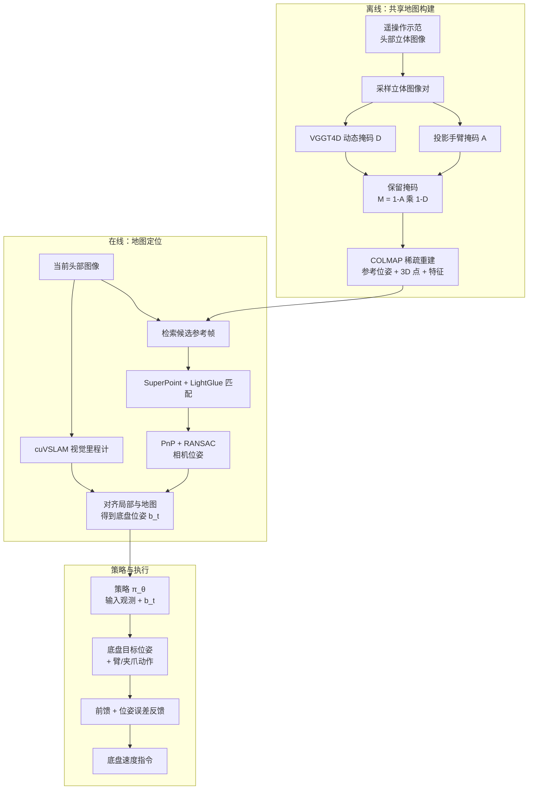
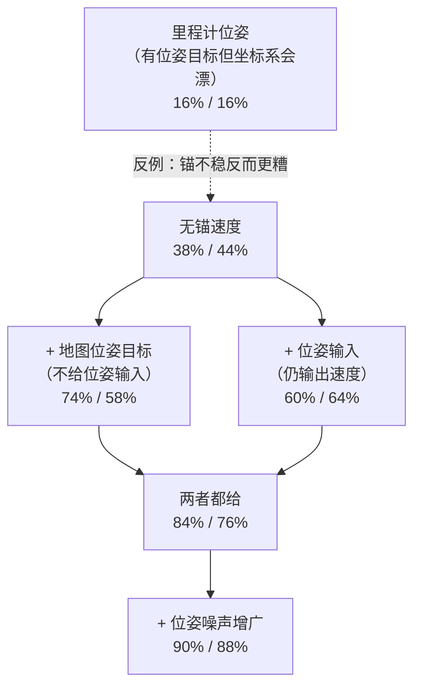
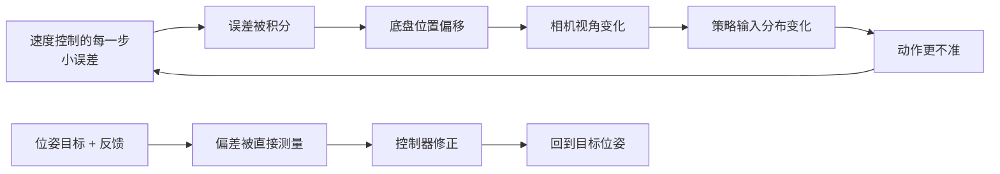
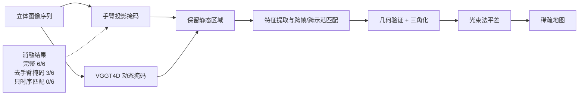
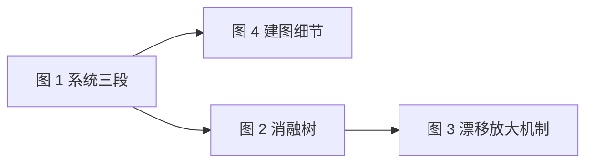

# P011 · 架构图与流程图

> 本文共 4 张图：
> **图 1 三段式系统（建图 → 定位 → 策略+控制）** ／ **图 2 四个因素的消融树** ／ **图 3 漂移为什么会被放大** ／ **图 4 建图流程与消融**
> 每张图后附：逐节点解释 → 数据流 → 核心创新位置 → 原文出处。
>
> 导航：[[Paper_011_MAVP/01_论文精读|01 精读]] ｜ [[Paper_011_MAVP/02_核心创新与方法|02 创新]] ｜ [[Paper_011_MAVP/04_术语和公式解释|04 术语]] ｜ [[Paper_011_MAVP/05_科研启发与复现建议|05 启发]]

---

## 图 1 · 三段式系统

### 1.1 逐节点解释

| 节点 | 含义 | 关键点 |
|---|---|---|
| M3/M4 | 手臂掩码 / 动态掩码 | **手臂掩码是建图成败的关键**（表 IV） |
| M5 | 两者相乘 | 只有"非手臂 且 非动态"的像素参与建图 |
| M6 | COLMAP | 跨示范、跨视角的统一坐标系 |
| L4/L5 | 绝对定位 / 相对里程计 | 一个准但稀疏，一个连续但会漂 |
| L6 | 对齐 | $T_{align}$ 把里程计轨迹拉回地图系 |
| P2 | **核心创新** | 底盘输出"目标位姿"而非速度 |
| P3 | 反馈 | 修正"目标 - 当前"的偏差 |

### 1.2 数据如何流动

示教图像 → 共享地图（一次）→ 在线图像定位到地图 → 得到底盘位姿 → 策略出动作 → 控制器追目标。

**这条链的关键是"坐标系"**：所有环节都在**同一个地图坐标系**下，标签、输入、目标、反馈才互相可比。

### 1.3 核心创新在哪

**P2 的"目标位姿"表示**。上游（建图/定位）是"提供坐标系"，下游（控制器）是"利用坐标系"，只有 P2 是"改变动作语义"。

### 1.4 原文出处

图 2、§III-A、§III-B、§III-C。

---

## 图 2 · 四个因素的消融树（表 II 的可视化）

### 2.1 逐节点解释

| 节点 | 变化 | 成功率（Disassemble / Lidded） |
|---|---|---|
| A | 基线：速度，无位姿输入 | 38 / 44 |
| B | 换成目标位姿（无位姿输入） | 74 / 58 |
| C | 给位姿输入（仍速度） | 60 / 64 |
| D | 两者都有 | 84 / 76 |
| E | 再加噪声增广 | **90 / 88** |
| F | 反例：episode 初始化的里程计坐标 | **16 / 16** |

### 2.2 这张图想说明什么

1. **表示（B）比信息（C）更重要**：74 > 60；
2. **两者叠加（D）最好**；
3. **坐标系不稳会毁掉一切（F）**——这是全文最有洞察的一条。

### 2.3 原文出处

表 II、§IV-B（Q1–Q3）。

---

## 图 3 · 漂移为什么会被放大（我的解释图）

### 3.1 逐节点解释

| 链 | 机制 |
|---|---|
| A–F | **正反馈回路**：误差 → 视角变化 → 策略更差 → 误差更大 |
| G–J | **负反馈回路**：偏差 → 修正 |

### 3.2 为什么这张图重要

它解释了为什么"速度控制"在长任务里会崩：**不是单步误差大，而是误差会改变观测分布，进而让策略失效**。

作者在 §I 说的"spatial misalignment and subsequent manipulation failures"就是这个意思。

### 3.3 原文出处

§I 的问题描述；图 6（速度控制"提前停下" vs 地图位姿"继续走向任务位置"）。

---

## 图 4 · 建图流程与消融

### 4.1 逐节点解释

| 节点 | 消融后的影响（表 IV） |
|---|---|
| B 手臂掩码 | 去掉 → 完整地图 3/6、可部署查询 600/912 |
| E 匹配策略 | 只用时序 → 0/6；用最近邻替 LightGlue → 4/6 |
| F 几何验证 | 保留（COLMAP 自带） |

### 4.2 数据如何流动

图像 → 掩码 → 匹配 → 三角化 → 平差 → 地图。

### 4.3 核心创新在哪

**"遮掉机器人自己"** 这个看似琐碎的步骤，是建图能不能用的分水岭。

### 4.4 原文出处

§III-A、§IV-E、表 IV、图 3。

---

## 五、四张图的关系

---

## 六、自检：哪些是原文有，哪些是我补的

| 元素 | 性质 |
|---|---|
| 建图、定位、策略三段 | 【原文·图 2、§III】 |
| 掩码公式、对齐公式、增广公式 | 【原文·式 (1)(2)(3)(6)(7)】 |
| 表 II 的 6 行数字 | 【原文·表 II，列重建还原】 |
| 表 IV 的建图消融 | 【原文·表 IV，列重建还原】 |
| **图 3 的"漂移正反馈回路"** | **【我的解释】**，原文只说"误差累积"与"视角受影响"，没有画回路 |
| 图 2 的树状结构 | 【我的可视化】，数字来自表 II |
