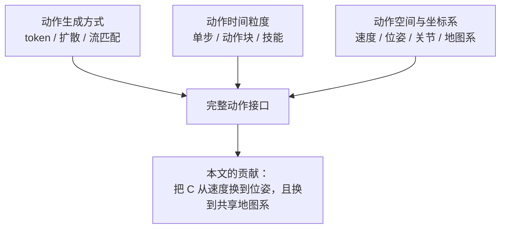

# P011 · 科研启发与复现建议

> 证据分级：**【原文证明】** / **【合理推测】** / **【待验证】**。
> 导航：[[Paper_011_MAVP/01_论文精读|01 精读]] ｜ [[Paper_011_MAVP/02_核心创新与方法|02 创新]] ｜ [[Paper_011_MAVP/03_架构图与流程图|03 图]] ｜ [[Paper_011_MAVP/04_术语和公式解释|04 术语]]

---

## 一、它在你的研究地图里的位置：动作表示的"第三维"

前面几篇讨论"动作怎么生成"（token / 扩散 / 流匹配），这篇讨论**"动作在什么坐标系里被表达"**——这是一个被严重低估的维度。

**一句话**：动作接口 = **生成方式 × 时间粒度 × 坐标系**。前两维被研究得很多，第三维很少。

---

## 二、A–H 八问

### A. 对 VLA 推理加速的启发

**【原文证明】**
1. 本文**完全不涉及加速**——它换的是表示，不是速度。
2. 但没有报告推理延迟（定位 + 策略的耗时未知）。

**【合理推测】一个反直觉的角度**
> **"换表示"有时比"加速模型"更有效。**
> 本文用同一个 ACT/DP/FM 网络，只改底盘动作表示，成功率从 38% 提到 90%（+52 点）。而任何加速方法（量化、剪枝、蒸馏）都不可能带来这么大的任务成功率提升。

**对我的提醒**：做加速研究时，应该先问"**这个系统的瓶颈真的是模型速度吗**"。如果瓶颈是"漂移""对齐""坐标系"，那加速是白费力气。

**【待验证】**：MAVP 的定位模块（匹配 + PnP）占了多少延迟？如果占大头，那"加速"应该做在定位上。

### B. 对动作分块 / 执行调度的启发

**【原文证明】**
1. 动作块：ACT 30 步；DP/FM 预测 32、执行 24 步（执行比例 75%）。
2. **执行比例 24/32 = 75%**，比 π0（32%–50%）和 TrajWAM（25%）都高。
3. 底盘由**连续反馈控制器**执行，而不是开环执行动作块。

**【合理推测】一个重要的结构性差异**
> **MAVP 的"动作块"只管手臂，底盘走的是连续反馈回路。**
> 也就是说：**同一个系统里，不同部件可以有不同的"执行调度"**。
> - 手臂：动作块 + 开环执行 24 步；
> - 底盘：位姿目标 + 连续反馈（不依赖动作块）。

这给了我一个之前没想到的视角：**调度不是全局的，可以按部件分层**。

**【待验证】**：手臂是否也能用"位姿目标 + 反馈"？如果手臂也换成位姿目标，会不会也涨？（作者只改了底盘）

### C. 对量化、缓存、压缩的启发

**【原文证明】**：本文没有量化/剪枝/蒸馏。

**【合理推测】"表示"与"压缩"的交互**
- 如果动作表示是**位姿目标**（低频、平滑），那么策略输出的熵更低，**量化可能更宽容**；
- 如果动作表示是**速度**（高频、抖动），量化误差会被积分放大。
- **这是一个可检验的假设**：同一模型，换表示后测量化鲁棒性。

**【待验证】**：这条假设很有意思，且实验便宜。

### D. 是否能用于轮式双臂机器人？

**【原文证明】**：本文就是用**四轮全向底盘 + 双臂**（两个 7-DoF）。
**【结论】**：**这是 24 篇里对"轮式双臂"支持最直接的一篇**——它就是在轮式双臂平台上做的。

**【合理推测】**：把"底盘位姿目标"扩展到"底盘 + 躯干位姿目标"是自然的下一步（本文机器人有可升降旋转躯干，但没单独讨论）。

### E. 是否需要真实硬件？

| 目标 | 需求 | 可行性 |
|---|---|---|
| 完整复现 | 轮式双臂 + 立体相机 + 真机 | ❌ 很高 |
| 复现"换表示" | 仿真移动操作任务 | ✅ 容易 |
| 复现"建图+定位" | 仿真 + COLMAP/cuVSLAM | ⚠️ 中等 |

### F. 能否在仿真中先复现？

**【合理推测】非常适合"换表示"这一半**：
- 在 Habitat / Isaac / MuJoCo 里搭一个移动操作任务；
- 用同样的策略网络，分别用"速度"和"世界坐标系位姿目标"作为底盘动作；
- 看成功率差异。

**难点**：仿真的"定位"是免费的（有真值），所以**不会复现出"地图定位 vs 里程计"的差距**（表 II 的 16% 那一行）。要复现那一行，必须**人为给定位加漂移**。

### G. 本科阶段能否完成小规模实验？

**【我的判断】能，而且题目很干净**：

> **题目**：在仿真移动操作任务里，比较三种底盘动作表示：① 速度 ② episode 局部坐标系位姿 ③ 世界坐标系位姿。固定策略网络与数据。

- 变量：动作表示；
- 指标：成功率、终点位置误差；
- 预期：【合理推测】③ > ② > ①（复现表 II 的趋势）。

### H. 博士阶段能否进一步拓展？

三条线：
1. **动作表示的系统研究**：速度/位姿/关节/末端 在什么任务下最优？
2. **部件级调度**：不同部件用不同的表示与执行方式（见 B）；
3. **表示与压缩的交互**（见 C）。

---

## 三、四个可落地的研究点

### 研究点 #1：动作表示的系统消融

| 项目 | 内容 |
|---|---|
| **动机** | MAVP 只比了"速度 vs 位姿"；还有"末端位姿""关节位置""混合"等 |
| **设计** | 固定网络与数据，比较 4–5 种表示的：成功率、平滑度、对延迟的鲁棒性 |
| **指标** | 成功率、jerk、延迟容忍度 |
| **价值** | 补上一个被忽视的维度；结论对任何移动操作都适用 |

### 研究点 #2：部件级调度

| 项目 | 内容 |
|---|---|
| **动机** | MAVP 手臂用动作块、底盘用反馈；这种"混合调度"没人系统研究 |
| **假设** | 高频部件（底盘）用反馈、低频部件（手臂）用动作块，是最优组合 |
| **设计** | 2×2：{手臂：块 / 反馈} × {底盘：块 / 反馈} |
| **指标** | 成功率、延迟、轨迹平滑度 |
| **价值** | 把"执行调度"从"全局超参"变成"按部件分配" |

### 研究点 #3：表示 × 量化的交互

| 项目 | 内容 |
|---|---|
| **动机** | 见 C：位姿目标可能比速度更抗量化 |
| **设计** | 同一模型，两种表示，各做 int8/int4，测成功率 |
| **指标** | 成功率 vs 精度 |
| **价值** | 若成立，说明"换表示"可以降低对精度的要求——对边缘部署有意义 |

### 研究点 #4：定位误差的主动补偿

| 项目 | 内容 |
|---|---|
| **动机** | 表 III 只是"被动加噪训练"；能否让策略**估计自己的定位不确定性**并调整行为？ |
| **设计** | 给策略额外输入"定位置信度"，训练时用真实的定位残差作为标签 |
| **指标** | 高噪声下的成功率 |
| **价值** | 从"鲁棒"升级到"不确定性感知" |

---

## 四、一个具体案例：拆开玩具、把零件送到另一个箱子（原文任务）

> [!warning] 案例性质
> "Disassemble and Deliver" 是**原文的六个真机任务之一**（表 I）。下面的时间线是**教学示例**。

**场景**：桌上有一个可拆的玩具（有 peg），远处有一个箱子。任务：拔下 peg，走到箱子，把零件放进去。

| 阶段 | 发生了什么 | 说明 |
|---|---|---|
| 1 | 机器人在位置 A 拔下 peg | 底盘不动 |
| 2 | 策略输出**底盘目标位姿**（地图坐标 $(1.8, 0.4, 90°)$） | 关键：不是速度 |
| 3 | 控制器算"目标 − 当前"，前馈 + 反馈 → 速度指令 | 闭环 |
| 4 | 走得过程中定位持续更新，偏差被修正 | 表 VI：持续定位 90% |
| 5 | 到达目标附近，策略输出手臂动作放零件 | 动作块 |
| 6 | 完成 | 成功率 90%（ACT） |

**对照：速度控制会怎样？**
- 策略输出速度，控制器照着走；
- 每步小误差累积 → 底盘偏 20–30 cm；
- 相机视角变了 → 箱子不在预期位置 → 手臂抓空；
- 成功率 38%。

**关键理解**：**不是"手臂不会抓"，而是"底盘没站对"**。MAVP 的全部价值就是让底盘站对。

---

## 五、复现路线

---

## 六、复现时会踩的坑

| 坑 | 说明 | 建议 |
|---|---|---|
| **仿真定位是真值** | 复现不出"里程计漂移"效应 | 人为加漂移/噪声 |
| **坐标系定义混乱** | "地图系""世界系""局部系"容易混 | 画一张坐标系图 |
| **位姿目标的范围** | 超出地图的目标准确率会掉 | 限制在可定位区域 |
| **动作块与反馈的接口** | 底盘走反馈、手臂走块，代码要分开 | 明确两套接口 |
| **噪声增广的 Σ** | 原文用实测协方差 | 复现时要么实测，要么扫 |
| **50 次 rollout** | 统计噪声大 | 至少 50，最好 100 |

---

## 七、与前后论文的关系

| 论文 | 关系 |
|---|---|
| [[00_文献总索引#P010 DiPLO]] | 都涉及"移动 + 操作"，但 DiPLO 是人形全身、MAVP 是轮式底盘 + 双臂 |
| [[00_文献总索引#P005 π0 (pi-zero)]] | 都是"动作块"；MAVP 的底盘走反馈而非动作块 |
| [[00_文献总索引#P008 Cue the Flow]] | 都用"外部空间信号"（热图 / 地图位姿）来引导 |
| [[00_文献总索引#P006 Diffusion Policy]] | MAVP 的 DP 基线就是 Diffusion Policy |
| [[00_文献总索引#P012 Cracking Mobile Manipulation]] | 同为移动操作的系统级工作，可对照 |

---

## 八、一句话总结对我的价值

> **MAVP 让我意识到"动作接口"有三个维度：怎么生成、多久一次、在什么坐标系里。第三个维度几乎没人系统研究，但它能带来 50 点的提升。**
> 更具体地说，它给了我两个可以直接用的观察：
> ① **"显式目标 + 反馈" 优于 "增量速度"**，因为前者有锚；
> ② **锚必须建在稳定的坐标系上**，否则显式目标反而更糟（里程计 16% 比速度 38% 还差）。
> 这两条对任何"长程、跨位置"的机器人任务都成立——包括我正在关心的"执行调度"。
