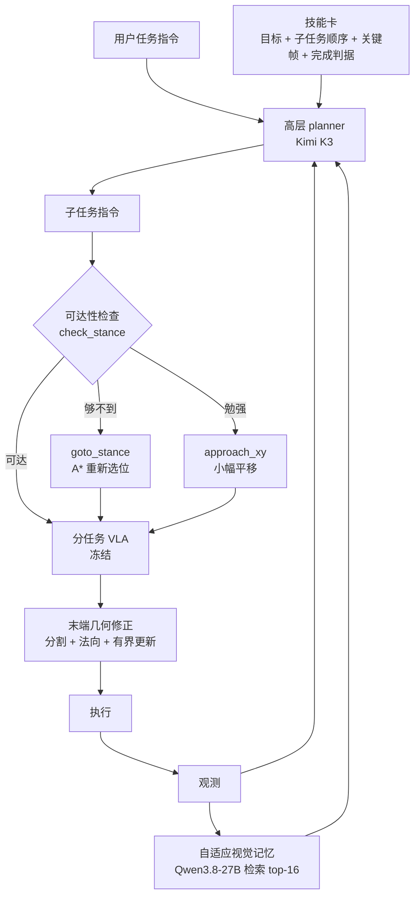
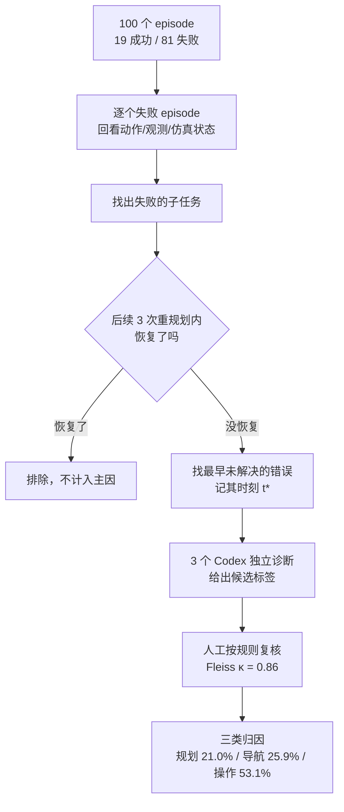
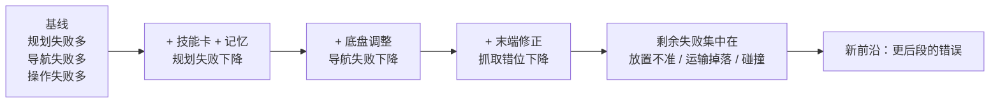
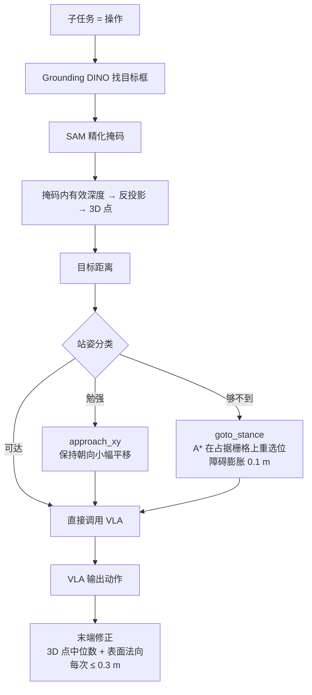
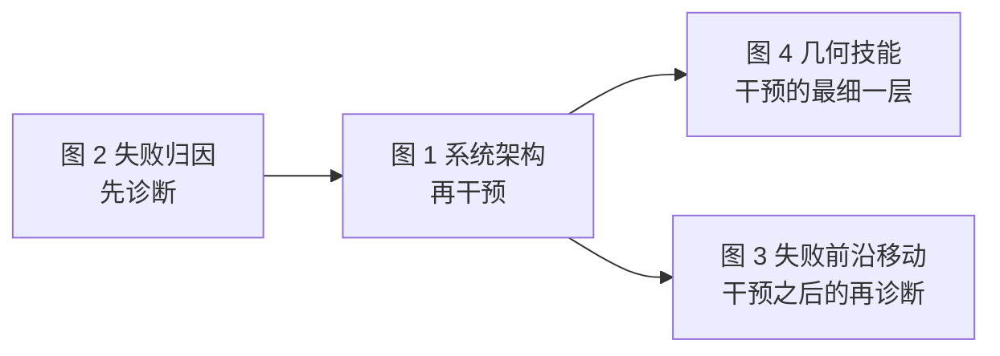

# P012 · 架构图与流程图

> 本文共 4 张图：
> **图 1 系统架构（三个外挂 + 冻结 VLA）** ／ **图 2 失败归因流程** ／ **图 3 失败前沿的移动** ／ **图 4 几何技能的决策树**
> 每张图后附：逐节点解释 → 数据流 → 核心创新位置 → 原文出处。
>
> 导航：[[Paper_012_CrackingMM/01_论文精读|01 精读]] ｜ [[Paper_012_CrackingMM/02_核心创新与方法|02 创新]] ｜ [[Paper_012_CrackingMM/04_术语和公式解释|04 术语]] ｜ [[Paper_012_CrackingMM/05_科研启发与复现建议|05 启发]]

---

## 图 1 · 系统架构

### 1.1 逐节点解释

| 节点 | 职责 | 是否训练 |
|---|---|---|
| P | 选子任务、调工具 | 否（提示） |
| SK | 提供"示范里怎么做的" | 离线生成 |
| VM | 提供"之前发生了什么" | 检索，不训练 |
| CHK | 判断"现在能不能操作" | 阈值固定 |
| G1/G2 | 修底盘 | 几何算法 |
| VLA | 执行子任务 | **冻结** |
| EE | 修末端 | 几何算法 |

### 1.2 数据如何流动

指令 + 技能卡 + 记忆 → planner → 子任务 → （必要时修底盘）→ VLA → （必要时修末端）→ 执行 → 记忆。

**关键**：**VLA 在中间，但所有"修正"都在它的两侧**——输入侧（规划/记忆）与输出侧（底盘/末端）。

### 1.3 核心创新在哪

不是某一个模块，而是**"每个模块都对应一个被诊断出的失败模式"**这个对应关系。

### 1.4 原文出处

图 3、§4 各小节。

---

## 图 2 · 失败归因流程

### 2.1 逐节点解释

| 节点 | 说明 |
|---|---|
| D | **"3 次重规划恢复窗口"** 是这套方法的关键定义 |
| F | 取"最早未解决"，避免把后段失败误归因 |
| G/H | 模型提议 + 人工复核，双重保障 |
| I | 结果直接变成"处方" |

### 2.2 数据如何流动

失败 episode → 子任务级失败 → 恢复检查 → 时刻 $t^*$ → 标签 → 分布。

### 2.3 核心创新在哪

**"把失败定义得可操作"**。没有这套规则，"21%/26%/53%"这组数字就不可信。

### 2.4 原文出处

§3.2（归因规则）、图 2（分布）。

---

## 图 3 · 失败前沿的移动（图 5 的概念化）

### 3.1 逐节点解释

| 阶段 | 下降的失败类型 | 数据 |
|---|---|---|
| + 技能卡/记忆 | 放置目标/容器指派错误 | **9 → 0** |
| + 底盘调整 | 接近无效/底盘差 | **11 → 1** |
| + 末端修正 | 抓取错位/空抓 | **10 → 3** |
| 之后 | 放置不准、掉落、碰撞 | 成为主要剩余 |

### 3.2 这张图想说明什么

**修好一个瓶颈，下一个瓶颈就暴露。** 作者用"moving failure frontier"来描述这个现象。

对我的意义：**这意味着"可靠性"不是一个可以一次达到的状态，而是一个需要持续诊断的过程。**

### 3.3 原文出处

§5.2、图 5、附录 G。

---

## 图 4 · 几何技能的决策树（§4.3）

### 4.1 逐节点解释

| 节点 | 关键设计 |
|---|---|
| D | 只用**有效深度**像素（缺失/无效值跳过） |
| E/F | 三分阈值**用训练轨迹估计**并固定 |
| I | 障碍物**膨胀 0.1 m** 作为安全边界 |
| K | 取**中位数**抗离群；用**表面法向**决定接近方向；**有界**（0.3 m）防过冲 |

### 4.2 数据如何流动

图像 → 框 → 掩码 → 3D 点 → 距离/法向 → 决策 → 修正。

### 4.3 核心创新在哪

**"分层的最小干预"**：
- 先判断要不要动底盘（大动作）；
- 能动底盘就不动末端；
- 末端只做有界修正（小动作）。

### 4.4 原文出处

§4.3、附录 D（参数）。

---

## 五、四张图的关系

---

## 六、自检：哪些是原文有，哪些是我补的

| 元素 | 性质 |
|---|---|
| 四个外挂、冻结 VLA | 【原文·§4】 |
| 归因规则（3 次重规划、$t^*$、κ=0.86） | 【原文·§3.2】 |
| 三类占比 21.0/25.9/53.1 | 【原文·图 2】 |
| 细项 9→0、11→1、10→3 | 【原文·§5.2】 |
| 几何技能流程与参数 | 【原文·§4.3、附录 D】 |
| 图 3 的"失败前沿移动" | 【原文·§5.2、图 5】的图示化 |
| 图 1 的"修正都在 VLA 两侧" | 【我的总结】 |
| 中间集成点的具体数值 | **【原文未给出】**（图 4 是折线图） |
