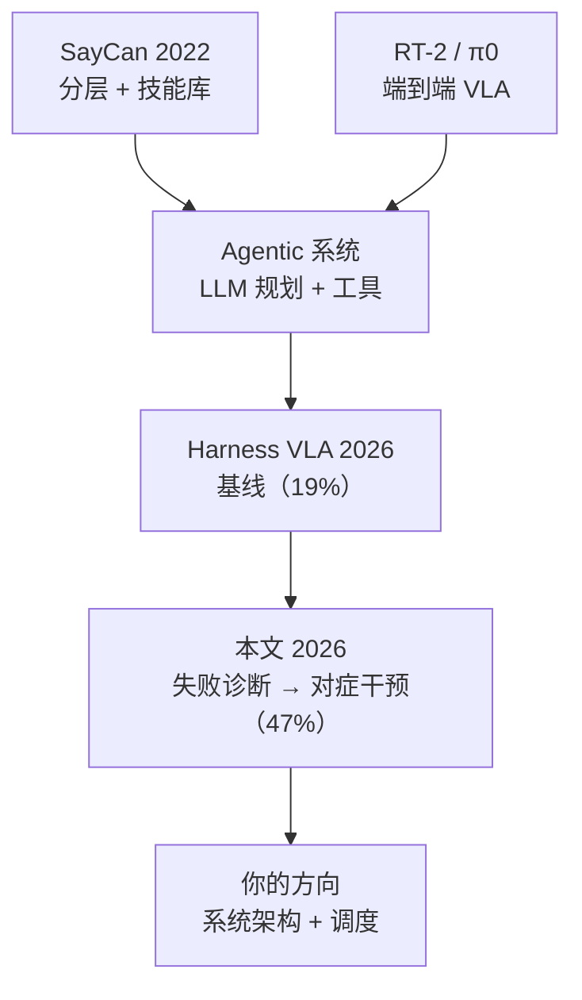

# P012 · 科研启发与复现建议

> 证据分级：**【原文证明】** / **【合理推测】** / **【待验证】**。
> 导航：[[Paper_012_CrackingMM/01_论文精读|01 精读]] ｜ [[Paper_012_CrackingMM/02_核心创新与方法|02 创新]] ｜ [[Paper_012_CrackingMM/03_架构图与流程图|03 图]] ｜ [[Paper_012_CrackingMM/04_术语和公式解释|04 术语]]

---

## 一、它在你的研究地图里的位置：系统架构层的"诊断学派"

**它的独特价值**：这是 24 篇里**唯一一篇把"失败分析"当作主要贡献**的论文。其余论文的贡献是"新模块"，它的贡献是"**知道该加什么模块**"。

---

## 二、A–H 八问

### A. 对 VLA 推理加速的启发

**【原文证明】**
1. 底层 VLA **完全冻结**——本文没有训练任何新模型。
2. 四个外挂都是"提示 + 几何算法"，没有梯度。
3. **延迟完全没报**（这是最大的空白）。

**【合理推测】一个"反向"的启发**
> 本文的 47% 是在**冻结策略**的前提下达到的。这说明：**很多性能损失不在模型自身，而在系统编排**。
> 对加速研究的启示是：**在优化模型之前，先确认模型的输出有没有被正确地"用起来"**。
> - 如果可达性检查缺失，再快的 VLA 也会"站错位置抓空"；
> - 如果规划不跟踪进度，再快的 VLA 也会做错事。

**【待验证】**：四个外挂的延迟开销有多大？如果 planner 每轮要 2–3 秒，那真机上还能用吗？

### B. 对动作分块 / 执行调度的启发

**【原文证明】**
1. 调度粒度是**子任务**（2–15 个/任务），比动作块还粗。
2. **"检查点"是调度的关键**：`check_stance` 在"导航→操作"之间插入一次检查。
3. 恢复窗口是 **3 次重规划**——这是一个"调度层的超参"。

**【合理推测】一个可迁移的结构**
> **在每个阶段切换处插入一个"检查"，比在每个控制步都检查更经济。**
> - MAVP（P011）：在导航→操作之间检查可达性；
> - 本文：同样在导航→操作之间检查，并且**在操作前后各加一次几何修正**。
>
> 两篇独立工作都指向同一个设计：**交接点是可靠性的关键**。

这为我的"执行调度"研究提供了一个新维度：**不只是"多久重规划一次"，还有"在哪些边界上插入检查"**。

### C. 对量化、缓存、压缩的启发

**【原文证明】**：本文不做压缩。
**【合理推测】**：
- 如果底层 VLA 被量化/剪枝，**外挂可能反而更重要**（因为策略更弱，需要更多外部修正）；
- 反过来，**外挂也可能掩盖压缩带来的退化**——这在评估压缩方法时要小心：**别让系统级外挂"救"回了模型级的损失，从而高估了压缩的质量**。

**【待验证】**：在 SPAR/TinyVLA 这类压缩模型上，加不加外挂，性能差距会不会变大？

### D. 是否能用于轮式双臂机器人？

**【原文证明】**：真机实验用的是**双臂移动操作平台**（附录 J）。
**【结论】**：**直接适用**。

**【合理推测】**：外挂的设计与形态无关（都是"检查 + 几何修正"），换机器人主要是重标阈值。

### E. 是否需要真实硬件？

| 目标 | 需求 | 可行性 |
|---|---|---|
| 完整复现 | RoboCasa365 仿真 + 已训子任务 VLA | ⚠️ 中等（需 VLA checkpoint） |
| 复现"诊断—干预"流程 | 任意分层 agent + 几何工具 | ✅ **容易** |
| 复现真机 | 双臂移动平台 | ❌ 很高 |

### F. 能否在仿真中先复现？

**【原文证明】**：主实验都在 RoboCasa365 仿真；代码将开源。
**【合理推测】**：**这是 24 篇里最适合仿真复现的系统级工作**——因为它的核心是"编排"，不是"训练"。

### G. 本科阶段能否完成小规模实验？

**【我的判断】能，而且是一个很好的"系统+分析"型课题**：

> **题目**：在一个分层 agent 系统里，实现"失败归因"脚本，统计三类瓶颈的分布，然后只加一个外挂（比如可达性检查），看分布如何移动。

- 变量：加/不加外挂；
- 指标：总成功率 + 三类失败占比；
- 价值：学会"用失败分布指导设计"这套方法。

### H. 博士阶段能否进一步拓展？

三条线：
1. **自动化的失败诊断**：现在要 3 个 Codex + 人工，能否全自动且可信？
2. **失败前沿的预测**：能不能在加外挂之前就预测"下一个瓶颈会是什么"？
3. **调度层的检查点设计**：在哪些边界插入检查最划算（见 B）？

---

## 三、四个可落地的研究点

### 研究点 #1：检查点的最优放置

| 项目 | 内容 |
|---|---|
| **动机** | 本文在"导航→操作"插检查；MAVP 也是；但没人研究"该在哪插、插几个" |
| **假设** | 存在"性价比最高"的检查点集合，取决于各阶段的失败率与检查成本 |
| **设计** | 在 3–4 个阶段边界上做全组合（插/不插），测成功率与延迟 |
| **指标** | 成功率、端到端延迟、每次检查的收益/成本比 |
| **价值** | 把"可靠性"变成一个可优化的调度问题 |

### 研究点 #2：失败前沿的预测

| 项目 | 内容 |
|---|---|
| **动机** | 本文观察到前沿移动，但只能事后看 |
| **假设** | 用"当前各阶段失败率 + 干预效果"可以预测下一个瓶颈 |
| **设计** | 收集多个系统的失败分布，拟合"干预 → 分布移动"的规律 |
| **指标** | 预测的下一个主要失败类型是否准确 |
| **价值** | 从"试错"升级到"规划改进路线" |

### 研究点 #3：外挂与压缩的交互

| 项目 | 内容 |
|---|---|
| **动机** | 见 C：外挂可能掩盖压缩损失 |
| **设计** | 4 组：{原始, 压缩} × {无外挂, 有外挂}，比较性能 |
| **指标** | 成功率、延迟、显存 |
| **价值** | 给"压缩评估"提供一个更严格的协议 |

### 研究点 #4：全自动失败归因

| 项目 | 内容 |
|---|---|
| **动机** | 现在依赖 3 个 Codex + 人工，成本高 |
| **设计** | 用视觉-语言模型 + 仿真状态做自动归因，与人工标注对比 κ |
| **指标** | 与人工的一致性、成本 |
| **价值** | 让"诊断"可以规模化 |

---

## 四、一个具体案例：把杯子放进柜子（教学示例，基于原文任务类型）

> [!warning] 案例性质
> RoboCasa365 的复合任务包含"物体搬运、抓放、铰接物体交互"（§3.1）。下面的具体任务与数字是**教学示例**，不是原文某个具体任务的记录。

**场景**：厨房里，机器人要把台面上的杯子放进上方柜子。

| 阶段 | 可能的失败 | 对应外挂 | 干预后 |
|---|---|---|---|
| 规划 | 选错柜子 / 忘了已经开过柜门 | 技能卡 + 记忆 | 放置目标错误 9→0 |
| 导航 | 到了柜子前但站太远 | 可达性检查 + 底盘 | 接近无效 11→1 |
| 操作 | 抓取时偏了 2 cm | 末端修正 | 抓取错位 10→3 |
| 后段 | 运输中杯子滑落 | **无外挂** | 仍是主要剩余失败 |

**关键理解**：
- 前三行都被"针对性"修好了；
- 第四行（运输掉落）**没有对应的外挂**——这正是作者说的"失败前沿移动"：修好前三段，后段的问题才显现出来。
- 这也解释了为什么最终只有 47% 而不是 90%：**还有一类失败没有被覆盖**。

---

## 五、复现路线

---

## 六、复现时会踩的坑

| 坑 | 说明 | 建议 |
|---|---|---|
| **拿不到子任务 VLA** | 需要 RoboCasa365 训练的 checkpoint | 先用弱一点的策略，看相对提升 |
| **失败归因主观** | 没有统一规则会各说各话 | 严格照抄"3 次重规划 + 最早未解决" |
| **大模型成本** | Kimi/Gemini/Qwen 都是外部服务 | 用小模型替代，注意能力下降 |
| **阈值要标定** | 可达性阈值依赖机器人 | 用训练轨迹估计并记录 |
| **延迟未报告** | 真机可用性未知 | 自己测每轮的端到端时间 |
| **只有 5 次 rollout** | 统计噪声大 | 至少 20 次/任务 |

---

## 七、与前后论文的关系

| 论文 | 关系 |
|---|---|
| [[00_文献总索引#P007 SayCan]] | 同为"分层 + 技能库"，但 SayCan 的技能是训练好的策略，本文的技能卡是"文本程序" |
| [[00_文献总索引#P011 MAVP]] | 都在"导航→操作"交接点做可达性检查；MAVP 改动作表示，本文加检查与修正 |
| [[00_文献总索引#P005 π0 (pi-zero)]] | 本文的底层"子任务 VLA"属于 π0 一类；π0 在本基准上只有 2–3% |
| [[00_文献总索引#P010 DiPLO]] | 都用 RL/后训练之外的"系统手段"提升性能 |
| [[00_文献总索引#P002 SPAR]] | SPAR 用 RL 恢复被压缩的能力；本文用外挂补偿系统的结构性缺陷 |

---

## 八、一句话总结对我的价值

> **这篇论文给了我一套"系统研究方法"：先量化失败分布，再对症下药，然后观察前沿移动，再诊断。**
> 它最有价值的两个数字不是 47%，而是：
> ① **19% 的系统里，有 46.9% 的失败根本不发生在"抓取"上**——所以只优化策略是浪费；
> ② **底盘调整单步带来 11 个点**（29→40）——**一个"检查 + 挪一下"的外挂，比很多模型改进都值钱**。
> 而"失败前沿会移动"这句话，让我以后做任何系统改进时都会问一句：**我把瓶颈推到哪里去了？**
