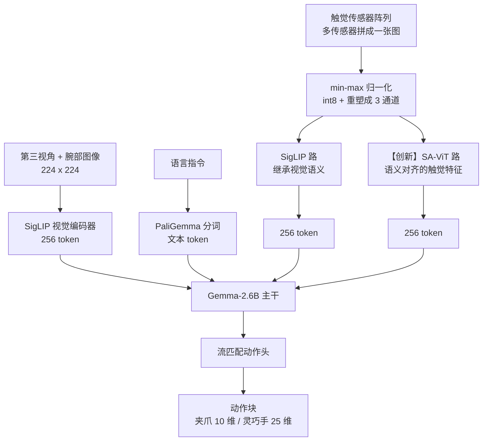
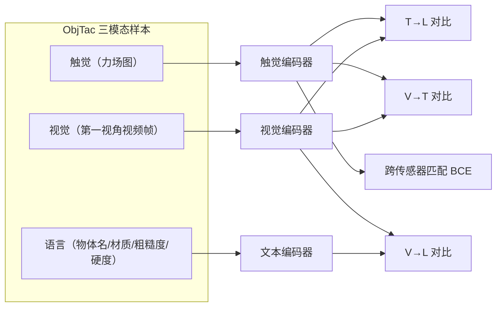
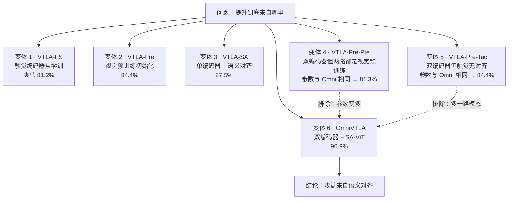
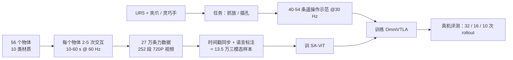

# P013 · 架构图与流程图

> 本文共 4 张图：
> **图 1 双编码器系统架构** ／ **图 2 SA-ViT 的对比预训练** ／ **图 3 六变体对照树（最重要）** ／ **图 4 数据采集与实验流程**
> 每张图后附：逐节点解释 → 数据流 → 核心创新位置 → 原文出处。
>
> 导航：[[Paper_013_OmniVTLA/01_论文精读|01 精读]] ｜ [[Paper_013_OmniVTLA/02_核心创新与方法|02 创新]] ｜ [[Paper_013_OmniVTLA/04_术语和公式解释|04 术语]] ｜ [[Paper_013_OmniVTLA/05_科研启发与复现建议|05 启发]]

---

## 图 1 · 双编码器系统架构

### 1.1 逐节点解释

| 节点 | 说明 | token 数 |
|---|---|---|
| S1 | 视觉编码（π0 原生） | 256/张 |
| T1 | 语言 | 变长 |
| N1 | 触觉预处理：**归一化 + 拼图 + 当图像处理** | — |
| S2 | 第一路触觉编码（纯视觉语义） | 256 |
| **S3** | 第二路触觉编码（**语义对齐的触觉特征**） | 256 |
| BB | 多模态融合 | — |
| AH | 流匹配解码 | — |

### 1.2 数据如何流动

**三种模态各自变成 token，拼成一条长序列进 LLM。**
触觉的特殊之处：它有**两路**编码，一路"像看图一样看触觉"，一路"用对齐过的触觉语义看触觉"。

### 1.3 核心创新在哪

**S3（SA-ViT）**。它让触觉 token 在 LLM 的语义空间里"可读"。

### 1.4 原文出处

图 1、§III-B。

---

## 图 2 · SA-ViT 的对比预训练

### 2.1 逐节点解释

| 节点 | 说明 |
|---|---|
| D | 13.5 万条"触觉-视觉-语言"配对 |
| L1/L2/L3 | 方向性对比损失（把一种模态拉向另一种） |
| L4 | 同一个物体的不同传感器信号要匹配 |

### 2.2 数据如何流动

三模态 → 各自编码 → 两两对比 + 跨传感器匹配 → 触觉编码器学会"把力信号对应到语义概念"。

### 2.3 核心创新在哪

**"触觉被拉进视觉/语言的语义空间"**——这是本文与"直接把触觉当额外通道"的根本区别。

### 2.4 原文出处

§III-C、式（对齐损失）。

---

## 图 3 · 六变体对照树（本文方法学上最有价值的部分）

### 3.1 逐节点解释

| 变体 | 控制住的变量 | 结果 | 排除了什么 |
|---|---|---|---|
| FS | 只用遥操作数据 | 81.2 | 大规模数据有没有用 |
| Pre | 视觉预训练初始化 | 84.4 | "预训练"本身有没有用 |
| SA | 单编码器 + 对齐 | 87.5 | 对齐在单路上有没有用 |
| **Pre-Pre** | **参数相同、双路、无触觉预训练** | **81.3** | **不是参数变多** |
| **Pre-Tac** | **参数相同、双路、触觉无对齐** | **84.4** | **不是多一路模态** |
| **Omni** | **参数相同、双路、有对齐** | **96.9** | — |

### 3.2 这张图想说明什么

这是一个**教科书级的消融设计**：把"参数""模态数""对齐"三个因素逐一控制，最后只剩"对齐"这一个差异。

**结果**：Pre-Pre（81.3）和 Pre-Tac（84.4）都远低于 Omni（96.9），**说明收益确实来自语义对齐**。

### 3.3 原文出处

§IV-A "Evaluation Variants"（六个变体的定义）、表 II。

---

## 图 4 · 数据采集与实验流程

### 4.1 逐节点解释

| 节点 | 数字 |
|---|---|
| A/B | 56 物体、10 类、2–5 次、10–60 s、60 Hz |
| C | 27 万力数据、252 视频段（均 18 s）、720P@30fps |
| D | 13.5 万三模态样本 |
| H | 抓放 40 条/物体；插孔 54 条 |
| J | 夹爪 32 次、灵巧手 16 次、插孔每形状 10 次 |

### 4.2 数据如何流动

物体 → 交互 → 多模态记录 → 对齐 → 预训练 → 策略训练 → 真机评测。

### 4.3 核心创新在哪

**"数据集"和"评测"是两条独立的管线**：数据集只用来训编码器，策略训练用的是**另一批遥操作示范**。这个分离设计让"触觉预训练"的贡献可以被隔离。

### 4.4 原文出处

§III-C、§IV-A、图 3。

---

## 五、四张图的关系

---

## 六、自检：哪些是原文有，哪些是我补的

| 元素 | 性质 |
|---|---|
| 双编码器、token 数、动作维度 | 【原文·§III-B】 |
| ObjTac 规模与采集参数 | 【原文·§III-C】 |
| 对齐损失的形式 | 【原文·§III-C】 |
| 六个变体的定义 | 【原文·§IV-A】 |
| 表 II/III/IV/V/VI/VII 的数字 | 【原文，已逐格核对渲染图】 |
| 图 3 的"排除法"表达 | 【我的整理】，逻辑来自变体定义 |
| 图 1 的"两路触觉编码"并列表述 | 【我的可视化】 |
