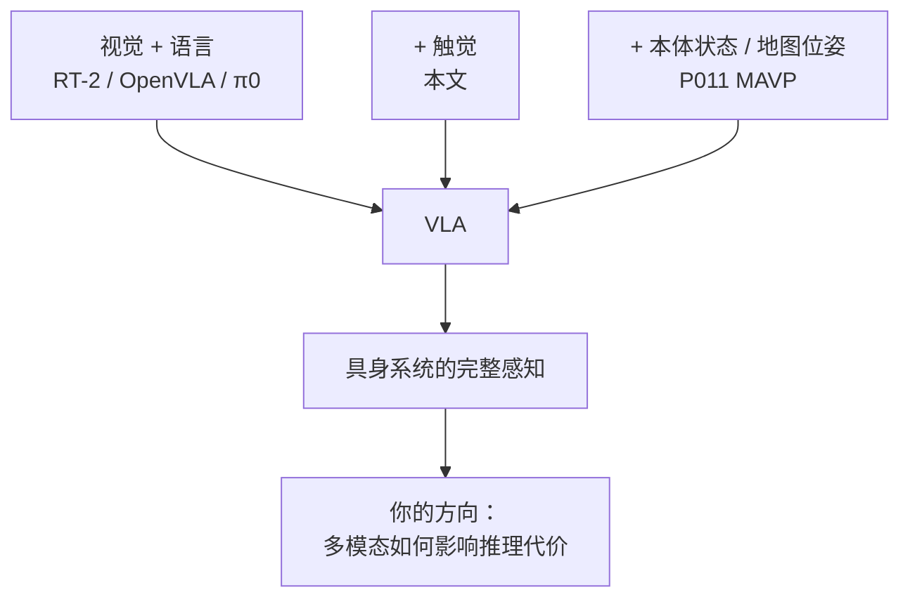

---
title: P013 OmniVTLA 科研启发与复现建议
paper_id: P013
short: OmniVTLA
tags:
  - 科研启发
  - 触觉
  - 多模态
  - 复现
status: done
created: 2026-11-05
---

# P013 · 科研启发与复现建议

> 证据分级：**【原文证明】** / **【合理推测】** / **【待验证】**。
> 导航：[[Paper_013_OmniVTLA/01_论文精读|01 精读]] ｜ [[Paper_013_OmniVTLA/02_核心创新与方法|02 创新]] ｜ [[Paper_013_OmniVTLA/03_架构图与流程图|03 图]] ｜ [[Paper_013_OmniVTLA/04_术语和公式解释|04 术语]]

---

## 一、它在你的研究地图里的位置：多模态的"第三条腿"

**它的独特价值**：这是 24 篇里**唯一涉及触觉**的论文。而触觉恰恰是"高频、低维、强实时"的信号——**与视觉（低频、高维）的计算特性完全相反**，这给加速研究带来了新问题。

---

## 二、A–H 八问

### A. 对 VLA 推理加速的启发

**【原文证明】**
1. 视觉：2 张图 × 256 token = 512 token；
2. 触觉：**双路各 256 token = 512 token**；
3. 语言：不定长。
→ **触觉让输入 token 数几乎翻倍**。

**【合理推测】一个被忽略的加速问题**
> **触觉是高频信号（本文 60 Hz），但 VLA 的推理频率通常只有 3–15 Hz。**
> 这意味着：要么触觉信号被"降采样/压缩"进模型，要么大量触觉信息被丢弃。
> **"高频传感 + 低频推理"的不匹配，是触觉 VLA 特有的调度问题**——而本文没有讨论。

**【待验证】**：如果把触觉从 60 Hz 降到 15 Hz 再喂模型，性能会掉多少？如果几乎不掉，那就可以省大量算力。

### B. 对动作分块 / 执行调度的启发

**【原文证明】**
1. 动作块：夹爪 10 维、灵巧手 25 维（**是动作维度，不是块长**）；块长未给。
2. 抓放允许**最多 3 次重抓**——这是一种"重试式调度"。
3. 插孔需要**多次尝试插入**。

**【合理推测】触觉改变了"重试"的语义**
> 没有触觉时，"重试"意味着"退回去重新看"；
> 有触觉时，"重试"可以是"不离开接触、只微调"——**这就是为什么插孔提升最大**。
> **触觉把"重规划"从"视觉级别的大动作"变成了"接触级别的小修正"。**

这对我做调度研究很有启发：**有触觉时，调度的粒度可以更细、更便宜。**

### C. 对量化、缓存、压缩的启发

**【原文证明】**：本文没做压缩，但触觉编码器用了 int8 归一化（数据层面，不是权重量化）。

**【合理推测】三个可做的压缩点**
| 对象 | 压缩思路 | 预期 |
|---|---|---|
| 双路触觉编码器 | 两路合并成一路（但表 II 显示会掉点） | ⚠️ 有害 |
| 触觉 token | 11 个传感器 → 更少的 token | ✅ 可能有效 |
| 触觉采样率 | 60 Hz → 更低 | ✅ 最便宜 |

### D. 是否能用于轮式双臂机器人？

**【原文证明】**：单臂 UR5 + 灵巧手；不是双臂。
**【合理推测】**：双臂 = 两套触觉，token 数再翻倍 → **输入序列会变得很长**，这对 LLM 的上下文和延迟都是压力。
**【待验证】**：双臂 + 双手触觉时的 token 预算。

### E. 是否需要真实硬件？

| 目标 | 需求 | 可行性 |
|---|---|---|
| 完整复现 | 触觉传感器 + 灵巧手 + 真机 | ❌ 很高 |
| 复现"语义对齐"思想 | 仿真里的接触力信号 | ⚠️ 中等 |
| 复现"触觉 vs 无触觉"对照 | 仿真（如 ManiSkill 有力传感） | ✅ 可行 |

### F. 能否在仿真中先复现？

**【合理推测】**：可以，但要接受"仿真触觉 ≠ 真实触觉"的差距。
- ManiSkill / Isaac 提供接触力；
- 用"力 + 位置"代替真实触觉图；
- 验证"对齐 vs 不对齐"的相对结论（**这正是本文最核心的主张**）。

### G. 本科阶段能否完成小规模实验？

**【我的判断】能，但需要简化触觉**：

> **题目**：在一个有接触力的仿真任务（如插孔）里，比较三种触觉接入方式：① 不加 ② 直接把力拼进观测 ③ 用对比学习把力对齐到视觉/语言。

- 变量：触觉接入方式；
- 指标：成功率、完成时间；
- 预期：【合理推测】③ > ② > ①。

### H. 博士阶段能否进一步拓展？

三条线：
1. **高频触觉 vs 低频推理的调度**（见 A）；
2. **触觉的 token 压缩**（见 C）；
3. **触觉与执行粒度的关系**（见 B）。

---

## 三、四个可落地的研究点

### 研究点 #1：触觉采样率与性能的关系

| 项目 | 内容 |
|---|---|
| **动机** | 触觉 60 Hz，VLA 推理 3–15 Hz，采样率冗余未知 |
| **假设** | 存在一个"够用"的采样率，低于它性能才开始掉 |
| **设计** | 扫触觉降采样率（60/30/15/7.5 Hz），测成功率与延迟 |
| **指标** | 成功率、端到端延迟 |
| **价值** | 直接省算力，且结论对任何触觉 VLA 适用 |

### 研究点 #2：触觉 token 的压缩

| 项目 | 内容 |
|---|---|
| **动机** | 双路各 256 token，占输入的一大半 |
| **设计** | 对比：全 token / 池化到 64 / 只保留接触区域 / 用单路 |
| **指标** | 成功率、延迟、显存 |
| **价值** | 与"视觉 token 剪枝"同构，是加速研究的自然延伸 |

### 研究点 #3：触觉如何改变重试策略

| 项目 | 内容 |
|---|---|
| **动机** | 见 B：触觉让"重试"变成"接触内微调" |
| **假设** | 有触觉时，最优的重试策略是"不脱离接触"；无触觉时必须"退开重看" |
| **设计** | 对比两种重试策略 × {有/无触觉} |
| **指标** | 成功率、完成时间 |
| **价值** | 把"触觉"与"执行调度"连起来，**这个角度没人做过** |

### 研究点 #4："对齐"是否真的必要？

| 项目 | 内容 |
|---|---|
| **动机** | 本文的对齐需要 13.5 万三模态样本——如果只是"更好的初始化"，能不能用更便宜的方式达到？ |
| **设计** | 对比：语义对齐 / 大规模触觉自监督（无语言）/ 只用视觉预训练 + 微调 |
| **指标** | 成功率、所需数据量 |
| **价值** | 检验"对齐"是不是必要条件，还是"更多数据"就够了 |

---

## 四、一个具体案例：把销钉插进方孔（原文任务）

> [!warning] 案例性质
> 插孔是 **OmniVTLA 的原始任务**（表 V，间隙 0.9/1.2/1.8 mm）。下面的时间线是**教学示例**。

**场景**：UR5 + 两指夹爪（指尖有触觉），要把方形销钉插进方孔。

| 阶段 | 发生了什么 | 有/无触觉的差别 |
|---|---|---|
| 1 | 视觉定位销钉，抓起 | 差别小 |
| 2 | 移动到孔上方 | 差别小 |
| 3 | **下降接触，视觉被销钉挡住** | **差别大** |
| 4a | 无触觉：反复上下试探、换角度 | 基线只有 60% |
| 4b | 有触觉：感觉到"左侧碰到"，向左微调 | OmniVTLA 90% |
| 5 | 对齐后插入到底 | — |

**关键理解**：
- 第 3 步是分水岭——**视觉在接触瞬间失效**；
- 触觉提供的不是"更准的位置"，而是"偏差的方向"；
- 这就是为什么插孔的提升（+33.3）远大于抓放（+21.9）和灵巧手（+6.2）。

---

## 五、复现路线

---

## 六、复现时会踩的坑

| 坑 | 说明 | 建议 |
|---|---|---|
| **触觉数据难采** | 真实传感器昂贵 | 仿真力信号替代 |
| **对齐损失的定义不全** | 原文没给各项细节 | 回 AnyTouch 原文 |
| **表 VII 的解释有疑点** | 见 01 笔记 §5.5 | 别直接引用软物体结论 |
| **离线指标误导** | MSE 低但成功率不高 | 以闭环为准 |
| **双编码器算力翻倍** | 延迟未报 | 自己测 |
| **单格样本少** | 插孔 10 次/形状 | 多跑几次 |

---

## 七、与前后论文的关系

| 论文 | 关系 |
|---|---|
| [[00_文献总索引#P005 π0 (pi-zero)]] | 本文的底座就是 π0（Gemma-2.6B + 流匹配） |
| [[00_文献总索引#P004 OpenVLA]] | 同为 VLA，但 OpenVLA 是离散 token，本文继承 π0 的流匹配 |
| [[00_文献总索引#P011 MAVP]] | 都在"加一路模态"：MAVP 加地图位姿，本文加触觉 |
| [[00_文献总索引#P012 Cracking Mobile Manipulation|Cracking MM]] | 都强调"接触丰富任务"；本文用触觉，那篇用几何修正 |
| [[00_文献总索引#P001 TinyVLA]] | 都基于 π0/VLM 的架构思路，但一个减、一个加 |

---

## 八、一句话总结对我的价值

> **OmniVTLA 让我第一次认真想"多模态的代价"：视觉 2×256 token、触觉 2×256 token——加一路触觉，输入几乎翻倍，而触觉原本是 60 Hz 的高频信号。**
> 这暴露了一个很有意思的矛盾：**传感越快，信息越多；但模型推理越慢，能用的越少。**
> 再加上它那套参数匹配的六变体对照（81.3 / 84.4 / 96.9），我学到了一个可以反复使用的论证结构：**先把"参数"和"模态数"固定住，再让唯一变量说话。**
