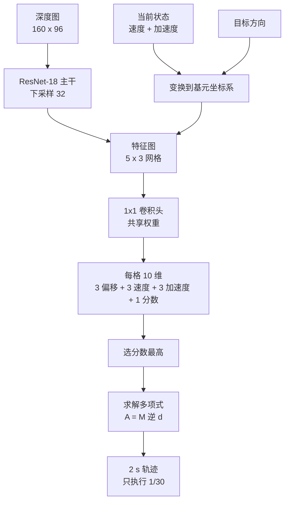
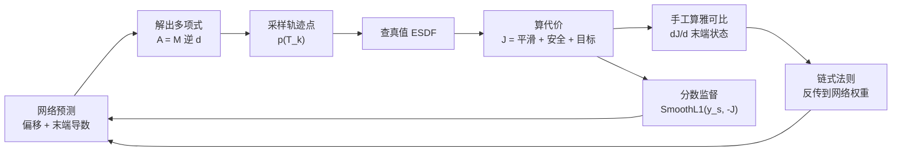
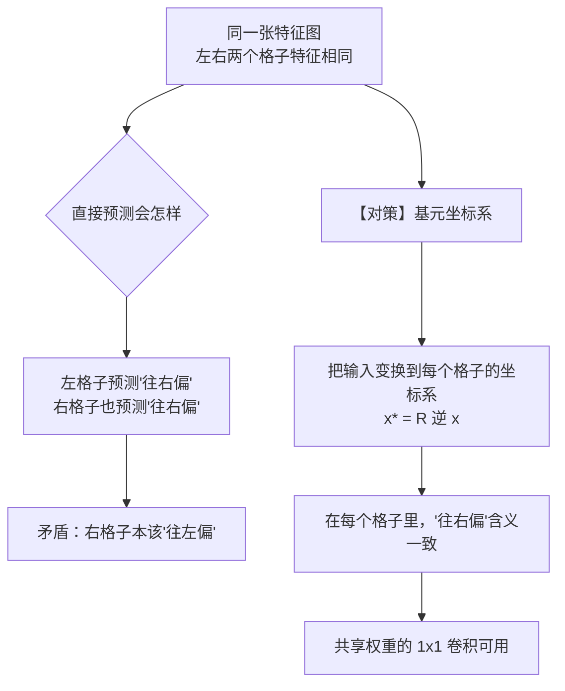
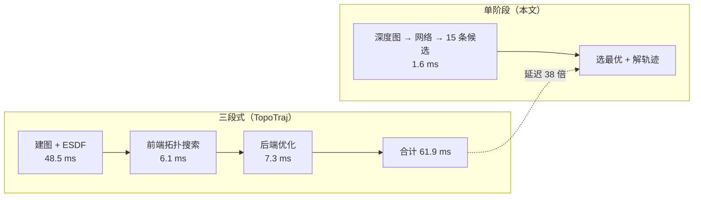
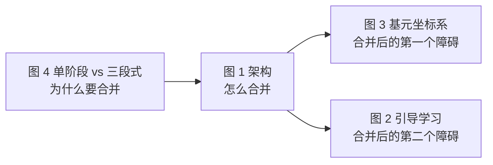

# P014 · 架构图与流程图

> 本文共 4 张图：
> **图 1 单阶段规划器架构** ／ **图 2 引导学习的梯度流** ／ **图 3 基元坐标系为什么必要** ／ **图 4 单阶段 vs 三段式**
> 每张图后附：逐节点解释 → 数据流 → 核心创新位置 → 原文出处。
>
> 导航：[[Paper_014_YOPO/01_论文精读|01 精读]] ｜ [[Paper_014_YOPO/02_核心创新与方法|02 创新]] ｜ [[Paper_014_YOPO/04_术语和公式解释|04 术语]] ｜ [[Paper_014_YOPO/05_科研启发与复现建议|05 启发]]

---

## 图 1 · 单阶段规划器架构

### 1.1 逐节点解释

| 节点 | 说明 |
|---|---|
| BB | ResNet-18，图像 160×96 → 特征图 5×3（下采样 32） |
| TR | **基元坐标系变换**（式 6、7），解决平移不变性问题 |
| H | 1×1 卷积 + 共享权重，等价于 YOLO 的检测头 |
| O | $M_d=10$ 维输出（5 阶多项式） |
| SEL | 取分数最高的基元 |
| EXP | 多项式系数由常数矩阵求逆得到（式 5） |

### 1.2 数据如何流动

深度图 → 特征；状态/目标 → 变换后拼到特征图位置 → 每格预测 → 选最优 → 解轨迹。

### 1.3 核心创新在哪

**"每个格子对应一条基元"** 这个设计——它让"一次前向出多条候选"成为可能，且避免了模式坍缩。

### 1.4 原文出处

图 3、§II-A-1、§II-A-2。

---

## 图 2 · 引导学习的梯度流

### 2.1 逐节点解释

| 节点 | 说明 |
|---|---|
| C | 沿轨迹按 $\delta t$ 采样 |
| D | **只有训练时能查真值 ESDF** |
| E | 三项代价加权（式 10） |
| F | 式 14/17/19，手工推导 |
| G | **不经过任何"专家网络"**，直接反传到权重 |

### 2.2 数据如何流动

网络输出 → 轨迹 → 代价 → 梯度 → 权重更新。**这是一个闭环的、以代价函数为"老师"的训练。**

### 2.3 核心创新在哪

**"老师"是代价函数本身，不是专家轨迹**——这打破了模仿学习的上界。

### 2.4 原文出处

§II-B-1、式 (10)–(21)、图 5。

---

## 图 3 · 基元坐标系为什么必要

### 3.1 逐节点解释

| 节点 | 说明 |
|---|---|
| A–D | 全卷积头的**平移不变性**与规划的**平移变异性**冲突 |
| E–G | 用基元坐标系把"绝对位置"变成"相对该基元的方向" |

### 3.2 这张图想说明什么

**"照搬 YOLO"是不够的**——检测任务里"猫就是猫"与位置无关；规划里"往哪拐"与位置强相关。

### 3.3 原文出处

§II-A-2、图 4、式 (6)(7)。

---

## 图 4 · 单阶段 vs 三段式

### 4.1 逐节点解释

| 段 | 传统耗时 | 本文 |
|---|---|---|
| 建图 | 48.5 ms | **消除**（网络直接吃深度） |
| 前端 | 6.1 ms | **变成基元锚点**（预定义，零计算） |
| 后端 | 7.3 ms | **变成网络回归** |
| 合计 | 61.9 ms | **1.6 ms** |

### 4.2 这张图想说明什么

**"单阶段"的收益主要来自消除建图**（48.5 / 61.9 ≈ 78% 的时间）。

### 4.3 原文出处

表 II、§III-B-1。

---

## 五、四张图的关系

---

## 六、自检：哪些是原文有，哪些是我补的

| 元素 | 性质 |
|---|---|
| 网络结构、基元定义、坐标系变换 | 【原文·§II-A】 |
| 引导学习的代价与雅可比 | 【原文·§II-B】 |
| 表 I/II 的数字 | 【原文，已逐格核对】 |
| 图 2 的"闭环"画法 | 【我的可视化】，逻辑来自式 (20)(21) |
| 图 3 的"矛盾"表述 | 【我的解释】，原文只说"not translation invariant" |
| 图 4 的耗时分解 | 【原文·表 II】 |
