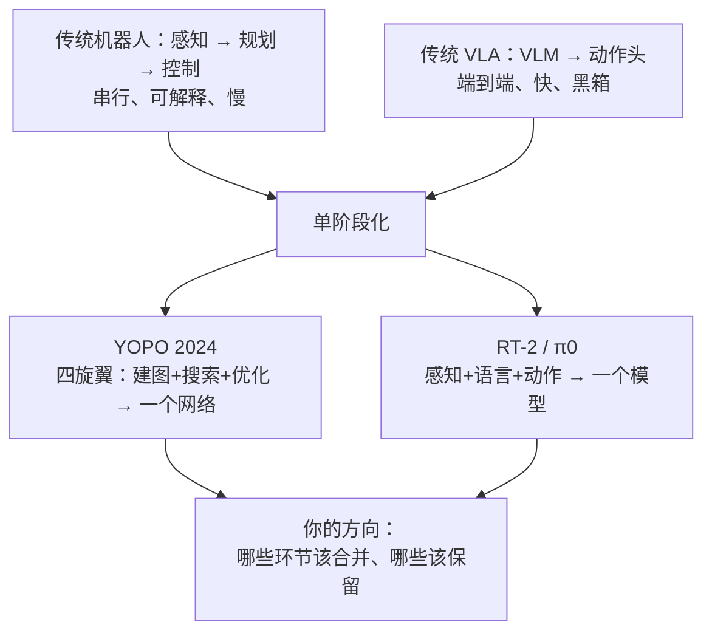

---
title: P014 You Only Plan Once 科研启发与复现建议
paper_id: P014
short: YOPO
tags:
  - 科研启发
  - 单阶段
  - 运动规划
  - 复现
status: done
created: 2026-11-05
---

# P014 · 科研启发与复现建议

> 证据分级：**【原文证明】** / **【合理推测】** / **【待验证】**。
> 导航：[[Paper_014_YOPO/01_论文精读|01 精读]] ｜ [[Paper_014_YOPO/02_核心创新与方法|02 创新]] ｜ [[Paper_014_YOPO/03_架构图与流程图|03 图]] ｜ [[Paper_014_YOPO/04_术语和公式解释|04 术语]]

---

## 一、它在你的研究地图里的位置：最早的"单阶段 vs 三段式"论证之一

**它的独特价值**：这是 24 篇里**唯一一篇把"三段式 → 单阶段"的账算得这么清楚**的论文（建图 48.5 ms、前端 6.1、后端 7.3 → 1.6）。

---

## 二、A–H 八问

### A. 对 VLA 推理加速的启发

**【原文证明】**
1. **1.6 ms（RTX 3060）/ 16 ms（Xavier NX）**，传统 61.9 ms。
2. 加速主要来自**消除建图**（48.5 / 61.9 ≈ 78%）。
3. 并行预测 15 条候选，而传统方法的计算量随候选数**线性增长**。

**【合理推测】一个可以直接借用的判断**
> **"加速"最有效的方式往往不是"把某一步做快"，而是"取消某一步"。**
> - YOPO 取消建图 → 78% 的时间消失；
> - TinyVLA 取消自回归解码 → 10 倍；
> - Cue the Flow 取消重训 → 参数省 99.98%。
>
> 这三种"取消"分别对应：**取消中间表示、取消串行解码、取消训练**。

**【待验证】**：VLA 里有没有可以"取消"的环节？（比如"取消动作 token 化"已经由 π0 做了；"取消视觉编码"不太可能）

### B. 对动作分块 / 执行调度的启发

**【原文证明】**
1. **2 s 时窗、15 Hz 重规划、只执行 1/30（约 66 ms）**。
2. 这是一个**极短的开环执行**（66 ms）——比 π0 的 0.5–0.8 s 短一个数量级。

**【合理推测】为什么它敢只执行 1/30？**
- 四旋翼速度高（5.5 m/s），66 ms 内飞 0.36 m——**再长就撞了**；
- 而 π0 的机械臂速度慢，0.8 s 只移动几厘米。
> **执行时长的选择与"平台速度"直接相关**：快平台必须短开环，慢平台可以长开环。

这给"执行调度"增加了一个变量：**平台速度**。我在前面的笔记里只考虑了"推理延迟"和"任务动态性"，这是一个补充。

### C. 对量化、缓存、压缩的启发

**【原文证明】**：本文用 TensorRT 部署，但没做量化/剪枝。
**【合理推测】**：
- 1.6 ms 已经很快，加速空间有限；
- 真正的瓶颈可能在**深度图预处理**与**控制**，不在网络。

**【待验证】**：端到端延迟（含相机、预处理、控制）是多少？论文只给网络的 1.6/16 ms。

### D. 是否能用于轮式双臂机器人？

**【原文证明】**：只在四旋翼上验证。
**【合理推测】**：
- 方法的核心（基元 + 逐格回归 + 引导学习）**与平台无关**；
- 但"基元"的定义依赖动力学：四旋翼的基元是"球坐标端点"，机械臂的基元可能是"末端位姿序列"；
- **引导学习需要可微的代价**：机械臂的碰撞代价也可以用 ESDF，所以可行。

**【待验证】**：机械臂上的"单阶段规划"是否也能超过传统规划器？

### E. 是否需要真实硬件？

| 目标 | 需求 | 可行性 |
|---|---|---|
| 复现仿真结果 | Flightmare + RTX 显卡 | ✅ **容易** |
| 复现真机 | 四旋翼 + Xavier + D455 | ❌ 高 |
| 复现核心思想 | 任意带 ESDF 的仿真 | ✅ 可行 |

### F. 能否在仿真中先复现？

**【原文证明】**：主实验在 Flightmare（开源）。
**【我的判断】**：**这是 24 篇里最适合"从零复现"的一篇**——开源代码 + 开源仿真器 + 明确的评价指标（延迟/安全/平滑）。

### G. 本科阶段能否完成小规模实验？

**【我的判断】能，而且题目清晰**：

> **题目**：在 Flightmare 里复现"基元 + 逐格回归"，先只做推理（不做引导学习），对比"只用基元（不预测偏移）"与"基元 + 偏移"的成功率/安全性。

- 变量：有没有偏移预测；
- 指标：成功率、最近障碍距离；
- 成本：只需仿真 + 训练一个小网络。

### H. 博士阶段能否进一步拓展？

三条线：
1. **"取消中间表示"的一般性研究**：哪些 pipeline 环节可以被网络吸收？
2. **引导学习用于其他可微代价的任务**（如机械臂的接触规划）；
3. **平台速度与执行时长的关系**（见 B）。

---

## 三、四个可落地的研究点

### 研究点 #1：引导学习 vs 模仿学习的系统对比

| 项目 | 内容 |
|---|---|
| **动机** | 本文只在一个任务上比了"网络 vs 专家"，没比"引导学习 vs 模仿学习" |
| **假设** | 在"多峰 + 专家不稳定"的任务上，引导学习显著更好；在"单峰 + 专家可靠"的任务上差距小 |
| **设计** | 同一网络结构，两种训练信号（专家轨迹 vs 代价梯度），扫任务的多峰程度 |
| **指标** | 平均代价、成功率、训练稳定性 |
| **价值** | 给出"何时该用引导学习"的判断标准 |

### 研究点 #2：基元数量的影响

| 项目 | 内容 |
|---|---|
| **动机** | 固定 5×3，没扫过 |
| **设计** | 扫 $M_\phi\times M_\theta\in\{3\times3,5\times3,7\times5,9\times5\}$ |
| **指标** | 成功率、延迟、安全距离 |
| **价值** | 找到"覆盖 vs 计算"的最优点 |

### 研究点 #3：平滑度与安全性的权衡

| 项目 | 内容 |
|---|---|
| **动机** | 表 II：本文安全最好但平滑不如 MPPI |
| **设计** | 扫 $\lambda_s/\lambda_o$ 比例，画"安全-平滑"帕累托前沿 |
| **指标** | 安全距离、jerk 积分、成功率 |
| **价值** | 给工程选参提供依据 |

### 研究点 #4：平台速度与执行比例

| 项目 | 内容 |
|---|---|
| **动机** | 本文执行 1/30、π0 执行 32%–50%，差异可能来自平台速度 |
| **假设** | 最优执行比例 $\propto 1/v_{\max}$ |
| **设计** | 在不同速度平台上扫执行比例 |
| **指标** | 成功率、碰撞率 |
| **价值** | 把"执行调度"与"平台动力学"连起来 |

---

## 四、一个具体案例：树林里以 5 m/s 穿行（原文任务）

> [!warning] 案例性质
> 密林飞行是 **YOPO 的真机实验**（§III-C，1/10 tree/m²、树径 0.25 m、最高 5.52 m/s）。下面的时间线是**教学示例**。

**场景**：Xavier NX 上的网络，深度图 160×96，每 66 ms 重规划一次。

| 时刻 | 发生了什么 |
|---|---|
| $t=0$ | 拍深度图，网络前向 16 ms → 15 条候选 |
| $t=16$ ms | 选分数最高的基元，加偏移，解多项式 → 2 s 轨迹 |
| $t=16\text{–}82$ ms | **只执行前 1/30**（约 66 ms 的参考轨迹，50 Hz 离散化） |
| $t=82$ ms | 重新拍图、重新规划 |
| 期间 | 几何控制器以 50 Hz 跟踪参考 |

**关键理解**：
- **2 s 的规划 + 66 ms 的执行**——这是一种"想得远、走得短"的策略；
- 为什么走得这么短？因为 5 m/s 下 66 ms 就是 0.33 m，再长就来不及躲突然出现的树枝；
- **这与 π0 的"想 50 步、走 16 步"是同一种思路的不同参数化**。

---

## 五、复现路线

---

## 六、复现时会踩的坑

| 坑 | 说明 | 建议 |
|---|---|---|
| **真值 ESDF 的生成** | 训练必需 | Flightmare 自带；自建仿真要自己实现 |
| **基元坐标系的实现** | 容易写错旋转顺序 | 对照式 (6) 逐步验证 |
| **雅可比的符号** | 手工推导易错 | 用数值差分验证 |
| **$\tanh$ 的缩放** | $d_\theta,d_\phi,d_r$ 要设合理 | 从论文的"略大于 FOV/grid"估计 |
| **1.6 vs 16 ms** | 平台不同 | 报告时写清硬件 |
| **阈值 0.04** | 轨迹选择阈值 | 太小过拟合安全，太大不收玫 |

---

## 七、与前后论文的关系

| 论文 | 关系 |
|---|---|
| [[00_文献总索引#P006 Diffusion Policy]] | 都是"一次生成一段轨迹"；DP 用去噪，本文用多项式回归 |
| [[00_文献总索引#P005 π0 (pi-zero)]] | 都用"只执行一小段"的滚动时域；执行比例不同（1/30 vs 32%–50%） |
| [[00_文献总索引#P010 DiPLO]] | 都用"特权信息"训练；DiPLO 用自蒸馏去掉依赖，本文直接用真值 ESDF |
| [[00_文献总索引#P002 SPAR]] | 都用"代价/奖励驱动"的优化，而非纯模仿 |
| [[00_文献总索引#P012 Cracking Mobile Manipulation|Cracking MM]] | 都是"系统级"思考：一个是合并流水线，一个是诊断干预 |

---

## 八、一句话总结对我的价值

> **YOPO 教会我一件很实用的事：加速最狠的手段是"取消一个环节"，而不是"把每个环节做快"。**
> 它把建图（48.5 ms）整个取消了，于是 61.9 ms 变成 1.6 ms——这比任何模型优化都有效。
> 而且它敢说"我的网络超过了我的专家"，并且用表 I 证明了：**当监督信号来自代价而不是示范时，模型就有机会突破示范的上界。** 这句话对做 VLA 的人同样成立——**如果你只用人类示范训策略，你的天花板就是人类。**
