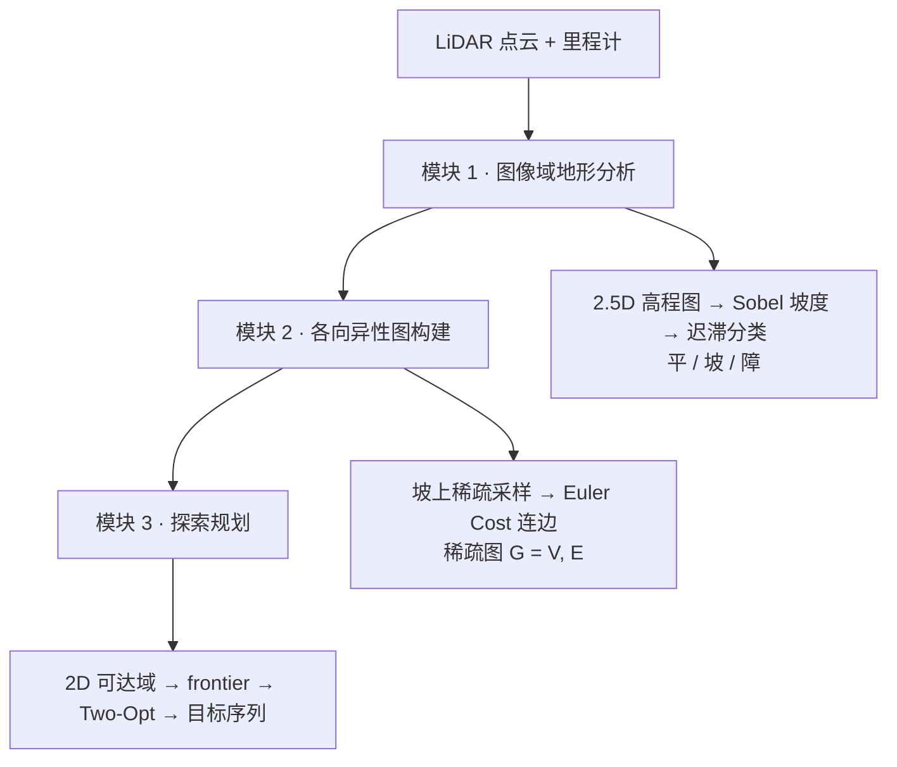
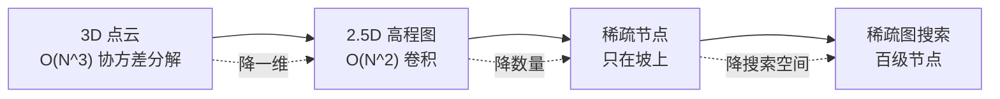
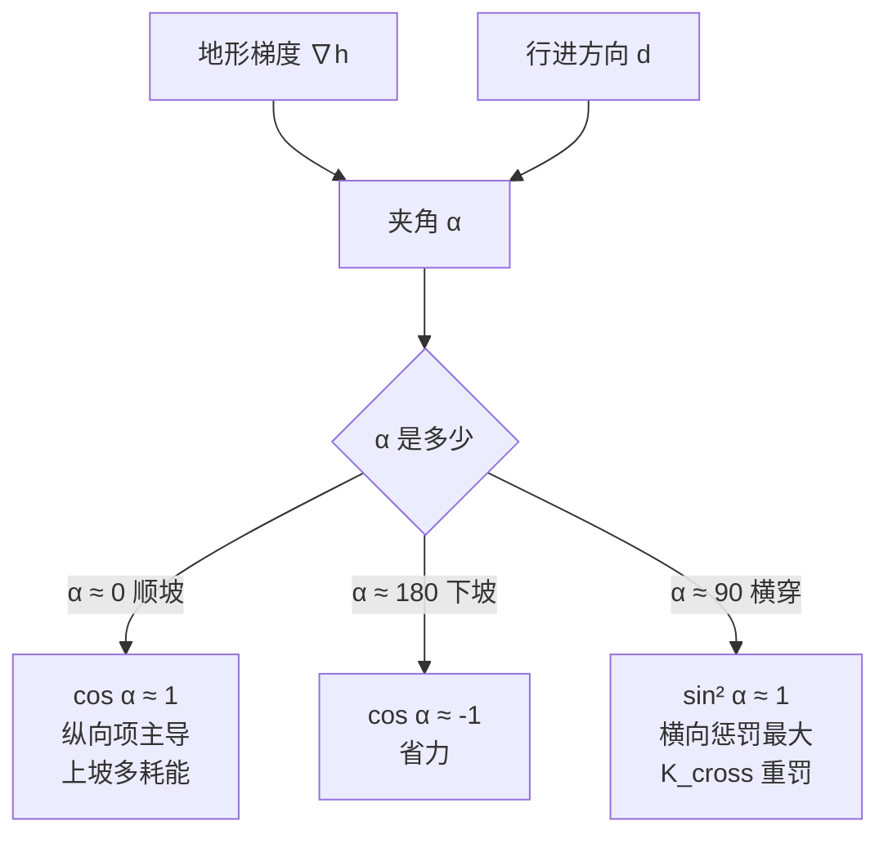
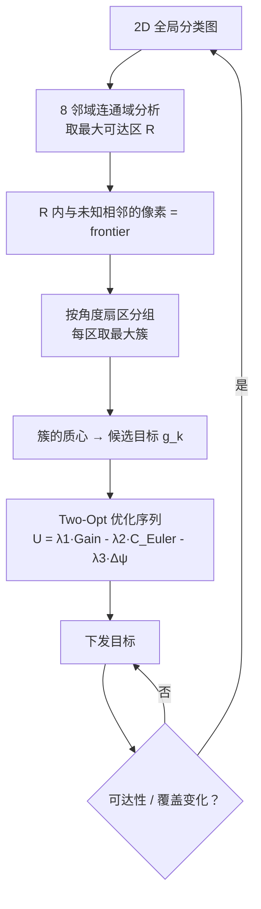
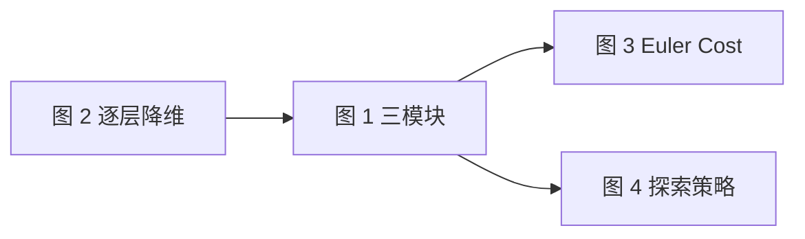

# P015 · 架构图与流程图

> 本文共 4 张图：
> **图 1 三模块系统** ／ **图 2 逐层降维** ／ **图 3 Euler Cost 的方向依赖** ／ **图 4 探索策略流程**
> 每张图后附：逐节点解释 → 数据流 → 核心创新位置 → 原文出处。
>
> 导航：[[Paper_015_ATE/01_论文精读|01 精读]] ｜ [[Paper_015_ATE/02_核心创新与方法|02 创新]] ｜ [[Paper_015_ATE/04_术语和公式解释|04 术语]] ｜ [[Paper_015_ATE/05_科研启发与复现建议|05 启发]]

---

## 图 1 · 三模块系统

### 1.1 逐节点解释

| 模块 | 输入 | 输出 | 关键 |
|---|---|---|---|
| 1 | 点云 | 三类地形 mask | 卷积 + 迟滞 |
| 2 | mask | 稀疏图 | **Euler Cost** |
| 3 | 图 + 覆盖 | 目标序列 | 效用函数 |

### 1.2 数据如何流动

点云 → 高程 → 坡度 → 分类 → 节点 → 边 → 目标。

**每一层都比上一层"更稀疏"**：点云（百万级）→ 高程格（万级）→ 稀疏节点（百级）。

### 1.3 核心创新在哪

**模块 2 的 Euler Cost**。模块 1 是"让模块 2 负担得起"的前置条件。

### 1.4 原文出处

图 1、§III-A。

---

## 图 2 · 逐层降维

### 2.1 逐节点解释

| 层 | 降了什么 | 收益 |
|---|---|---|
| 3D → 2.5D | 空间维 | 可以用图像算子 |
| 稠密 → 稀疏 | 节点数 | 图搜索可行 |
| 连续 → 三类 | 状态空间 | 迟滞分类可做 |

### 2.2 这张图想说明什么

**"降维"不是一个技巧，而是一条链**：每降一次，下一层就能负担更精细的建模（如各向异性代价）。

这与 YOPO（[[Paper_014_YOPO/02_核心创新与方法]]）"取消建图"是相反的策略：**YOPO 是"删掉中间层"，本文是"把中间层压薄"。**

### 2.3 原文出处

图 2、§III-B。

---

## 图 3 · Euler Cost 的方向依赖

### 3.1 逐节点解释

| 情形 | $\cos\alpha$ | $\sin^2\alpha$ | 代价 |
|---|---|---|---|
| 顺坡上 | +1 | 0 | $1+\omega_{slope}s$ |
| 顺坡下 | −1 | 0 | $1-\omega_{slope}s$（有下限 0.1） |
| 横穿 | 0 | 1 | $1+K_{cross}s$（最大） |

### 3.2 数字例子（教学示例）

设 $s_{avg}=0.3$、$\omega_{slope}=0.7$、$K_{cross}=25$：
- 顺坡上：$1+0.7\times0.3=1.21$
- 顺坡下：$1-0.21=0.79$
- 横穿：$1+25\times0.3=8.5$
→ **横穿代价是顺坡的 7 倍**。

### 3.3 核心创新在哪

**用两个三角项把"方向"编码进代价**——$\cos$ 管纵向、$\sin^2$ 管横向，互不干扰。

### 3.4 原文出处

式 (4)(5)、图 3。

---

## 图 4 · 探索策略流程

### 4.1 逐节点解释

| 节点 | 作用 |
|---|---|
| B | 避免孤立误判区域 |
| C | frontier 定义：可达且邻接未知 |
| D | 扇区分组 → 覆盖均匀 |
| F | 效用 = 信息增益 − 安全代价 − 转向代价 |

### 4.2 数据如何流动

分类图 → 可达域 → frontier → 候选 → 序列 → 执行 → 更新。

### 4.3 核心创新在哪

**效用函数里的 $C_{Euler}$**——它把"安全"直接纳入了探索目标选择，而不只是路径规划。

### 4.4 原文出处

§III-D、式 (7)。

---

## 五、四张图的关系

---

## 六、自检：哪些是原文有，哪些是我补的

| 元素 | 性质 |
|---|---|
| 三模块、Sobel、迟滞、Euler Cost | 【原文·§III】 |
| 式 (1)–(7) | 【原文】 |
| 表 I/II 数字 | 【原文，已逐格核对】 |
| 图 3 的数字例子 | **【我的教学示例】**，非原文实验 |
| "逐层降维"的链式表述 | 【我的总结】 |
| "与 YOPO 相反策略"的对比 | 【我的跨论文观察】 |
