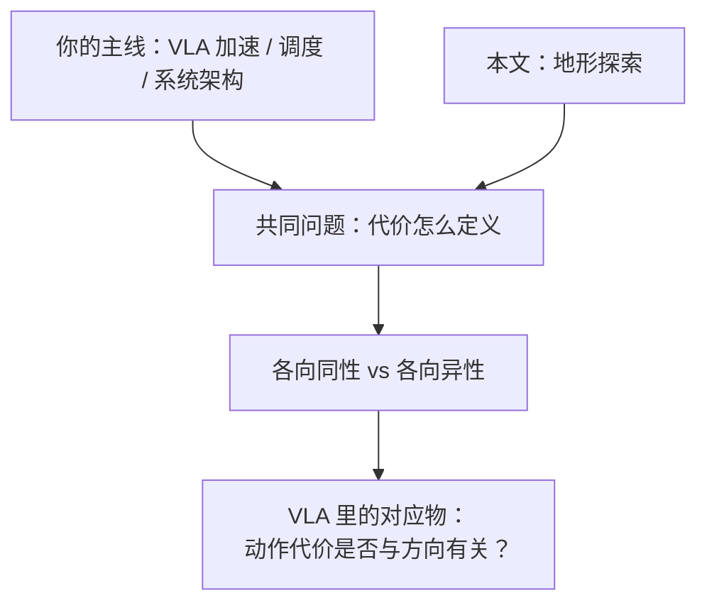

---
title: P015 Anisotropic Terrain-Aware Exploration 科研启发与复现建议
paper_id: P015
short: ATE
tags:
  - 科研启发
  - 地形感知
  - 各向异性
  - 复现
status: done
created: 2026-11-05
---

# P015 · 科研启发与复现建议

> 证据分级：**【原文证明】** / **【合理推测】** / **【待验证】**。
> 导航：[[Paper_015_ATE/01_论文精读|01 精读]] ｜ [[Paper_015_ATE/02_核心创新与方法|02 创新]] ｜ [[Paper_015_ATE/03_架构图与流程图|03 图]] ｜ [[Paper_015_ATE/04_术语和公式解释|04 术语]]

---

## 一、它在你的研究地图里的位置：离 VLA 最远的一篇，但有一个通用洞察

**坦白说**：这是 24 篇里与你的 VLA 方向**关系最远**的一篇。它的平台是轮式/四足，任务是探索，没有学习成分。
但它有一个**可以迁移的抽象**：**代价函数是否应该与"方向/姿态"耦合。**

---

## 二、A–H 八问

### A. 对 VLA 推理加速的启发

**【原文证明】**：本文与加速无关，但它的"降维"思路可以类比：
- 3D → 2.5D → 稀疏图，每降一次复杂度就掉一个量级。

**【合理推测】VLA 里的"降维"类比**
| 本文 | VLA 里的对应 |
|---|---|
| 点云 → 高程图 | 图像 → 视觉 token（已在做） |
| 稠密图 → 稀疏节点 | 全图 → 关键区域（token 剪枝） |
| 连续 → 三类 | 连续动作 → 动作块/技能 |

**结论**：**"降维"是通用的加速手段**，但 VLA 已经把前两步做完了，剩的空间在"动作/时间维度"。

### B. 对动作分块 / 执行调度的启发

**【原文证明】**
1. 高层规划周期约 30 ms，低层控制频率更高（未给具体值）。
2. 只在目标不可达/覆盖变化时重规划。

**【合理推测】**：这是典型的"事件触发重规划"——比固定频率更省。VLA 里也可以用：**不是每 N 步重规划，而是"检测到异常才重规划"**。

**【待验证】**：事件触发 vs 固定频率，在 VLA 上哪个更好？

### C. 对量化、缓存、压缩的启发

**【原文证明】**：无压缩。
**【合理推测】**：无直接可迁移点。

### D. 是否能用于轮式双臂机器人？

**【原文证明】**：本文用在**轮式底盘**（+四足）。
**【合理推测】**：**底盘的"各向异性"对轮式双臂同样成立**——横穿斜坡、侧向加速度都会影响机械臂的操作精度。这一点我在 MAVP（P011）里没看到讨论。

**【待验证】**：底盘姿态对机械臂末端精度的影响有多大？

### E. 是否需要真实硬件？

| 目标 | 需求 | 可行性 |
|---|---|---|
| 完整复现 | LiDAR + 崎岖地形 + 双平台 | ❌ 高 |
| 复现代价函数 | 任意 2.5D 仿真 | ✅ 容易 |

### F. 能否在仿真中先复现？

**【合理推测】**：可以。用 Gazebo/Isaac 造一个起伏地形，实现 Sobel + 迟滞 + Euler Cost，验证"侧倾角是否下降"。

### G. 本科阶段能否完成小规模实验？

**【我的判断】能，但价值有限**（除非你对导航感兴趣）。最小题目：在仿真里对比"各向同性坡度代价"与"Euler Cost"的翻车率。

### H. 博士阶段能否进一步拓展？

如果做**轮式双臂**，可以把"各向异性"从"底盘安全"扩展到"操作精度"：
- 底盘倾斜 → 机械臂重力补偿误差 → 末端精度下降；
- 这可以定义一个"操作感知的各向异性代价"。

**这是一个我认为有新意的方向**（见研究点 #1）。

---

## 三、四个可落地的研究点

### 研究点 #1：操作感知的各向异性代价（我最推荐）

| 项目 | 内容 |
|---|---|
| **动机** | 本文的代价只考虑"底盘安全"，没考虑"机械臂精度" |
| **假设** | 底盘倾斜/朝向会显著影响末端定位精度，应纳入路径代价 |
| **设计** | 在轮式双臂上，测不同底盘姿态下的末端重复定位误差，拟合"姿态→精度"模型，加入路径代价 |
| **指标** | 任务成功率、末端误差、路径长度 |
| **价值** | 把"导航代价"与"操作精度"连起来，**这是本文和 MAVP 都没做的** |

### 研究点 #2：事件触发重规划

| 项目 | 内容 |
|---|---|
| **动机** | 本文用"不可达/覆盖变化"触发重规划，VLA 里通常用固定块长 |
| **设计** | 对比：固定频率重规划 vs 异常触发重规划 |
| **指标** | 成功率、推理次数、延迟 |
| **价值** | 直接减少推理开销 |

### 研究点 #3：图像域感知的通用性

| 项目 | 内容 |
|---|---|
| **动机** | "用卷积替代几何拟合"是一个通用技巧 |
| **设计** | 在机械臂的抓取位姿估计里，用同样的"降维 + 卷积"替代 3D 拟合 |
| **价值** | 工程性强 |

### 研究点 #4：迟滞思想用于 VLA 的"模式切换"

| 项目 | 内容 |
|---|---|
| **动机** | VLA 在"抓/放"模式切换时也可能抖动 |
| **设计** | 给动作模式加迟滞（进入/退出用不同阈值） |
| **指标** | 动作平滑度、成功率 |
| **价值** | 跨领域的技巧迁移 |

---

## 四、一个具体案例：横穿草坡 vs 绕路（原文场景）

> [!warning] 案例性质
> 横穿斜坡的风险是**原文的核心动机**（图 7 有对照）。下面的时间是**教学示例**。

**场景**：轮式机器人要到一个坡对面的 frontier，直线距离 20 m 需要横穿 15° 斜坡；绕路 30 m 但全程顺坡。

| 方案 | 路径 | 代价（式 5） |
|---|---|---|
| 横穿 | 20 m | $20\times(1+25\times0.26\times1)=20\times7.5=150$ |
| 绕路 | 30 m | $30\times(1+0.7\times0.26\times1)\approx30\times1.18=35.4$ |

**结果**：规划器选绕路——**代价差 4 倍**。

**关键理解**：这就是"各向异性"的作用——**它让"安全"变成可比较的数字**，而不是一句口号。

---

## 五、复现路线

---

## 六、复现时会踩的坑

| 坑 | 说明 | 建议 |
|---|---|---|
| **85 百分位的实现** | 每格统计点高度 | 注意空格与少点格的处理 |
| **迟滞需要保存上一帧** | 状态要跨帧 | 维护 mask 缓存 |
| **阈值的量纲** | 弧度 vs 度 | 统一成度或弧度 |
| **$K_{cross}$ 的量级** | 25 是相对值 | 跟 $s_{avg}$ 的量纲一起看 |
| **侧倾角的测量** | 需要底盘姿态 | 仿真里可从 IMU 取 |
| **只测最大侧倾不够** | 还要看持续时间 | 加"超过阈值的时长"指标 |

---

## 七、与前后论文的关系

| 论文 | 关系 |
|---|---|
| [[00_文献总索引#P014 You Only Plan Once|YOPO]] | 都做"降复杂度"：YOPO 删中间层，本文压薄中间层 |
| [[00_文献总索引#P011 MAVP]] | 都关心底盘位姿与安全；MAVP 用地图位姿目标，本文用各向异性代价 |
| [[00_文献总索引#P012 Cracking Mobile Manipulation|Cracking MM]] | 都有"导航-操作交接"的问题；本文的"可达性"与 MAVP 的 `check_stance` 同类 |
| [[00_文献总索引#P006 Diffusion Policy]] | 都有"代价/评价"的设计；DP 的延迟容忍与本文的侧倾阈值都是安全边界 |

---

## 八、一句话总结对我的价值

> **这篇离我的方向最远，但它留下了一个我可以直接用的抽象：**代价函数是否应该与方向/姿态耦合**。**
> 在 VLA 里，我们通常把动作代价简化成"和示范的距离"——**但动作的方向、姿态、时序位置，可能同样重要**。本文用地形探索证明了这一点：仅仅加入一个方向项，就能把危险动作的代价放大 7 倍。
> 另外，它的消融有一处反常（去掉 Euler Cost 反而比去掉朝向一致性更不安全），我如实记下了。**读论文时，"数字对不上叙事"的地方往往是最值得追问的地方。**
