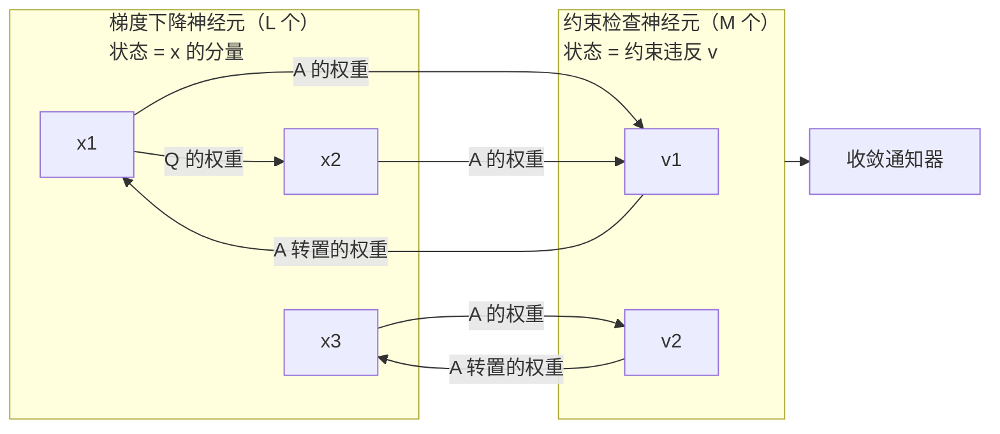
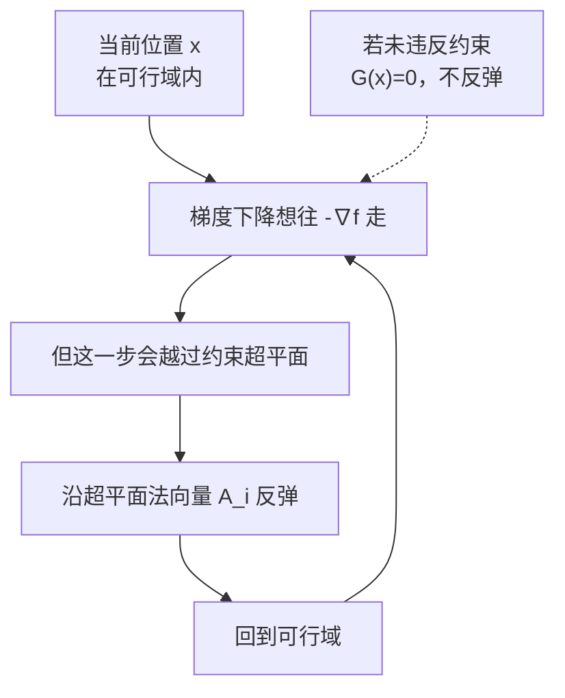
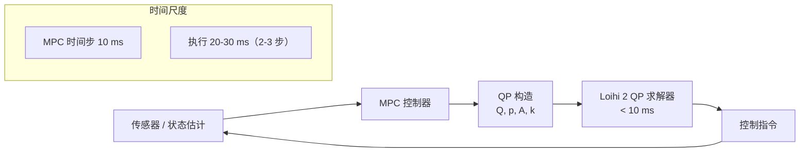
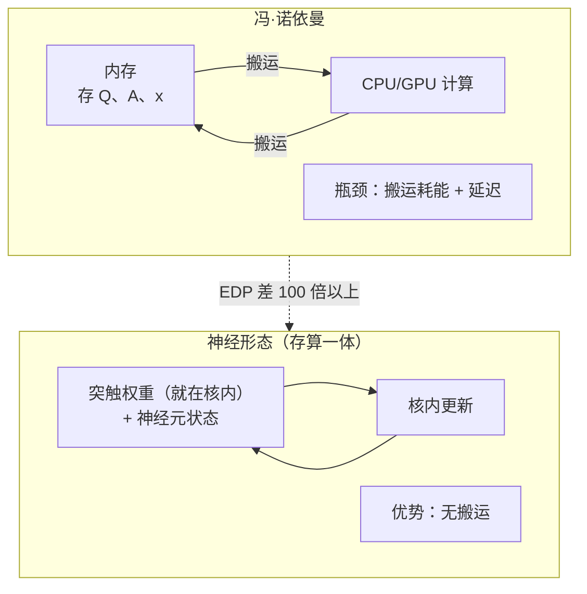

# P016 · 架构图与流程图

> 本文共 4 张图：
> **图 1 两级神经元网络** ／ **图 2 约束反弹的几何直觉** ／ **图 3 MPC 闭环中的位置** ／ **图 4 为什么存算一体省能**
> 每张图后附：逐节点解释 → 数据流 → 核心创新位置 → 原文出处。
>
> 导航：[[Paper_016_NeuromorphicQP/01_论文精读|01 精读]] ｜ [[Paper_016_NeuromorphicQP/02_核心创新与方法|02 创新]] ｜ [[Paper_016_NeuromorphicQP/04_术语和公式解释|04 术语]] ｜ [[Paper_016_NeuromorphicQP/05_科研启发与复现建议|05 启发]]

---

## 图 1 · 两级神经元网络

### 1.1 逐节点解释

| 节点 | 说明 |
|---|---|
| $x_i$ 梯度神经元 | 维护 $x$ 的一个分量，24 位状态 |
| $v_j$ 约束神经元 | 维护第 $j$ 个约束的违反量，过 ReLU |
| 突触（$Q$、$A$、$A^\top$） | 8 位权重，存在核内 |
| 收敛通知器 | 判断是否停止 |

### 1.2 数据如何流动

$x$ → （$A$）→ 约束违反 → ReLU → （$A^\top$）→ 修正项 → 与梯度项叠加 → 更新 $x$。

**这是双向的**：不是单向前馈，而是"读出-修正-写回"的循环，直到收敛。

### 1.3 核心创新在哪

**"矩阵 = 突触权重"这个映射**——它让"矩阵向量乘"变成硬件的天然操作。

### 1.4 原文出处

图 3、图中标注（"Constraint Correction / Gradient Descent"）、§神经形态实现。

---

## 图 2 · 约束反弹的几何直觉

### 2.1 逐节点解释

| 节点 | 对应公式 |
|---|---|
| B | $x\leftarrow(I-\alpha Q)x-\alpha p$ |
| C | $A_ix>k_i$ |
| D | $-\beta A_i^\top G_i(x)$，其中 $G_i=\max(0,A_ix-k_i)$ |
| F | ReLU 为零，无修正 |

### 2.2 这张图想说明什么

**约束不是"硬墙"，而是"软弹簧"**——越界越多，反弹越强；刚好在边界上则不反弹。这种"软约束"正是可以在模拟硬件上实现的形式。

### 2.3 原文出处

图 2、式 (4)(5)。

---

## 图 3 · MPC 闭环中的位置

### 3.1 逐节点解释

| 节点 | 说明 |
|---|---|
| QP 构造 | 由 MPC 的模型、约束、参考轨迹生成 |
| Loihi 求解 | 本文章的主角 |
| 执行 | 只执行前 2–3 步（滚动时域） |

### 3.2 数据如何流动

状态 → QP → 求解 → 指令 → 执行 → 新状态。

### 3.3 核心创新在哪

**求解器**这一环。**注意：本文没有测这个闭环的效果**——这是最大的空白。

### 3.4 原文出处

图 1（MPC Controller 框图）、§实验。

---

## 图 4 · 为什么存算一体省能（概念图）

### 4.1 逐节点解释

| 对比 | 传统 | 神经形态 |
|---|---|---|
| 数据位置 | 内存与计算分离 | 权重与计算同址 |
| 通信 | 总线搬运 | 片上事件路由 |
| 空闲时 | 仍在跑（时钟） | 不耗能（事件驱动） |

### 4.2 这张图想说明什么

**"省能"不是靠更快的计算，而是靠"不做无用功"**：不搬数据、不为零元素发脉冲。

### 4.3 原文出处

§Introduction（冯·诺依曼瓶颈的论述）、图 1。

---

## 五、四张图的关系

---

## 六、自检：哪些是原文有，哪些是我补的

| 元素 | 性质 |
|---|---|
| 两类神经元、突触映射 | 【原文·图 3 与文字】 |
| 约束反弹 | 【原文·式 (4)(5)、图 2】 |
| 式 (1)–(8) | 【原文，但 PDF 抽取错乱，按可读片段重建】 |
| 结果数字（EDP、TTS、7200 神经元） | 【原文·摘要与实验】 |
| 图 3 的"无闭环验证"标注 | **【我的观察】**，原文确实没有报 |
| 图 4 的对比 | 【我的概念图】，基于原文对冯·诺依曼瓶颈的论述 |
