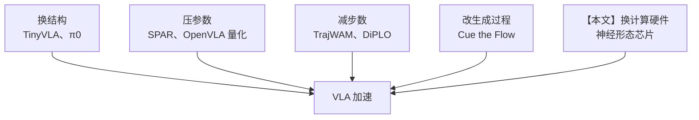

# P016 · 科研启发与复现建议

> 证据分级：**【原文证明】** / **【合理推测】** / **【待验证】**。
> 导航：[[Paper_016_NeuromorphicQP/01_论文精读|01 精读]] ｜ [[Paper_016_NeuromorphicQP/02_核心创新与方法|02 创新]] ｜ [[Paper_016_NeuromorphicQP/03_架构图与流程图|03 图]] ｜ [[Paper_016_NeuromorphicQP/04_术语和公式解释|04 术语]]

---

## 一、它在你的研究地图里的位置：唯一一篇"换硬件"的加速论文

24 篇里，加速手段可以分成五类，这是第五类：

**它的独特价值**：其它论文都在"算法层"优化，只有它在"**硬件层**"优化——而且它优化的不是 VLA，是 **MPC**。

---

## 二、A–H 八问

### A. 对 VLA 推理加速的启发

**【原文证明】**
1. EDP 改善 2 个数量级以上（最大规模 520×）。
2. 小问题 CPU 更快。
3. 精度受限（定点）。

**【合理推测】这套思路能搬到 VLA 上吗？**
> **很难，但有一个可能的切入点。**
> - VLA 的主体是 Transformer（密集矩阵乘 + 注意力），**不是稀疏迭代优化**；
> - 神经形态硬件擅长"稀疏 + 事件驱动 + 迭代"，恰好与 Transformer 的特性相反；
> - **可能的切入点**：VLA 的动作头如果是**扩散/流匹配**（多步迭代 + 相对稀疏的更新），理论上更适合神经形态硬件——但这只是我的推测，**没有实验证据**。

**【待验证】**：把扩散动作头的去噪迭代映射到神经形态硬件，能效如何？

### B. 对动作分块 / 执行调度的启发

**【原文证明】**
1. MPC 时间步 10 ms；**只执行 20–30 ms（2–3 步）**。
2. 这是"滚动时域"的经典形式。

**【合理推测】**：10 ms 的 MPC 步长意味着 **100 Hz 的控制频率**——比 π0（20–50 Hz）高得多。这解释了为什么 MPC 对求解器延迟如此敏感：**它没有动作块可以"摊薄"延迟**。

> 对比：π0 用 0.8 s 的动作块把 73 ms 的推理摊薄到 9% 占空比；MPC 每 10 ms 就要解一次，**占空比接近 100%**。
> **"有没有动作块"决定了对延迟的敏感度。**

### C. 对量化、缓存、压缩的启发

**【原文证明】**：本文本身就是"用低精度换能效"的极端案例（8 位权重、24 位状态）。
**【合理推测】**：
- 它验证了"**低精度在控制任务上可行**"——因为控制有反馈，误差会被纠正；
- 这对 VLA 的 int4 量化是一个侧面支持（OpenVLA 的 int4 也是这个逻辑）。
- 但注意：**控制任务的容错来自闭环反馈，而 VLA 的动作生成是开环一段**，容错空间更小。

### D. 是否能用于轮式双臂机器人？

**【原文证明】**：用于四足 ANYmal 的 MPC。
**【合理推测】**：轮式双臂的 MPC 也是 QP（甚至更大：更多自由度 + 接触约束），**理论上更受益**——问题越大，神经形态的优势越明显（图 6 的趋势）。

**【待验证】**：轮式双臂 MPC 的 QP 规模是否落在"Loihi 占优"的区间。

### E. 是否需要真实硬件？

| 目标 | 需求 | 可行性 |
|---|---|---|
| 完整复现 | Loihi 2 + INRC 资格 | ❌ 极难 |
| 复现算法 | CPU 上实现"梯度+反弹" | ✅ 容易 |
| 复现 EDP 对比 | 需要硬件 | ❌ 不可能 |

### F. 能否在仿真中先复现？

**【合理推测】**：算法可以在 CPU 上复现（验证收敛性），但**能效结论无法复现**——EDP 是硬件属性。

### G. 本科阶段能否完成小规模实验？

**【我的判断】只能做"算法侧"**：

> **题目**：在 CPU 上实现本文的"梯度下降 + 约束反弹"迭代，与 OSQP 比"达到同等精度所需的迭代次数/时间"，验证它在稀疏 QP 上是否收敛更快。

- 变量：稀疏度；
- 指标：迭代次数、时间；
- 结论：能验证算法，不能验证硬件优势。

### H. 博士阶段能否进一步拓展？

三条线：
1. **VLA 动作头的神经形态映射**（见 A，推测性强）；
2. **低精度控制的容错边界**：定点/量化到什么程度控制开始失效；
3. **硬件-算法协同设计的方法论**：如何系统地为某类硬件找匹配算法。

---

## 三、四个可落地的研究点

### 研究点 #1：低精度对闭环控制的影响曲线

| 项目 | 内容 |
|---|---|
| **动机** | 本文只给"定点 vs 浮点"的求解器指标，没给"控制性能" |
| **设计** | 在同一个 MPC 上，把求解精度从 32 位逐步降到 4 位，测跟踪误差 |
| **指标** | 跟踪 RMSE、稳定性、求解时间 |
| **价值** | 给出"控制任务能容忍多少精度"的定量答案，**对 VLA 量化有直接参考** |

### 研究点 #2：稀疏度与硬件加速比的关系

| 项目 | 内容 |
|---|---|
| **动机** | 本文说"稀疏问题 GPU 利用率低"，但没给"稀疏度 → 加速比"曲线 |
| **设计** | 构造不同稀疏度的 QP，比较 CPU/GPU/（模拟的）事件驱动模型 |
| **指标** | 加速比 vs 稀疏度 |
| **价值** | 找出"神经形态开始占优"的稀疏度阈值 |

### 研究点 #3：VLA 动作头的迭代结构分析

| 项目 | 内容 |
|---|---|
| **动机** | 见 A：扩散/流匹配动作头是否适合神经形态 |
| **设计** | 分析去噪迭代的稀疏性、精度敏感度、并行度 |
| **指标** | 理论能效估算 |
| **价值** | 判断"这条路值不值得走" |

### 研究点 #4：有无动作块 → 延迟敏感度

| 项目 | 内容 |
|---|---|
| **动机** | MPC（无块，100 Hz）vs π0（有块，20–50 Hz）vs RT-2（无块，1–3 Hz） |
| **假设** | 延迟敏感度 ∝ 1/(块长 × 控制周期) |
| **设计** | 在同一任务上，对比"有块/无块"两种调度下的性能-延迟曲线 |
| **指标** | 成功率 vs 求解延迟 |
| **价值** | 把"调度"与"延迟容忍"定量连起来 |

---

## 四、一个具体案例：ANYmal 每 10 ms 解一次 QP

> [!warning] 案例性质
> ANYmal MPC 是**原文的应用场景**。下面的时间线是**教学示例**。

**场景**：四足机器人以 0.8 m/s 行走，MPC 每 10 ms 更新一次。

| 时刻 | 发生什么 | 耗时 |
|---|---|---|
| $t=0$ | 传感器读状态 | — |
| $t=0$ | 构造 QP（$Q,p,A,k$） | 小 |
| $t=0\text{–}8$ ms | Loihi 2 迭代求解（55 次迭代） | **< 10 ms** |
| $t=8$ ms | 得到最优控制序列 | — |
| $t=8\text{–}30$ ms | 执行前 2–3 步 | 20–30 ms |
| $t=10$ ms | **下一次 MPC 已经开始了** | — |

**关键理解**：MPC 的求解是**连续不断**的——上一次还没执行完，下一次已经开始算了。这就是为什么"求解时间必须小于控制周期"，也是为什么它需要 <10 ms。

---

## 五、复现路线

---

## 六、复现时会踩的坑

| 坑 | 说明 | 建议 |
|---|---|---|
| **公式抽取错乱** | PDF 里式 (1)–(8) 不可直接读 | 对照投影梯度的标准形式 |
| **无硬件** | Loihi 2 需 INRC | 只能做算法侧 |
| **EDP 无法复现** | 是硬件属性 | 别声称复现了能效 |
| **定点模拟** | "减半步长+加倍"的细节未详述 | 用标准定点库近似 |
| **闭环性能缺失** | 原文没报 | 自己补这个实验反而有新意 |

---

## 七、与前后论文的关系

| 论文 | 关系 |
|---|---|
| [[00_文献总索引#P014 You Only Plan Once]] | 都是"规划/控制的加速"：YOPO 换算法结构，本文换硬件 |
| [[00_文献总索引#P015 Anisotropic Terrain-Aware Exploration]] | 都是"代价/约束"的处理；本文处理的是硬约束 |
| [[00_文献总索引#P006 Diffusion Policy]] | 都是"迭代求解"；DP 的 100 步去噪与本文的 55 次迭代结构相似 |
| [[00_文献总索引#P017 Actor-Critic MPC]] | 同为 MPC，可以对照"优化 vs 学习"两条路 |
| [[00_文献总索引#P004 OpenVLA]] | 都涉及低精度（int4 量化 vs 定点），可对照"精度换什么" |

---

## 八、一句话总结对我的价值

> **这篇论文最值得学的不是"神经形态"，而是它的**协同设计顺序**：先看硬件的形状（存算一体、事件驱动、低精度），再找一个形状匹配的算法（迭代、稀疏、可定点化）。**
> 而它最大的空白——**只报求解器指标，不报闭环控制效果**——恰好是我可以补的：**"解得更快"只有在"机器人走得更稳"时才有意义。**
> 另外，它让我意识到"延迟敏感度"取决于"有没有动作块"：MPC 每 10 ms 解一次（占空比 ~100%），π0 每 0.8 s 推一次（占空比 9%）——**同样的求解器延迟，对两者的意义完全不同。**
