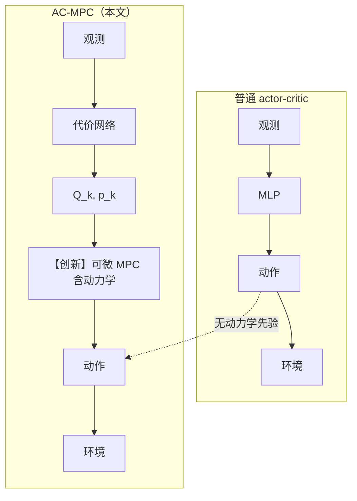
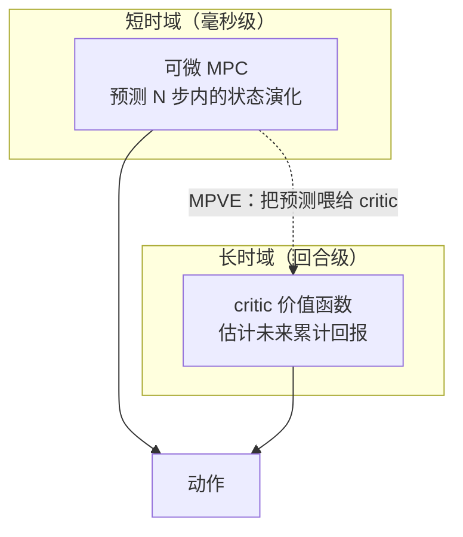
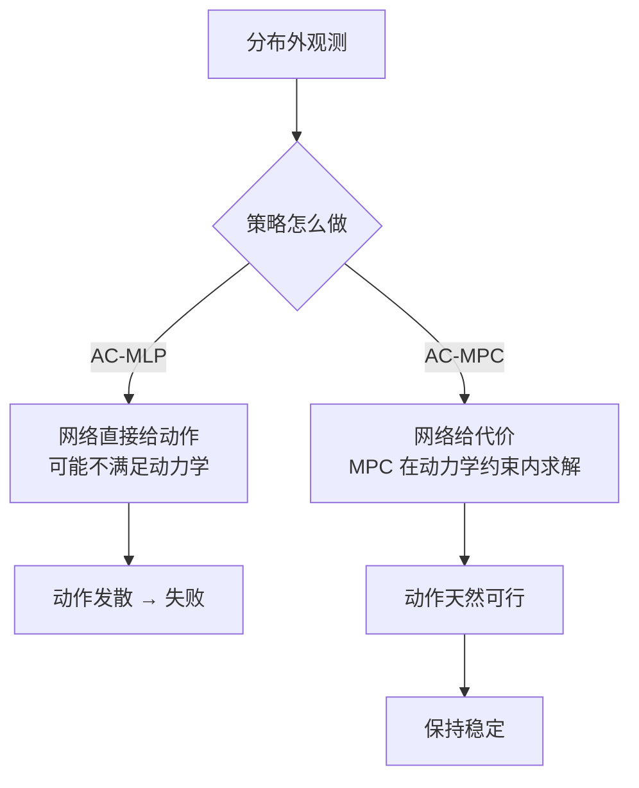
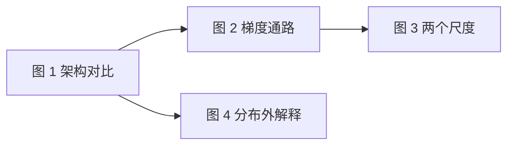

# P017 · 架构图与流程图

> 本文共 4 张图：
> **图 1 普通 actor vs AC-MPC** ／ **图 2 梯度如何穿过 MPC** ／ **图 3 两个时间尺度** ／ **图 4 分布外为什么更稳**
> 每张图后附：逐节点解释 → 数据流 → 核心创新位置 → 原文出处。
>
> 导航：[[Paper_017_ACMPC/01_论文精读|01 精读]] ｜ [[Paper_017_ACMPC/02_核心创新与方法|02 创新]] ｜ [[Paper_017_ACMPC/04_术语和公式解释|04 术语]] ｜ [[Paper_017_ACMPC/05_科研启发与复现建议|05 启发]]

---

## 图 1 · 普通 actor vs AC-MPC

### 1.1 逐节点解释

| 节点 | 说明 |
|---|---|
| A2 | 普通 MLP，输入输出都是稠密向量 |
| B2 | 代价网络，输出 QP 参数 |
| B4 | **可微 MPC**：解 QP，输出满足动力学的控制 |

### 1.2 数据如何流动

普通：观测 → 动作（一步映射）。
AC-MPC：观测 → 代价 → （优化）→ 动作（**中间隔了一次优化**）。

### 1.3 核心创新在哪

**B4**。它是"网络的一层"，但这一层是**优化器**而不是矩阵乘。

### 1.4 原文出处

图 1、§III-D、§III-F。

---

## 图 2 · 梯度如何穿过 MPC

### 2.1 逐节点解释

| 边 | 含义 |
|---|---|
| $F\to D$ | 策略梯度 |
| $D\to B$ | **对优化问题求导**（KKT 条件的隐函数定理） |
| $B\to A$ | 普通反向传播 |

### 2.2 关键点

**"对优化问题求导"** 是整篇论文能成立的技术前提：
- QP 的最优解 $u^*$ 是 $(Q_k,p_k)$ 的隐函数；
- 由 KKT 条件可以对它求导；
- 因此 RL 的梯度可以"穿过"求解器。

### 2.3 原文出处

§III-F（differentiable MPC）、引 [31]。

---

## 图 3 · 两个时间尺度

### 3.1 逐节点解释

| 模块 | 时间尺度 | 负责 |
|---|---|---|
| MPC | horizon 内（N 步） | 短期预测优化 |
| critic | 整个回合 | 长期价值 |

### 3.2 为什么重要

作者把它类比为"快思考 + 慢思考"：
- MPC 是"立刻算几毫秒后的后果"；
- critic 是"估计这局能不能赢"。

而 **MPVE 把短时域预测"喂"给长时域学习**——两个尺度因此耦合。

### 3.3 原文出处

§I、§III-H。

---

## 图 4 · 分布外为什么更稳

### 4.1 逐节点解释

| 路线 | 为什么失败/成功 |
|---|---|
| AC-MLP | 分布外观测 → 网络输出偏离 → 没有机制保证可行 |
| AC-MPC | 即使代价预测有偏差，**MPC 的解仍在可行域内** |

### 4.2 数据（表 I）

| 控制器 | 1.5× 自重风扰下成功率 |
|---|---|
| AC-MLP | 失败 |
| 跟踪 MPC | 失败 |
| L1-MPC | 41.66% |
| **AC-MPC** | **83.33%** |

### 4.3 原文出处

表 I、§IV-C、图 6。

---

## 五、四张图的关系

---

## 六、自检：哪些是原文有，哪些是我补的

| 元素 | 性质 |
|---|---|
| actor 输出代价、可微 MPC | 【原文·§III-D/F、图 1】 |
| 梯度穿过求解器 | 【原文·§III-F】 |
| 两时间尺度、MPVE | 【原文·§I、§III-H】 |
| 表 I 的成功率 | 【原文·表 I】 |
| 图 2 的"隐函数定理"表述 | 【我的补充】原文说 "differentiable MPC" 但未展开推导 |
| 图 4 的"为什么更稳" | 【我的解释】原文说 "MPC 提供在线重规划"，未这样画 |
